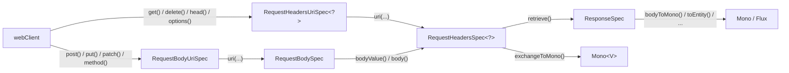
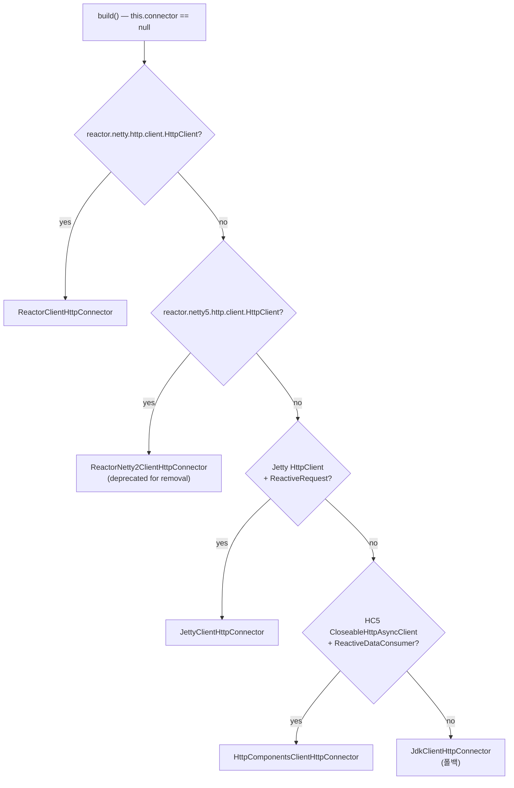

# WebClient Builder 구조와 커넥터 선택

`WebClient`가 왜 하나의 거대한 인터페이스가 아니라 중첩 spec 계층으로 쪼개져 있는지, 그리고 `DefaultWebClientBuilder`가 어떤 상태를 들고 어떤 순서로 `ClientHttpConnector`를 고르는지를 소스로 추적한다.

## 목차
- [1. 핵심 개념 (What)](#1-핵심-개념-what)
- [2. 왜 알아야 하는가 (Why)](#2-왜-알아야-하는가-why)
- [3. 내부 구현 분석 (How)](#3-내부-구현-분석-how)
- [4. 실전 예제](#4-실전-예제)
- [5. 정리](#5-정리)

---

## 1. 핵심 개념 (What)

`WebClient`는 단일 인터페이스가 아니라, **요청을 조립하는 단계마다 호출 가능한 메서드를 제한하는 타입 계층**이다. `spring-webflux/src/main/java/org/springframework/web/reactive/function/client/WebClient.java:80`에서 시작하는 한 파일 안에 7개의 중첩 인터페이스가 선언되어 있다.

```
WebClient                                  (WebClient.java:80)
├── Builder                                (WebClient.java:170)
├── UriSpec<S extends RequestHeadersSpec<?>>       (WebClient.java:382)
├── RequestHeadersSpec<S>                  (WebClient.java:422)
│   └── RequestBodySpec                    (WebClient.java:652)
├── ResponseSpec                           (WebClient.java:806)
├── RequestHeadersUriSpec<S>               (WebClient.java:978)  = UriSpec + RequestHeadersSpec
└── RequestBodyUriSpec                     (WebClient.java:986)  = RequestBodySpec + RequestHeadersUriSpec
```

각 단계가 반환하는 타입이 다음 단계에서 **할 수 있는 일**을 결정한다.



핵심은 `get()`이 `RequestHeadersUriSpec<?>`를, `post()`가 `RequestBodyUriSpec`을 반환한다는 점이다(`WebClient.java:86`, `WebClient.java:98`). `RequestBodyUriSpec`만 `bodyValue()`를 가지므로, **GET 요청에 바디를 붙이는 코드는 컴파일되지 않는다**. 타입 시스템이 HTTP 세만틱을 강제한다.

`UriSpec<S extends RequestHeadersSpec<?>>`와 `RequestHeadersSpec<S extends RequestHeadersSpec<S>>`의 self-referential 제네릭(F-bounded polymorphism)은 `accept()`, `header()` 같은 체이닝 메서드가 **상위 타입이 아니라 자기 자신의 구체 타입을 반환**하도록 만든다. 그래서 `post().uri(...).contentType(...).bodyValue(...)`가 중간에 `RequestBodySpec`을 잃지 않는다.

---

## 2. 왜 알아야 하는가 (Why)

실무에서 세 가지 질문이 반복된다.

**(1) `WebClient.Builder` 빈을 여러 서비스가 공유해도 안전한가?**
`DefaultWebClientBuilder`는 **가변(mutable)** 객체다. `baseUrl()`, `defaultHeader()` 모두 `this`를 변경하고 `this`를 반환한다(`DefaultWebClientBuilder.java:157`, `DefaultWebClientBuilder.java:175`). 즉 같은 빌더 인스턴스를 두 곳에서 설정하면 서로의 설정이 섞인다. 싱글턴 빌더 빈을 여러 `@Bean` 메서드가 공유하는 구성에서 바로 사고가 난다. 해법은 `clone()`(`DefaultWebClientBuilder.java:306`)이고, 아래 4.2절의 모든 예제가 이 규칙을 따른다.

**(2) 커넥터를 명시하지 않으면 무엇이 쓰이는가?**
`WebClient.create()`는 Reactor Netty를 쓴다고 javadoc에 적혀 있지만(`WebClient.java:137-141`), 실제로는 **클래스패스 탐지 결과에 따라 5가지 중 하나**가 선택된다. Reactor Netty가 없는 환경(예: `spring-boot-starter-web` + WebClient만)에서는 조용히 다른 커넥터로 떨어지고, 타임아웃·커넥션 풀 설정 방식이 전부 달라진다.

**(3) 기존 `WebClient`에서 baseUrl만 바꾸고 싶다.**
`mutate()`가 그 답이고, 그게 동작하는 이유는 `DefaultWebClient`가 자신을 만든 빌더의 **복제본**을 들고 있기 때문이다.

---

## 3. 내부 구현 분석 (How)

### 3.1 DefaultWebClientBuilder가 보관하는 상태

`DefaultWebClientBuilder.java:79-118`에 14개 필드가 선언되어 있다.

| 필드 | 타입 | 역할 |
|---|---|---|
| `baseUrl` | `String` | `initUriBuilderFactory()`에서 `DefaultUriBuilderFactory`로 변환 |
| `defaultUriVariables` | `Map<String, ?>` | URI 템플릿 기본 변수 |
| `uriBuilderFactory` | `UriBuilderFactory` | 지정 시 `baseUrl`을 **무시**하고 우선 적용 |
| `defaultHeaders` | `HttpHeaders` | 요청별 헤더보다 먼저 들어감 |
| `defaultCookies` | `MultiValueMap<String,String>` | 동일 |
| `defaultRequest` | `Consumer<RequestHeadersSpec<?>>` | 모든 spec 생성 직후 실행 |
| `statusHandlers` | `Map<Predicate, Function>` | `retrieve()` 경로에만 적용 |
| `filters` | `List<ExchangeFilterFunction>` | `build()`에서 하나로 축약 |
| `connector` | `ClientHttpConnector` | `null`이면 `initConnector()` |
| `strategies` / `strategiesConfigurers` | `ExchangeStrategies` | 코덱 설정. `strategiesConfigurers`에는 `codecs(Consumer)`와 **deprecated** `exchangeStrategies(Consumer)`가 함께 쌓인다 |
| `exchangeFunction` | `ExchangeFunction` | 지정 시 커넥터를 **완전히 우회** |
| `observationRegistry` / `observationConvention` | Micrometer | 기본값 `ObservationRegistry.NOOP` |

`uriBuilderFactory`가 `baseUrl`을 덮어쓰는 건 `initUriBuilderFactory()`의 early return에서 확인된다(`DefaultWebClientBuilder.java:364-372`).

```java
private UriBuilderFactory initUriBuilderFactory() {
    if (this.uriBuilderFactory != null) {
        return this.uriBuilderFactory;   // baseUrl / defaultUriVariables 무시
    }
    DefaultUriBuilderFactory factory = (this.baseUrl != null ?
            new DefaultUriBuilderFactory(this.baseUrl) : new DefaultUriBuilderFactory());
    factory.setDefaultUriVariables(this.defaultUriVariables);
    return factory;
}
```

`uriBuilderFactory()`를 직접 호출하면서 `baseUrl()`도 같이 호출하는 코드는 조용히 `baseUrl`을 잃는다. 흔한 함정이다.

코덱 설정에는 입구가 둘인데 하나는 deprecated다. `codecs(Consumer<ClientCodecConfigurer>)`(`DefaultWebClientBuilder.java:254-261`)와 `exchangeStrategies(Consumer<ExchangeStrategies.Builder>)`(`DefaultWebClientBuilder.java:269-277`, 선언은 `WebClient.java:330`에 `@Deprecated` since 5.1.13)가 **같은 `strategiesConfigurers` 리스트에 쌓인다.** 전자를 쓴다 — 후자는 7.0에서 제거된다([12-boot4-spring7-migration.md](12-boot4-spring7-migration.md)). 인자를 받지 않는 `exchangeStrategies(ExchangeStrategies)`는 deprecated가 아니고, `strategies` 필드에 따로 들어간다.

### 3.2 copy-constructor가 clone()과 mutate()를 받친다

`DefaultWebClientBuilder(DefaultWebClientBuilder other)` (`DefaultWebClientBuilder.java:124-153`)는 **컬렉션을 새로 만들어 복사**한다.

```java
this.defaultUriVariables = (other.defaultUriVariables != null ?
        new LinkedHashMap<>(other.defaultUriVariables) : null);
...
this.filters = (other.filters != null ? new ArrayList<>(other.filters) : null);
```

반면 `connector`, `strategies`, `exchangeFunction`, `defaultRequest`는 **참조만 복사**한다(`DefaultWebClientBuilder.java:146-152`). 커넥터는 스레드 안전한 공유 자원이고 커넥션 풀을 담고 있으므로, 복제해서는 안 되기 때문이다. 이 구분이 중요하다 — **복제된 빌더는 설정 목록은 독립이지만 커넥션 풀은 공유한다.**

`clone()`은 이 생성자를 그대로 노출한다(`DefaultWebClientBuilder.java:306-308`), 그리고 `build()`는 **자기 자신의 복제본을 `DefaultWebClient`에 넘긴다**(`DefaultWebClientBuilder.java:332`).

```java
return new DefaultWebClient(
        exchange, filterFunctions,
        initUriBuilderFactory(), defaultHeaders, defaultCookies,
        this.defaultRequest,
        this.statusHandlers,
        this.observationRegistry, this.observationConvention,
        new DefaultWebClientBuilder(this));   // ← 스냅샷
```

`DefaultWebClient.mutate()`는 그 스냅샷을 또 복제한다(`DefaultWebClient.java:188-190`).

```java
@Override
public Builder mutate() {
    return new DefaultWebClientBuilder(this.builder);
}
```

**결론: "빌더를 재사용해도 안전한가?"**
- `build()` 호출 후 원본 빌더를 계속 바꿔도, **이미 만들어진 `WebClient`는 영향받지 않는다.** 빌더가 스냅샷으로 들어갔기 때문이다.
- 같은 빌더 인스턴스로 서로 다른 설정의 `WebClient`를 만들려면 `clone()`을 먼저 쓴다. 그러지 않으면 두 번째 설정이 첫 번째에 누적된다.
- `mutate()`로 파생된 클라이언트는 커넥터·코덱·필터 목록을 상속하되, 필터 목록은 복제본이므로 추가해도 원본에 안 퍼진다.

### 3.3 initConnector() — 클래스 존재 탐지 우선순위

`static` 초기화 블록에서 네 개의 `boolean` 플래그를 한 번만 계산한다(`DefaultWebClientBuilder.java:66-76`).

```java
static {
    ClassLoader loader = DefaultWebClientBuilder.class.getClassLoader();
    reactorNettyClientPresent  = ClassUtils.isPresent("reactor.netty.http.client.HttpClient", loader);
    reactorNetty2ClientPresent = ClassUtils.isPresent("reactor.netty5.http.client.HttpClient", loader);
    jettyClientPresent =
            ClassUtils.isPresent("org.eclipse.jetty.client.HttpClient", loader) &&
                    ClassUtils.isPresent("org.eclipse.jetty.reactive.client.ReactiveRequest", loader);
    httpComponentsClientPresent =
            ClassUtils.isPresent("org.apache.hc.client5.http.impl.async.CloseableHttpAsyncClient", loader) &&
                    ClassUtils.isPresent("org.apache.hc.core5.reactive.ReactiveDataConsumer", loader);
}
```

Jetty와 HttpComponents는 **클래스 두 개를 모두** 요구한다. 코어 클라이언트만 있고 리액티브 브릿지(`jetty-reactive-httpclient`, `httpcore5-reactive`)가 없으면 탐지되지 않는다.

그리고 `initConnector()`는 5단계 분기다(`DefaultWebClientBuilder.java:335-352`).

```java
@SuppressWarnings("removal")
private ClientHttpConnector initConnector() {
    if (reactorNettyClientPresent)        return new ReactorClientHttpConnector();
    else if (reactorNetty2ClientPresent)  return new ReactorNetty2ClientHttpConnector();
    else if (jettyClientPresent)          return new JettyClientHttpConnector();
    else if (httpComponentsClientPresent) return new HttpComponentsClientHttpConnector();
    else                                  return new JdkClientHttpConnector();
}
```



중간의 `ReactorNetty2ClientHttpConnector` 분기가 `initConnector()`에 `@SuppressWarnings("removal")`이 붙은 이유다. 그 클래스는 `@Deprecated(since = "6.2.18", forRemoval = true)`로 선언돼 있다(`spring-web/src/main/java/org/springframework/http/client/reactive/ReactorNetty2ClientHttpConnector.java:45`) — Netty 5 기반 경로이며 제거 예정이다. 실무에서 이 분기에 들어가는 일은 거의 없지만, **"Reactor Netty 다음은 Jetty"가 아니라 Netty 5 분기가 하나 끼어 있다**는 점은 알아둘 만하다.

### 3.4 ClientHttpConnector — 단일 추상 메서드

`spring-web/src/main/java/org/springframework/http/client/reactive/ClientHttpConnector.java:34-51`:

```java
public interface ClientHttpConnector {

    Mono<ClientHttpResponse> connect(HttpMethod method, URI uri,
            Function<? super ClientHttpRequest, Mono<Void>> requestCallback);
}
```

메서드가 하나뿐이라 람다로 구현할 수 있지만, **`@FunctionalInterface` 애노테이션은 붙어 있지 않다**(v6.2.19 기준). 시그니처의 핵심은 `requestCallback`이다. 커넥터가 네이티브 요청 객체를 준비한 뒤 콜백을 호출하고, 콜백은 헤더·쿠키·바디를 써넣고 "쓰기 완료" 신호(`Mono<Void>`)를 돌려준다. 즉 **바디 직렬화는 커넥터가 아니라 호출자(`ClientRequest.writeTo()`)의 책임**이다.

`JdkClientHttpConnector.connect()`가 이 계약을 가장 읽기 쉽게 보여준다(`JdkClientHttpConnector.java:110-126`).

```java
JdkClientHttpRequest jdkClientHttpRequest = new JdkClientHttpRequest(method, uri, this.bufferFactory, this.readTimeout);

return requestCallback.apply(jdkClientHttpRequest).then(Mono.defer(() -> {
    HttpRequest httpRequest = jdkClientHttpRequest.getNativeRequest();
    CompletableFuture<HttpResponse<Flow.Publisher<List<ByteBuffer>>>> future =
            this.httpClient.sendAsync(httpRequest, HttpResponse.BodyHandlers.ofPublisher());
    return Mono.fromCompletionStage(future)
            .map(response -> new JdkClientHttpResponse(response, this.bufferFactory));
}));
```

### 3.5 4종 커넥터 비교

| 커넥터 | `@since` | 기본 생성자 동작 | 언제 고르는가 |
|---|---|---|---|
| `ReactorClientHttpConnector` | 5.0 | `HttpClient.create().compress(true)` (`ReactorClientHttpConnector.java:86-90`) | **기본 선택.** Reactor 스케줄러와 네이티브 통합, 커넥션 풀/타임아웃 제어가 가장 세밀하다. `SmartLifecycle`을 구현해 컨텍스트 종료 시 자원을 정리한다(`ReactorClientHttpConnector.java:54`) |
| `JettyClientHttpConnector` | 5.1 | `new HttpClient()` (`JettyClientHttpConnector.java:51-53`) | 이미 Jetty를 서버로 쓰고 스레드풀/`ByteBufferPool`을 공유하고 싶을 때. `JettyResourceFactory`로 executor·scheduler를 주입한다(`JettyClientHttpConnector.java:69-77`) |
| `HttpComponentsClientHttpConnector` | 5.3 | `HttpAsyncClients.createDefault()` 후 즉시 `start()` (`HttpComponentsClientHttpConnector.java:65-93`) | HttpComponents 생태계(프록시 인증, 커스텀 쿠키 스토어, `HttpClientContext` 요청별 주입)가 필요할 때. 요청마다 컨텍스트를 만드는 `BiFunction`을 받는다 |
| `JdkClientHttpConnector` | 6.0 | `HttpClient.newHttpClient()` (`JdkClientHttpConnector.java:60-62`) | **의존성을 늘리기 싫을 때.** JDK 내장 `java.net.http.HttpClient`만 쓴다. 6.2부터 `setReadTimeout(Duration)`이 생겼지만(`JdkClientHttpConnector.java:104-107`), 커넥션 풀 세부 제어는 JDK가 노출하지 않아 한계가 있다 |

여기에 **6.2 전용 커넥터가 하나 더** 있다. `ReactorNetty2ClientHttpConnector`(`spring-web/src/main/java/org/springframework/http/client/reactive/ReactorNetty2ClientHttpConnector.java`)는 Netty 5 preview를 쓰는 경로로, `@Deprecated(since = "6.2.18", forRemoval = true)`가 붙어 있고(:45) **7.0에서 파일째로 제거**되었다. 새로 고를 대상이 아니므로 위 비교 표에서는 제외했다 — 다만 `initConnector()`의 2순위 분기라서 탐지 순서를 읽을 때는 반드시 세어야 한다. 제거 영향은 [12-boot4-spring7-migration.md](12-boot4-spring7-migration.md).

> 타임아웃·커넥션 풀의 구체적 설정은 [06-connection-pool.md](06-connection-pool.md)와 [07-timeout-strategy.md](07-timeout-strategy.md)에서 다룬다.

### 3.6 build()가 조립하는 것

`DefaultWebClientBuilder.build()` (`DefaultWebClientBuilder.java:310-333`)는 네 가지를 한다.

```java
ClientHttpConnector connectorToUse = (this.connector != null ? this.connector : initConnector());

ExchangeFunction exchange = (this.exchangeFunction == null ?
        ExchangeFunctions.create(connectorToUse, initExchangeStrategies()) :
        this.exchangeFunction);

ExchangeFilterFunction filterFunctions = (this.filters != null ? this.filters.stream()
        .reduce(ExchangeFilterFunction::andThen)
        .orElse(null) : null);
```

1. 커넥터 결정 (명시 > 탐지)
2. `ExchangeFunction` 생성 — **`exchangeFunction()`을 지정하면 커넥터가 아예 쓰이지 않는다.** 테스트에서 커넥터 없이 가짜 응답을 주입하는 통로다([11-testing-webclient.md](11-testing-webclient.md))
3. 필터 리스트를 `reduce(andThen)`으로 **하나의 `ExchangeFilterFunction`으로 접는다** ([04-exchange-filter-function.md](04-exchange-filter-function.md))
4. 기본 헤더/쿠키를 **읽기 전용 복제본**으로 만든다(`copyDefaultHeaders()` → `HttpHeaders.readOnlyHttpHeaders`, `DefaultWebClientBuilder.java:374-392`)

---

## 4. 실전 예제

### 4.1 create() vs builder() vs mutate() 선택 기준

| API | 반환 | 언제 |
|---|---|---|
| `WebClient.create()` | 설정 없는 `WebClient` | 1회성 스크립트, 테스트 스케치. 프로덕션 금지 — 타임아웃·에러 처리·관측이 전무하다 |
| `WebClient.create(baseUrl)` | baseUrl만 설정된 `WebClient` | 위와 동일한 한계 |
| `WebClient.builder()` | 새 `DefaultWebClientBuilder` | 커넥터/필터/코덱을 직접 조립할 때 |
| 주입받은 `WebClient.Builder` 빈 | Boot가 자동 설정을 적용한 빌더 | **프로덕션 기본.** Micrometer 관측, 코덱, 커넥터 커스터마이저가 이미 적용돼 있다 |
| `webClient.mutate()` | 기존 설정을 승계한 빌더 | 같은 커넥션 풀을 공유하면서 baseUrl·헤더만 바꿀 때 |

### 4.2 빈 등록 패턴 — Builder 빈을 받아 baseUrl만 바꿔 쓰기

가장 중요한 규칙: **`WebClient.Builder`를 주입받고, 반드시 `clone()`한 뒤 설정한다.**

```java
package com.example.infra.http;

import java.time.Duration;

import io.netty.channel.ChannelOption;
import io.netty.handler.timeout.ReadTimeoutHandler;
import reactor.netty.http.client.HttpClient;
import reactor.netty.resources.ConnectionProvider;

import org.springframework.boot.context.properties.ConfigurationProperties;
import org.springframework.context.annotation.Bean;
import org.springframework.context.annotation.Configuration;
import org.springframework.http.MediaType;
import org.springframework.http.client.reactive.ReactorClientHttpConnector;
import org.springframework.web.reactive.function.client.WebClient;

@Configuration(proxyBeanMethods = false)
class WebClientConfig {

    /**
     * 커넥터는 커넥션 풀과 이벤트 루프를 들고 있으므로 애플리케이션 전역에 하나만 둔다.
     * copy-constructor가 connector를 참조로만 복사하기 때문에
     * (DefaultWebClientBuilder.java:146) 파생 클라이언트들이 이 풀을 공유한다.
     */
    @Bean
    ReactorClientHttpConnector reactorClientHttpConnector(HttpClientProperties props) {
        ConnectionProvider provider = ConnectionProvider.builder("app-http")
                .maxConnections(props.maxConnections())
                .pendingAcquireTimeout(props.pendingAcquireTimeout())
                .maxIdleTime(props.maxIdleTime())
                .build();

        HttpClient httpClient = HttpClient.create(provider)
                .option(ChannelOption.CONNECT_TIMEOUT_MILLIS, (int) props.connectTimeout().toMillis())
                .responseTimeout(props.responseTimeout())
                .doOnConnected(conn ->
                        conn.addHandlerLast(new ReadTimeoutHandler(props.readTimeout().toSeconds())));

        return new ReactorClientHttpConnector(httpClient);
    }

    /**
     * 공통 기준선. 각 서비스 클라이언트는 이 빌더를 clone() 해서 baseUrl만 바꾼다.
     */
    @Bean
    WebClient.Builder appWebClientBuilder(ReactorClientHttpConnector connector) {
        return WebClient.builder()
                .clientConnector(connector)
                .defaultHeader("Accept", MediaType.APPLICATION_JSON_VALUE)
                .codecs(codecs -> codecs.defaultCodecs().maxInMemorySize(2 * 1024 * 1024));
    }
}

@ConfigurationProperties("app.http-client")
record HttpClientProperties(
        int maxConnections,
        Duration pendingAcquireTimeout,
        Duration maxIdleTime,
        Duration connectTimeout,
        Duration responseTimeout,
        Duration readTimeout) {
}
```

```yaml
# application.yml — 수치는 환경별로 외부화한다
app:
  http-client:
    max-connections: 200
    pending-acquire-timeout: 3s
    max-idle-time: 20s
    connect-timeout: 2s
    response-timeout: 5s
    read-timeout: 5s
  payment:
    base-url: ${PAYMENT_API_BASE_URL}
    api-key: ${PAYMENT_API_KEY}
```

서비스별 클라이언트는 `clone()`으로 가지를 친다.

```java
@Configuration(proxyBeanMethods = false)
class PaymentClientConfig {

    @Bean
    WebClient paymentWebClient(WebClient.Builder appWebClientBuilder, PaymentProperties props) {
        // clone() 없이 appWebClientBuilder.baseUrl(...)을 호출하면
        // 공유 빌더가 오염되어 다음 @Bean 메서드가 이 baseUrl을 물려받는다.
        return appWebClientBuilder.clone()
                .baseUrl(props.baseUrl())
                .defaultHeader("X-Api-Key", props.apiKey())
                .build();
    }
}

@ConfigurationProperties("app.payment")
record PaymentProperties(String baseUrl, String apiKey) {
}
```

### 4.3 mutate()로 테넌트별 파생 클라이언트

커넥션 풀을 공유하면서 헤더만 다른 클라이언트가 필요할 때 — 예를 들어 멀티테넌트 환경에서 테넌트 ID를 기본 헤더로 고정하고 싶을 때.

```java
@Component
class TenantAwareClientFactory {

    private final WebClient base;
    private final Map<String, WebClient> cache = new ConcurrentHashMap<>();

    TenantAwareClientFactory(WebClient paymentWebClient) {
        this.base = paymentWebClient;
    }

    WebClient forTenant(String tenantId) {
        // mutate()는 base를 만든 빌더의 스냅샷을 복제한다(DefaultWebClient.java:188).
        // connector는 참조 복사이므로 커넥션 풀은 공유되고, 헤더 맵만 독립이다.
        return this.cache.computeIfAbsent(tenantId, id -> this.base.mutate()
                .defaultHeader("X-Tenant-Id", id)
                .build());
    }
}
```

`cache`가 중요하다. `mutate().build()`는 매번 `DefaultWebClient`를 새로 만드는데, 그 자체는 가볍지만(커넥터 공유) 요청마다 호출하면 불필요한 쓰레기를 만든다.

### 4.4 안티패턴: 공유 빌더를 직접 변경

```java
// 나쁜 예 — appWebClientBuilder 빈이 싱글턴일 때 두 설정이 누적된다
@Bean
WebClient aClient(WebClient.Builder b) {
    return b.baseUrl("https://a.example.com").build();
}

@Bean
WebClient bClient(WebClient.Builder b) {
    // b는 이미 a의 baseUrl을 들고 있다. 여기서 덮어쓰면 a는 괜찮지만,
    // defaultHeader 처럼 누적되는 설정이라면 a의 헤더가 b에 섞여 들어간다.
    return b.baseUrl("https://b.example.com").build();
}
```

`defaultHeader()`는 `initHeaders().put(...)`로 **같은 `HttpHeaders` 인스턴스를 변경**한다(`DefaultWebClientBuilder.java:174-191`). `filter()`도 같은 `ArrayList`에 `add`한다(`DefaultWebClientBuilder.java:229-233`). 누적형 설정은 반드시 `clone()` 뒤에서 호출한다.

---

## 5. 정리

- `WebClient`의 중첩 spec 계층은 **타입으로 HTTP 세만틱을 강제**한다. `get()`은 `RequestHeadersUriSpec`, `post()`는 `RequestBodyUriSpec`을 반환하므로 GET에 바디를 붙일 수 없다(`WebClient.java:86`, `WebClient.java:98`).
- `DefaultWebClientBuilder`는 가변이다. `build()`가 **자기 복제본을 `DefaultWebClient`에 스냅샷으로 넘기므로**(`DefaultWebClientBuilder.java:332`) 만들어진 클라이언트는 이후 빌더 변경에 영향받지 않는다. 반대로 **같은 빌더로 여러 클라이언트를 만들 때는 `clone()`이 필수**다.
- copy-constructor는 컬렉션은 깊게, `connector`/`strategies`/`exchangeFunction`은 얕게 복사한다(`DefaultWebClientBuilder.java:124-153`). 그래서 `mutate()`로 파생된 클라이언트는 **설정은 독립, 커넥션 풀은 공유**한다.
- `initConnector()`의 탐지 순서는 Reactor Netty → Reactor Netty 2 → Jetty → HttpComponents → JDK 폴백이다(`DefaultWebClientBuilder.java:335-352`). Jetty/HttpComponents는 리액티브 브릿지 클래스까지 있어야 탐지된다.
- `ClientHttpConnector.connect()`는 단일 추상 메서드이고(애노테이션은 없음), 바디 직렬화를 **호출자 콜백에 위임**한다. 이 구조가 커넥터 교체를 가능하게 한다.
- `uriBuilderFactory()`를 쓰면 `baseUrl`/`defaultUriVariables`가 무시된다(`DefaultWebClientBuilder.java:364-372`). 둘을 섞어 쓰지 않는다.

---

## 관련 문서
- 선행: [Assembly time vs Subscribe time](../main/02-assembly-vs-subscribe-time.md)
- 후행: [요청 파이프라인 전체 추적](02-request-pipeline-trace.md)
- 참고: [코덱과 DataBuffer](05-codecs-and-databuffer.md), [커넥션 풀](06-connection-pool.md), [Boot 4 / Spring 7 마이그레이션](12-boot4-spring7-migration.md)

---
*참고: Spring Framework 6.2.19 (Spring Boot 3.x) 기준*
