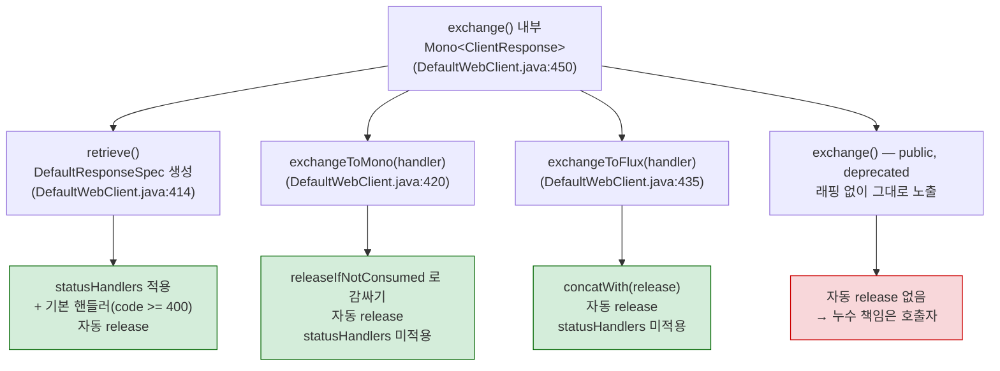
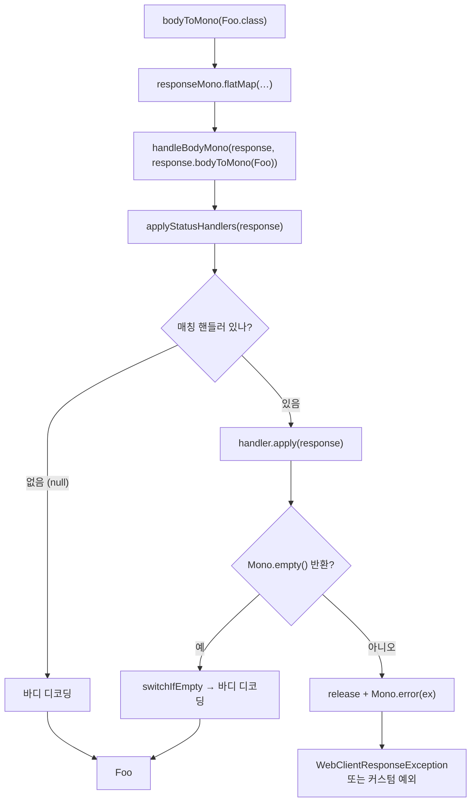

# retrieve vs exchangeToMono와 에러 처리

`WebClient`의 세 가지 종단 API — `retrieve()`, `exchangeToMono()`/`exchangeToFlux()`, 그리고 deprecated된 `exchange()` — 가 에러와 리소스 해제를 어떻게 다르게 처리하는지 소스로 비교한다.

## 목차
- [1. 핵심 개념 (What)](#1-핵심-개념-what)
- [2. 왜 알아야 하는가 (Why)](#2-왜-알아야-하는가-why)
- [3. 내부 구현 분석 (How)](#3-내부-구현-분석-how)
- [4. 실전 예제](#4-실전-예제)
- [5. 정리](#5-정리)

---

## 1. 핵심 개념 (What)

`RequestHeadersSpec`에는 요청을 실제로 보내는 종단 메서드가 네 개 있다.

| 메서드 | 선언 위치 | 반환 | 상태 |
|---|---|---|---|
| `retrieve()` | `spring-webflux/src/main/java/org/springframework/web/reactive/function/client/WebClient.java:549` | `ResponseSpec` | 권장 |
| `exchangeToMono(Function)` | `WebClient.java:578` | `Mono<V>` | `@since 5.3` |
| `exchangeToFlux(Function)` | `WebClient.java:607` | `Flux<V>` | `@since 5.3` |
| `exchange()` | `WebClient.java:645` | `Mono<ClientResponse>` | **`@Deprecated` (since 5.3)** |

> `exchange()`는 v6.2.19에 **여전히 존재한다.** `@Deprecated`가 붙어 있고 javadoc이 메모리 누수 위험을 명시하지만 컴파일은 되고, `DefaultWebClient`가 이를 public으로 구현한다(`DefaultWebClient.java:448-490`). Spring 7에서 제거되었으므로 이전 계획은 [12-boot4-spring7-migration.md](12-boot4-spring7-migration.md)를 참고한다.

`exchange()` 외에 v6.2.19의 요청/응답 API에 남아 있는 deprecated 멤버는 세 개 더다. 모두 7.0에서 제거되므로 신규 코드에서 쓰지 않는다.

| 멤버 | 선언 | deprecated 시점 | 대체 |
|---|---|---|---|
| `RequestBodySpec.syncBody(Object)` | `WebClient.java:799` (구현 `DefaultWebClient.java:408-411`) | 5.2 | `bodyValue(Object)` — 구현이 그대로 위임한다 |
| `RequestHeadersSpec.context(Function<Context, Context>)` | `WebClient.java:512-513` | 5.3.2 | 호출 체인 바깥의 `contextWrite()` |
| `Builder.exchangeStrategies(Consumer<ExchangeStrategies.Builder>)` | `WebClient.java:330` | 5.1.13 | `codecs(Consumer<ClientCodecConfigurer>)` |

세 경로가 갈라지는 지점은 **"응답 바디를 누가 책임지고 해제하는가"** 하나다.



---

## 2. 왜 알아야 하는가 (Why)

**(1) 기본 에러 동작을 모르면 4xx를 놓친다.**
`retrieve()`는 **4xx/5xx를 자동으로 예외로 바꾼다.** 이건 편리하지만, 404를 "없음"으로 처리하고 싶은 경우에는 방해가 된다. 반대로 `exchangeToMono()`는 **아무 상태도 에러로 바꾸지 않는다** — 직접 확인해야 한다. 이 비대칭을 모르면 `exchangeToMono()`에서 500 응답을 성공으로 처리하는 버그가 난다.

**(2) `defaultStatusHandler()`가 조용히 무시되는 경로가 있다.**
`Builder.defaultStatusHandler()`로 전역 에러 정책을 세워 두고 `exchangeToMono()`를 쓰면, 그 정책이 **전혀 적용되지 않는다.** 소스를 보면 이유가 명확하다.

**(3) 에러 바디를 버리고 있다.**
4xx 응답의 JSON 에러 바디(`{"code":"INSUFFICIENT_BALANCE","message":"..."}`)를 읽으려고 `exchangeToMono()`로 내려가는 코드를 자주 본다. `WebClientResponseException.getResponseBodyAs(Class)`를 쓰면 `retrieve()`를 유지하면서도 읽을 수 있다.

---

## 3. 내부 구현 분석 (How)

### 3.1 기본 에러 동작 — DEFAULT_STATUS_HANDLER

`DefaultResponseSpec`의 첫 필드가 전부를 설명한다(`DefaultWebClient.java:530-533`).

```java
private static class DefaultResponseSpec implements ResponseSpec {

    private static final StatusHandler DEFAULT_STATUS_HANDLER =
            new StatusHandler(code -> code.value() >= 400, ClientResponse::createException);
```

`code.value() >= 400`이면 `ClientResponse.createException()`을 호출한다. 즉 **4xx와 5xx뿐 아니라 400 이상의 모든 상태 코드**(커스텀 코드 499, 599 포함)가 예외가 된다.

`createException()`은 `DefaultClientResponse.java:200-233`에 있다.

```java
@Override
public Mono<WebClientResponseException> createException() {
    return bodyToMono(byte[].class)
            .defaultIfEmpty(EMPTY)
            .onErrorReturn(ex -> !(ex instanceof Error), EMPTY)
            .map(bodyBytes -> {
                HttpRequest request = this.requestSupplier.get();
                Optional<MediaType> mediaType = headers().contentType();
                Charset charset = mediaType.map(MimeType::getCharset).orElse(null);
                HttpStatusCode statusCode = statusCode();

                WebClientResponseException exception;
                if (statusCode instanceof HttpStatus httpStatus) {
                    exception = WebClientResponseException.create(
                            statusCode, httpStatus.getReasonPhrase(),
                            headers().asHttpHeaders(), bodyBytes, charset, request);
                }
                else {
                    exception = new UnknownHttpStatusCodeException(
                            statusCode, headers().asHttpHeaders(), bodyBytes, charset, request);
                }
                exception.setBodyDecodeFunction(initDecodeFunction(bodyBytes, mediaType.orElse(null)));
                return exception;
            });
}
```

네 가지가 중요하다 — 특히 (4)가 4.4절 `getResponseBodyAs()`의 기반이다.

1. **바디를 `byte[]`로 전부 읽는다.** 그래서 예외 객체에 에러 바디가 담긴다. 바디가 크면 메모리를 그만큼 쓴다.
2. **바디 읽기가 실패해도 예외 생성은 계속된다** — `onErrorReturn(ex -> !(ex instanceof Error), EMPTY)`. 응답이 깨져 있어도 상태 코드 기반 예외는 나온다.
3. `HttpStatusCode`가 표준 `HttpStatus`enum이면 `WebClientResponseException.create()`로 **상태별 서브클래스**를 만들고, 비표준 코드면 `UnknownHttpStatusCodeException`을 만든다.
4. `setBodyDecodeFunction()`으로 **나중에 바디를 역직렬화할 수 있는 함수를 심어 둔다.** 이게 `getResponseBodyAs()`의 기반이다.

### 3.2 상태별 서브클래스

`WebClientResponseException.create(HttpStatusCode, ...)` (`WebClientResponseException.java:315-341`)가 switch로 분기한다.

```java
if (statusCode instanceof HttpStatus httpStatus) {
    return switch (httpStatus) {
        case BAD_REQUEST -> new WebClientResponseException.BadRequest(...);
        case UNAUTHORIZED -> new WebClientResponseException.Unauthorized(...);
        // … FORBIDDEN, NOT_FOUND, METHOD_NOT_ALLOWED, NOT_ACCEPTABLE, CONFLICT, GONE,
        //    UNSUPPORTED_MEDIA_TYPE, TOO_MANY_REQUESTS, UNPROCESSABLE_ENTITY,
        //    INTERNAL_SERVER_ERROR, NOT_IMPLEMENTED, BAD_GATEWAY,
        //    SERVICE_UNAVAILABLE, GATEWAY_TIMEOUT
        default -> new WebClientResponseException(statusCode, statusText, headers, body, charset, request);
    };
}
return new WebClientResponseException(statusCode, statusText, headers, body, charset, request);
```

**16개 상태만** 전용 서브클래스를 갖는다(`WebClientResponseException.java:351-591`). 그 외(402 Payment Required, 418, 503이 아닌 5xx 등)는 기반 클래스로 떨어진다. 따라서 **`catch (WebClientResponseException.NotFound e)` 같은 타입 기반 분기는 그 16개에서만 동작하고, 나머지는 `getStatusCode()` 비교가 필요하다.**

`createError()`는 `createException()`에 `flatMap(Mono::error)`를 붙인 것뿐이다(`DefaultClientResponse.java:255-258`).

```java
@Override
public <T> Mono<T> createError() {
    return createException().flatMap(Mono::error);
}
```

반환 타입이 `<T> Mono<T>`라 어떤 체인에도 끼울 수 있다 — `exchangeToMono()` 안에서 쓰기 좋게 만든 편의 메서드다(`@since 6.0`).

`getMessage()`에 숨은 디테일이 하나 있다(`WebClientResponseException.java:275-288`). 상태 코드가 1xx/2xx/3xx일 때는 메시지 끝에 `", but response failed with cause: " + getCause()`를 덧붙인다. **2xx인데 `WebClientResponseException`이 났다면 디코딩 실패**라는 뜻이고, 그 원인을 메시지가 알려주는 것이다. `handleBodyMono()`가 바디 에러를 `exceptionWrappingFunction()`으로 감쌀 때 이 경로를 탄다(`DefaultWebClient.java:685-687`).

```java
private <T> Function<Throwable, Mono<? extends T>> exceptionWrappingFunction(ClientResponse response) {
    return t -> response.createException().flatMap(ex -> Mono.error(ex.initCause(t)));
}
```

### 3.3 onStatus 핸들러는 기본 핸들러보다 앞에 삽입된다

생성자에서 핸들러 목록을 세팅한다(`DefaultWebClient.java:546-555`).

```java
DefaultResponseSpec(HttpMethod httpMethod, URI uri, Mono<ClientResponse> responseMono,
        List<StatusHandler> defaultStatusHandlers) {

    this.httpMethod = httpMethod;
    this.uri = uri;
    this.responseMono = responseMono;
    this.statusHandlers.addAll(defaultStatusHandlers);     // Builder.defaultStatusHandler() 들
    this.statusHandlers.add(DEFAULT_STATUS_HANDLER);       // code >= 400
    this.defaultStatusHandlerCount = this.statusHandlers.size();
}
```

그리고 `onStatus()`가 **계산된 인덱스에 삽입**한다(`DefaultWebClient.java:557-566`).

```java
@Override
public ResponseSpec onStatus(Predicate<HttpStatusCode> statusCodePredicate,
        Function<ClientResponse, Mono<? extends Throwable>> exceptionFunction) {

    Assert.notNull(statusCodePredicate, "StatusCodePredicate must not be null");
    Assert.notNull(exceptionFunction, "Function must not be null");
    int index = this.statusHandlers.size() - this.defaultStatusHandlerCount;  // Default handlers always last
    this.statusHandlers.add(index, new StatusHandler(statusCodePredicate, exceptionFunction));
    return this;
}
```

주석이 의도를 그대로 말한다 — `Default handlers always last`.

`onStatus()`를 세 번 호출하면 목록은 이렇게 쌓인다.

```
초기:            [D1, D2, DEFAULT]              defaultStatusHandlerCount = 3
onStatus(A) →    [A, D1, D2, DEFAULT]           index = 3 - 3 = 0
onStatus(B) →    [A, B, D1, D2, DEFAULT]        index = 4 - 3 = 1
onStatus(C) →    [A, B, C, D1, D2, DEFAULT]     index = 5 - 3 = 2
```

**요청별 `onStatus()` 핸들러는 등록 순서대로, 전역 핸들러보다 앞에 온다.** 그리고 `applyStatusHandlers()`는 목록을 순회하며 **첫 번째로 매칭되는 핸들러에서 멈춘다**(`DefaultWebClient.java:689-710`).

```java
@Nullable
private <T> Mono<T> applyStatusHandlers(ClientResponse response) {
    HttpStatusCode statusCode = response.statusCode();
    for (StatusHandler handler : this.statusHandlers) {
        if (handler.test(statusCode)) {
            Mono<? extends Throwable> exMono;
            try {
                exMono = handler.apply(response);
                exMono = exMono.flatMap(ex -> releaseIfNotConsumed(response, ex));
                exMono = exMono.onErrorResume(ex -> releaseIfNotConsumed(response, ex));
            }
            catch (Throwable ex2) {
                exMono = releaseIfNotConsumed(response, ex2);
            }
            Mono<T> result = exMono.flatMap(Mono::error);
            return result.checkpoint(statusCode + " from " +
                    WebClientUtils.getRequestDescription(this.httpMethod, this.uri) +
                    " [DefaultWebClient]");
        }
    }
    return null;
}
```

핸들러가 예외를 만들든 던지든, 모든 경로가 `releaseIfNotConsumed()`를 거친다. **상태 핸들러 경로에서는 바디 누수가 구조적으로 불가능하다.**

핸들러가 `Mono.empty()`를 반환하면 `exMono.flatMap(Mono::error)`가 빈 `Mono`가 되고, 호출자 `handleBodyMono()`의 `switchIfEmpty(body)`가 정상 바디 처리로 넘긴다(`DefaultWebClient.java:663-667`). 이것이 javadoc이 말하는 "에러 상태를 정상 응답으로 처리하기"다(`WebClient.java:815-817`).



### 3.4 defaultStatusHandler()가 exchangeTo*()에 적용되지 않는 이유

`DefaultWebClient`는 전역 상태 핸들러를 필드에 들고 있다(`DefaultWebClient.java:100`).

```java
private final List<DefaultResponseSpec.StatusHandler> defaultStatusHandlers;
```

이 필드를 읽는 곳은 **딱 한 곳**, `retrieve()`뿐이다(`DefaultWebClient.java:413-417`).

```java
@Override
public ResponseSpec retrieve() {
    return new DefaultResponseSpec(
            this.httpMethod, initUri(), exchange(), DefaultWebClient.this.defaultStatusHandlers);
}
```

`exchangeToMono()`와 `exchangeToFlux()`는 `exchange()`만 호출하고 `DefaultResponseSpec`을 전혀 거치지 않는다(`DefaultWebClient.java:419-446`) — 구현 어디에도 `statusHandlers`가 등장하지 않는다.

**상태 핸들러 로직 전체가 `DefaultResponseSpec`에 캡슐화돼 있고, `exchangeTo*()`는 그 클래스를 쓰지 않는다.** 설계상 의도된 것이다 — `exchangeTo*()`는 "상태와 헤더를 직접 보고 결정하겠다"는 선언이므로, 자동 에러 변환이 끼어들면 목적이 무너진다.

### 3.5 자동 release — exchangeTo*()는 안전, exchange()는 아니다

`exchangeToMono()`의 구현(`DefaultWebClient.java:419-432`):

```java
@Override
public <V> Mono<V> exchangeToMono(Function<ClientResponse, ? extends Mono<V>> responseHandler) {
    return exchange().flatMap(response -> {
        try {
            return responseHandler.apply(response)
                    .flatMap(value -> releaseIfNotConsumed(response).thenReturn(value))
                    .switchIfEmpty(Mono.defer(() -> releaseIfNotConsumed(response).then(Mono.empty())))
                    .onErrorResume(ex -> releaseIfNotConsumed(response, ex));
        }
        catch (Throwable ex) {
            return releaseIfNotConsumed(response, ex);
        }
    });
}
```

**네 경로 모두 release를 거친다**: 값 방출, 빈 완료, 에러, 핸들러가 던진 예외. `exchangeToFlux()`는 `concatWith(Flux.defer(() -> releaseIfNotConsumed(response).then(Mono.empty())))`로 스트림 완료 후 release한다(`DefaultWebClient.java:434-446`).

`releaseIfNotConsumed()` 자체는 `response.releaseBody().onErrorComplete()`가 전부다(`DefaultWebClient.java:192-198`). 이름이 "IfNotConsumed"지만 실제로는 **조건 없이 `releaseBody()`를 호출**하고, 이미 소비됐으면 발생하는 에러를 `onErrorComplete()`로 삼킨다. `releaseBody()`는 `body(BodyExtractors.toDataBuffers()).map(DataBufferUtils::release).then()`으로 남은 `DataBuffer`를 전부 release한다(`DefaultClientResponse.java:170-173`).

반면 **`exchange()`에는 이 래핑이 없다.** `DefaultWebClient.java:448-490`의 `exchange()`는 `Mono<ClientResponse>`를 그대로 돌려준다. javadoc의 경고가 그래서 나온 것이다(`WebClient.java:626-642`).

> **NOTE:** Unlike `retrieve()`, when using `exchange()`, it is the responsibility of the application to consume any response content regardless of the scenario (success, error, unexpected data, etc). Not doing so can cause a memory leak.
>
> `@deprecated` since 5.3 due to the possibility to leak memory and/or connections; please, use `exchangeToMono(Function)`, `exchangeToFlux(Function)`; consider also using `retrieve()` …

"memory leak"뿐 아니라 **"connections"** 누수도 적혀 있다. Reactor Netty에서는 바디를 소비하지 않으면 커넥션이 풀로 반환되지 않는다 — [08-connection-reuse-pitfalls.md](08-connection-reuse-pitfalls.md).

누수가 나는 전형적 코드와 고친 형태:

```java
// 안티패턴 — 상태만 보고 바디를 버린다. release 되지 않아 호출량이 많으면 풀이 고갈된다.
Mono<Boolean> bad = webClient.get().uri("/foo/{id}", id)
        .exchange()                                       // @Deprecated
        .map(response -> response.statusCode().is2xxSuccessful());

// exchangeToMono 로 바꾸면 DefaultWebClient.java:424 의
// flatMap(value -> releaseIfNotConsumed(response).thenReturn(value)) 가 붙는다.
Mono<Boolean> good = webClient.get().uri("/foo/{id}", id)
        .exchangeToMono(response -> Mono.just(response.statusCode().is2xxSuccessful()));
```

더 간단하게는 `retrieve().toBodilessEntity()`가 명시적으로 release한다(`DefaultWebClient.java:653-661`).

### 3.6 getResponseBodyAs() — 많이 놓치는 기능

`createException()`이 심어 둔 디코드 함수(`DefaultClientResponse.java:230`)를 꺼내 쓴다.

```java
// WebClientResponseException.java:235-254
@Nullable
public <E> E getResponseBodyAs(Class<E> targetType) {
    return decodeBody(ResolvableType.forClass(targetType));
}

@Nullable
public <E> E getResponseBodyAs(ParameterizedTypeReference<E> targetType) {
    return decodeBody(ResolvableType.forType(targetType.getType()));
}

private <E> E decodeBody(ResolvableType targetType) {
    Assert.state(this.bodyDecodeFunction != null, "Decoder function not set");
    return (E) this.bodyDecodeFunction.apply(targetType);
}
```

디코드 함수는 `initDecodeFunction()`이 만든다(`DefaultClientResponse.java:235-253`). 응답의 `Content-Type`에 맞는 `HttpMessageReader`를 `strategies().messageReaders()`에서 찾아 그 `Decoder`로 바이트 배열을 디코딩한다 — **네트워크 I/O는 이미 끝났으므로 동기 호출이지만 블로킹이 아니다.**

중요한 제약 세 가지:

1. **바디가 비어 있으면 `null`을 반환한다**(`ObjectUtils.isEmpty(body)` 분기). 호출부에서 null 체크가 필수다.
2. **맞는 디코더가 없으면 `IllegalStateException("No suitable decoder")`**를 던진다(`Assert.state`). 서버가 4xx에 `text/html`을 돌려주는데 `getResponseBodyAs(ErrorBody.class)`를 호출하면 터진다.
3. 디코딩 실패는 `DecodingException`이다(`WebClientResponseException.java:232` javadoc).

`@since 6.0`이다. 문자열 버전 `getResponseBodyAsString()`도 여전히 유용하다 — 기본 UTF-8이고(`WebClientResponseException.java:209-211`), charset 지정 오버로드가 따로 있다(`WebClientResponseException.java:221`).

---

## 4. 실전 예제

### 4.1 결정 표 — 어떤 API를 언제 쓰는가

| 상황 | 선택 | 이유 |
|---|---|---|
| 2xx면 바디, 그 외는 예외 (가장 흔함) | `retrieve().bodyToMono(T)` | 기본 핸들러가 `>= 400`을 예외로 바꿔 준다 |
| 응답 상태/헤더도 필요 | `retrieve().toEntity(T)` | `ResponseEntity<T>`로 상태·헤더·바디를 한 번에 |
| 바디가 없거나 버려도 됨 | `retrieve().toBodilessEntity()` | 명시적 `releaseBody()` 포함 (`DefaultWebClient.java:657`) |
| 특정 상태만 다르게 (404 → `Optional.empty`) | `retrieve().onStatus(...)` | 핸들러가 `Mono.empty()`를 반환하면 바디 처리로 떨어진다 |
| 전역 에러 정책 (도메인 예외로 변환) | `Builder.defaultStatusHandler(...)` + `retrieve()` | `retrieve()` 경로에만 적용됨에 주의 |
| 상태별로 **디코딩 타입이 다름** (200→`Foo`, 202→`JobRef`) | `exchangeToMono(...)` | `ResponseSpec`은 단일 타입만 받는다 |
| 응답 헤더를 보고 바디를 읽을지 결정 | `exchangeToMono(...)` | 자동 에러 변환이 끼면 안 되는 경우 |
| 스트리밍 응답을 상태에 따라 분기 | `exchangeToFlux(...)` | 완료 후 자동 release (`DefaultWebClient.java:439`) |
| 에러 바디의 JSON을 읽고 싶다 | `retrieve()` + `getResponseBodyAs(...)` | `exchangeToMono()`로 내려갈 필요 없다 |
| — | ~~`exchange()`~~ | **쓰지 않는다.** deprecated이고 자동 release가 없다 |

요약 규칙: **기본은 `retrieve()`, 응답을 보고 분기해야 할 때만 `exchangeToMono()`, `exchange()`는 절대 쓰지 않는다.**

### 4.2 retrieve() + onStatus로 404를 빈 값으로

```java
package com.example.catalog;

import reactor.core.publisher.Mono;

import org.springframework.http.HttpStatus;
import org.springframework.stereotype.Component;
import org.springframework.web.reactive.function.client.WebClient;

@Component
public class ProductClient {

    private final WebClient webClient;

    public ProductClient(WebClient catalogWebClient) {
        this.webClient = catalogWebClient;
    }

    /**
     * 404 를 "없음"으로 취급한다.
     * onStatus 핸들러가 Mono.empty() 를 반환하면 applyStatusHandlers 가 빈 Mono 를 돌려주고
     * handleBodyMono 의 switchIfEmpty 가 정상 바디 디코딩으로 넘긴다
     * (DefaultWebClient.java:666). 바디가 비어 있으면 Mono 도 빈 상태로 완료된다.
     */
    public Mono<Product> findById(String productId) {
        return this.webClient.get()
                .uri("/products/{productId}", productId)
                .retrieve()
                .onStatus(status -> status == HttpStatus.NOT_FOUND, response ->
                        // 바디를 쓰지 않으므로 release 를 명시한다.
                        // (applyStatusHandlers 가 어차피 release 하지만,
                        //  핸들러가 Mono.empty() 를 반환할 때는 switchIfEmpty 경로로 빠지므로
                        //  바디를 소비하는 쪽이 안전하다)
                        response.releaseBody().then(Mono.<Throwable>empty()))
                .bodyToMono(Product.class);
    }
}
```

### 4.3 전역 에러 정책을 도메인 예외로 — defaultStatusHandler

```java
@Configuration(proxyBeanMethods = false)
class CatalogClientConfig {

    @Bean
    WebClient catalogWebClient(WebClient.Builder appWebClientBuilder, CatalogProperties props) {
        return appWebClientBuilder.clone()
                .baseUrl(props.baseUrl())
                // 이 핸들러는 retrieve() 경로에만 적용된다.
                // exchangeToMono()/exchangeToFlux() 는 DefaultResponseSpec 을 거치지 않으므로
                // 완전히 무시된다 (DefaultWebClient.java:414 가 유일한 사용처).
                .defaultStatusHandler(HttpStatusCode::is5xxServerError, response ->
                        response.createException()
                                .map(ex -> new CatalogUnavailableException(
                                        "catalog 5xx: " + ex.getStatusCode(), ex)))
                .defaultStatusHandler(status -> status == HttpStatus.TOO_MANY_REQUESTS, response ->
                        response.createException()
                                .map(ex -> new CatalogRateLimitedException(
                                        ex.getHeaders().getFirst("Retry-After"), ex)))
                .build();
    }
}
```

요청별 `onStatus()`를 함께 쓰면 **요청별 핸들러가 먼저 평가된다**(`DefaultWebClient.java:563`). 그래서 전역 정책을 특정 호출에서만 덮어쓰는 패턴이 자연스럽게 동작한다.

### 4.4 에러 바디 역직렬화 — getResponseBodyAs()

```java
package com.example.payment;

import reactor.core.publisher.Mono;

import org.springframework.stereotype.Component;
import org.springframework.web.reactive.function.client.WebClient;
import org.springframework.web.reactive.function.client.WebClientResponseException;

@Component
public class PaymentClient {

    private final WebClient webClient;

    public PaymentClient(WebClient paymentWebClient) {
        this.webClient = paymentWebClient;
    }

    public Mono<PaymentResult> charge(ChargeCommand command) {
        return this.webClient.post()
                .uri("/charges")
                .bodyValue(command)
                .retrieve()
                .bodyToMono(PaymentResult.class)
                .onErrorMap(WebClientResponseException.class, PaymentClient::toDomainError);
    }

    /**
     * createException() 이 예외에 바디 바이트와 디코드 함수를 심어 두기 때문에
     * (DefaultClientResponse.java:202, :230) 이 시점에 역직렬화할 수 있다.
     * I/O 는 이미 끝났으므로 블로킹이 아니다.
     */
    private static Throwable toDomainError(WebClientResponseException ex) {
        ApiError body;
        try {
            // Content-Type 에 맞는 디코더가 없으면 IllegalStateException("No suitable decoder"),
            // 바디가 비면 null 이다 (DefaultClientResponse.java:237).
            body = ex.getResponseBodyAs(ApiError.class);
        }
        catch (RuntimeException decodeFailure) {
            // 서버가 4xx 에 text/html 을 주는 경우 등
            return new PaymentFailedException(
                    "UNPARSEABLE_ERROR_BODY", ex.getStatusCode().value(), ex);
        }
        if (body == null) {
            return new PaymentFailedException(
                    "EMPTY_ERROR_BODY", ex.getStatusCode().value(), ex);
        }
        return new PaymentFailedException(body.code(), ex.getStatusCode().value(), ex);
    }
}

record ApiError(String code, String message) {
}
```

### 4.5 exchangeToMono()가 필요한 경우 — 상태별 다른 타입

```java
/**
 * 202 Accepted 는 작업 참조를, 200 OK 는 결과를 돌려주는 API.
 * ResponseSpec 은 단일 타입만 디코딩하므로 exchangeToMono 가 필요하다.
 * exchangeToMono 는 defaultStatusHandler 를 적용하지 않으므로
 * 모든 상태를 직접 처리해야 한다.
 */
public Mono<ReportOutcome> requestReport(ReportQuery query) {
    return this.webClient.post()
            .uri("/reports")
            .bodyValue(query)
            .exchangeToMono(response -> {
                HttpStatusCode status = response.statusCode();
                if (status == HttpStatus.OK) {
                    return response.bodyToMono(Report.class).map(ReportOutcome::completed);
                }
                if (status == HttpStatus.ACCEPTED) {
                    return response.bodyToMono(JobRef.class).map(ReportOutcome::pending);
                }
                // createError() 가 createException().flatMap(Mono::error) 를 해 준다
                // (DefaultClientResponse.java:256). 바디도 함께 읽어 예외에 담긴다.
                return response.createError();
            });
}
```

빠뜨리기 쉬운 두 가지:
- `exchangeToMono()`는 `4xx/5xx`를 자동으로 에러로 만들지 않는다. **마지막 `return`을 `createError()`로 닫지 않으면 500 응답이 성공으로 흘러간다.**
- 핸들러 안에서 `response.bodyToMono()`를 **호출하지 않고 끝내도** `releaseIfNotConsumed()`가 자동으로 바디를 해제한다(`DefaultWebClient.java:424-426`). 이 점은 안심해도 된다.

---

## 5. 정리

- 기본 에러 동작은 `DEFAULT_STATUS_HANDLER = new StatusHandler(code -> code.value() >= 400, ClientResponse::createException)` 한 줄이다(`DefaultWebClient.java:532-533`). 400 이상의 **모든** 상태 코드가 대상이다.
- `createException()`은 바디를 `byte[]`로 전부 읽어 예외에 담고, 역직렬화 함수까지 심어 둔다(`DefaultClientResponse.java:200-233`). 그래서 `getResponseBodyAs(Class)`가 I/O 없이 동작한다(`WebClientResponseException.java:235-254`).
- 상태별 서브클래스는 **16개 상태만** 존재한다(`WebClientResponseException.java:315-341`). 나머지는 기반 클래스이므로 타입 기반 catch에 의존하지 말고 `getStatusCode()`를 비교한다.
- `onStatus()`/`onRawStatus()` 핸들러는 `index = size - defaultStatusHandlerCount`로 **항상 기본 핸들러보다 앞에** 삽입된다(`DefaultWebClient.java:563-564`). 첫 매칭에서 멈춘다.
- 핸들러가 `Mono.empty()`를 반환하면 `handleBodyMono()`의 `switchIfEmpty`가 정상 바디 처리로 넘긴다(`DefaultWebClient.java:666`). 에러 상태를 성공으로 취급하는 공식 통로다.
- **`Builder.defaultStatusHandler()`는 `retrieve()`에만 적용된다.** `defaultStatusHandlers` 필드의 유일한 사용처가 `retrieve()`이고(`DefaultWebClient.java:416`), `exchangeTo*()`는 `DefaultResponseSpec`을 거치지 않기 때문이다.
- `exchangeToMono()`/`exchangeToFlux()`는 값·빈 완료·에러·핸들러 예외의 **네 경로 모두** `releaseIfNotConsumed()`를 거친다(`DefaultWebClient.java:419-446`). 바디를 읽지 않아도 누수가 없다.
- `exchange()`는 v6.2.19에 `@Deprecated`(since 5.3)로 **존재하지만** 자동 release가 없다. javadoc이 "memory leak and/or connections" 누수를 명시한다(`WebClient.java:626-642`). 쓰지 않는다.

---

## 관련 문서
- 선행: [요청 파이프라인 전체 추적](02-request-pipeline-trace.md)
- 후행: [필터 체인](04-exchange-filter-function.md)
- 참고: [코덱과 DataBuffer](05-codecs-and-databuffer.md), [커넥션 재사용 함정](08-connection-reuse-pitfalls.md), [복원력 통합](09-resilience-integration.md), [Boot 4 / Spring 7 마이그레이션](12-boot4-spring7-migration.md)

---
*참고: Spring Framework 6.2.19 (Spring Boot 3.x) 기준*
