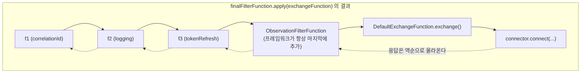

# ExchangeFilterFunction — 필터 체인

함수형 인터페이스 하나와 기본 메서드 두 개로 미들웨어 체인을 구성하는 `ExchangeFilterFunction`의 합성 규칙과, 필터 안에서 응답 바디를 건드리면 안 되는 이유를 소스로 확인한다.

## 목차
- [1. 핵심 개념 (What)](#1-핵심-개념-what)
- [2. 왜 알아야 하는가 (Why)](#2-왜-알아야-하는가-why)
- [3. 내부 구현 분석 (How)](#3-내부-구현-분석-how)
- [4. 실전 예제](#4-실전-예제)
- [5. 정리](#5-정리)

---

## 1. 핵심 개념 (What)

`ExchangeFilterFunction`은 추상 메서드 하나뿐인 함수형 인터페이스다(`spring-webflux/src/main/java/org/springframework/web/reactive/function/client/ExchangeFilterFunction.java:34-51`).

```java
@FunctionalInterface
public interface ExchangeFilterFunction {

    Mono<ClientResponse> filter(ClientRequest request, ExchangeFunction next);
}
```

`next`가 체인의 다음 단계다. 그리고 `ExchangeFunction` 자체도 함수형 인터페이스다(`ExchangeFunction.java:41-55`).

```java
@FunctionalInterface
public interface ExchangeFunction {

    Mono<ClientResponse> exchange(ClientRequest request);
}
```

**필터는 `ExchangeFunction → ExchangeFunction` 변환기다.** 이 사실이 전체 설계를 설명한다. 필터 N개와 실제 교환 함수 1개가 결국 **단 하나의 `ExchangeFunction`**으로 접히고, `DefaultWebClient`는 그걸 호출할 뿐이다.

```
build() 시점:
  [f1, f2, f3]  ──reduce(andThen)──▶  F = f1.andThen(f2).andThen(f3)

구독 시점:
  F.andThen(ObservationFilterFunction)  ──apply(exchangeFunction)──▶  단일 ExchangeFunction
```



요청은 위에서 아래로, 응답은 아래에서 위로 흐른다. **등록 순서가 요청 처리 순서이고, 응답 처리 순서는 그 역순이다.**

---

## 2. 왜 알아야 하는가 (Why)

**(1) 합성 순서를 잘못 알면 인증 필터가 로깅 필터보다 늦게 돌아 토큰 없는 요청이 로그에 찍힌다.** `andThen`이 "나중에 추가한 게 먼저"인지 "먼저 추가한 게 먼저"인지는 소스를 봐야 확정된다.

**(2) 필터에서 응답 바디를 읽으면 다운스트림이 빈 바디를 받는다.** `ClientResponse`의 바디는 **한 번만 읽을 수 있는 스트림**이다. 필터에서 로깅하려고 `bodyToMono(String.class)`를 호출하면, `retrieve().bodyToMono(Foo.class)`가 아무것도 받지 못한다. 이건 가장 흔하고 가장 디버깅하기 어려운 함정이다.

**(3) `ClientRequest`는 불변이다.** 필터에서 헤더를 추가하려면 `ClientRequest.from(request)`로 새 객체를 만들어야 한다. 직접 `headers().add()`를 호출하면 `UnsupportedOperationException`이 난다([02-request-pipeline-trace.md](02-request-pipeline-trace.md) 3.4절).

---

## 3. 내부 구현 분석 (How)

### 3.1 andThen() — 합성 순서의 확정

`ExchangeFilterFunction.java:59-63`:

```java
default ExchangeFilterFunction andThen(ExchangeFilterFunction afterFilter) {
    Assert.notNull(afterFilter, "ExchangeFilterFunction must not be null");
    return (request, next) ->
            filter(request, afterRequest -> afterFilter.filter(afterRequest, next));
}
```

한 줄씩 풀어 본다. 합성된 필터 `C = A.andThen(B)`를 호출하면:

```
C.filter(request, next)
  = A.filter(request, afterRequest -> B.filter(afterRequest, next))
```

즉 **`A`가 먼저 호출되고**, `A`가 받는 `next`는 "`B`를 호출한 뒤 원래 `next`로 가는 함수"다. **`A`가 바깥, `B`가 안쪽.**

`reduce`로 셋을 접으면:

```
f1.andThen(f2).andThen(f3)

.filter(req, next)
  = (f1.andThen(f2)).filter(req, r -> f3.filter(r, next))
  = f1.filter(req, r1 -> f2.filter(r1, r2 -> f3.filter(r2, next)))
```

**결론: `filter()`로 등록한 순서대로 요청 처리가 일어난다. 먼저 등록한 필터가 가장 바깥이다.**

`java.util.function.Function.andThen()`과 의미가 같다 — "이것을 먼저, 그 다음에 저것을". 헷갈릴 이유가 없지만, 서블릿 `Filter` 체인을 떠올리면 방향을 반대로 생각하기 쉽다. 같은 방향이다.

### 3.2 apply() — 필터와 exchange를 하나로 접기

`ExchangeFilterFunction.java:71-74`:

```java
default ExchangeFunction apply(ExchangeFunction exchange) {
    Assert.notNull(exchange, "ExchangeFunction must not be null");
    return request -> this.filter(request, exchange);
}
```

필터(2-arity)와 `ExchangeFunction`(1-arity)을 결합해 **새로운 `ExchangeFunction`(1-arity)**를 만든다. 부분 적용(partial application)이다.

반대 방향 편의 메서드도 있다(`ExchangeFunction.java:64-66`).

```java
default ExchangeFunction filter(ExchangeFilterFunction filter) {
    return filter.apply(this);
}
```

같은 일을 하는 두 입구다.

### 3.3 build()에서 하나로 접는 지점

`DefaultWebClientBuilder.build()` (`DefaultWebClientBuilder.java:319-321`):

```java
ExchangeFilterFunction filterFunctions = (this.filters != null ? this.filters.stream()
        .reduce(ExchangeFilterFunction::andThen)
        .orElse(null) : null);
```

`Stream.reduce(BinaryOperator)`는 `Optional`을 반환하므로, 필터가 없으면 `null`이 된다. `DefaultWebClient`는 그 `null`을 그대로 받아 필드에 보관한다(`DefaultWebClient.java:86-87`).

그리고 구독 시점에 프레임워크 필터가 하나 더 붙는다(`DefaultWebClient.java:458-461`).

```java
ExchangeFilterFunction filterFunction = new ObservationFilterFunction(observation.getContext());
if (filterFunctions != null) {
    filterFunction = filterFunctions.andThen(filterFunction);
}
```

**`filterFunctions.andThen(observationFilter)`** — 사용자 필터가 바깥, `ObservationFilterFunction`이 가장 안쪽이다. `ObservationFilterFunction`은 `next.exchange(request)`의 결과에 `doOnNext(clientContext::setResponse)`를 붙이는 것이 전부다(`DefaultWebClient.java:737-753`).

가장 안쪽이라는 뜻은 — **관측 컨텍스트에 기록되는 `ClientResponse`는 사용자 필터가 가공하기 전의 원본이다.** 필터에서 응답을 `mutate()`해 상태 코드를 바꿔도 메트릭에는 원본 상태가 남는다. 의도된 설계다([10-observability.md](10-observability.md)).

마지막으로 `finalFilterFunction.apply(exchangeFunction).exchange(request)`가 실제 호출이다(`DefaultWebClient.java:468-469`).

```mermaid
flowchart LR
    subgraph build "build() — 1회"
    A1["filters = [f1, f2, f3]"] --> A2["reduce(andThen)"] --> A3["filterFunctions = F"]
    end
    subgraph subscribe "구독 시점 — 매번"
    B1["F.andThen(ObservationFilterFunction)"] --> B2["finalFilterFunction"]
    B2 --> B3["apply(exchangeFunction)"] --> B4["단일 ExchangeFunction"]
    B4 --> B5[".exchange(request)"]
    end
    A3 --> B1
```

### 3.4 ofRequestProcessor / ofResponseProcessor

양쪽 중 한쪽만 손대는 필터를 위한 어댑터다(`ExchangeFilterFunction.java:82-96`).

```java
static ExchangeFilterFunction ofRequestProcessor(Function<ClientRequest, Mono<ClientRequest>> processor) {
    Assert.notNull(processor, "ClientRequest Function must not be null");
    return (request, next) -> processor.apply(request).flatMap(next::exchange);
}

static ExchangeFilterFunction ofResponseProcessor(Function<ClientResponse, Mono<ClientResponse>> processor) {
    Assert.notNull(processor, "ClientResponse Function must not be null");
    return (request, next) -> next.exchange(request).flatMap(processor);
}
```

`ofRequestProcessor`가 `Mono<ClientRequest>`를 받는다는 점이 유용하다 — **요청 변형이 비동기일 수 있다.** 토큰을 비동기로 가져와 헤더에 붙이는 필터가 자연스럽게 표현된다.

`ofResponseProcessor`는 `flatMap(processor)`이므로 응답을 교체하거나 에러로 바꿀 수 있다. 다만 **원본 응답을 버리고 다른 걸 반환하면 원본 바디가 release되지 않는다**(3.7절 참조).

### 3.5 내장 필터 — ExchangeFilterFunctions

`ExchangeFilterFunctions.java:42-180`에 세 가지(오버로드 포함 네 개)가 있다.

**`limitResponseSize(long)`** (`ExchangeFilterFunctions.java:59-65`)

```java
public static ExchangeFilterFunction limitResponseSize(long maxByteCount) {
    return (request, next) ->
            next.exchange(request).map(response ->
                    response.mutate()
                            .body(body -> DataBufferUtils.takeUntilByteCount(body, maxByteCount))
                            .build());
}
```

`response.mutate()`로 **바디 `Flux<DataBuffer>`를 변환**한다. 직접 읽지 않고 변환만 하므로 안전하다. `takeUntilByteCount`는 한도를 넘으면 상류를 취소한다 — 즉 **예외를 던지지 않고 조용히 잘라낸다.** 잘렸는지 알고 싶으면 JSON 파싱 실패로 간접 감지해야 한다. 코덱 레벨의 `maxInMemorySize`와는 동작이 다르다([05-codecs-and-databuffer.md](05-codecs-and-databuffer.md)).

**`statusError(Predicate, Function)`** (`ExchangeFilterFunctions.java:74-83`)

```java
public static ExchangeFilterFunction statusError(Predicate<HttpStatusCode> statusPredicate,
        Function<ClientResponse, ? extends Throwable> exceptionFunction) {

    return ExchangeFilterFunction.ofResponseProcessor(
            response -> (statusPredicate.test(response.statusCode()) ?
                    Mono.error(exceptionFunction.apply(response)) : Mono.just(response)));
}
```

`exceptionFunction`이 `Function<ClientResponse, ? extends Throwable>`로 **동기**다. 즉 `createException()`처럼 바디를 읽는 비동기 함수를 쓸 수 없다. 그리고 에러로 바꿀 때 **바디를 release하지 않는다** — 누수 경로다. `retrieve().onStatus()`가 `releaseIfNotConsumed()`를 보장하므로([03-retrieve-vs-exchange.md](03-retrieve-vs-exchange.md) 3.3절), 상태 기반 에러 변환은 `onStatus()`/`defaultStatusHandler()`를 쓰는 게 맞다.

**`basicAuthentication(String, String)`** (`ExchangeFilterFunctions.java:95-101`)

```java
public static ExchangeFilterFunction basicAuthentication(String username, String password) {
    String encodedCredentials = HttpHeaders.encodeBasicAuth(username, password, null);
    return (request, next) ->
            next.exchange(ClientRequest.from(request)
                    .headers(headers -> headers.setBasicAuth(encodedCredentials))
                    .build());
}
```

인코딩이 **필터 생성 시점에 한 번만** 일어난다 — 요청마다 Base64를 다시 계산하지 않는다. `encodeBasicAuth(username, password, null)`의 세 번째 인자가 charset이고 `null`은 ISO-8859-1을 의미한다.

그리고 `ClientRequest.from(request)`로 새 요청을 만드는 **불변 객체 변형의 정석 패턴**을 보여준다.

**`basicAuthentication()`** — 무인자 오버로드는 `@Deprecated` (since 5.1) (`ExchangeFilterFunctions.java:103-125`)

요청 attribute(`BASIC_AUTHENTICATION_CREDENTIALS_ATTRIBUTE`, 선언 `ExchangeFilterFunctions.java:47-48`)에서 `Credentials`를 꺼내 헤더로 바꾸는 방식이다. **자격증명을 attribute에 담으면 로그와 관측 컨텍스트에 노출될 위험**이 있고, 그 값을 담는 public 중첩 클래스 `Credentials`(`ExchangeFilterFunctions.java:128-178`) 자체도 `@Deprecated`다. javadoc이 권하는 대안은 `HttpHeaders.setBasicAuth(String, String)`을 요청 빌드 시점에 직접 호출하는 것이다.

> v6.2.19의 `ExchangeFilterFunctions`는 180줄이고 `basicAuthentication` 오버로드는 **이 두 개뿐**이다. 무인자 버전과 `Credentials`는 7.0에서 제거된다([12-boot4-spring7-migration.md](12-boot4-spring7-migration.md)).

### 3.6 ClientRequest 변형의 정석

`ClientRequest.from(ClientRequest)` (`ClientRequest.java:133`)가 기존 요청을 복사한 빌더를 준다. `DefaultClientRequestBuilder`의 복사 생성자가 헤더를 `addAll`로 가져온다(`DefaultClientRequestBuilder.java:75`).

```java
headers(headers -> headers.addAll(other.headers()));
```

`build()`가 다시 `HttpHeaders.readOnlyHttpHeaders`로 잠근다(`DefaultClientRequestBuilder.java:204`). 그래서 **필터 체인에서는 매 변형마다 새 `ClientRequest`가 생긴다.** 요청 객체를 수십 번 복사하는 비용이 걱정될 수 있지만, 헤더 맵 복사는 네트워크 I/O 대비 무시할 수준이다.

### 3.7 필터 안에서 바디를 읽으면 안 되는 이유

`ClientResponse`의 바디는 `Flux<DataBuffer>`이고, 그 소스는 **네트워크 소켓에서 나오는 일회성 스트림**이다. `DefaultClientResponse.bodyToMono()`는 `BodyExtractors`를 통해 그 `Flux`를 소비한다(`DefaultClientResponse.java:148-151`).

```java
@Override
public <T> Mono<T> bodyToMono(Class<? extends T> elementClass) {
    return body(BodyExtractors.toMono(elementClass));
}
```

한 번 소비하면 두 번째 구독에는 아무것도 남지 않는다. 게다가 `DataBuffer`는 (Netty 커넥터에서) **참조 카운트된 네이티브 메모리**다. 읽고 release하지 않으면 누수고, 두 번 release하면 `IllegalReferenceCountException`이다.

```java
// 안티패턴 — 다운스트림이 빈 바디를 받는다
ExchangeFilterFunction brokenLogging = (request, next) ->
        next.exchange(request)
                .flatMap(response -> response.bodyToMono(String.class)   // ← 스트림 소비
                        .doOnNext(body -> log.info("response body: {}", body))
                        .thenReturn(response));                          // ← 빈 껍데기 반환
```

위 필터를 끼우면 `retrieve().bodyToMono(Foo.class)`가 빈 `Mono`로 완료된다. 에러도 안 난다. 조용히 `null`이 흐른다.

프레임워크도 이 위험을 javadoc에 명시한다(`ExchangeFilterFunction.java:42-46`).

> **Note:** When a filter handles the response after the call to `ExchangeFunction.exchange(...)`, extra care must be taken to always consume its content or otherwise propagate it downstream for further handling, for example by the `WebClient`.

같은 경고가 `ExchangeFunction.exchange()`에도 있다(`ExchangeFunction.java:46-51`).

**정말 바디를 로깅해야 한다면** `limitResponseSize`처럼 `response.mutate().body(...)`로 **스트림을 변환**하는 방식을 쓴다 — 읽지 않고 통과시키면서 엿본다. 4.3절에 예제가 있다. 다만 그 방식도 전체 바디를 메모리에 모으므로 운영 환경에서는 권하지 않는다.

---

## 4. 실전 예제

### 4.1 상관관계 ID 전파 필터

Reactor Context에서 상관관계 ID를 꺼내 헤더로 내려보낸다. `Mono.deferContextual`로 **구독 시점의 Context**를 읽는 것이 핵심이다.

```java
package com.example.infra.http;

import reactor.core.publisher.Mono;

import org.springframework.web.reactive.function.client.ClientRequest;
import org.springframework.web.reactive.function.client.ExchangeFilterFunction;
import org.springframework.web.reactive.function.client.ExchangeFunction;

public final class CorrelationIdFilter {

    /** Reactor Context 키. 요청 진입점(WebFilter)에서 심어 둔다. */
    public static final String CONTEXT_KEY = "correlationId";

    private CorrelationIdFilter() {
    }

    public static ExchangeFilterFunction create(String headerName) {
        return (ClientRequest request, ExchangeFunction next) ->
                Mono.deferContextual(ctx -> {
                    if (!ctx.hasKey(CONTEXT_KEY)) {
                        return next.exchange(request);
                    }
                    String correlationId = ctx.get(CONTEXT_KEY);
                    // ClientRequest 는 불변이므로 from() 으로 새 객체를 만든다
                    // (DefaultClientRequestBuilder.java:204 에서 헤더가 읽기 전용으로 잠긴다)
                    ClientRequest decorated = ClientRequest.from(request)
                            .header(headerName, correlationId)
                            .build();
                    return next.exchange(decorated);
                });
    }
}
```

`Mono.deferContextual` 없이 바로 `next.exchange()`를 호출하면 Context에 접근할 길이 없다. Context 전파 전반은 [../main/09-context-propagation.md](../main/09-context-propagation.md).

### 4.2 요청/응답 로깅 필터 — 바디는 건드리지 않는다

```java
package com.example.infra.http;

import java.util.List;
import java.util.Set;

import org.slf4j.Logger;
import org.slf4j.LoggerFactory;
import reactor.core.publisher.Mono;

import org.springframework.http.HttpHeaders;
import org.springframework.web.reactive.function.client.ClientRequest;
import org.springframework.web.reactive.function.client.ExchangeFilterFunction;
import org.springframework.web.reactive.function.client.ExchangeFunction;

public final class HttpLoggingFilter {

    private static final Logger log = LoggerFactory.getLogger(HttpLoggingFilter.class);

    /** 값을 절대 로그에 남기지 않는 헤더. 소문자로 비교한다. */
    private static final Set<String> MASKED_HEADERS = Set.of(
            "authorization", "proxy-authorization", "cookie", "set-cookie",
            "x-api-key", "x-auth-token");

    private HttpLoggingFilter() {
    }

    public static ExchangeFilterFunction create() {
        return (ClientRequest request, ExchangeFunction next) -> {
            long startedAt = System.nanoTime();
            if (log.isDebugEnabled()) {
                log.debug("{}--> {} {} headers={}",
                        request.logPrefix(),           // LOG_ID_ATTRIBUTE 기반 상관관계 접두사
                        request.method(), safeUrl(request.url()),   // 아래 주의 참고
                        mask(request.headers()));
            }
            return next.exchange(request)
                    .doOnNext(response -> {
                        if (log.isDebugEnabled()) {
                            log.debug("{}<-- {} ({} ms)",
                                    request.logPrefix(),
                                    response.statusCode(),
                                    (System.nanoTime() - startedAt) / 1_000_000);
                        }
                    })
                    .doOnError(ex -> log.warn("{}<-- failed after {} ms: {}",
                            request.logPrefix(),
                            (System.nanoTime() - startedAt) / 1_000_000,
                            ex.toString()));
            // 바디를 읽지 않는다. 읽으면 다운스트림이 빈 스트림을 받는다.
        };
    }

    private static String mask(HttpHeaders headers) {
        HttpHeaders copy = new HttpHeaders();
        headers.forEach((name, values) -> copy.put(name,
                MASKED_HEADERS.contains(name.toLowerCase()) ? List.of("***") : values));
        return copy.toString();
    }
}
```

`request.logPrefix()`를 쓰면 `DefaultWebClient`/`DefaultExchangeFunction`이 남기는 로그와 같은 ID로 묶인다(`ClientRequest.java:108-114`, `DefaultClientRequestBuilder.java:210-211`).

**URL 로깅 주의**: `request.url()`은 쿼리 스트링·userInfo·fragment를 그대로 포함한다. 민감 값이 URL에 들어갈 수 있다면 직접 정제해야 한다 — 프레임워크의 `WebClientUtils`는 package-private이라 재사용할 수 없고, **v6.2.19 구현 자체도 불완전하다.** `getRequestDescription()`의 정제는 `if (StringUtils.hasText(uri.getQuery()))` 가드 안에서만 일어나므로(`WebClientUtils.java:75-85`) **쿼리 없이 userInfo나 fragment만 있는 URL은 걸러지지 않는다.** 직접 쓰는 정제 함수는 가드 없이 항상 재구성하도록 만든다.

```java
private static String safeUrl(URI uri) {
    try {
        // userInfo, query, fragment 를 조건 없이 제거한다 (6.2.19 의 getRequestDescription 과 달리)
        return new URI(uri.getScheme(), null, uri.getHost(), uri.getPort(), uri.getPath(), null, null).toString();
    }
    catch (URISyntaxException ex) {
        return uri.getScheme() + "://" + uri.getHost() + uri.getRawPath();
    }
}
```

### 4.3 바디 로깅이 정말 필요할 때 — mutate()로 엿보기

운영에서는 권하지 않는다 — 바디 전체를 메모리에 모으므로 큰 응답/스트리밍 응답에서는 OOM이고, 응답 본문이 로그에 남으면 개인정보·토큰 유출 경로가 된다. 로컬 디버깅 한정으로 쓴다.

```java
/**
 * 바디를 "읽지 않고" 변환해서 통과시킨다.
 * limitResponseSize(ExchangeFilterFunctions.java:59) 와 같은 기법.
 */
static ExchangeFilterFunction debugBodyLogging(int maxLoggedBytes) {
    return (request, next) -> next.exchange(request).map(response ->
            response.mutate()
                    .body(body -> DataBufferUtils.join(body)
                            .map(buffer -> {
                                byte[] bytes = new byte[buffer.readableByteCount()];
                                buffer.read(bytes);
                                DataBufferUtils.release(buffer);   // 필수 — 생략하면 네이티브 메모리 누수
                                log.debug("{}body: {}", request.logPrefix(),
                                        new String(bytes, 0, Math.min(bytes.length, maxLoggedBytes),
                                                StandardCharsets.UTF_8));
                                // 읽은 내용으로 새 DataBuffer 를 만들어 다운스트림에 넘긴다
                                return DefaultDataBufferFactory.sharedInstance.wrap(bytes);
                            })
                            .flux())
                    .build());
}
```

### 4.4 토큰 갱신 필터

401을 받으면 토큰을 갱신하고 **한 번만** 재시도한다. 요점은 두 가지다 — 재시도 전에 원본 응답의 바디를 release해야 하고, 무한 루프를 막아야 한다.

```java
package com.example.infra.http;

import java.util.concurrent.atomic.AtomicBoolean;

import reactor.core.publisher.Mono;

import org.springframework.http.HttpStatus;
import org.springframework.web.reactive.function.client.ClientRequest;
import org.springframework.web.reactive.function.client.ClientResponse;
import org.springframework.web.reactive.function.client.ExchangeFilterFunction;
import org.springframework.web.reactive.function.client.ExchangeFunction;

public class TokenRefreshFilter implements ExchangeFilterFunction {

    private final TokenProvider tokenProvider;

    public TokenRefreshFilter(TokenProvider tokenProvider) {
        this.tokenProvider = tokenProvider;
    }

    @Override
    public Mono<ClientResponse> filter(ClientRequest request, ExchangeFunction next) {
        // 재시도 1회 제한. 구독마다 새 플래그가 필요하므로 defer 안에서 만든다.
        return Mono.defer(() -> {
            AtomicBoolean retried = new AtomicBoolean();
            return this.tokenProvider.currentToken()
                    .flatMap(token -> exchangeWithToken(request, next, token))
                    .flatMap(response -> {
                        if (response.statusCode() != HttpStatus.UNAUTHORIZED || retried.getAndSet(true)) {
                            return Mono.just(response);
                        }
                        // 재시도하기 전에 401 응답의 바디를 반드시 해제한다.
                        // 이 필터는 WebClient 의 자동 release 바깥에서 응답을 버리기 때문에
                        // (exchangeToMono 의 releaseIfNotConsumed 는 최종 응답에만 적용된다)
                        // 여기서 release 하지 않으면 커넥션이 풀로 반환되지 않는다.
                        return response.releaseBody()
                                .onErrorComplete()
                                .then(this.tokenProvider.refreshToken())
                                .flatMap(freshToken -> exchangeWithToken(request, next, freshToken));
                    });
        });
    }

    private Mono<ClientResponse> exchangeWithToken(ClientRequest request, ExchangeFunction next, String token) {
        return next.exchange(ClientRequest.from(request)
                .headers(headers -> headers.setBearerAuth(token))
                .build());
    }
}
```

`TokenProvider`는 `Mono<String> currentToken()`(캐시된 토큰)과 `Mono<String> refreshToken()`(강제 갱신) 두 메서드를 가진다. `refreshToken()`의 동시성 제어가 실제로는 가장 어려운 부분이다. 401이 동시에 100건 오면 갱신 요청도 100건 나간다. `Mono.cache(Duration)`나 `Sinks`로 묶는다. 상세 전략은 [09-resilience-integration.md](09-resilience-integration.md).

> OAuth2를 쓴다면 이 필터를 직접 만들지 말고 Spring Security의 `ServerOAuth2AuthorizedClientExchangeFilterFunction`을 쓴다. 토큰 저장·갱신·동시성이 이미 해결돼 있다.

### 4.5 등록 — 순서가 의미를 만든다

```java
@Configuration(proxyBeanMethods = false)
class FilteredWebClientConfig {

    @Bean
    WebClient apiWebClient(
            WebClient.Builder appWebClientBuilder,
            TokenProvider tokenProvider,
            ApiProperties props) {

        // reduce(andThen) 으로 접히므로 (DefaultWebClientBuilder.java:319)
        // 등록 순서 = 요청 처리 순서, 역순 = 응답 처리 순서.
        return appWebClientBuilder.clone()
                .baseUrl(props.baseUrl())
                // 1) 가장 바깥 — 모든 요청/재시도에 상관관계 ID가 붙는다
                .filter(CorrelationIdFilter.create("X-Correlation-Id"))
                // 2) 로깅 — 토큰 필터보다 바깥이라 재시도도 각각 로그에 남는다
                .filter(HttpLoggingFilter.create())
                // 3) 가장 안쪽 — 재시도를 여기서 하므로 1,2 는 재시도마다 다시 돌지 않는다
                .filter(new TokenRefreshFilter(tokenProvider))
                .filter(ExchangeFilterFunctions.limitResponseSize(props.maxResponseBytes()))
                .build();
    }
}
```

순서 선택의 근거: 상관관계 ID를 가장 바깥에 두면 안쪽 필터가 만드는 재시도 요청에도 ID가 붙는다. 로깅을 토큰 필터보다 바깥에 두면 재시도 1회차와 2회차가 각각 로그에 찍힌다(안쪽이면 최종 결과만). `limitResponseSize`를 가장 안쪽에 두면 재시도를 포함한 모든 응답에 적용된다.

**중요**: `ObservationFilterFunction`은 구독 시점에 **항상 가장 안쪽**으로 추가된다(`DefaultWebClient.java:458-461`). 사용자가 순서를 바꿀 수 없다.

### 4.6 안티패턴 정리

```java
// ① 바디를 읽는다 → 다운스트림이 빈 바디를 받는다
(request, next) -> next.exchange(request)
        .flatMap(r -> r.bodyToMono(String.class).doOnNext(log::info).thenReturn(r));

// ② 요청 객체를 직접 수정한다 → UnsupportedOperationException
(request, next) -> {
    request.headers().add("X-Foo", "bar");   // readOnlyHttpHeaders
    return next.exchange(request);
};

// ③ 응답을 버리고 다른 걸 반환한다 → 원본 바디 누수
(request, next) -> next.exchange(request)
        .flatMap(r -> r.statusCode().is4xxClientError()
                ? Mono.error(new MyException())   // r.releaseBody() 없음
                : Mono.just(r));

// ④ 필터 안에서 블로킹 호출
(request, next) -> {
    String token = tokenProvider.fetchBlocking();   // 이벤트 루프를 멈춘다
    return next.exchange(ClientRequest.from(request)
            .headers(h -> h.setBearerAuth(token)).build());
};
```

③의 올바른 형태는 `r.releaseBody().onErrorComplete().then(Mono.error(new MyException()))`이거나, 애초에 `retrieve().onStatus()`를 쓰는 것이다 — 그쪽은 release가 보장된다(`DefaultWebClient.java:697-702`).

④는 `ofRequestProcessor`로 비동기화한다.

```java
ExchangeFilterFunction.ofRequestProcessor(request ->
        tokenProvider.currentToken()
                .map(token -> ClientRequest.from(request)
                        .headers(h -> h.setBearerAuth(token))
                        .build()));
```

---

## 5. 정리

- `ExchangeFilterFunction`은 `(ClientRequest, ExchangeFunction) -> Mono<ClientResponse>`인 함수형 인터페이스이고, 본질은 **`ExchangeFunction → ExchangeFunction` 변환기**다.
- `andThen(afterFilter)`는 `filter(request, afterRequest -> afterFilter.filter(afterRequest, next))`로 합성한다(`ExchangeFilterFunction.java:59-63`). **먼저 등록한 필터가 가장 바깥**이고, 요청은 등록 순서대로, 응답은 역순으로 지나간다.
- `apply(exchange)`는 필터와 교환 함수를 **단일 `ExchangeFunction`으로 접는다**(`ExchangeFilterFunction.java:71-74`).
- `build()`가 `filters.stream().reduce(ExchangeFilterFunction::andThen)`으로 필터 목록을 하나로 접고(`DefaultWebClientBuilder.java:319-321`), 구독 시점에 `ObservationFilterFunction`이 **항상 가장 안쪽으로** 추가된다(`DefaultWebClient.java:458-461`).
- 내장 필터는 `limitResponseSize`, `statusError`, `basicAuthentication(String, String)`, 그리고 `@Deprecated`(since 5.1) `basicAuthentication()` 무인자 버전이다. `statusError`는 바디를 release하지 않으므로 상태 기반 에러 변환은 `onStatus()` 쪽을 쓴다.
- `ClientRequest`는 불변이다. 변형은 항상 `ClientRequest.from(request)...build()`다(`ExchangeFilterFunctions.java:98-100`이 정석을 보여준다).
- **필터에서 응답 바디를 읽으면 안 된다.** 바디는 일회성 스트림이고, 소비하면 다운스트림이 빈 스트림을 받는다. javadoc도 명시적으로 경고한다(`ExchangeFilterFunction.java:42-46`). 꼭 엿봐야 하면 `response.mutate().body(...)`로 변환하되 `DataBuffer`를 직접 release한다.
- 응답을 버리고 에러로 바꾸는 필터는 반드시 `response.releaseBody()`를 먼저 호출한다. `retrieve()` 경로의 상태 핸들러는 이 release가 보장되지만(`DefaultWebClient.java:697-702`), 필터는 그렇지 않다.

---

## 관련 문서
- 선행: [retrieve vs exchangeToMono와 에러 처리](03-retrieve-vs-exchange.md), [요청 파이프라인 전체 추적](02-request-pipeline-trace.md)
- 후행: [코덱과 DataBuffer](05-codecs-and-databuffer.md)
- 참고: [Context 전파](../main/09-context-propagation.md), [복원력 통합](09-resilience-integration.md), [관측성](10-observability.md), [WebClient 테스트](11-testing-webclient.md)

---
*참고: Spring Framework 6.2.19 (Spring Boot 3.x) 기준*
