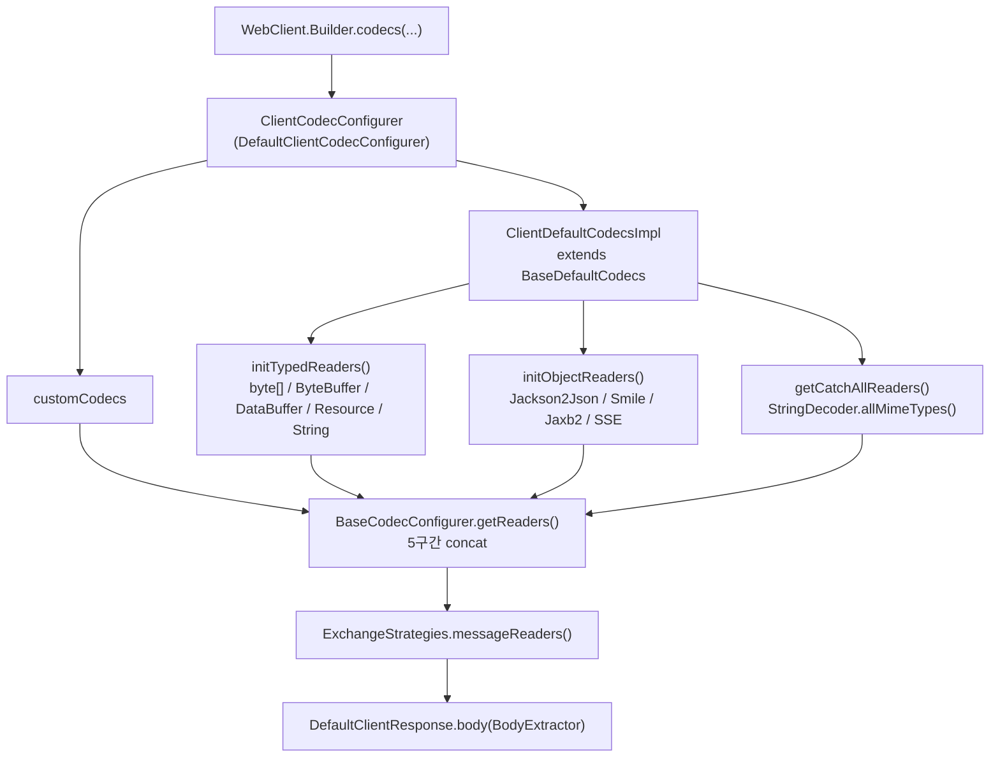
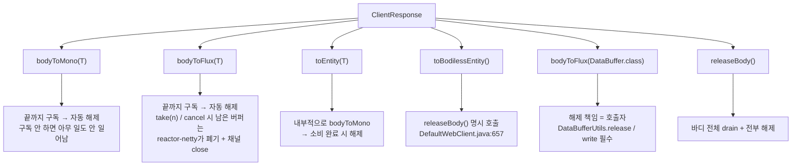

# 코덱·바디 변환과 DataBuffer 누수

`WebClient`가 바이트 스트림을 객체로 바꾸는 코덱 계층(`ExchangeStrategies` → `ClientCodecConfigurer` → `Decoder`/`Encoder`)을 소스로 따라가고, `maxInMemorySize` 기본값 256KB가 어디에 저장되어 어떻게 전파되는지, 그리고 응답 바디를 소비하지 않을 때 무엇이 새는지를 정리한다.

## 목차
- [1. 핵심 개념 (What)](#1-핵심-개념-what)
- [2. 왜 알아야 하는가 (Why)](#2-왜-알아야-하는가-why)
- [3. 내부 구현 분석 (How)](#3-내부-구현-분석-how)
- [4. 실전 예제](#4-실전-예제)
- [5. 정리](#5-정리)

---

## 1. 핵심 개념 (What)

`WebClient`의 바디 변환은 **4층 구조**다. 위에서 아래로 갈수록 추상화가 낮아진다.

```
ExchangeStrategies                  (spring-webflux)  — 클라이언트가 들고 다니는 reader/writer 목록
  └── ClientCodecConfigurer         (spring-web)      — 기본 코덱 등록 + 공통 설정 전파
        └── HttpMessageReader/Writer (spring-web)      — HTTP 메시지(헤더 + 바디) 단위
              └── Decoder/Encoder    (spring-core)     — 순수 DataBuffer ↔ 객체 변환
                    └── DataBuffer   (spring-core)     — Netty ByteBuf를 감싼 레퍼런스 카운트 버퍼
```

핵심 분리는 `HttpMessageReader`와 `Decoder` 사이다. `Decoder`는 HTTP를 전혀 모르고 `Publisher<DataBuffer>` → `Publisher<T>` 변환만 한다. HTTP 헤더를 보고 어떤 `Decoder`를 쓸지, `Content-Type`을 어떻게 힌트로 넘길지는 `HttpMessageReader`의 일이고, 대부분은 `DecoderHttpMessageReader`가 `Decoder`를 한 겹 감싸는 어댑터다(`spring-web/src/main/java/org/springframework/http/codec/DecoderHttpMessageReader.java`). 쓰기 방향도 대칭으로 `EncoderHttpMessageWriter`가 `Encoder`를 감싼다.

`ExchangeStrategies`는 인터페이스 두 개(`messageReaders()`, `messageWriters()`)뿐인 아주 얇은 홀더다. 생성 경로가 세 개 있다(`spring-webflux/src/main/java/org/springframework/web/reactive/function/client/ExchangeStrategies.java:66`, `:75`, `:84`).

| 팩토리 | 동작 |
| --- | --- |
| `ExchangeStrategies.withDefaults()` | `DefaultExchangeStrategiesBuilder.DEFAULT_EXCHANGE_STRATEGIES` **static 싱글턴**을 반환 (`ExchangeStrategies.java:67`) |
| `ExchangeStrategies.builder()` | 새 빌더 + `defaultConfiguration()` 적용 (`ExchangeStrategies.java:76-78`) |
| `ExchangeStrategies.empty()` | 기본 코덱 없이 빈 빌더 (`ExchangeStrategies.java:85`) |

여기서 중요한 함정이 하나 있다. `DefaultExchangeStrategiesBuilder`의 생성자는 `registerDefaults(false)`로 시작하고(`DefaultExchangeStrategiesBuilder.java:49`), `defaultConfiguration()`이 호출될 때만 `registerDefaults(true)`로 바뀐다(`DefaultExchangeStrategiesBuilder.java:58`). 즉 `ExchangeStrategies.empty()`로 만든 전략은 **기본 Jackson 코덱조차 없다.**

---

## 2. 왜 알아야 하는가 (Why)

운영에서 이 계층 때문에 터지는 사고는 크게 세 가지다.

**(1) `DataBufferLimitException`** — 응답이 256KB를 넘는 순간 터진다. 기본값이 생각보다 작고, 에러 메시지(`"Exceeded limit on max bytes to buffer : 262144"`)만 보면 어느 설정을 올려야 하는지 바로 안 떠오른다.

**(2) 커넥션 풀 붕괴** — 응답 바디를 소비하지 않으면 `DataBuffer`가 해제되지 않고, 더 나쁜 것은 **커넥션이 풀로 반납되지 않고 폐기된다**. 부하가 걸린 상태에서 이게 누적되면 풀 재사용률이 0에 가까워지고, 매 요청마다 TCP+TLS 핸드셰이크를 새로 한다. 이 경로는 [커넥션 재사용 함정](08-connection-reuse-pitfalls.md)에서 소스로 추적한다.

**(3) 네이티브 메모리 누수** — reactor-netty는 기본적으로 풀링된 다이렉트 `ByteBuf`를 쓴다. `DataBuffer`가 해제되지 않으면 JVM 힙이 아니라 **네이티브 메모리**가 새서, `-Xmx`를 올려도 `OutOfMemoryError: Direct buffer memory`로 죽는다. 힙 덤프를 떠도 범인이 안 보인다.

세 문제 모두 "누가 바디를 소비할 책임을 지는가"라는 하나의 질문으로 수렴한다.

---

## 3. 내부 구현 분석 (How)

### 3.1 기본 코덱 목록이 조립되는 순서

`ClientCodecConfigurer.create()`가 만드는 `DefaultClientCodecConfigurer`는 `BaseCodecConfigurer`를 상속하고, reader 목록을 **다섯 구간을 순서대로 이어 붙여** 만든다(`spring-web/src/main/java/org/springframework/http/codec/support/BaseCodecConfigurer.java:95-105`).

```
getReaders() =
  1. customCodecs.getTypedReaders()      ← 사용자가 customCodecs().register(...)로 넣은 타입 전용
  2. defaultCodecs.getTypedReaders()     ← byte[], ByteBuffer, DataBuffer, Resource, String(text/plain), Form, Multipart
  3. customCodecs.getObjectReaders()     ← 사용자 객체 코덱
  4. defaultCodecs.getObjectReaders()    ← Jackson2Json, Jackson2Smile, Jaxb2Xml, SSE(클라이언트 전용)
  5. defaultCodecs.getCatchAllReaders()  ← StringDecoder.allMimeTypes()  (최후 폴백)
```

이 순서가 곧 **우선순위**다. `DefaultClientResponse`는 목록을 앞에서부터 훑어 `canRead()`가 참인 첫 reader를 쓴다. 그래서 커스텀 코덱을 `customCodecs()`로 등록하면 같은 구간의 기본 코덱보다 **앞**에 놓인다.

`defaultCodecs.getTypedReaders()`의 실제 등록 순서는 `BaseDefaultCodecs.initTypedReaders()`에 있다(`spring-web/src/main/java/org/springframework/http/codec/support/BaseDefaultCodecs.java:424-452`).

```java
// BaseDefaultCodecs.java:424-434 (발췌)
addCodec(this.typedReaders, new DecoderHttpMessageReader<>(new ByteArrayDecoder()));
addCodec(this.typedReaders, new DecoderHttpMessageReader<>(new ByteBufferDecoder()));
addCodec(this.typedReaders, new DecoderHttpMessageReader<>(new DataBufferDecoder()));
// (netty 존재 시) NettyByteBufDecoder
addCodec(this.typedReaders, new ResourceHttpMessageReader(new ResourceDecoder()));
addCodec(this.typedReaders, new DecoderHttpMessageReader<>(StringDecoder.textPlainOnly()));
```

JSON 코덱은 object reader 구간에 들어간다(`BaseDefaultCodecs.java:613`). **v6.2.19의 JSON 코덱 클래스명은 `Jackson2JsonDecoder` / `Jackson2JsonEncoder`** 이고, 패키지는 `org.springframework.http.codec.json`이다. 내부 구현은 `AbstractJackson2Decoder` / `AbstractJackson2Encoder`로, 같은 패키지에 Smile 변종(`Jackson2SmileDecoder`)이 같은 베이스를 공유한다.

클라이언트 전용으로 하나가 더 추가된다. `ClientDefaultCodecsImpl`이 object reader 구간에 `ServerSentEventHttpMessageReader`를 끼워 넣는다(`spring-web/src/main/java/org/springframework/http/codec/support/ClientDefaultCodecsImpl.java:60`). 이게 `WebClient`로 SSE를 받을 수 있는 이유이고, 서버 쪽 `ServerCodecConfigurer`에는 없다.



### 3.2 `maxInMemorySize`는 어디에 저장되고 어떻게 전파되나

여기가 이 문서의 핵심이다. `maxInMemorySize`는 **한 곳에 저장되지 않는다.** 설정값은 configurer가 들고 있고, 실제 제한은 **각 디코더 인스턴스가 자기 필드로** 들고 있다.

**설정 보관 위치**: `BaseDefaultCodecs.maxInMemorySize` — `Integer` 박스 타입이고 **초기값은 `null`** 이다(`spring-web/src/main/java/org/springframework/http/codec/support/BaseDefaultCodecs.java:174`). `null`은 "애플리케이션이 지정하지 않음"을 뜻한다.

```java
// BaseDefaultCodecs.java:342-348
@Override
public void maxInMemorySize(int byteCount) {
    if (!ObjectUtils.nullSafeEquals(this.maxInMemorySize, byteCount)) {
        this.maxInMemorySize = byteCount;
        initReaders();        // ← 기존 reader 목록을 전부 재생성
    }
}
```

`initReaders()`를 다시 부른다는 점이 중요하다. 설정을 바꾸면 이미 만들어진 디코더에 값을 밀어 넣는 게 아니라, **reader 목록을 처음부터 다시 만든다.**

**전파**: 모든 코덱 등록은 `addCodec()`을 거치고, `addCodec()`은 `initCodec()`을 호출한다(`BaseDefaultCodecs.java:462-465`). `initCodec()`이 타입별로 분기해 setter를 호출한다(`BaseDefaultCodecs.java:473-525`).

```java
// BaseDefaultCodecs.java:484-503 (발췌)
Integer size = this.maxInMemorySize;
if (size != null) {
    if (codec instanceof AbstractDataBufferDecoder<?> abstractDataBufferDecoder) {
        abstractDataBufferDecoder.setMaxInMemorySize(size);
    }
    if (protobufPresent) {
        if (codec instanceof ProtobufDecoder protobufDec) {
            protobufDec.setMaxMessageSize(size);   // ← 메서드 이름이 다르다
        }
    }
    ...
    if (jackson2Present) {
        if (codec instanceof AbstractJackson2Decoder abstractJackson2Decoder) {
            abstractJackson2Decoder.setMaxInMemorySize(size);
        }
    }
}
```

`initCodec()`은 먼저 래퍼를 벗긴다. `DecoderHttpMessageReader`면 `getDecoder()`를, `EncoderHttpMessageWriter`면 `getEncoder()`를 꺼내서 그 **알맹이**에 설정을 적용한다(`BaseDefaultCodecs.java:474-479`). 그래서 래퍼가 몇 겹이든 실제 디코더까지 값이 닿는다.

**기본값**: `size == null`이면 `initCodec()`은 아무것도 하지 않고, 디코더가 자기 필드 초기값을 그대로 쓴다. 두 계열 모두 **256 * 1024 = 262,144 바이트 (256KB)** 다.

| 디코더 계열 | 기본값 | 소스 |
| --- | --- | --- |
| `AbstractDataBufferDecoder` (→ `ByteArrayDecoder`, `ByteBufferDecoder`, `DataBufferDecoder`, `ResourceDecoder`, `StringDecoder`) | `256 * 1024` | `spring-core/src/main/java/org/springframework/core/codec/AbstractDataBufferDecoder.java:50` |
| `AbstractJackson2Decoder` (→ `Jackson2JsonDecoder`, `Jackson2SmileDecoder`) | `256 * 1024` | `spring-web/src/main/java/org/springframework/http/codec/json/AbstractJackson2Decoder.java:67` |

`StringDecoder`가 `AbstractDataBufferDecoder`의 적용 대상인 이유는 상속 경로 때문이다. `StringDecoder extends AbstractCharSequenceDecoder`(`spring-core/.../StringDecoder.java:43`)이고 `AbstractCharSequenceDecoder extends AbstractDataBufferDecoder`(`spring-core/.../AbstractCharSequenceDecoder.java:50`)다. 그래서 `instanceof AbstractDataBufferDecoder` 분기 하나로 String 계열까지 다 잡힌다.

**초과 시 예외**: `DataBufferLimitException` (`org.springframework.core.io.buffer.DataBufferLimitException`). 던지는 지점은 두 곳이고 메시지가 다르다.

| 던지는 위치 | 메시지 | 언제 |
| --- | --- | --- |
| `spring-core/.../LimitedDataBufferList.java:99-100` | `Exceeded limit on max bytes to buffer : <limit>` | 응답 전체를 하나로 모으는 경로 (`toMono`, `byte[]`, `String` 등) |
| `spring-web/.../json/Jackson2Tokenizer.java:225-226` | `Exceeded limit on max bytes per JSON object: <limit>` | JSON 토크나이저가 **객체 하나**를 버퍼링하다 초과 |

두 메시지의 차이가 진단에 바로 쓰인다. 전자는 "응답이 크다", 후자는 "응답 스트림 안의 **개별 JSON 객체 하나**가 크다"는 뜻이다. `bodyToFlux(Item.class)`로 스트리밍하는데도 후자가 뜨면 아이템 하나가 256KB를 넘는다는 얘기다.

### 3.3 큰 응답을 받는 올바른 대응

`maxInMemorySize`를 올리는 것은 **마지막 수단**이다. 올린 값 × 동시 요청 수만큼 메모리가 잡히므로, 50MB로 올리고 동시 100 요청이 들어오면 5GB가 필요하다.

판단 기준은 **"전체를 한 번에 메모리에 둘 필요가 있는가"** 다.

| 상황 | 대응 |
| --- | --- |
| JSON 배열 응답을 아이템 단위로 처리 | `bodyToFlux(Item.class)` — 토크나이저가 객체 단위로 끊어 흘린다. 제한은 **아이템 하나**에만 적용 |
| 파일/대용량 바이너리를 디스크나 다른 스트림으로 흘림 | `bodyToFlux(DataBuffer.class)` + `DataBufferUtils.write(...)` — 애초에 집계하지 않으므로 제한에 걸리지 않음 |
| SSE / 긴 수명 스트림 | `bodyToFlux(ServerSentEvent.class)` |
| 응답 전체가 하나의 큰 객체이고 분해 불가 | `maxInMemorySize` 상향 (동시성 × 크기 계산 후) |

`bodyToFlux(DataBuffer.class)`에는 특수 분기가 있다. `DefaultClientResponse.bodyToFlux()`는 요청 타입이 `DataBuffer.class`면 디코더를 타지 않고 `BodyExtractors.toDataBuffers()`로 직행한다(`spring-webflux/src/main/java/org/springframework/web/reactive/function/client/DefaultClientResponse.java:160-163`). 코덱 계층을 완전히 우회하므로 `maxInMemorySize`와 무관하다. 대신 **해제 책임이 전부 호출자에게 넘어온다.**

### 3.4 DataBuffer 누수: 무엇이 새고, 어디서 막히나

`DataBuffer`는 레퍼런스 카운팅 버퍼다. reactor-netty 커넥터에서는 `NettyDataBuffer`가 Netty `ByteBuf`를 감싸고, 그 `ByteBuf`는 보통 **풀링된 다이렉트 버퍼**다. 해제하지 않으면 네이티브 메모리가 풀로 돌아가지 않는다.

해제 유틸은 `DataBufferUtils.release()`다. 풀링 버퍼만 실제로 해제하고, 비풀링 버퍼에는 아무 일도 하지 않는다(`spring-core/src/main/java/org/springframework/core/io/buffer/DataBufferUtils.java:599-611`).

```java
// DataBufferUtils.java:599-611 (발췌)
public static boolean release(@Nullable DataBuffer dataBuffer) {
    if (dataBuffer instanceof PooledDataBuffer pooledDataBuffer) {
        if (pooledDataBuffer.isAllocated()) {
            try {
                return pooledDataBuffer.release();
            }
            catch (IllegalStateException ex) { ... return false; }
        }
    }
    ...
}
```

`ClientResponse.releaseBody()`는 "바디를 끝까지 흘려보내면서 전부 해제"하는 한 줄 구현이다(`DefaultClientResponse.java:171-173`).

```java
// DefaultClientResponse.java:171-173
@Override
public Mono<Void> releaseBody() {
    return body(BodyExtractors.toDataBuffers()).map(DataBufferUtils::release).then();
}
```

`DefaultWebClient`는 이걸 `releaseIfNotConsumed()`로 한 겹 감싼다. 두 오버로드가 있고, 에러를 받는 쪽은 **해제 후 원래 에러를 다시 던진다**(`spring-webflux/src/main/java/org/springframework/web/reactive/function/client/DefaultWebClient.java:192-198`).

```java
// DefaultWebClient.java:192-198
private static Mono<Void> releaseIfNotConsumed(ClientResponse response) {
    return response.releaseBody().onErrorComplete();
}

private static <T> Mono<T> releaseIfNotConsumed(ClientResponse response, Throwable ex) {
    return response.releaseBody().onErrorComplete().then(Mono.error(ex));
}
```

`onErrorComplete()`가 붙은 이유는, 이미 에러 처리 경로에 있을 때 해제 자체가 또 실패해도 원래 에러를 가려서는 안 되기 때문이다.

호출 지점은 세 군데로 뭉쳐 있다.

| 호출 지점 | 소스 | 보장 범위 |
| --- | --- | --- |
| `exchangeToMono()` | `DefaultWebClient.java:424-429` | 핸들러가 값을 내든, 비어서 끝나든, 에러를 내든, **동기적으로 throw 하든** 전부 해제 |
| `exchangeToFlux()` | `DefaultWebClient.java:439-443` | 스트림 완료 후 `concatWith`로 해제 + `onErrorResume`으로 해제 |
| `applyStatusHandlers()` | `DefaultWebClient.java:697-701` | 4xx/5xx status handler가 예외를 만들 때, 그 예외를 던지기 전에 해제 |

`applyStatusHandlers()` 쪽이 실전에서 제일 고맙다. `onStatus(...)`로 에러를 매핑하면 바디를 읽지 않고 예외만 던지게 되는데, 이 지점이 조용히 해제해 준다. `exchangeToMono()`는 `try/catch`까지 감싸서 **핸들러가 람다 안에서 바로 예외를 던지는 경우**도 커버한다(`DefaultWebClient.java:427-429`).

반대로 **`WebClient`가 해제를 보장하지 않는 경로가 있다**. `retrieve()` 계열 중 `toEntityFlux()`는 `ResponseEntity`의 바디로 `Flux<T>`를 그대로 넘긴다(`DefaultWebClient.java:636-651`). 아직 소비되지 않은 스트림을 돌려주는 것이므로 해제 시점을 `WebClient`가 알 수 없다. 반면 `toBodilessEntity()`는 명시적으로 `releaseBody()`를 부른다(`DefaultWebClient.java:654-661`).

### 3.5 소비 책임 정리



| 메서드 | 바디 소비 | 해제 책임 | 주의점 |
| --- | --- | --- | --- |
| `bodyToMono(Class)` | 전체 집계 | 프레임워크 (끝까지 구독 시) | `maxInMemorySize` 적용. **구독하지 않으면 아무것도 해제되지 않음** |
| `bodyToFlux(Class)` | 요소 단위 스트리밍 | 프레임워크 (완료까지 구독 시) | 중간 `cancel`/`take(n)`은 해제가 아니라 **채널 폐기** 경로로 간다 |
| `toEntity(Class)` | 전체 집계 | 프레임워크 | 상태코드 + 헤더 + 바디 전부 필요할 때 |
| `toBodilessEntity()` | **drain 후 버림** | 프레임워크 (`releaseBody()` 명시) | 바디가 필요 없을 때 **반드시 이걸 쓴다**. 커넥션이 정상 반납된다 |
| `toEntityFlux(...)` | 호출자에게 `Flux` 전달 | **호출자** | 반환된 `Flux`를 구독하지 않으면 누수 |
| `bodyToFlux(DataBuffer.class)` | raw 버퍼 스트리밍 | **호출자** | `DataBufferUtils.release()` 또는 `write()`로 반드시 소비 |
| `exchangeToMono/Flux(...)` | 핸들러 재량 | 프레임워크 (`releaseIfNotConsumed`) | 핸들러가 바디를 안 읽어도 안전 |

**바디를 소비하지 않으면 무엇이 새는가**:
1. **네이티브 메모리** — 풀링 다이렉트 `ByteBuf`가 Netty 할당자 풀로 반납되지 않는다.
2. **커넥션** — 더 치명적이다. 응답을 끝까지 읽지 않으면 reactor-netty가 채널을 release 대신 **직접 close** 한다. 풀 재사용이 깨진다. 소스 추적은 [커넥션 재사용 함정](08-connection-reuse-pitfalls.md)에 있다.
3. **디버깅 비용** — Netty 누수 탐지기를 `paranoid`로 올리지 않으면 스택트레이스가 남지 않는다.

---

## 4. 실전 예제

### 4.1 코덱 설정 (프로퍼티 주입)

설정값은 하드코딩하지 않고 바인딩한다.

```java
package com.example.http;

import org.springframework.boot.context.properties.ConfigurationProperties;
import org.springframework.boot.context.properties.bind.DefaultValue;
import org.springframework.util.unit.DataSize;

@ConfigurationProperties(prefix = "app.http.codec")
public record CodecProperties(
        /** 응답 집계 시 메모리에 담을 수 있는 최대 바이트. Spring 기본값은 256KB. */
        @DefaultValue("256KB") DataSize maxInMemorySize,
        /** 운영에서는 false. 요청 상세(바디/파라미터)가 로그에 남는다. */
        @DefaultValue("false") boolean logRequestDetails
) {}
```

```java
package com.example.http;

import com.fasterxml.jackson.databind.ObjectMapper;
import org.springframework.context.annotation.Bean;
import org.springframework.context.annotation.Configuration;
import org.springframework.http.MediaType;
import org.springframework.http.codec.json.Jackson2JsonDecoder;
import org.springframework.http.codec.json.Jackson2JsonEncoder;
import org.springframework.web.reactive.function.client.ExchangeStrategies;

@Configuration(proxyBeanMethods = false)
class CodecConfig {

    @Bean
    ExchangeStrategies exchangeStrategies(ObjectMapper objectMapper, CodecProperties props) {
        return ExchangeStrategies.builder()
                .codecs(configurer -> {
                    // (1) 모든 기본 디코더에 한 번에 전파된다.
                    //     BaseDefaultCodecs.maxInMemorySize(int) -> initReaders() -> initCodec()
                    configurer.defaultCodecs()
                              .maxInMemorySize((int) props.maxInMemorySize().toBytes());

                    // (2) 애플리케이션 ObjectMapper를 JSON 코덱에 주입.
                    //     v6.2.x의 클래스명은 Jackson2JsonDecoder / Jackson2JsonEncoder.
                    configurer.defaultCodecs()
                              .jackson2JsonDecoder(new Jackson2JsonDecoder(objectMapper));
                    configurer.defaultCodecs()
                              .jackson2JsonEncoder(new Jackson2JsonEncoder(objectMapper));

                    // (3) 운영에서는 끈다. 켜면 요청 바디가 DEBUG 로그에 남는다.
                    configurer.defaultCodecs()
                              .enableLoggingRequestDetails(props.logRequestDetails());
                })
                .build();
    }
}
```

`maxInMemorySize()`를 `jackson2JsonDecoder()`보다 **먼저** 부르는 순서가 안전하다. 어느 순서든 `getReaders()` 시점에 `applyDefaultConfig()`가 한 번 더 돌아 값이 적용되지만(`BaseCodecConfigurer.java:96`), 코드를 읽는 사람에게 전파 방향이 분명해진다.

### 4.2 Content-Type이 수상한 서버에서 응답을 안전하게 꺼내기

일부 레거시 서버는 JSON을 `text/plain`이나 `application/octet-stream`으로 보낸다. 이때 기본 코덱 목록은 `StringDecoder.textPlainOnly()` 또는 catch-all `StringDecoder.allMimeTypes()`로 떨어져서, `bodyToMono(Dto.class)`가 `UnsupportedMediaTypeException`으로 실패한다.

```java
package com.example.http;

import com.fasterxml.jackson.databind.ObjectMapper;
import org.springframework.http.MediaType;
import org.springframework.http.codec.json.Jackson2JsonDecoder;
import org.springframework.web.reactive.function.client.ExchangeStrategies;

final class LenientJsonStrategies {

    /**
     * 선언한 Content-Type이 틀린 서버를 위해 Jackson 디코더의 지원 MIME을 넓힌다.
     * 신뢰할 수 있는 내부 시스템에만 쓴다.
     */
    static ExchangeStrategies of(ObjectMapper mapper, MediaType... extraTypes) {
        MediaType[] supported = new MediaType[extraTypes.length + 1];
        supported[0] = MediaType.APPLICATION_JSON;
        System.arraycopy(extraTypes, 0, supported, 1, extraTypes.length);

        return ExchangeStrategies.builder()
                .codecs(c -> c.customCodecs()
                              // customCodecs 는 defaultCodecs 보다 앞에 놓인다
                              // (BaseCodecConfigurer.java:99-103)
                              .registerWithDefaultConfig(new Jackson2JsonDecoder(mapper, supported)))
                .build();
    }
}
```

`registerWithDefaultConfig`를 쓰는 이유는, 이렇게 등록한 커스텀 코덱에도 `maxInMemorySize` 같은 공통 설정이 적용되게 하기 위해서다. 그냥 `register(...)`로 넣으면 공통 설정이 전파되지 않는다.

### 4.3 대용량 응답을 메모리에 올리지 않고 파일로 흘리기

```java
package com.example.http;

import java.nio.file.Path;
import java.nio.file.StandardOpenOption;

import org.springframework.core.io.buffer.DataBuffer;
import org.springframework.core.io.buffer.DataBufferUtils;
import org.springframework.stereotype.Component;
import org.springframework.web.reactive.function.client.WebClient;
import reactor.core.publisher.Flux;
import reactor.core.publisher.Mono;
import reactor.core.scheduler.Schedulers;

@Component
public class ReportDownloader {

    private final WebClient webClient;

    ReportDownloader(WebClient webClient) {
        this.webClient = webClient;
    }

    /**
     * 응답을 코덱 계층을 거치지 않고 raw DataBuffer 로 받아 파일로 흘린다.
     * maxInMemorySize 와 무관하며, 응답 크기만큼 메모리를 쓰지 않는다.
     */
    public Mono<Path> download(String reportId, Path target) {
        Flux<DataBuffer> body = this.webClient.get()
                .uri("/reports/{id}/export", reportId)
                .retrieve()
                // DefaultClientResponse.java:160-163 의 DataBuffer 특수 분기를 탄다.
                .bodyToFlux(DataBuffer.class);

        // DataBufferUtils.write 가 각 버퍼를 쓴 뒤 해제까지 책임진다.
        // 파일 I/O 는 블로킹이므로 boundedElastic 으로 내린다.
        return DataBufferUtils.write(body, target,
                        StandardOpenOption.CREATE,
                        StandardOpenOption.TRUNCATE_EXISTING)
                .subscribeOn(Schedulers.boundedElastic())
                .thenReturn(target);
    }
}
```

`DataBufferUtils.write(Publisher<DataBuffer>, Path, OpenOption...)`은 내부에서 버퍼를 해제한다. 직접 `doOnNext`로 처리할 때는 **반드시** `DataBufferUtils.release()`를 부르고, 에러 경로에서도 빠지지 않게 `DataBufferUtils.releaseConsumer()`를 쓰는 편이 안전하다.

### 4.4 바디가 필요 없을 때 — 가장 자주 틀리는 부분

```java
// 나쁜 예 — 바디를 소비하지 않아 커넥션이 풀로 반납되지 않는다.
Mono<Void> bad = webClient.delete()
        .uri("/sessions/{id}", id)
        .retrieve()
        .bodyToMono(Void.class);   // Void 는 "바디를 읽지 않는다"는 뜻이 아니다

// 좋은 예 — releaseBody() 가 명시적으로 호출된다 (DefaultWebClient.java:657)
Mono<Void> good = webClient.delete()
        .uri("/sessions/{id}", id)
        .retrieve()
        .toBodilessEntity()
        .then();
```

`bodyToMono(Void.class)`는 디코더를 거쳐 "아무 요소도 내지 않는" 결과를 만드는 경로이지, 바디를 drain 하라는 지시가 아니다. 서버가 바디를 보냈다면 그 바이트는 처리되지 않은 채 남는다. 바디를 버릴 의도라면 `toBodilessEntity()`가 정답이다.

### 4.5 에러 응답 바디를 읽으면서도 누수를 막기

```java
package com.example.http;

import org.springframework.http.HttpStatusCode;
import org.springframework.web.reactive.function.client.ClientResponse;
import org.springframework.web.reactive.function.client.WebClient;
import reactor.core.publisher.Mono;

final class ErrorBodyHandling {

    /**
     * onStatus 핸들러가 바디를 읽든 안 읽든 DefaultWebClient 가 해제를 보장한다
     * (DefaultWebClient.applyStatusHandlers -> releaseIfNotConsumed, DefaultWebClient.java:697-701).
     */
    static <T> Mono<T> get(WebClient client, String uri, Class<T> type) {
        return client.get()
                .uri(uri)
                .retrieve()
                .onStatus(HttpStatusCode::is4xxClientError, ErrorBodyHandling::toDomainError)
                .onStatus(HttpStatusCode::is5xxServerError, ErrorBodyHandling::toDomainError)
                .bodyToMono(type);
    }

    private static Mono<Throwable> toDomainError(ClientResponse response) {
        // 에러 바디를 읽는다. 읽어서 소비되었으므로 추가 해제는 필요 없다.
        return response.bodyToMono(String.class)
                .defaultIfEmpty("")
                .map(body -> new UpstreamException(response.statusCode(), body));
    }

    static final class UpstreamException extends RuntimeException {
        private final HttpStatusCode statusCode;

        UpstreamException(HttpStatusCode statusCode, String body) {
            super("upstream responded " + statusCode + ": " + truncate(body));
            this.statusCode = statusCode;
        }

        HttpStatusCode statusCode() {
            return this.statusCode;
        }

        private static String truncate(String s) {
            return s.length() <= 512 ? s : s.substring(0, 512) + "...(truncated)";
        }
    }
}
```

`truncate`를 넣은 이유는, 에러 바디가 수 MB인 서버도 있어서 그대로 예외 메시지에 담으면 로그가 터지기 때문이다.

### 4.6 누수 탐지 켜기 (개발/스테이징 한정)

```properties
# application-local.properties 가 아니라 JVM 옵션으로 준다.
# -Dio.netty.leakDetection.level=paranoid
# -Dio.netty.leakDetection.targetRecords=64
```

`paranoid`는 모든 버퍼를 추적하므로 성능이 크게 떨어진다. 운영에는 쓰지 않고, 재현 가능한 스테이징에서만 켜서 `LEAK: ByteBuf.release() was not called` 로그의 `Recent access records`로 누수 지점을 찾는다.

---

## 5. 정리

- **코덱은 4층**이다. `ExchangeStrategies`(reader/writer 목록) → `ClientCodecConfigurer`(기본 등록 + 공통 설정) → `HttpMessageReader/Writer`(HTTP 인지) → `Decoder/Encoder`(순수 변환). 대부분의 reader는 `DecoderHttpMessageReader`가 `Decoder`를 감싼 어댑터다.
- **기본 reader 목록은 5구간 concat** 이고 그 순서가 우선순위다(`BaseCodecConfigurer.java:95-105`). `customCodecs`가 같은 구간의 기본 코덱보다 앞에 온다. 맨 끝은 `StringDecoder.allMimeTypes()` catch-all이다.
- **v6.2.19의 JSON 코덱은 `Jackson2JsonDecoder` / `Jackson2JsonEncoder`** (`org.springframework.http.codec.json`). 클라이언트 전용으로 `ServerSentEventHttpMessageReader`가 object reader 구간에 추가된다(`ClientDefaultCodecsImpl.java:60`).
- **`maxInMemorySize` 기본값은 256KB (`256 * 1024` = 262,144 바이트)** 이고, 두 계열에 각각 박혀 있다 — `AbstractDataBufferDecoder.java:50`, `AbstractJackson2Decoder.java:67`. configurer 쪽 필드는 `Integer` `null`로 시작해서(`BaseDefaultCodecs.java:174`) "미지정"을 표현한다.
- **전파 경로는 `maxInMemorySize(int)` → `initReaders()` → `addCodec()` → `initCodec()`** 이고, `initCodec()`이 래퍼를 벗겨 알맹이 디코더의 setter를 호출한다(`BaseDefaultCodecs.java:474-525`). `ProtobufDecoder`만 메서드명이 `setMaxMessageSize`로 다르다.
- **초과 시 `DataBufferLimitException`** 이고 메시지가 두 종류다. `Exceeded limit on max bytes to buffer`(전체 집계, `LimitedDataBufferList.java:99`)와 `Exceeded limit on max bytes per JSON object`(객체 하나, `Jackson2Tokenizer.java:225`). 후자가 뜨면 버퍼를 올릴 게 아니라 응답 구조를 봐야 한다.
- **큰 응답의 1순위 대응은 스트리밍**이다. `bodyToFlux(Item.class)`로 객체 단위로 끊거나, `bodyToFlux(DataBuffer.class)` + `DataBufferUtils.write()`로 집계를 피한다. `bodyToFlux(DataBuffer.class)`는 코덱 계층을 우회하는 특수 분기를 탄다(`DefaultClientResponse.java:160-163`).
- **`DataBuffer`는 레퍼런스 카운팅 네이티브 버퍼**다. 해제 실패는 힙이 아니라 다이렉트 메모리를 먹고, `-Xmx`를 올려도 해결되지 않는다.
- **`releaseIfNotConsumed()`가 안전망**이다. `exchangeToMono/Flux`(`DefaultWebClient.java:424-443`)와 `applyStatusHandlers()`(`:697-701`)에서 호출되어, 핸들러가 바디를 읽지 않거나 예외를 던져도 해제한다.
- **바디가 필요 없으면 `toBodilessEntity()`** 를 쓴다. `bodyToMono(Void.class)`는 drain 하지 않는다. `toEntityFlux(...)`와 `bodyToFlux(DataBuffer.class)`는 해제 책임이 **호출자**에게 있다.
- **바디 미소비의 진짜 대가는 메모리가 아니라 커넥션**이다. 풀 반납이 깨져 부하 상황에서 재사용률이 붕괴한다.

---

## 관련 문서
- 선행: [retrieve() vs exchange()](03-retrieve-vs-exchange.md)
- 후행: [reactor-netty 커넥션 풀](06-connection-pool.md)
- 참고: [WebClient Builder 구조와 커넥터 선택](01-webclient-builder-connectors.md), [커넥션 재사용 함정](08-connection-reuse-pitfalls.md), [백프레셔와 drain loop](../main/05-backpressure-and-drain-loop.md), [Boot 4 / Spring 7 마이그레이션](12-boot4-spring7-migration.md)

---
*참고: Spring Framework 6.2.19 (Spring Boot 3.x) 기준*
