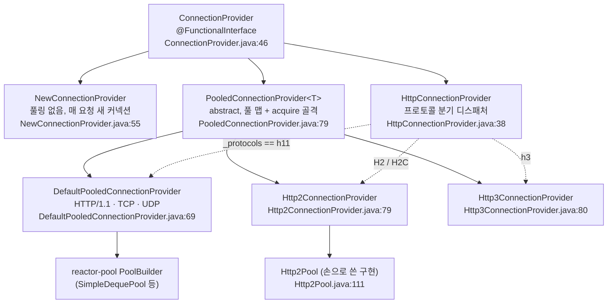
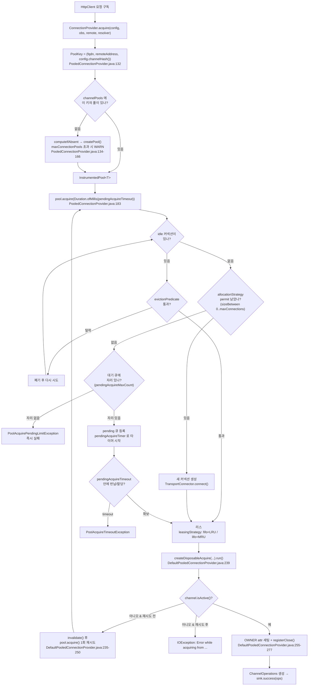

# reactor-netty 커넥션 풀

`WebClient` 뒤에서 TCP 커넥션을 관리하는 `ConnectionProvider`의 모든 옵션과 v1.2.18 실제 기본값, 프로토콜에 따라 갈라지는 provider 계층, HTTP/2가 별도 풀을 쓰는 이유, 그리고 풀 포화 시 터지는 두 예외의 구분을 소스로 정리한다.

## 목차
- [1. 핵심 개념 (What)](#1-핵심-개념-what)
- [2. 왜 알아야 하는가 (Why)](#2-왜-알아야-하는가-why)
- [3. 내부 구현 분석 (How)](#3-내부-구현-분석-how)
- [4. 실전 예제](#4-실전-예제)
- [5. 정리](#5-정리)

---

## 1. 핵심 개념 (What)

`ConnectionProvider`는 `@FunctionalInterface`이고 추상 메서드는 `acquire()` 하나다(`reactor-netty-core/src/main/java/reactor/netty/resources/ConnectionProvider.java:47-48`, `:197-200`). 커넥션을 "빌려주는" 책임만 가진다.

가장 먼저 이해해야 할 단위는 **"풀 하나 = 원격 호스트 하나"** 다. `maxConnections`는 provider 전체 상한이 아니라 **풀 하나당** 상한이다(`ConnectionProvider.java:385-390` 클래스 javadoc). 서로 다른 세 API를 호출하면 풀이 세 개 생기고, `maxConnections=100`이면 최대 300개 소켓이 열릴 수 있다.

풀을 구분하는 키는 원격 주소만이 아니다. `PoolKey`는 세 필드로 구성된다(`reactor-netty-core/src/main/java/reactor/netty/resources/PooledConnectionProvider.java:748-765`).

```java
// PooledConnectionProvider.java:748-765 (발췌)
static final class PoolKey {
    final String fqdn;         // 해석된 InetSocketAddress 의 hostString (IP보다 FQDN 우선)
    final SocketAddress holder;
    final int pipelineKey;     // config.channelHash() — 파이프라인 구성 해시
```

`pipelineKey = config.channelHash()`가 들어 있다는 점이 중요하다. 같은 호스트라도 **파이프라인 구성(SSL, 압축, 핸들러 등)이 다르면 다른 풀**이 된다. `mutate()`로 설정만 바꾼 `WebClient`가 풀을 공유하지 못하는 경우가 여기서 나온다.

---

## 2. 왜 알아야 하는가 (Why)

`ConnectionProvider` 기본값은 "애플리케이션이 자기 상황을 모를 때 그럭저럭 돌아가는" 값으로 잡혀 있고, 운영에서는 거의 항상 바꿔야 한다.

가장 큰 함정은 **`maxIdleTime`과 `maxLifeTime`이 기본적으로 꺼져 있다**는 점이다(둘 다 `-1`). 즉 **커넥션을 무제한으로 오래 붙잡는다.** 업스트림(또는 중간 LB/프록시)이 자기 idle timeout으로 조용히 끊어버리면, 풀에는 이미 죽은 소켓이 남아 있고 그걸 꺼내 쓰는 순간 `PrematureCloseException` 또는 connection reset이 난다. 이게 "간헐적으로 커넥션 에러가 뜬다"의 압도적 1순위 원인이다. 자세한 분기는 [커넥션 재사용 함정](08-connection-reuse-pitfalls.md)에서 다룬다.

두 번째 함정은 **기본으로 쓰이는 공유 풀의 값이 `DEFAULT_POOL_*` 상수와 다르다**는 점이다. 문서나 블로그에서 "기본 maxConnections는 CPU×2"라고 읽고 그 숫자로 용량 계산을 하면 틀린다. `HttpClient.create()`가 쓰는 전역 공유 풀은 `maxConnections=500`이다(아래 3.2에서 소스로 확인).

세 번째는 **풀 포화 시 터지는 두 예외를 구분하지 못하면 오진한다**는 점이다. `PoolAcquireTimeoutException`은 "대기했지만 못 받았다"(용량 부족 또는 업스트림 느림)이고, `PoolAcquirePendingLimitException`은 "대기 큐 자체가 꽉 찼다"(폭주 또는 `pendingAcquireMaxCount`가 너무 작음)다. 대응이 전혀 다르다.

---

## 3. 내부 구현 분석 (How)

### 3.1 전체 옵션과 v1.2.18 실제 기본값

모든 값은 `reactor-netty-core/src/main/java/reactor/netty/resources/ConnectionProvider.java`에서 직접 읽은 것이다.

| 옵션 | 기본값 | 시스템 프로퍼티 | 소스 |
| --- | --- | --- | --- |
| `maxConnections` | `Math.max(availableProcessors, 8) * 2` → **최소 16** | `reactor.netty.pool.maxConnections` | `ConnectionProvider.java:54-56`, `ReactorNetty.java:132` |
| `pendingAcquireMaxCount` | **미지정(`-2`)** → 런타임에 `2 * maxConnections` | — | `ConnectionProvider.java:530`, `:535`, `PooledConnectionProvider.java:514-515` |
| `pendingAcquireTimeout` | **45,000ms (45초)** | `reactor.netty.pool.acquireTimeout` | `ConnectionProvider.java:63-65`, `ReactorNetty.java:138` |
| `maxIdleTime` | **없음(비활성)** — 필드가 `null` | `reactor.netty.pool.maxIdleTime` (기본 `-1`) | `ConnectionProvider.java:70-72`, `:536`, `:549-551` |
| `maxLifeTime` | **없음(비활성)** — 필드가 `null` | `reactor.netty.pool.maxLifeTime` (기본 `-1`) | `ConnectionProvider.java:77-79`, `:537`, `:552-554` |
| `leasingStrategy` | **`"fifo"`** (= LRU) | `reactor.netty.pool.leasingStrategy` | `ConnectionProvider.java:98-99`, `:84`, `:89`, `ReactorNetty.java:161` |
| `evictInBackground` | **`Duration.ZERO`** (비활성) | — | `ConnectionProvider.java:529`, `:532` |
| `disposeInactivePoolsInBackground` | **`Duration.ZERO`** (비활성) | — | `ConnectionProvider.java:396`, `:400` |
| `disposeTimeout` | **`null`** (graceful shutdown 없음) | — | `ConnectionProvider.java:402` |
| `metrics` | **`false`** | — | `ConnectionProvider.java:538` |
| `maxConnectionPools` | **`-1`** (검사 비활성, 1.2.2+) | — | `ConnectionProvider.java:397`, `:403`, `:504` |
| `pendingAcquireTimer` | `null` → javadoc상 `Schedulers.parallel()` | — | `ConnectionProvider.java:541`, `:799` |
| `allocationStrategy` | `null` → `sizeBetween(0, maxConnections)` | — | `ConnectionProvider.java:543`, `PooledConnectionProvider.java:612-614` |
| `evictionPredicate` | `null` → `!isActive() \|\| !isPersistent()` + idle/life 검사 | — | `ConnectionProvider.java:544`, `PooledConnectionProvider.java:593-601` |
| (샘플링) `getPermitsSamplingRate` | `0` (비활성) | `reactor.netty.pool.getPermitsSamplingRate` | `PooledConnectionProvider.java:455-458`, `ReactorNetty.java:169` |
| (샘플링) `returnPermitsSamplingRate` | `0` (비활성) | `reactor.netty.pool.returnPermitsSamplingRate` | `PooledConnectionProvider.java:471-474`, `ReactorNetty.java:177` |

**`maxConnections` 계산식 주의.** 소스는 `Math.max(Runtime.getRuntime().availableProcessors(), 8) * 2`다. javadoc은 "2 * available number of processors (but with a minimum value of 16)"라고 적혀 있다(`ConnectionProvider.java:50-52`). CPU 4코어면 `max(4,8)*2 = 16`, 16코어면 32다. 컨테이너에서는 `availableProcessors()`가 cgroup 제한을 반영하므로 CPU limit에 따라 달라진다.

**`maxIdleTime`/`maxLifeTime`의 "기본값 없음"이 어떻게 구현되는가.** `ConnectionPoolSpec` 필드는 `Duration` 참조라 초기값이 `null`이고(`ConnectionProvider.java:536-537`), 생성자가 시스템 프로퍼티가 `-1`보다 클 때만 값을 세팅한다.

```java
// ConnectionProvider.java:548-555
private ConnectionPoolSpec() {
    if (DEFAULT_POOL_MAX_IDLE_TIME > -1) {
        maxIdleTime(Duration.ofMillis(DEFAULT_POOL_MAX_IDLE_TIME));
    }
    if (DEFAULT_POOL_MAX_LIFE_TIME > -1) {
        maxLifeTime(Duration.ofMillis(DEFAULT_POOL_MAX_LIFE_TIME));
    }
}
```

즉 `-Dreactor.netty.pool.maxIdleTime=20000`을 주면 **코드를 안 고치고도** 전역으로 켤 수 있다. 반대로 코드에서 `.maxIdleTime(...)`을 명시하면 시스템 프로퍼티는 덮어쓰인다.

**`pendingAcquireMaxCount` 미지정 시 해석 규칙.** 센티넬 값 `-2`가 "미지정"을 뜻하고(`ConnectionProvider.java:530`), 실제 해석은 `PoolFactory` 생성자에서 일어난다.

```java
// PooledConnectionProvider.java:514-515
this.pendingAcquireMaxCount = conf.pendingAcquireMaxCount == PENDING_ACQUIRE_MAX_COUNT_NOT_SPECIFIED ?
        2 * conf.maxConnections : conf.pendingAcquireMaxCount;
```

명시 값의 의미는 세 가지로 갈린다(`ConnectionProvider.java:606-615` javadoc + `:622-628` 검증).

| 값 | 동작 |
| --- | --- |
| `-1` | 대기 큐 무제한 |
| `0` | 대기 큐 사용 안 함 → idle 커넥션이 없으면 **즉시 실패(fail-fast)** |
| 양수 | 그 개수만큼 대기 허용 |
| 미지정 | `2 * maxConnections` |

`-1`과 `0` 외의 음수는 `IllegalArgumentException`이다(`ConnectionProvider.java:623-625`).

**`leasingStrategy` — fifo/lifo 이름이 직관과 반대다.** 메서드 이름과 javadoc이 분명하게 정의한다.

| 설정 | 의미 | 선택되는 커넥션 | 소스 |
| --- | --- | --- | --- |
| `fifo()` (기본) | **LRU** = Least Recently Used | idle 중 **가장 먼저 반납된** 것 | `ConnectionProvider.java:738-748` |
| `lifo()` | **MRU** = Most Recently Used | idle 중 **가장 나중에 반납된** 것 | `ConnectionProvider.java:724-734` |

구현은 reactor-pool 빌더 호출로 끝난다.

```java
// PooledConnectionProvider.java:628-633
if (LEASING_STRATEGY_FIFO.equals(leasingStrategy)) {
    poolBuilder = poolBuilder.idleResourceReuseLruOrder();
}
else {
    poolBuilder = poolBuilder.idleResourceReuseMruOrder();
}
```

실무적 의미: 기본 `fifo`(LRU)는 모든 커넥션을 골고루 돌려 쓴다. idle 상태가 길어지는 커넥션이 줄어드는 대신, **커넥션 수가 좀처럼 줄지 않는다.** `lifo`(MRU)는 소수의 뜨거운 커넥션만 재사용하므로 나머지가 idle 상태로 남고, `maxIdleTime`과 `evictInBackground`를 함께 쓰면 **트래픽이 줄 때 풀이 실제로 축소된다.**

**`evictInBackground`.** `Duration.ZERO`면 비활성이고(`ConnectionProvider.java:529`), 이때 eviction 검사는 **커넥션을 꺼내는 순간에만** 일어난다. 즉 트래픽이 없으면 죽은 커넥션이 그대로 남아 있다가 다음 요청이 그걸 집는다. 값을 주면 reactor-pool이 주기적으로 풀을 훑어 eviction 대상을 제거한다.

> v1.2.18에는 `evictInBackground(Duration)` **한 가지 오버로드만** 있다(`ConnectionProvider.java:762`). `Scheduler`를 함께 받는 오버로드는 1.3+에서 추가된 것이므로 여기서는 쓸 수 없다 — 즉 **v1.2.18에서는 이 점검이 도는 스케줄러를 고를 방법이 아예 없다.** 아래 `disposeInactivePoolsInBackground`가 쓰는 `Schedulers.parallel()`은 **커넥션 eviction이 아니라 풀 폐기용**이므로 혼동하지 않는다. 1.3 이후 차이는 [Boot 4 / Spring 7 마이그레이션](12-boot4-spring7-migration.md)을 참고한다.

**`disposeInactivePoolsInBackground(disposeInterval, poolInactivity)`.** 풀 **자체**를 지우는 기능이다. `evictInBackground`가 커넥션을 지우는 것과 구분된다. "비어 있음"의 정의가 javadoc에 명시돼 있다 — active 커넥션도, idle 커넥션도, 대기 중 acquire도 없는 상태(`ConnectionProvider.java:440-451`). 이 유지보수 작업만은 스케줄러가 소스에 박혀 있다.

```java
// PooledConnectionProvider.java:409-412
if (!inactivePoolDisposeInterval.isZero()) {
    Schedulers.parallel()
              .schedule(this::disposeInactivePoolsInBackground, inactivePoolDisposeInterval.toMillis(), TimeUnit.MILLISECONDS);
}
```

호스트가 동적으로 늘어나는 환경(서비스 디스커버리, 멀티테넌트 아웃바운드)에서 풀 맵이 무한히 자라는 것을 막는 용도다. 같은 맥락의 진단 장치로 1.2.2에서 `maxConnectionPools`가 추가됐다. 초과하면 **예외가 아니라 WARN 로그**다(`PooledConnectionProvider.java:139-144`).

**`disposeTimeout`.** 기본 `null`이면 `dispose()`가 즉시 전체 종료다. 값을 주면 graceful shutdown으로 전환되고, 새 acquire는 즉시 실패하지만 **이미 대기 중인 acquire는 그 시간 동안 기회를 얻는다**(`ConnectionProvider.java:459-470` javadoc). 구현은 reactor-pool 데코레이터다 — `InstrumentedPoolDecorators::gracefulShutdown`(`PooledConnectionProvider.java:530-571`), 종료 시 `disposeGracefully(disposeTimeout)`(`PooledConnectionProvider.java:214`). 롤링 배포 중 in-flight 요청을 보존하려면 필요하다.

### 3.2 `ConnectionProvider.create(name)`은 기본값과 다르다

여기가 가장 많이 오해받는 부분이다. 정적 팩토리 세 개가 **각자 다른 값**을 쓴다.

```java
// ConnectionProvider.java:137-142
static ConnectionProvider create(String name) {
    return builder(name).maxConnections(DEFAULT_POOL_MAX_CONNECTIONS)
                        .pendingAcquireMaxCount(500)        // ← 명시! 2*maxConnections 아님
                        .pendingAcquireTimeout(Duration.ofMillis(DEFAULT_POOL_ACQUIRE_TIMEOUT))
                        .build();
}

// ConnectionProvider.java:159-163
static ConnectionProvider create(String name, int maxConnections) {
    return builder(name).maxConnections(maxConnections)
                        .pendingAcquireTimeout(Duration.ofMillis(DEFAULT_POOL_ACQUIRE_TIMEOUT))
                        .build();                           // ← pendingAcquireMaxCount 미지정 → 2*maxConnections
}
```

| 생성 방법 | maxConnections | pendingAcquireMaxCount |
| --- | --- | --- |
| `ConnectionProvider.builder(name).build()` | `max(cpu,8)*2` | `2 * maxConnections` |
| `ConnectionProvider.create(name)` | `max(cpu,8)*2` | **`500` 고정** (`ConnectionProvider.java:139`) |
| `ConnectionProvider.create(name, N)` | `N` | `2 * N` |

**그리고 실제로 `WebClient`가 기본으로 쓰는 풀은 이 중 어느 것도 아니다.** `HttpClient.create()`는 전역 `HttpResources`를 쓰고, 그 provider는 `TcpResources.create()`에서 만들어진다.

```java
// reactor-netty-core/src/main/java/reactor/netty/tcp/TcpResources.java:410-411 (발췌)
loops = loops == null ? LoopResources.create("reactor-" + name) : loops;
provider = provider == null ? ConnectionProvider.create(name, 500) : provider;   // ← 500
```

`HttpResources.get()`은 이름을 `"http"`로 넘긴다(`reactor-netty-http/src/main/java/reactor/netty/http/HttpResources.java:119`). 따라서 **설정을 전혀 하지 않은 `WebClient`의 실제 풀은 이렇다.**

| 항목 | 값 |
| --- | --- |
| 풀 이름 | `"http"` |
| maxConnections | **500** (호스트당) |
| pendingAcquireMaxCount | **1000** (= 2 × 500) |
| pendingAcquireTimeout | 45초 |
| maxIdleTime / maxLifeTime | 없음 |
| leasingStrategy | fifo (LRU) |
| metrics | off |

Spring 쪽도 비슷하다. `ReactorResourceFactory`는 `useGlobalResources = true`가 기본이라 위 전역 풀을 그대로 쓰고(`spring-web/src/main/java/org/springframework/http/client/ReactorResourceFactory.java:56`), 전역 리소스를 끄면 `ConnectionProvider.create("webflux", 500)`을 만든다(`ReactorResourceFactory.java:61`). 어느 쪽이든 **500** 이다.

### 3.3 클래스 계층



`HttpConnectionProvider`는 풀을 가지지 않는 **디스패처**다. `acquire()`에서 `((HttpClientConfig) config)._protocols`를 `HttpClientConfig.h11` / `h3`와 비교해 갈라진다(`HttpConnectionProvider.java:41-66`, 분기 판정은 `:46-50`).

중요한 결과: **HTTP/1.1용 풀과 HTTP/2용 풀은 별개 객체**다. `H2`/`H2C`를 쓰면 커스텀 `ConnectionProvider`로 넘긴 설정이 HTTP/1.1 provider로 들어가고, HTTP/2 provider는 그것을 **기반으로 파생**된다(`HttpConnectionProvider.java:95-104`, `HTTP2_CONNECTION_PROVIDER_FACTORY = Http2ConnectionProvider::new`, `:122-123`). 그래서 `ConnectionProvider` 지표를 볼 때 HTTP/2 환경에서는 풀이 둘로 보일 수 있다.

`PooledConnectionProvider`는 풀 맵과 acquire 골격을 담당하고, 실제 풀 생성과 커넥션 래핑은 추상 메서드로 서브클래스에 맡긴다 — `createDisposableAcquire()`(`PooledConnectionProvider.java:298`), `createPool()`(`:317`).

### 3.4 reactor-pool 연동과 shading

`DefaultPooledConnectionProvider`는 풀을 직접 구현하지 않는다. 외부 아티팩트 **reactor-pool 1.1.9**(`gradle.properties`의 `reactorPoolVersion=1.1.9`)를 쓰고, 조립은 `PooledConnectionProvider.PoolFactory.newPoolInternal()` 한 메서드에 모여 있다(`PooledConnectionProvider.java:582-639`).

```java
// PooledConnectionProvider.java:587-601 (발췌)
PoolBuilder<T, PoolConfig<T>> poolBuilder =
        PoolBuilder.from(allocator)
                   .destroyHandler(destroyHandler)
                   .maxPendingAcquire(pendingAcquireMaxCount)
                   .evictInBackground(evictionInterval);

if (this.evictionPredicate != null) {
    poolBuilder = poolBuilder.evictionPredicate(
            (poolable, meta) -> this.evictionPredicate.test(poolable, new PooledConnectionMetadata(meta)));
}
else {
    poolBuilder = poolBuilder.evictionPredicate(defaultEvictionPredicate.or((poolable, meta) ->
            (maxIdleTime != -1 && meta.idleTime() >= maxIdleTime)
                    || (maxLifeTime != -1 && meta.lifeTime() >= maxLifeTime)));   // ← if/else
}
```

주목할 점: **커스텀 `evictionPredicate`를 주면 `maxIdleTime`/`maxLifeTime`이 적용되지 않는다.** `if/else`이기 때문이다. javadoc도 "Otherwise only the custom eviction predicate is invoked"로 명시한다(`ConnectionProvider.java:662-672`). 커스텀 조건을 쓸 거면 idle/life 검사를 직접 넣어야 한다.

기본 eviction predicate는 `DefaultPooledConnectionProvider`에 있다.

```java
// DefaultPooledConnectionProvider.java:612-613
static final BiPredicate<PooledConnection, PooledRefMetadata> DEFAULT_EVICTION_PREDICATE =
        (pooledConnection, metadata) -> !pooledConnection.channel.isActive() || !pooledConnection.isPersistent();
```

**shading.** reactor-netty는 reactor-pool을 자기 jar 안으로 relocate 한다.

```
// reactor-netty-core/build.gradle:214
relocationPrefix = "reactor.netty.internal.shaded"
```

결과적으로 런타임 패키지는 `reactor.netty.internal.shaded.reactor.pool.*` 가 된다. 이것이 소스를 읽을 때 혼란스러운 이유가 있다. **core 모듈 소스는 relocate 전 이름(`reactor.pool.PoolBuilder`)으로 import 하고**(`PooledConnectionProvider.java:35-44`), 빌드 시점에 relocate 된다. 반면 **http 모듈은 이미 shade 된 core에 의존하므로**(`reactor-netty-http/build.gradle:66`의 `configuration: 'shadow'`) 소스에서 **shade 된 이름을 직접 import 한다**(`Http2Pool.java:49-56`).

```java
// Http2Pool.java:49-56 (발췌)
import reactor.netty.internal.shaded.reactor.pool.InstrumentedPool;
import reactor.netty.internal.shaded.reactor.pool.PoolAcquirePendingLimitException;
import reactor.netty.internal.shaded.reactor.pool.PoolAcquireTimeoutException;
```

운영 중 스택트레이스는 **항상 relocate 된 이름**으로 보인다.

```
reactor.netty.internal.shaded.reactor.pool.PoolAcquireTimeoutException:
    Pool#acquire(Duration) has been pending for more than the configured timeout of 45000ms
    at reactor.netty.internal.shaded.reactor.pool.SimpleDequePool.lambda$...
```

실무에서 알아야 할 두 가지:
1. **`io.projectreactor.addons:reactor-pool`을 직접 의존성에 추가해도 reactor-netty는 그걸 쓰지 않는다.** 버전을 올려도 효과가 없다.
2. **예외를 `catch`할 때 import 패키지가 `reactor.netty.internal.shaded.reactor.pool`이어야 한다.** `reactor.pool.PoolAcquireTimeoutException`을 잡으면 런타임에 절대 매치되지 않는다.

### 3.5 HTTP/2는 왜 `PoolBuilder`를 안 쓰는가

`Http2ConnectionProvider`는 reactor-pool의 `PoolBuilder`로 풀을 만들지 않고, `poolConfig -> new Http2Pool(poolConfig, poolFactory.allocationStrategy(), ...)` 형태의 `poolConfigFunction`으로 손으로 쓴 `Http2Pool`을 끼워 넣는다(`Http2ConnectionProvider.java:630-645`, 생성은 `:633`·`:638`).

이유는 `Http2Pool` 클래스 javadoc에 그대로 적혀 있다(`Http2Pool.java:64-110`). 핵심은 **스트림 멀티플렉싱이 reactor-pool의 acquire/release/destroy 모델과 맞지 않는다**는 것이다.

일반 풀 모델은 "리소스 하나 = 사용자 하나"다. acquire 하면 그 리소스는 점유되고, release 하면 돌아온다. HTTP/2는 커넥션 하나에 수백 개 스트림이 **동시에** 붙는다. 그래서:

- **`release`라는 개념이 성립하지 않는다.** javadoc: *"This pool always invalidate the `PooledRef`, there is no release functionality"*(`Http2Pool.java:86`). release가 invalidate로 동작한다(`:101`).
- **점유/유휴 구분이 흐려진다.** `acquiredSize()`, `allocatedSize()`, `idleSize()`가 모두 **캐시된 커넥션 수**를 반환한다(`Http2Pool.java:88-89`). 활성 스트림은 별도로 `activeStreams()`로 본다(`:90`).
- **"쓸 수 있는데 안 쓴다"는 상태가 필요하다.** eviction 조건을 만족했거나 GO_AWAY를 받았지만 활성 스트림이 남아 있으면, 커넥션은 풀에 남은 채 **새 스트림에만 할당되지 않는다**. 스트림이 0이 되면 제거된다(`Http2Pool.java:76-84`).
- **적용되지 않는 설정이 생긴다.** javadoc이 나열한다 — `destroyHandler()`, `metricsRecorder()`(풀 계측 없음), `releaseHandler()`, `reuseIdleResourcesInLruOrder()`(항상 FIFO로 검사), 그리고 warm-up 미지원(`Http2Pool.java:97-105`).

`maxConnections` 하나로는 HTTP/2 용량을 표현할 수 없다. 그래서 **`Http2AllocationStrategy`** 가 따로 있다.

| 설정 | 기본값 | 소스 |
| --- | --- | --- |
| `maxConcurrentStreams` | **`-1`** (서버가 advertise 한 값을 그대로 사용) | `reactor-netty-http/src/main/java/reactor/netty/http/client/Http2AllocationStrategy.java:166` |
| `maxConnections` | **`Integer.MAX_VALUE`** | `Http2AllocationStrategy.java:167` |
| `minConnections` | **`0`** | `Http2AllocationStrategy.java:168` |

`maxConcurrentStreams`는 **상한만 낮추는 방향으로** 적용된다. 서버가 보낸 `SETTINGS_MAX_CONCURRENT_STREAMS`와 설정값 중 **작은 쪽**을 쓴다.

```java
// Http2Pool.java:1010-1012 (발췌)
this.maxConcurrentStreams = ((Http2FrameCodec) frameCodec.handler()).connection().local().maxActiveStreams();
this.maxConcurrentStreams = pool.maxConcurrentStreams == -1 ? maxConcurrentStreams :
        Math.min(pool.maxConcurrentStreams, maxConcurrentStreams);
```

즉 설정값을 서버 한도보다 크게 올려도 효과가 없다. 반대로 작게 주면 커넥션당 스트림을 제한해 **더 많은 커넥션으로 분산**시킬 수 있고, 이게 L4 로드밸런서 뒤의 백엔드로 트래픽을 고르게 퍼뜨리는 실무 수단이다.

`minConnections`는 "활성 스트림을 가진 캐시 커넥션을 최소 이 개수로 유지"다. 단 best effort이고, 기존 커넥션이 `maxConcurrentStreams`에 도달하면 `maxConnections`까지 새로 할당한다(`Http2Pool.java:93-95` javadoc).

### 3.6 풀 획득 흐름



`acquire()` 본문은 `PooledConnectionProvider.java:130-199`다. 눈여겨볼 두 가지가 있다.

**(1) 이벤트 루프 colocation.** acquire 시 `CONTEXT_CALLER_EVENTLOOP`를 Reactor Context에 심는다(`PooledConnectionProvider.java:168-185`). 호출자가 특정 이벤트 루프에서 돌고 있으면 **같은 루프에 붙은 커넥션을 우선 고른다.** 스레드 간 핸드오프를 줄이는 최적화다. 이 때문에 "풀에 커넥션이 남았는데도 새로 생성되는" 현상이 관찰될 수 있다. 관련 배경은 [스케줄러와 스레딩](../main/08-schedulers-and-threading.md)을 참고한다.

**(2) 죽은 커넥션에 대한 1회 재시도.** 리스는 받았지만 채널이 이미 죽은 경우를 `DisposableAcquire.run()`이 처리한다. `invalidate()` 후 **딱 한 번** 다시 acquire 하고, 두 번째도 실패하면 `IOException`을 낸다(`DefaultPooledConnectionProvider.java:233-253`). eviction 검사와 실제 사용 사이의 경합 구간을 메우는 장치다.

### 3.7 두 예외의 구분

둘 다 **외부 reactor-pool 아티팩트가 정의한 클래스**이고, 이 레포에는 정의가 없다 — `Http2Pool.java`에 throw 지점만 있다(HTTP/1.1 경로는 reactor-pool 내부에서 throw 한다).

| | `PoolAcquirePendingLimitException` | `PoolAcquireTimeoutException` |
| --- | --- | --- |
| **런타임 FQCN** | `reactor.netty.internal.shaded.reactor.pool.PoolAcquirePendingLimitException` | `reactor.netty.internal.shaded.reactor.pool.PoolAcquireTimeoutException` |
| **정의 위치** | 외부 reactor-pool 1.1.9 (shade 됨) | 외부 reactor-pool 1.1.9 (shade 됨) |
| **발생 시점** | **제안 시점** — 대기 큐에 넣으려 했으나 이미 포화 | **대기 후** — 큐에는 들어갔지만 시간 초과 |
| **지연** | 즉시(0ms) | `pendingAcquireTimeout`만큼 기다린 뒤 |
| **관련 설정** | `pendingAcquireMaxCount` | `pendingAcquireTimeout` |
| **throw 지점(HTTP/2)** | `Http2Pool.java:632-639` | `Http2Pool.java:814` |
| **의미** | 요청 폭주, 또는 큐가 너무 작음 | 업스트림이 느림, 또는 `maxConnections` 부족 |

`pendingAcquireMaxCount(0)`일 때는 메시지가 달라진다.

```java
// Http2Pool.java:632-639
static void pendingAcquireLimitReached(Borrower borrower, int maxPending) {
    if (maxPending == 0) {
        borrower.fail(new PoolAcquirePendingLimitException(0,
                "No pending allowed and pool has reached allocation limit"));
    }
    else {
        borrower.fail(new PoolAcquirePendingLimitException(maxPending));
    }
}
```

`PoolAcquireTimeoutException`은 `Borrower.run()`(타이머 콜백)에서 나온다. 타이머가 발화하면 pending 카운트를 정리하고 acquire를 취소한 뒤 에러를 낸다(`Http2Pool.java:807-816`).

**진단 요령**: `PoolAcquirePendingLimitException`이 뜨면 `pendingAcquireMaxCount`를 올리는 게 보통 답이 아니다. 큐를 늘리면 **대기 시간만 길어지고** 결국 `PoolAcquireTimeoutException`으로 바뀐다. 진짜 원인은 거의 항상 (a) `maxConnections` 부족, (b) 업스트림 지연, (c) 응답 바디 미소비로 인한 커넥션 폐기 중 하나다. (c)는 [커넥션 재사용 함정](08-connection-reuse-pitfalls.md)에서 다룬다.

---

## 4. 실전 예제

### 4.1 프로퍼티 바인딩

```java
package com.example.http;

import java.time.Duration;

import org.springframework.boot.context.properties.ConfigurationProperties;
import org.springframework.boot.context.properties.bind.DefaultValue;

@ConfigurationProperties(prefix = "app.http.pool")
public record HttpPoolProperties(
        @DefaultValue("upstream") String name,
        /** 호스트당 최대 커넥션. reactor-netty 전역 공유 풀은 500. */
        @DefaultValue("100") int maxConnections,
        /** 대기 큐 길이. -1=무제한, 0=fail-fast. 미지정 시 2*maxConnections. */
        @DefaultValue("200") int pendingAcquireMaxCount,
        /** reactor-netty 기본값 45s — 대부분의 서비스에 과도하게 길다. */
        @DefaultValue("5s") Duration pendingAcquireTimeout,
        /** 기본값 없음(무제한). 반드시 서버 keep-alive timeout 보다 짧게 잡는다. */
        @DefaultValue("20s") Duration maxIdleTime,
        /** 기본값 없음(무제한). LB 뒤 백엔드 재분산을 위해 상한을 둔다. */
        @DefaultValue("5m") Duration maxLifeTime,
        /** 기본값 Duration.ZERO(비활성). 트래픽 없는 구간의 죽은 커넥션을 정리한다. */
        @DefaultValue("30s") Duration evictInBackground,
        /** 기본값 null(즉시 종료). 롤링 배포 중 in-flight 요청을 보존한다. */
        @DefaultValue("10s") Duration disposeTimeout,
        /** 기본값 false. micrometer-core 가 classpath 에 있어야 한다. */
        @DefaultValue("true") boolean metricsEnabled
) {}
```

```yaml
app:
  http:
    pool:
      name: ${APP_HTTP_POOL_NAME:upstream}
      max-connections: ${APP_HTTP_POOL_MAX_CONNECTIONS:100}
      pending-acquire-max-count: ${APP_HTTP_POOL_PENDING_MAX:200}
      pending-acquire-timeout: ${APP_HTTP_POOL_PENDING_TIMEOUT:5s}
      # 서버 keep-alive 가 60s 면 여기는 20~30s
      max-idle-time: ${APP_HTTP_POOL_MAX_IDLE:20s}
      max-life-time: ${APP_HTTP_POOL_MAX_LIFE:5m}
      evict-in-background: ${APP_HTTP_POOL_EVICT_INTERVAL:30s}
      dispose-timeout: ${APP_HTTP_POOL_DISPOSE_TIMEOUT:10s}
      metrics-enabled: ${APP_HTTP_POOL_METRICS:true}
```

### 4.2 커스텀 `ConnectionProvider`를 `ReactorClientHttpConnector`로 주입

```java
package com.example.http;

import org.springframework.boot.web.reactive.function.client.WebClientCustomizer;
import org.springframework.context.annotation.Bean;
import org.springframework.context.annotation.Configuration;
import org.springframework.http.client.reactive.ReactorClientHttpConnector;
import reactor.netty.http.client.HttpClient;
import reactor.netty.resources.ConnectionProvider;

@Configuration(proxyBeanMethods = false)
class HttpPoolConfig {

    /**
     * destroyMethod="dispose" 로 컨텍스트 종료 시 풀이 정리되게 한다.
     * disposeTimeout 을 설정했으므로 graceful shutdown 이 적용된다
     * (PooledConnectionProvider.java:214 의 disposeGracefully).
     */
    @Bean(destroyMethod = "dispose")
    ConnectionProvider upstreamConnectionProvider(HttpPoolProperties props) {
        return ConnectionProvider.builder(props.name())
                .maxConnections(props.maxConnections())
                .pendingAcquireMaxCount(props.pendingAcquireMaxCount())
                .pendingAcquireTimeout(props.pendingAcquireTimeout())
                .maxIdleTime(props.maxIdleTime())
                .maxLifeTime(props.maxLifeTime())
                .evictInBackground(props.evictInBackground())
                .disposeTimeout(props.disposeTimeout())
                // lifo = MRU. 소수의 뜨거운 커넥션만 재사용하므로
                // maxIdleTime + evictInBackground 와 함께 쓰면 풀이 실제로 축소된다.
                .lifo()
                .metrics(props.metricsEnabled())
                .build();
    }

    @Bean
    ReactorClientHttpConnector reactorClientHttpConnector(ConnectionProvider provider) {
        HttpClient httpClient = HttpClient.create(provider);
        return new ReactorClientHttpConnector(httpClient);
    }

    @Bean
    WebClientCustomizer connectorCustomizer(ReactorClientHttpConnector connector) {
        return builder -> builder.clientConnector(connector);
    }
}
```

주의할 점이 둘 있다.

**`HttpClient.create(provider)`를 쓰면 전역 `HttpResources`의 풀을 우회한다.** 하지만 **이벤트 루프(`LoopResources`)는 여전히 전역 공유**다. 루프까지 분리하려면 `.runOn(LoopResources.create(...))`를 명시해야 한다.

**`destroyMethod = "dispose"`를 빼면 풀이 정리되지 않는다.** 테스트에서 컨텍스트를 반복 생성하면 커넥션이 누적된다.

### 4.3 호스트별로 다른 설정

여러 업스트림을 하나의 provider로 묶되 특정 호스트만 다르게 잡고 싶을 때 `forRemoteHost()`를 쓴다(`ConnectionProvider.java:485-493`).

```java
ConnectionProvider provider = ConnectionProvider.builder(defaults.name())
        .maxConnections(defaults.maxConnections())
        .pendingAcquireTimeout(defaults.pendingAcquireTimeout())
        .maxIdleTime(defaults.maxIdleTime())
        // 느리고 무거운 업스트림 하나만 별도 설정
        .forRemoteHost(heavyUpstream, spec -> spec
                .maxConnections(defaults.maxConnections() * 4)
                .pendingAcquireTimeout(Duration.ofSeconds(30))
                .maxIdleTime(Duration.ofSeconds(10)))
        // 동적 호스트가 많은 환경에서 풀 맵이 무한히 자라는 것을 막는다
        .disposeInactivePoolsInBackground(Duration.ofMinutes(1), Duration.ofMinutes(5))
        // 1.2.2+ — 초과 시 예외가 아니라 WARN 로그 (PooledConnectionProvider.java:139-144)
        .maxConnectionPools(64)
        .build();
```

### 4.4 풀 포화 예외를 구분해서 잡기

**import 패키지가 shade 된 이름이어야 한다.** `reactor.pool.*`을 잡으면 런타임에 절대 매치되지 않는다.

```java
package com.example.http;

import org.springframework.web.reactive.function.client.WebClient;
import reactor.core.publisher.Mono;
// 반드시 shade 된 패키지 (reactor-netty-core/build.gradle:214 의 relocationPrefix)
import reactor.netty.internal.shaded.reactor.pool.PoolAcquirePendingLimitException;
import reactor.netty.internal.shaded.reactor.pool.PoolAcquireTimeoutException;

public class UpstreamClient {

    private final WebClient webClient;

    UpstreamClient(WebClient webClient) {
        this.webClient = webClient;
    }

    public Mono<Quote> quote(String symbol) {
        return this.webClient.get()
                .uri("/quotes/{symbol}", symbol)
                .retrieve()
                .bodyToMono(Quote.class)
                // 대기 큐 자체가 포화 → 즉시 실패. 들어온 요청량이 용량을 넘었다.
                // 큐를 늘리는 게 아니라 상류에서 흘려보내거나(shed) 용량을 늘려야 한다.
                .onErrorMap(PoolAcquirePendingLimitException.class,
                        ex -> new UpstreamOverloadedException("pool pending queue is full", ex))
                // 큐에는 들어갔으나 시간 초과 → 업스트림이 느리거나 maxConnections 부족.
                .onErrorMap(PoolAcquireTimeoutException.class,
                        ex -> new UpstreamSlowException("could not acquire a connection in time", ex));
    }

    public static final class UpstreamOverloadedException extends RuntimeException {
        UpstreamOverloadedException(String m, Throwable c) { super(m, c); }
    }

    public static final class UpstreamSlowException extends RuntimeException {
        UpstreamSlowException(String m, Throwable c) { super(m, c); }
    }

    public record Quote(String symbol, String price) {}
}
```

### 4.5 HTTP/2 풀 설정

```java
@Bean(destroyMethod = "dispose")
ConnectionProvider http2ConnectionProvider(Http2PoolProperties props) {
    Http2AllocationStrategy strategy = Http2AllocationStrategy.builder()
            // 기본값 -1 = 서버가 advertise 한 값을 그대로 사용 (Http2AllocationStrategy.java:166).
            // 낮춰 잡으면 커넥션 수가 늘어 L4 LB 뒤 백엔드로 고르게 분산된다.
            // 서버 한도보다 크게 줘도 min() 이 적용되어 효과가 없다 (Http2Pool.java:1010-1012).
            .maxConcurrentStreams(props.maxConcurrentStreams())
            // 기본값 Integer.MAX_VALUE (Http2AllocationStrategy.java:167)
            .maxConnections(props.maxConnections())
            // 기본값 0 (Http2AllocationStrategy.java:168). best effort 로 유지된다.
            .minConnections(props.minConnections())
            .build();

    return ConnectionProvider.builder(props.name())
            .allocationStrategy(strategy)
            .pendingAcquireTimeout(props.pendingAcquireTimeout())
            .maxIdleTime(props.maxIdleTime())
            .metrics(true)
            .build();
}

@Bean
ReactorClientHttpConnector http2Connector(ConnectionProvider provider) {
    HttpClient httpClient = HttpClient.create(provider)
            .protocol(HttpProtocol.H2, HttpProtocol.HTTP11)  // ALPN 협상
            .secure();
    return new ReactorClientHttpConnector(httpClient);
}
```

`allocationStrategy()`를 주면 `maxConnections()`가 무효가 된다는 점에 주의한다. `maxConnections(int)`는 호출 시 `allocationStrategy = null`로 리셋하고(`ConnectionProvider.java:597-604`), 반대로 `allocationStrategy()`는 "마지막으로 설정된 전략을 대체"한다(`ConnectionProvider.java:805-813` javadoc). **둘 중 나중에 호출한 쪽이 이긴다.**

HTTP/2에서는 `Http2Pool`이 풀 계측을 지원하지 않으므로(`Http2Pool.java:100`), 커넥션 수보다 **활성 스트림 수**를 봐야 한다.

### 4.6 시스템 프로퍼티로 전역 조정

코드를 못 고치는 상황(서드파티 라이브러리가 만든 `WebClient` 등)에서는 JVM 옵션이 유일한 수단이다.

```bash
# 전역 공유 풀(name="http", maxConnections=500)에도 적용된다.
# 커넥션 에러가 반복될 때 가장 먼저 켜야 할 것은 maxIdleTime 이다.
-Dreactor.netty.pool.maxIdleTime=20000       \
-Dreactor.netty.pool.maxLifeTime=300000      \
-Dreactor.netty.pool.acquireTimeout=5000     \
-Dreactor.netty.pool.leasingStrategy=lifo
```

이 값들은 **클래스 로딩 시점에 한 번 읽힌다**(`ConnectionProvider.java:54-99`의 `static` 필드 초기화). 런타임에 `System.setProperty()`로 바꿔도 반영되지 않는다. `maxConnections`는 전역 공유 풀에 영향을 주지 않는다는 점도 기억해야 한다 — `TcpResources.create()`가 `500`을 명시로 넘기기 때문이다(`TcpResources.java:411`).

---

## 5. 정리

- **풀 하나 = 원격 호스트 하나**다. `maxConnections`는 provider 전체가 아니라 풀 하나당 상한이다. 풀 키는 `(fqdn, remoteAddress, config.channelHash())`라서 **파이프라인 구성이 다르면 같은 호스트라도 다른 풀**이 된다(`PooledConnectionProvider.java:748-765`).
- **v1.2.18 빌더 기본값**: `maxConnections = max(cpu,8)*2`(최소 16), `pendingAcquireTimeout = 45초`, `pendingAcquireMaxCount = 2*maxConnections`, `maxIdleTime`/`maxLifeTime` **없음**, `leasingStrategy = fifo(LRU)`, `evictInBackground`/`disposeInactivePoolsInBackground` **비활성(`Duration.ZERO`)**, `disposeTimeout = null`, `metrics = false`, `maxConnectionPools = -1`.
- **하지만 `WebClient` 기본 풀은 이 값이 아니다.** `HttpClient.create()`가 쓰는 전역 공유 풀은 `ConnectionProvider.create("http", 500)` — **maxConnections 500, pendingAcquireMaxCount 1000** 이다(`TcpResources.java:411`, `HttpResources.java:119`). Spring의 `ReactorResourceFactory`도 전역 리소스를 끄면 `create("webflux", 500)`이다(`ReactorResourceFactory.java:61`).
- **`create(name)`은 `pendingAcquireMaxCount(500)`을 명시로 넣는다**(`ConnectionProvider.java:139`). `create(name, N)`은 미지정이라 `2*N`이 된다. 셋이 다 다르다.
- **`maxIdleTime`/`maxLifeTime`이 꺼져 있는 것이 가장 위험한 기본값**이다. 시스템 프로퍼티 `reactor.netty.pool.maxIdleTime`으로 코드 수정 없이 켤 수 있다(`ConnectionProvider.java:548-555`).
- **`fifo()` = LRU, `lifo()` = MRU.** 이름과 의미가 어긋나 보이므로 javadoc(`ConnectionProvider.java:724-748`) 기준으로 기억한다. 풀 축소가 목적이면 `lifo()` + `maxIdleTime` + `evictInBackground` 조합이다.
- **커스텀 `evictionPredicate`를 주면 `maxIdleTime`/`maxLifeTime`이 무시된다**(`PooledConnectionProvider.java:593-601`의 `if/else`). 둘을 같이 쓰려면 직접 조건에 넣어야 한다.
- **클래스 계층**: `ConnectionProvider` → `NewConnectionProvider`(풀링 없음) / `PooledConnectionProvider`(추상) → `DefaultPooledConnectionProvider`(HTTP/1.1·TCP) · `Http2ConnectionProvider` · `Http3ConnectionProvider`. `HttpConnectionProvider`는 풀 없는 **디스패처**로 `_protocols`를 보고 갈라진다(`HttpConnectionProvider.java:46-66`). HTTP/2 환경에서는 풀이 둘로 보인다.
- **reactor-pool 1.1.9가 shade 되어 있다.** relocate 접두사는 `reactor.netty.internal.shaded`(`reactor-netty-core/build.gradle:214`). core 소스는 unshaded 이름으로 import 하고 빌드 시 relocate 되지만, http 모듈은 shade 된 core에 의존해 **소스에서 shade 된 이름을 직접 import** 한다(`Http2Pool.java:49-56`). 스택트레이스와 `catch` 문 모두 shade 된 FQCN을 쓴다.
- **HTTP/2는 손으로 쓴 `Http2Pool`을 쓴다.** 스트림 멀티플렉싱이 acquire/release/destroy 모델에 맞지 않아서다 — release가 invalidate로 동작하고(`Http2Pool.java:86`), `acquiredSize()`/`idleSize()`가 전부 캐시 커넥션 수를 반환하며(`:88-89`), 풀 계측·`destroyHandler`·LRU 순서·warm-up이 적용되지 않는다(`:97-105`).
- **`Http2AllocationStrategy` 기본값**: `maxConcurrentStreams = -1`(서버 advertise 값 그대로), `maxConnections = Integer.MAX_VALUE`, `minConnections = 0`(`Http2AllocationStrategy.java:166-168`). `maxConcurrentStreams`는 서버 한도와 `min()`으로 합쳐져 **낮추는 방향으로만** 작동한다(`Http2Pool.java:1010-1012`).
- **`PoolAcquirePendingLimitException`은 제안 시점 즉시 실패**(대기 큐 포화), **`PoolAcquireTimeoutException`은 큐에 들어간 뒤 타임아웃**이다. 둘 다 외부 reactor-pool이 정의하고 이 레포에는 throw 지점만 있다(`Http2Pool.java:632-639`, `:814`). 전자가 뜰 때 큐를 늘리는 것은 대개 오답이다.
- **`maxConnections()`와 `allocationStrategy()`는 서로를 덮어쓴다.** 나중에 호출한 쪽이 이긴다(`ConnectionProvider.java:597-604`, `:805-813`).

---

## 관련 문서
- 선행: [코덱·바디 변환과 DataBuffer 누수](05-codecs-and-databuffer.md)
- 후행: [타임아웃 전략](07-timeout-strategy.md)
- 참고: [WebClient Builder 구조와 커넥터 선택](01-webclient-builder-connectors.md), [커넥션 재사용 함정](08-connection-reuse-pitfalls.md), [관측성](10-observability.md), [스케줄러와 스레딩](../main/08-schedulers-and-threading.md), [Boot 4 / Spring 7 마이그레이션](12-boot4-spring7-migration.md)

---
*참고: reactor-netty 1.2.18 / Spring Framework 6.2.19 (Spring Boot 3.x) 기준*
