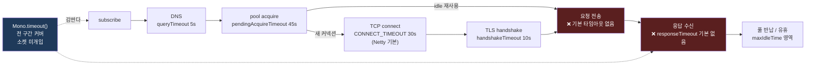

# 타임아웃 전략

`WebClient` 요청 하나에 걸릴 수 있는 모든 타임아웃을 계층별로 정리하고, 각각의 API·기본값·발생 예외를 소스에서 확인한다. 결론은 하나다 — **기본 설정만으로는 요청이 영원히 매달릴 수 있다.**

## 목차
- [1. 핵심 개념 (What)](#1-핵심-개념-what)
- [2. 왜 알아야 하는가 (Why)](#2-왜-알아야-하는가-why)
- [3. 내부 구현 분석 (How)](#3-내부-구현-분석-how)
- [4. 실전 예제](#4-실전-예제)
- [5. 정리](#5-정리)

---

## 1. 핵심 개념 (What)

"요청 타임아웃" 하나로 생각하면 반드시 구멍이 생긴다. `WebClient` 요청 하나의 수명주기는 최소 6개 구간으로 쪼개지고, **각 구간을 지키는 타임아웃이 서로 다른 레이어에 있다.**

```
┌─ Reactor 레벨 (소켓을 모름) ──────────────────────────────────────────┐
│  Mono.timeout(Duration)                      — 전체 구간, 소켓 미개입 │
└───────────────────────────────────────────────────────────────────────┘
┌─ reactor-netty 풀 레벨 ───────────────────────────────────────────────┐
│  ConnectionProvider.pendingAcquireTimeout     — 커넥션 대기 구간       │
└───────────────────────────────────────────────────────────────────────┘
┌─ Netty 채널 레벨 ─────────────────────────────────────────────────────┐
│  ChannelOption.CONNECT_TIMEOUT_MILLIS         — TCP 핸드셰이크         │
│  SslProvider.handshakeTimeout                 — TLS 핸드셰이크         │
│  HttpClient.responseTimeout → ReadTimeoutHandler — 응답 read 간격      │
│  수동 ReadTimeoutHandler / WriteTimeoutHandler — 커넥션 전 수명        │
└───────────────────────────────────────────────────────────────────────┘
┌─ 그 외 (기본으로 걸려 있음) ──────────────────────────────────────────┐
│  NameResolverProvider.queryTimeout            — DNS 질의 (기본 5초)    │
└───────────────────────────────────────────────────────────────────────┘
```

가장 중요한 구분은 **"소켓을 닫는 타임아웃"과 "구독을 끊는 타임아웃"** 이다. Netty 레벨 타임아웃은 채널을 닫아 리소스를 회수한다. `Mono.timeout()`은 구독만 취소한다 — 이 차이가 운영에서 매우 크다(3.6 참고).

---

## 2. 왜 알아야 하는가 (Why)

reactor-netty의 기본값 설계 철학은 "애플리케이션이 명시하지 않은 정책을 추측하지 않는다"다. 그 결과 **응답 타임아웃이 기본으로 없다.**

구체적으로, 설정을 전혀 하지 않은 `WebClient`로 요청을 보냈을 때:

- TCP 연결은 Netty 기본값 30초 안에 성공하거나 실패한다 (reactor-netty가 아니라 Netty가 주는 값).
- TLS 핸드셰이크는 10초 안에 끝나거나 실패한다 (reactor-netty가 명시한 값).
- 커넥션 풀 대기는 45초 안에 해결되거나 실패한다.
- **그다음부터는 상한이 없다.** 요청을 보내고 서버가 TCP 레벨에서 살아 있는 척하면서 응답 바이트를 영원히 안 보내면, 그 `Mono`는 **영원히 완료되지 않는다.**

이게 장애 전파의 전형적인 경로다. 업스트림이 죽지 않고 "느려지기만" 하면 — GC 폭주, 스레드 풀 고갈, DB 락 — 호출자의 커넥션 풀이 차고, `pendingAcquireTimeout` 45초가 줄줄이 터지고, 그 45초 동안 호출자 쪽 요청들도 묶여서 결국 호출자까지 죽는다. 서킷 브레이커를 달아도 **타임아웃이 없으면 실패를 감지하지 못하므로** 브레이커가 열리지 않는다. 이 조합은 [Resilience 통합](09-resilience-integration.md)에서 다룬다.

---

## 3. 내부 구현 분석 (How)

### 3.1 전체 요약표

| # | 계층 | 타임아웃 | API | v1.2.18 기본값 | 발생 예외 |
| --- | --- | --- | --- | --- | --- |
| 0 | DNS | 질의 타임아웃 | `HttpClient.resolver(spec -> spec.queryTimeout(...))` | **5초** (`NameResolverProvider.java:686`) | `UnknownHostException` (원인에 `DnsNameResolverTimeoutException`) |
| 1 | 풀 | 커넥션 대기 | `ConnectionProvider.Builder#pendingAcquireTimeout` | **45초** (`ConnectionProvider.java:63-65`) | `PoolAcquireTimeoutException` (shade 됨) |
| 2 | TCP | 연결 수립 | `HttpClient.option(ChannelOption.CONNECT_TIMEOUT_MILLIS, ms)` | **reactor-netty는 설정하지 않음** → Netty `DefaultChannelConfig` 기본 **30,000ms** | `io.netty.channel.ConnectTimeoutException` |
| 3 | TLS | 핸드셰이크 | `HttpClient.secure(spec -> spec.handshakeTimeout(...))` | **10,000ms** (`SslProvider.java:523-526`) | `SslHandshakeTimeoutException` (← `SSLHandshakeException` ← `SSLException`) |
| 4 | HTTP | 응답 read 간격 | `HttpClient.responseTimeout(Duration)` / 요청별 `HttpClientRequest#responseTimeout` | **없음** (`HttpClientConfig.responseTimeout` = `null`) | `io.netty.handler.timeout.ReadTimeoutException` |
| 5 | 채널 | 전 수명 read/write | `doOnConnected(c -> c.addHandlerLast(new ReadTimeoutHandler(...)))` | 없음 (수동) | `ReadTimeoutException` / `WriteTimeoutException` |
| 6 | Reactor | 전체 구간 | `Mono.timeout(Duration)` | 없음 (수동) | `java.util.concurrent.TimeoutException` |
| (참고) | TLS | close_notify flush | `HttpClient.secure(spec -> spec.closeNotifyFlushTimeout(...))` | **3,000ms** (`SslProvider.java:532`) | — |
| (참고) | TLS | close_notify read | `...closeNotifyReadTimeout(...)` | **0ms** (대기 안 함, `SslProvider.java:532-533`) | — |

### 3.2 (2) connect — reactor-netty는 기본값을 설정하지 않는다

reactor-netty 소스 전체에서 `CONNECT_TIMEOUT_MILLIS`를 **단 한 번도 설정하지 않는다.** `reactor-netty-core/src`와 `reactor-netty-http/src` 어디에도 참조가 없다. 채널 옵션 적용은 사용자가 준 맵을 그대로 복사하는 것뿐이다.

`TransportConnector.setChannelOptions()`는 사용자가 준 `Map<ChannelOption<?>, ?>`를 순회하며 `channel.config().setOption(...)`을 호출하는 것뿐이다(`reactor-netty-core/src/main/java/reactor/netty/transport/TransportConnector.java:203-220`). 기본값을 끼워 넣는 코드가 없다.

따라서 적용되는 값은 **Netty의 채널 기본값**이다. `DefaultChannelConfig` 생성자가 `connectTimeoutMillis = 30000`으로 초기화한다(바이트코드 확인: `netty-transport` `DefaultChannelConfig.<init>`에서 `sipush 30000` → `putfield connectTimeoutMillis`). reactor-netty 1.2.18이 번들하는 Netty는 **4.1.135.Final**이다(`build.gradle:112`).

**이 타임아웃은 "주소 하나당"이다.** `TransportConnector`는 DNS가 여러 A/AAAA 레코드를 돌려주면 하나씩 순차 시도한다.

```java
// TransportConnector.java:256-264 (발췌) — 실패 시 다음 주소로 넘길지 결정
int next = index + 1;
if (next < addresses.size()) {
    connectPromise.setFailure(new RetryConnectException(addresses));
}
else {
    connectPromise.setFailure(cause);
}

// TransportConnector.java:177-180 (발췌) — 주소 개수 - 1 만큼 재시도
.retryWhen(Retry.max(t.addresses.size() - 1)
                .filter(RETRY_PREDICATE)
                .doBeforeRetry(sig -> index.incrementAndGet()));
```

즉 호스트가 4개 IP로 해석되고 전부 응답 없는 상태라면, **최악의 연결 실패 대기 시간은 4 × 30초 = 120초**다. `CONNECT_TIMEOUT_MILLIS`를 잡을 때 이 곱셈을 고려해야 한다. 이 구간을 확실히 묶으려면 상위에 `Mono.timeout()`이 필요하다.

### 3.3 (4) `responseTimeout` — 요청 전송 후 핸들러를 붙이고, 응답 완료 시 떼낸다

이게 가장 중요한 타임아웃이고 **기본값이 없다.** `HttpClientConfig.responseTimeout` 필드는 초기화되지 않은 `Duration`이라 `null`이다(`reactor-netty-http/src/main/java/reactor/netty/http/client/HttpClientConfig.java:373`).

javadoc이 의미를 정확히 정의한다 — "응답을 읽는 동안 **각 네트워크 레벨 read 사이의 최대 간격**"이다(`HttpClient.java:1433-1449`). **응답 전체의 상한이 아니다.** 1초마다 1바이트씩 보내는 서버에 `responseTimeout(5s)`를 걸어도 영원히 안 끊긴다.

구현은 `HttpClientOperations.onOutboundComplete()`에 있다. 요청 바디 전송이 끝난 직후 `ReadTimeoutHandler`를 파이프라인에 **삽입**한다.

```java
// HttpClientOperations.java:738-769 (발췌)
listener().onStateChange(this, HttpClientState.REQUEST_SENT);
ChannelPipeline pipeline = channel().pipeline();
if (responseTimeout != null && pipeline.get(NettyPipeline.ResponseTimeoutHandler) == null) {
    // This handler has to be always as early as possible in order to handle correctly
    // the time for receiving the read/readComplete events.
    String baseName = null;
    if (pipeline.get(NettyPipeline.HttpCodec) != null) {
        baseName = NettyPipeline.HttpCodec;
    }
    else if (pipeline.get(NettyPipeline.H2ToHttp11Codec) != null) {
        baseName = NettyPipeline.H2ToHttp11Codec;
    }
    else if (pipeline.get(NettyPipeline.H3ToHttp11Codec) != null) {
        baseName = NettyPipeline.H3ToHttp11Codec;
    }
    else { /* HttpClientCodec 이름 탐색 */ }

    pipeline.addBefore(baseName, NettyPipeline.ResponseTimeoutHandler,
            new ReadTimeoutHandler(responseTimeout.toMillis(), TimeUnit.MILLISECONDS));
    ...
    if (isPersistent()) {
        onTerminate().subscribe(null, null, () -> removeHandler(NettyPipeline.ResponseTimeoutHandler));
    }
}
```

소스에서 읽어야 할 네 가지:

**(a) 요청이 전송된 **후에** 붙는다.** `REQUEST_SENT` 상태 전이 직후다. 즉 **요청 바디를 보내는 동안은 이 타임아웃이 보호하지 않는다.** 큰 바디를 업로드하는데 서버가 읽기를 멈추면 `responseTimeout`은 무력하다 — 그건 `WriteTimeoutHandler`의 영역이다(3.4).

**(b) 코덱 **앞**에 삽입된다.** 주석이 이유를 설명한다 — read/readComplete 이벤트 전달이 다른 핸들러 때문에 지연되면 간격 측정이 부정확해진다. 이 위치 때문에 `addHandlerFirst`로 직접 넣은 핸들러와는 순서가 다르다.

**(c) 응답 완료 시 제거된다.** `onTerminate()` 완료 콜백에서 `removeHandler`를 부른다. **단 `isPersistent()`일 때만** 제거한다. 비영속 커넥션은 어차피 닫히므로 정리할 필요가 없다.

**(d) `pipeline.get(...) == null` 가드.** 이미 붙어 있으면 다시 붙이지 않는다. 핸들러 이름은 `NettyPipeline.ResponseTimeoutHandler = "reactor.left.responseTimeoutHandler"`다(`reactor-netty-core/src/main/java/reactor/netty/NettyPipeline.java:128`).

**HTTP/2 스트림 경로는 별도 구현이다.** 스트림 채널마다 `addStreamHandlers()`가 `responseTimeoutMillis > -1`일 때 `ch.pipeline().addLast(NettyPipeline.ResponseTimeoutHandler, new ReadTimeoutHandler(...))`로 붙이고, `conn.isPersistent()`면 `onTerminate()`에서 제거한다(`HttpClientConfig.java:620-629`). HTTP/1.1 경로가 `addBefore(baseName, ...)`인 것과 달리 여기는 `addLast`다 — HTTP/2 스트림 채널은 시작 시점에 파이프라인이 비어 있어서 `addLast`가 곧 맨 앞이다.

**요청별 override.** `HttpClientRequest#responseTimeout(Duration)`으로 요청 하나만 다르게 잡을 수 있고, 클라이언트 레벨 설정을 이긴다(`HttpClient.java:1441-1442` javadoc). 단 **헤더 전송 전에만** 가능하다.

구현은 `hasSentHeaders()`가 참이면 `IllegalStateException("Status and headers already sent")`를 던지고, 거짓이면 필드에 값을 넣는 것뿐이다(`HttpClientOperations.java:429-438`).

전달 경로는 `HttpClientConnect.requestWithBody()`에서 설정값을 operations로 복사하는 한 줄이다(`HttpClientConnect.java:560`: `ch.responseTimeout = responseTimeout;`). 그 뒤 `doOnRequest`에서 덮어쓰면 요청별 값이 된다.

### 3.4 (5) `doOnConnected`로 수동 타임아웃 핸들러 추가

`responseTimeout`이 못 막는 두 구간이 있다.

1. **요청 바디 전송 중** — 서버가 읽기를 멈추고 TCP 윈도를 닫으면 write가 영원히 안 끝난다.
2. **커넥션이 풀에 유휴 상태로 있는 동안** — `responseTimeout` 핸들러는 요청 완료 시 제거되므로 보호 범위가 아니다.

이 구간은 `doOnConnected(Consumer<Connection>)`으로 직접 핸들러를 붙여 막는다(`reactor-netty-core/src/main/java/reactor/netty/transport/ClientTransport.java:163-169`).

`NettyPipeline`에는 `ReadTimeoutHandler` 상수만 있고(`NettyPipeline.java:127`) **`WriteTimeoutHandler` 상수는 없다.** 따라서 write 타임아웃은 이름을 직접 정해서 붙인다.

중요한 차이: `doOnConnected`로 붙인 핸들러는 **커넥션 수립 시 한 번 붙고 커넥션이 닫힐 때까지 남는다.** 즉 풀에 반납되어 유휴 상태일 때도 살아 있다. 그래서 값을 `responseTimeout`보다 **넉넉하게** 잡아야 한다 — 그러지 않으면 유휴 커넥션이 read 타임아웃으로 끊기면서 풀 효율이 떨어진다. 유휴 커넥션 정리는 타임아웃이 아니라 `maxIdleTime`의 일이다([커넥션 풀](06-connection-pool.md) 참고).

### 3.5 (3) SSL handshake timeout

```java
// reactor-netty-core/src/main/java/reactor/netty/tcp/SslProvider.java:523-533 (발췌)
static final long DEFAULT_SSL_HANDSHAKE_TIMEOUT =
        Long.parseLong(System.getProperty(ReactorNetty.SSL_HANDSHAKE_TIMEOUT, "10000"));
// ...
long handshakeTimeoutMillis = DEFAULT_SSL_HANDSHAKE_TIMEOUT;
long closeNotifyFlushTimeoutMillis = 3000L;
long closeNotifyReadTimeoutMillis;        // ← 초기화 없음 = 0
```

| 설정 | 기본값 | 시스템 프로퍼티 | 소스 |
| --- | --- | --- | --- |
| `handshakeTimeout` | **10,000ms** | `reactor.netty.tcp.sslHandshakeTimeout` (`ReactorNetty.java:184`) | `SslProvider.java:523-526`, `:531` |
| `closeNotifyFlushTimeout` | **3,000ms** | — | `SslProvider.java:532` |
| `closeNotifyReadTimeout` | **0ms** (대기 안 함, 필드 초기화 없음) | — | `SslProvider.java:533` |

세 값은 `SslProvider.configure(SslHandler)`에서 `setHandshakeTimeoutMillis` / `setCloseNotifyFlushTimeoutMillis` / `setCloseNotifyReadTimeoutMillis`로 그대로 전달된다(`SslProvider.java:430-432`).

핸드셰이크가 시간 내에 끝나지 않으면 Netty가 `io.netty.handler.ssl.SslHandshakeTimeoutException`을 낸다. 상속 계층은 `SslHandshakeTimeoutException` → `javax.net.ssl.SSLHandshakeException` → `javax.net.ssl.SSLException`이므로, **`SSLException`으로 잡으면 핸드셰이크 타임아웃과 인증서 검증 실패가 함께 잡힌다.** 구분이 필요하면 `SslHandshakeTimeoutException`을 먼저 잡는다.

SNI를 쓰면 `SniProvider`에도 같은 핸드셰이크 타임아웃이 전달된다(`SslProvider.java:385`).

### 3.6 (6) `Mono.timeout()`과의 결정적 차이

`Mono.timeout(Duration)`은 Reactor 연산자다. 상류 publisher를 **구독 취소**하고 `TimeoutException`을 하류로 내린다. **소켓을 닫지 않는다.**

이게 왜 중요한가. `WebClient` 체인에서 `.timeout(...)`이 발화하면:

1. Reactor가 `cancel()`을 상류로 전파한다.
2. reactor-netty의 `FluxReceive`가 취소를 받는다 → `doCancel(0)` → `unsubscribeReceiver()` → `isCancelled()`면 `parent.onInboundCancel()` 호출(`reactor-netty-core/src/main/java/reactor/netty/channel/FluxReceive.java:104-106`, `:504-510`).
3. `HttpClientOperations.onInboundCancel()`이 **채널을 직접 닫는다**(`HttpClientOperations.java:339-353`의 `channel().close()`).

즉 결과적으로 소켓이 닫히기는 한다. 하지만 **그 경로가 release가 아니라 폐기**다. 커넥션은 풀로 돌아가지 않는다. 자세한 분기는 [커넥션 재사용 함정](08-connection-reuse-pitfalls.md)에서 다룬다.

그래서 `Mono.timeout()`은 **1차 방어선이 아니라 최후의 안전망**으로 써야 한다.

| | Netty 레벨 타임아웃 (`responseTimeout` 등) | `Mono.timeout()` |
| --- | --- | --- |
| 측정 주체 | 이벤트 루프의 Netty 타이머 | Reactor `Scheduler` (기본 `parallel`) |
| 측정 대상 | **read 사이의 간격** (`responseTimeout`) | **구독부터 첫 신호까지의 총 시간** |
| 풀 획득 대기 포함 | ✗ | **✓** |
| DNS/connect/TLS 포함 | ✗ (각자 별도) | **✓** |
| 커넥션 처리 | 핸들러가 채널을 닫고 영속 커넥션은 정리 | 취소 전파 → `onInboundCancel()` → 폐기 |
| 예외 | `ReadTimeoutException` (`IOException` 계열) | `java.util.concurrent.TimeoutException` |
| 스택트레이스 | 이벤트 루프 | 호출자 체인 (Reactor 디버그 컨텍스트 포함) |

**둘 다 필요하다.** Netty 타임아웃은 각 구간을 정확하게 지키고 커넥션을 올바르게 정리한다. `Mono.timeout()`은 그 어느 것도 커버하지 않는 조합(DNS 멀티 주소 재시도 + 풀 대기 + 핸드셰이크 + 응답)의 **총합**에 상한을 씌운다. 값은 각 구간 합보다 조금 크게 잡는다.

### 3.7 요청 수명주기 타임라인 위의 타임아웃 구간

```
시간 ──────────────────────────────────────────────────────────────────────────────▶

 subscribe
    │
    ├─[A] DNS 해석 ───────┤
    │   queryTimeout 5s (기본 적용, NameResolverProvider.java:686)
    │   × maxQueriesPerResolve 16 (:684)
    │
    ├─[B] 풀에서 커넥션 획득 ──────────┤
    │   pendingAcquireTimeout 45s (기본 적용, ConnectionProvider.java:63)
    │   → PoolAcquireTimeoutException
    │
    │   (idle 커넥션 재사용 시 [B] 즉시 완료, [C][D] 생략)
    │
    ├─[C] TCP connect ─────────┤
    │   CONNECT_TIMEOUT_MILLIS 30s (Netty 기본, reactor-netty 미설정)
    │   주소 N개면 최악 N × 30s
    │   → ConnectTimeoutException
    │
    ├─[D] TLS handshake ────────┤
    │   handshakeTimeout 10s (기본 적용, SslProvider.java:523-526)
    │   → SslHandshakeTimeoutException (SSLException 계열)
    │
    ├─[E] 요청 헤더 + 바디 전송 ─────────────┤
    │   ███ 기본 타임아웃 없음 ███
    │   WriteTimeoutHandler 를 doOnConnected 로 직접 붙여야 보호된다
    │   → WriteTimeoutException
    │
    │        ◄── REQUEST_SENT. 여기서 ResponseTimeoutHandler 가 붙는다
    │            (HttpClientOperations.java:738-760)
    │
    ├─[F] 응답 대기 + 응답 수신 ────────────────────────────┤
    │   ███ responseTimeout 기본 없음 (HttpClientConfig.java:373 = null) ███
    │   설정하면: read 사이 간격 상한. 전체 응답 시간 상한이 아님
    │   → ReadTimeoutException
    │
    │        ◄── 응답 완료. onTerminate 에서 핸들러 제거 (isPersistent 일 때만)
    │
    ├─[G] 커넥션 풀 반납 후 유휴 ──────────────────────────────────▶
    │   responseTimeout 보호 범위 밖.
    │   doOnConnected 로 붙인 ReadTimeoutHandler 는 여기서도 살아 있다
    │   유휴 정리는 타임아웃이 아니라 ConnectionProvider.maxIdleTime 의 일
    │
    └─[A..F 전체] Mono.timeout(Duration) ────────────────────────────┤
        유일하게 전 구간을 덮는다. 소켓을 닫지 않고 취소만 전파한다
        → java.util.concurrent.TimeoutException
```



### 3.8 어떤 타임아웃이 없으면 요청이 영원히 매달리는가

**결론: `responseTimeout`이 없으면 매달린다.**

정확한 조건은 이렇다. 아래 세 가지가 동시에 성립하면 `Mono`는 **영원히 완료되지 않는다.**

1. `HttpClient.responseTimeout(...)`을 설정하지 않았다 (기본 상태).
2. `doOnConnected`로 `ReadTimeoutHandler`를 붙이지 않았다 (기본 상태).
3. 서버가 TCP 레벨에서 소켓을 닫지 않으면서 응답 바이트도 보내지 않는다.

(3)은 드문 상황이 아니다 — 서버 스레드가 DB 락을 기다리고 있거나, GC가 수십 초 돌거나, 중간 프록시가 커넥션을 붙잡고 백엔드를 기다리는 흔한 상황이다. 커널은 소켓을 살아 있다고 보고, Netty는 read 이벤트를 기다리고, Reactor는 신호를 기다린다. **아무도 포기하지 않는다.**

TCP keep-alive(`SO_KEEPALIVE`)는 해결책이 아니다. 리눅스 기본값은 유휴 2시간 후 첫 프로브이고, 애초에 **커널이 보기에 커넥션은 정상**(양쪽 다 살아 있음)이므로 keep-alive가 발화하지 않는다.

요청 바디 전송 구간도 똑같이 비어 있다. `responseTimeout`은 `REQUEST_SENT` **후에** 붙으므로(`HttpClientOperations.java:738-740`), 큰 바디를 업로드하는 중에 서버가 읽기를 멈추면 `responseTimeout`을 설정했더라도 보호받지 못한다. 이 구간은 `WriteTimeoutHandler`로만 막는다.

**최소 권장 조합**:

| 타임아웃 | 설정해야 하나 | 이유 |
| --- | --- | --- |
| `responseTimeout` | **필수** | 유일하게 응답 구간을 막는다 |
| `CONNECT_TIMEOUT_MILLIS` | **권장** | 기본 30초는 보통 너무 길고, 주소 개수만큼 곱해진다 |
| `pendingAcquireTimeout` | **권장** | 기본 45초는 호출자 스레드/커넥션을 그만큼 묶는다 |
| `WriteTimeoutHandler` | 요청 바디가 크면 **필수** | `responseTimeout`의 사각지대 |
| `ReadTimeoutHandler` (수동) | 선택 | `responseTimeout`보다 넉넉하게. 안전망 |
| `handshakeTimeout` | 선택 | 기본 10초로 대개 충분 |
| `Mono.timeout()` | **권장** | 전 구간 총합 상한. 최후 안전망 |

---

## 4. 실전 예제

### 4.1 프로퍼티 바인딩

```java
package com.example.http;

import java.time.Duration;

import org.springframework.boot.context.properties.ConfigurationProperties;
import org.springframework.boot.context.properties.bind.DefaultValue;

@ConfigurationProperties(prefix = "app.http.timeout")
public record TimeoutProperties(
        /** TCP connect. reactor-netty 미설정 → Netty 기본 30s. 주소 개수만큼 곱해진다. */
        @DefaultValue("2s") Duration connect,
        /** TLS handshake. reactor-netty 기본 10s. */
        @DefaultValue("5s") Duration sslHandshake,
        /** 풀 대기. reactor-netty 기본 45s — 거의 항상 줄여야 한다. */
        @DefaultValue("3s") Duration pendingAcquire,
        /** 응답 read 사이의 최대 간격. 기본값 없음 → 반드시 설정한다. */
        @DefaultValue("5s") Duration response,
        /** 요청 바디 write 상한. responseTimeout 의 사각지대를 막는다. */
        @DefaultValue("10s") Duration write,
        /** 수동 read 타임아웃. 커넥션 전 수명에 걸리므로 response 보다 넉넉하게. */
        @DefaultValue("30s") Duration channelRead,
        /** Reactor 레벨 총합 상한. 각 구간 합보다 약간 크게. */
        @DefaultValue("15s") Duration overall,
        /** DNS 질의. reactor-netty 기본 5s. */
        @DefaultValue("2s") Duration dnsQuery
) {}
```

```yaml
app:
  http:
    timeout:
      connect: ${APP_HTTP_TIMEOUT_CONNECT:2s}
      ssl-handshake: ${APP_HTTP_TIMEOUT_SSL:5s}
      pending-acquire: ${APP_HTTP_TIMEOUT_PENDING:3s}
      response: ${APP_HTTP_TIMEOUT_RESPONSE:5s}
      write: ${APP_HTTP_TIMEOUT_WRITE:10s}
      channel-read: ${APP_HTTP_TIMEOUT_CHANNEL_READ:30s}
      overall: ${APP_HTTP_TIMEOUT_OVERALL:15s}
      dns-query: ${APP_HTTP_TIMEOUT_DNS:2s}
```

### 4.2 권장 조합 전체 설정

```java
package com.example.http;

import java.util.concurrent.TimeUnit;

import io.netty.channel.ChannelOption;
import io.netty.handler.timeout.ReadTimeoutHandler;
import io.netty.handler.timeout.WriteTimeoutHandler;
import org.springframework.boot.web.reactive.function.client.WebClientCustomizer;
import org.springframework.context.annotation.Bean;
import org.springframework.context.annotation.Configuration;
import org.springframework.http.client.reactive.ReactorClientHttpConnector;
import reactor.netty.http.client.HttpClient;
import reactor.netty.resources.ConnectionProvider;

@Configuration(proxyBeanMethods = false)
class HttpTimeoutConfig {

    /** doOnConnected 로 붙이는 핸들러 이름. NettyPipeline 에는 WriteTimeoutHandler 상수가 없다. */
    private static final String WRITE_TIMEOUT_HANDLER = "app.writeTimeoutHandler";
    private static final String READ_TIMEOUT_HANDLER = "app.readTimeoutHandler";

    @Bean(destroyMethod = "dispose")
    ConnectionProvider connectionProvider(HttpPoolProperties pool, TimeoutProperties timeout) {
        return ConnectionProvider.builder(pool.name())
                .maxConnections(pool.maxConnections())
                // (1) 풀 대기 상한. 기본 45s (ConnectionProvider.java:63-65).
                .pendingAcquireTimeout(timeout.pendingAcquire())
                // 서버 keep-alive 보다 짧게. 자세한 이유는 08 문서 참고.
                .maxIdleTime(pool.maxIdleTime())
                .maxLifeTime(pool.maxLifeTime())
                .evictInBackground(pool.evictInBackground())
                .metrics(true)
                .build();
    }

    @Bean
    HttpClient httpClient(ConnectionProvider provider, TimeoutProperties timeout) {
        return HttpClient.create(provider)
                // (2) TCP connect. reactor-netty 가 기본값을 설정하지 않으므로 명시한다.
                //     주소 N개로 해석되면 최악 N × 이 값 (TransportConnector.java:177-180).
                .option(ChannelOption.CONNECT_TIMEOUT_MILLIS,
                        (int) timeout.connect().toMillis())

                // (3) TLS handshake. 기본 10s (SslProvider.java:523-526).
                .secure(spec -> spec.handshakeTimeout(timeout.sslHandshake()))

                // (4) 응답 read 간격. 기본값 없음 — 이 한 줄이 "영원히 매달림"을 막는다.
                //     요청 전송 후 ReadTimeoutHandler 를 붙이고 응답 완료 시 제거한다
                //     (HttpClientOperations.java:738-769).
                .responseTimeout(timeout.response())

                // (0) DNS 질의. 기본 5s (NameResolverProvider.java:686).
                .resolver(spec -> spec.queryTimeout(timeout.dnsQuery()))

                // (5) 수동 핸들러. 커넥션 수립 시 붙고 커넥션이 닫힐 때까지 남는다.
                //     - WriteTimeoutHandler: responseTimeout 이 못 막는 요청 바디 전송 구간
                //     - ReadTimeoutHandler: 안전망. responseTimeout 보다 넉넉하게 잡는다
                .doOnConnected(conn -> conn
                        .addHandlerLast(WRITE_TIMEOUT_HANDLER,
                                new WriteTimeoutHandler(timeout.write().toMillis(), TimeUnit.MILLISECONDS))
                        .addHandlerLast(READ_TIMEOUT_HANDLER,
                                new ReadTimeoutHandler(timeout.channelRead().toMillis(), TimeUnit.MILLISECONDS)));
    }

    @Bean
    WebClientCustomizer timeoutCustomizer(HttpClient httpClient) {
        return builder -> builder.clientConnector(new ReactorClientHttpConnector(httpClient));
    }
}
```

`channelRead`를 `response`보다 훨씬 크게 잡은 이유: `doOnConnected` 핸들러는 커넥션이 풀에 유휴 상태로 있을 때도 살아 있다. `response`와 같은 값으로 두면 유휴 커넥션이 read 타임아웃으로 끊겨 풀 효율이 떨어진다.

### 4.3 요청별 override와 전체 상한

```java
package com.example.http;

import java.time.Duration;

import org.springframework.stereotype.Component;
import org.springframework.web.reactive.function.client.WebClient;
import reactor.core.publisher.Mono;
import reactor.netty.http.client.HttpClientRequest;

@Component
public class ReportClient {

    private final WebClient webClient;
    private final TimeoutProperties timeout;

    ReportClient(WebClient webClient, TimeoutProperties timeout) {
        this.webClient = webClient;
        this.timeout = timeout;
    }

    /** 일반 조회 — 클라이언트 레벨 설정을 그대로 쓴다. */
    public Mono<Summary> summary(String id) {
        return this.webClient.get()
                .uri("/reports/{id}/summary", id)
                .retrieve()
                .bodyToMono(Summary.class)
                // Mono.timeout 은 소켓을 닫지 않는다. 각 구간 타임아웃의 보완재이며 대체재가 아니다.
                .timeout(this.timeout.overall());
    }

    /**
     * 느린 배치 집계 — 이 요청만 responseTimeout 을 늘린다.
     *
     * WebClient.RequestHeadersSpec#httpRequest(Consumer<ClientHttpRequest>)
     * (WebClient.java:525) 콜백은 헤더가 커밋되기 전에 실행되므로,
     * HttpClientOperations#responseTimeout 의 hasSentHeaders() 가드를
     * 통과한다 (HttpClientOperations.java:429-438).
     */
    public Mono<Report> heavyAggregate(String id, Duration responseTimeout) {
        return this.webClient.get()
                .uri("/reports/{id}/aggregate", id)
                .httpRequest(clientHttpRequest -> {
                    // ClientHttpRequest#getNativeRequest() 는 제네릭 반환이다
                    // (ClientHttpRequest.java:62). ReactorClientHttpConnector 를 쓸 때
                    // 실제 타입은 reactor.netty.http.client.HttpClientRequest 다.
                    HttpClientRequest nativeRequest = clientHttpRequest.getNativeRequest();
                    nativeRequest.responseTimeout(responseTimeout);
                })
                .retrieve()
                .bodyToMono(Report.class)
                // 전체 상한도 함께 늘린다. 그러지 않으면 Mono.timeout 이 먼저 터진다.
                .timeout(responseTimeout.plus(this.timeout.overall()));
    }

    public record Summary(String id, long count) {}
    public record Report(String id, String payload) {}
}
```

커넥터가 reactor-netty가 아니면 `getNativeRequest()`가 다른 타입을 돌려주므로 `ClassCastException`이 난다. 커넥터를 교체할 가능성이 있다면 `instanceof`로 감싸거나, 요청별 override 대신 별도 `WebClient` 인스턴스를 두는 편이 안전하다.

### 4.4 예외를 구분해서 잡기

```java
package com.example.http;

import java.util.concurrent.TimeoutException;

import javax.net.ssl.SSLException;

import io.netty.channel.ConnectTimeoutException;
import io.netty.handler.ssl.SslHandshakeTimeoutException;
import io.netty.handler.timeout.ReadTimeoutException;
import io.netty.handler.timeout.WriteTimeoutException;
import org.springframework.stereotype.Component;
import org.springframework.web.reactive.function.client.WebClient;
import reactor.core.publisher.Mono;
// shade 된 패키지여야 한다. reactor.pool.* 은 런타임에 매치되지 않는다.
import reactor.netty.internal.shaded.reactor.pool.PoolAcquireTimeoutException;

@Component
public class ClassifyingClient {

    /** 타임아웃 종류별로 다른 도메인 예외로 바꾼다. 재시도 가능성이 서로 다르다. */
    public enum Stage {
        /** 풀 대기 — 자기 쪽 용량 문제. 재시도는 상황을 악화시킨다. */
        POOL_ACQUIRE,
        /** TCP connect — 대상 불가. 다른 인스턴스로 재시도 가능. */
        CONNECT,
        /** TLS — 설정/인증서 문제일 수 있다. 재시도 전 원인 확인. */
        TLS,
        /** 응답 대기 — 업스트림 느림. 멱등 요청만 재시도. */
        RESPONSE,
        /** 요청 바디 write — 업스트림이 읽기를 멈췄다. */
        REQUEST_WRITE,
        /** 전체 상한 — 어느 구간인지 알 수 없다. */
        OVERALL
    }

    public static final class StageTimeoutException extends RuntimeException {
        private final Stage stage;

        StageTimeoutException(Stage stage, Throwable cause) {
            super(stage + " timed out: " + cause.getMessage(), cause);
            this.stage = stage;
        }

        public Stage stage() {
            return this.stage;
        }

        public boolean retryable() {
            return this.stage == Stage.CONNECT || this.stage == Stage.RESPONSE;
        }
    }

    private final WebClient webClient;

    ClassifyingClient(WebClient webClient) {
        this.webClient = webClient;
    }

    public <T> Mono<T> get(String uri, Class<T> type) {
        return this.webClient.get()
                .uri(uri)
                .retrieve()
                .bodyToMono(type)
                .onErrorMap(ClassifyingClient::classify);
    }

    /**
     * 순서가 중요하다. SslHandshakeTimeoutException 은 SSLException 의 하위 타입이므로
     * 먼저 검사해야 한다 (SslHandshakeTimeoutException -> SSLHandshakeException -> SSLException).
     */
    static Throwable classify(Throwable ex) {
        if (ex instanceof PoolAcquireTimeoutException) {
            return new StageTimeoutException(Stage.POOL_ACQUIRE, ex);
        }
        if (ex instanceof ConnectTimeoutException) {
            return new StageTimeoutException(Stage.CONNECT, ex);
        }
        if (ex instanceof SslHandshakeTimeoutException) {
            return new StageTimeoutException(Stage.TLS, ex);
        }
        if (ex instanceof SSLException) {
            // 핸드셰이크 타임아웃이 아닌 TLS 실패(인증서 검증 등). 재시도 대상이 아니다.
            return ex;
        }
        if (ex instanceof WriteTimeoutException) {
            return new StageTimeoutException(Stage.REQUEST_WRITE, ex);
        }
        if (ex instanceof ReadTimeoutException) {
            // responseTimeout 또는 수동 ReadTimeoutHandler. 둘 다 같은 예외 타입이다.
            return new StageTimeoutException(Stage.RESPONSE, ex);
        }
        if (ex instanceof TimeoutException) {
            // Mono.timeout(). 어느 구간인지 알 수 없다.
            return new StageTimeoutException(Stage.OVERALL, ex);
        }
        return ex;
    }
}
```

**`responseTimeout`과 수동 `ReadTimeoutHandler`는 같은 `ReadTimeoutException`을 던진다.** 둘을 구분하려면 예외 타입이 아니라 파이프라인 핸들러 이름으로 봐야 하고, 애플리케이션 코드에서는 사실상 구분할 수 없다. 그래서 수동 핸들러의 값을 `responseTimeout`보다 훨씬 크게 잡아, 이 예외가 뜨면 `responseTimeout`이 원인이라고 가정할 수 있게 만드는 것이 운영상 유리하다.

### 4.5 시스템 프로퍼티로 조정 (코드 수정 불가 시)

```bash
# SSL 핸드셰이크 타임아웃만 시스템 프로퍼티가 있다 (ReactorNetty.java:184).
-Dreactor.netty.tcp.sslHandshakeTimeout=5000

# 풀 대기 (ConnectionProvider.java:63-65, ReactorNetty.java:138)
-Dreactor.netty.pool.acquireTimeout=3000
```

**`responseTimeout`과 `CONNECT_TIMEOUT_MILLIS`에는 시스템 프로퍼티가 없다.** `ReactorNetty`의 공개 프로퍼티 상수 전체를 봐도(`ReactorNetty.java:92-217`) 해당 항목이 없다. 즉 **가장 중요한 두 타임아웃은 코드로만 설정할 수 있다.** 서드파티 라이브러리가 `WebClient`를 자체 생성한다면 `WebClientCustomizer` 빈으로 끼어들거나, `ClientHttpConnector` 빈을 교체해야 한다.

---

## 5. 정리

- **타임아웃은 6개 계층에 흩어져 있다.** Reactor(`Mono.timeout`), 풀(`pendingAcquireTimeout`), Netty 채널(`CONNECT_TIMEOUT_MILLIS`, `handshakeTimeout`, `responseTimeout`, 수동 핸들러), 그리고 DNS(`queryTimeout`). 하나만 설정하면 반드시 구멍이 남는다.
- **`responseTimeout`이 기본값 없음**이라는 것이 이 문서의 핵심이다(`HttpClientConfig.java:373`의 `Duration responseTimeout;` → `null`). 이것 없이 서버가 소켓을 닫지 않고 응답도 안 보내면 **`Mono`는 영원히 완료되지 않는다.** TCP keep-alive도 구제해 주지 않는다.
- **connect 타임아웃은 reactor-netty가 설정하지 않는다.** 소스 전체에 `CONNECT_TIMEOUT_MILLIS` 참조가 없고, `TransportConnector.setChannelOptions()`(`:203-220`)이 사용자 옵션만 복사한다. 적용되는 값은 Netty `DefaultChannelConfig` 기본 **30,000ms**다 (번들 Netty는 4.1.135.Final, `build.gradle:112`).
- **connect 타임아웃은 "주소 하나당"이다.** DNS가 N개 주소를 돌려주면 `Retry.max(N-1)`로 순차 시도하므로(`TransportConnector.java:177-180`, `:256-264`) 최악 대기 시간은 N × connect 타임아웃이다.
- **`responseTimeout`은 "read 사이의 최대 간격"** 이고 응답 전체 시간 상한이 아니다(`HttpClient.java:1433-1449` javadoc). 느리게 조금씩 보내는 서버는 막지 못한다.
- **`responseTimeout`은 `REQUEST_SENT` 후에 붙고 응답 완료 시 제거된다**(`HttpClientOperations.java:738-769`). 코덱 **앞**에 `addBefore`로 삽입해 read 이벤트 지연을 피하고, 제거는 `isPersistent()`일 때만 한다. 따라서 **요청 바디 전송 구간은 보호하지 않는다.**
- **HTTP/2 스트림은 별도 경로**다. `addStreamHandlers()`가 스트림 채널마다 `addLast`로 핸들러를 붙인다(`HttpClientConfig.java:620-629`).
- **요청별 override는 헤더 전송 전에만** 가능하다. 이후에는 `IllegalStateException("Status and headers already sent")`다(`HttpClientOperations.java:429-438`).
- **`NettyPipeline`에는 `ReadTimeoutHandler` 상수만 있고**(`NettyPipeline.java:127`) `WriteTimeoutHandler` 상수는 없다. write 타임아웃은 `doOnConnected`로 직접 이름을 정해 붙인다.
- **`doOnConnected` 핸들러는 커넥션 전 수명에 남는다.** 풀 유휴 상태도 포함하므로 `responseTimeout`보다 넉넉하게 잡아야 풀 효율이 안 떨어진다. 유휴 정리는 `maxIdleTime`의 일이다.
- **SSL 기본값**: `handshakeTimeout` **10,000ms**(`SslProvider.java:523-526`, 프로퍼티 `reactor.netty.tcp.sslHandshakeTimeout`), `closeNotifyFlushTimeout` **3,000ms**(`:532`), `closeNotifyReadTimeout` **0ms**(`:533`). 예외 계층은 `SslHandshakeTimeoutException` → `SSLHandshakeException` → `SSLException`이므로 **구분이 필요하면 하위 타입을 먼저 잡는다.**
- **`Mono.timeout()`은 소켓을 닫지 않는다.** 구독을 취소할 뿐이고, 그 취소가 `FluxReceive` → `onInboundCancel()`을 거쳐 결과적으로 `channel().close()`에 닿지만(`FluxReceive.java:504-510`, `HttpClientOperations.java:339-353`) 그 경로는 release가 아니라 **폐기**다. 커넥션이 풀로 돌아가지 않는다.
- **그래도 `Mono.timeout()`은 필요하다.** DNS 멀티 주소 재시도 + 풀 대기 + 핸드셰이크 + 응답의 **총합**을 묶는 유일한 수단이다. 각 구간 합보다 조금 크게 잡아 최후 안전망으로 쓴다.
- **최소 권장 조합**: `responseTimeout`(필수) + `CONNECT_TIMEOUT_MILLIS` + `pendingAcquireTimeout` + `Mono.timeout()`. 요청 바디가 크면 `WriteTimeoutHandler`를 추가한다.
- **`responseTimeout`과 `CONNECT_TIMEOUT_MILLIS`에는 시스템 프로퍼티가 없다**(`ReactorNetty.java:92-217`). 가장 중요한 두 타임아웃은 코드로만 설정한다.

---

## 관련 문서
- 선행: [reactor-netty 커넥션 풀](06-connection-pool.md)
- 후행: [커넥션 재사용 함정](08-connection-reuse-pitfalls.md)
- 참고: [요청 파이프라인 전체 추적](02-request-pipeline-trace.md), [Resilience 통합](09-resilience-integration.md), [관측성](10-observability.md), [스케줄러와 스레딩](../main/08-schedulers-and-threading.md), [Boot 4 / Spring 7 마이그레이션](12-boot4-spring7-migration.md)

---
*참고: reactor-netty 1.2.18 / Spring Framework 6.2.19 (Spring Boot 3.x) 기준*
