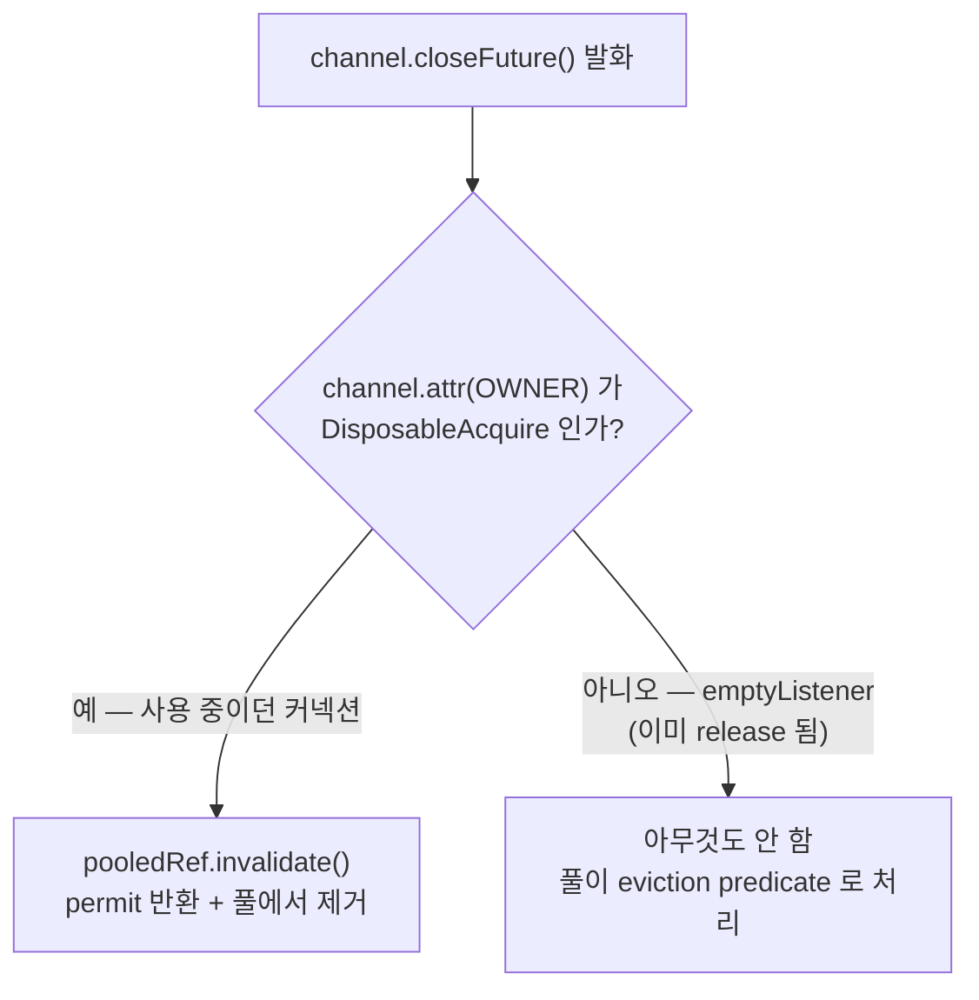
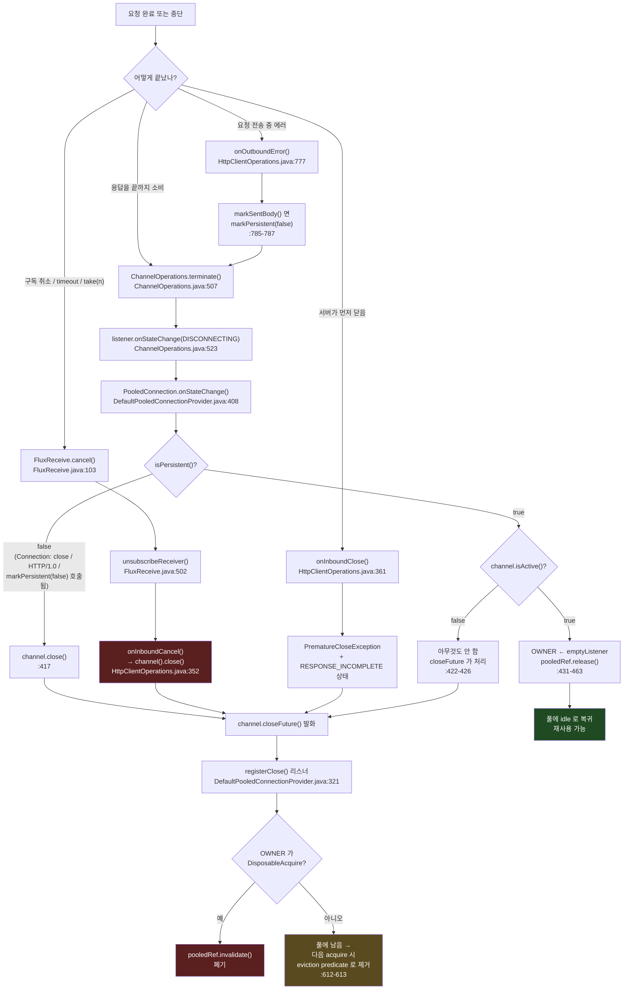

# 커넥션 재사용 함정

커넥션이 풀로 **반납되는 경로**와 **폐기되는 경로**를 reactor-netty 소스에서 갈라내고, 응답 바디를 끝까지 소비하지 않으면 왜 풀 효율이 붕괴하는지, `PrematureCloseException`의 단계별 메시지가 서버 쪽 무슨 상황을 뜻하는지, 그리고 `maxIdleTime`을 서버 keep-alive보다 짧게 두어야 하는 이유를 정리한다.

## 목차
- [1. 핵심 개념 (What)](#1-핵심-개념-what)
- [2. 왜 알아야 하는가 (Why)](#2-왜-알아야-하는가-why)
- [3. 내부 구현 분석 (How)](#3-내부-구현-분석-how)
- [4. 실전 예제](#4-실전-예제)
- [5. 정리](#5-정리)

---

## 1. 핵심 개념 (What)

커넥션 재사용의 전체 판단은 **단 하나의 채널 속성**으로 수렴한다.

```java
// reactor-netty-core/src/main/java/reactor/netty/Connection.java:246-249
default boolean isPersistent() {
    return !channel().hasAttr(ReactorNetty.PERSISTENT_CHANNEL) ||
            channel().attr(ReactorNetty.PERSISTENT_CHANNEL).get();
}
```

속성 키는 `AttributeKey.valueOf("$PERSISTENT_CHANNEL")`이다(`reactor-netty-core/src/main/java/reactor/netty/ReactorNetty.java:1047`). **속성이 없으면 영속으로 간주**한다(기본값 재사용). 누군가 `markPersistent(false)`를 호출하면 속성이 `false`로 박히고, 그 커넥션은 다시는 풀로 돌아가지 않는다.

`markPersistent(true)`는 속성이 아직 없으면 아무것도 하지 않고, 그 외에는 속성을 주어진 값으로 세팅한다(`Connection.java:264-273`). 즉 **한 번 `false`가 박히면 다시 `true`로 되돌릴 수 있지만, 아무도 그러지 않는다.**

그리고 커넥션이 풀로 돌아가는 유일한 정상 경로는 **`release()`** 이고, 버려지는 경로는 **`invalidate()`** 또는 **`channel().close()`** 다. 이 셋의 구분이 이 문서의 전부다.

| 호출 | 의미 | 결과 |
| --- | --- | --- |
| `pooledRef.release()` | 정상 반납 | 커넥션이 idle 상태로 풀에 복귀, 재사용 가능 |
| `pooledRef.invalidate()` | 폐기 | permit 반환 + 커넥션 제거, 재사용 불가 |
| `channel().close()` | 물리적 종료 | `closeFuture` 리스너가 `invalidate()` 호출 |

---

## 2. 왜 알아야 하는가 (Why)

운영에서 터지는 순서는 거의 항상 이렇다.

1. 평상시에는 아무 문제 없다. 트래픽이 적어 커넥션이 풀에 몇 개만 있고, 재사용이 잘 된다.
2. 트래픽이 늘면 응답 시간이 **비선형으로** 악화된다. p99가 특히 나쁘다.
3. 커넥션 수가 `maxConnections`에 붙어 있는데 TCP 연결 수립 로그가 끊임없이 찍힌다.
4. `PoolAcquireTimeoutException`이 터지기 시작한다.
5. 업스트림 쪽에서는 "TIME_WAIT 소켓이 수만 개"라는 보고가 올라온다.

원인은 **커넥션이 반납되지 않고 폐기되고 있는 것**이다. 풀의 `maxConnections`는 지켜지지만, 매 요청이 핸드셰이크(+ TLS면 2 RTT 추가)를 새로 하므로 실질 처리량이 떨어진다. 그리고 가장 흔한 트리거는 버그가 아니라 **아주 자연스러워 보이는 코드** — `take(1)`, `timeout()`, 에러 응답을 바디 없이 매핑하기, `bodyToMono(Void.class)` — 다.

두 번째 흔한 사고는 **간헐적 커넥션 에러**다. 풀 `maxIdleTime`이 서버 keep-alive timeout보다 길면, 서버가 이미 닫은 소켓이 풀에 남는다. reactor-netty가 기본으로 1회 재시도를 해 주기 때문에 **대부분 성공하지만**, 조건이 맞으면 재시도도 실패하고 에러가 사용자에게 노출된다. 왜 "대부분 성공"하는지와 "언제 실패"하는지를 알아야 대응이 가능하다.

---

## 3. 내부 구현 분석 (How)

### 3.1 반납 경로 — `PooledConnection.onStateChange()`

반납은 상태 전이 이벤트로 트리거된다. 요청이 정상 종료되면 `ChannelOperations.terminate()`(`reactor-netty-core/src/main/java/reactor/netty/channel/ChannelOperations.java:507-527`)가 outbound를 정리하고 `onInboundComplete()` / `afterInboundComplete()`를 거쳐 `listener.onStateChange(this, ConnectionObserver.State.DISCONNECTING)`를 발행한다(`:523`). 이후 `connection`은 `DisposedConnection`으로, `listener`는 `emptyListener()`로 교체된다.

이 이벤트를 `PooledConnection`이 받아 세 갈래로 나눈다(`reactor-netty-core/src/main/java/reactor/netty/resources/DefaultPooledConnectionProvider.java:408-466`).

```java
// DefaultPooledConnectionProvider.java:413-426 (발췌)
if (newState == State.DISCONNECTING) {
    if (!isPersistent() && channel.isActive()) {
        // Will be released by closeFuture
        channel.close();                                      // ← (A) 강제 종료
        owner().onStateChange(connection, State.DISCONNECTING);
        return;
    }

    if (!channel.isActive()) {
        owner().onStateChange(connection, State.DISCONNECTING);
        // Will be released by closeFuture
        return;                                               // ← (B) 이미 죽음
    }
    // ↓ (C) 정상 반납
```

| 분기 | 조건 | 동작 |
| --- | --- | --- |
| **(A)** | `!isPersistent() && channel.isActive()` | `channel.close()` → `closeFuture` 리스너가 `invalidate()` → **폐기** |
| **(B)** | `!channel.isActive()` | 아무것도 안 함. `closeFuture`가 이미 발화했거나 곧 발화 → **폐기** |
| **(C)** | `isPersistent() && channel.isActive()` | `pooledRef.release()` → **반납** |

(C)의 실제 구현은 `DefaultPooledConnectionProvider.java:428-463`이다. "Releasing channel" 로그를 찍고(`:429`), `channel.attr(OWNER)`를 `ConnectionObserver.emptyListener()`로 `getAndSet` 하고, Reactor Context를 비우고, `pooledRef.release()`를 구독해 완료/에러 양쪽에서 `onTerminate.tryEmitEmpty()` + `obs.onStateChange(connection, State.RELEASED)`를 발행한다.

`OWNER` 속성을 `emptyListener()`로 교체하는 것이 중요하다. 이 시점부터 채널은 "주인 없는" 상태이고, 다음 acquire가 새 소유자를 심는다. `registerClose()` 리스너가 이 값을 보고 동작을 결정한다(3.3 참고).

**누가 `markPersistent(false)`를 호출하는가.** `HttpClientOperations`에 세 지점이 있다.

| 지점 | 조건 | 소스 |
| --- | --- | --- |
| 응답 헤더 수신 시 | `!isKeepAlive()` — `Connection: close` 또는 HTTP/1.0 | `HttpClientOperations.java:828-830` |
| outbound 에러 시 | 요청 바디를 이미 보냈다면 | `HttpClientOperations.java:785-787` |
| `LastHttpContent` 처리 시 | `markSentBody()`가 참을 반환할 때 | `HttpClientOperations.java:930-932` |

첫 번째가 HTTP 프로토콜 규약 그 자체다.

```java
// HttpClientOperations.java:827-830, :440-447 (발췌)
if (!isKeepAlive()) {
    markPersistent(false);
}
// ...
public boolean isKeepAlive() {
    ResponseState rs = responseState;
    return rs != null ? HttpUtil.isKeepAlive(rs.response) : HttpUtil.isKeepAlive(nettyRequest);
}
```

`HttpUtil.isKeepAlive()`는 Netty 유틸로, HTTP/1.1에서는 `Connection: close`가 없으면 참, HTTP/1.0에서는 `Connection: keep-alive`가 있어야 참이다. 즉 **서버가 `Connection: close`를 보내거나 HTTP/1.0으로 응답하면 그 커넥션은 폐기 경로로 간다.** 이건 올바른 동작이지, 고칠 문제가 아니다.

### 3.2 폐기 경로 — 바디 미소비가 1순위 원인

**응답 바디를 끝까지 소비하지 않으면 `release()`가 호출되지 않는다.** `terminate()`가 불리지 않기 때문이다. 대신 취소 경로가 채널을 직접 닫는다.

연쇄는 이렇다. 구독자가 취소하면 `FluxReceive.cancel()`이 `doCancel(0)`을 부르고(`FluxReceive.java:103-106`), `cancelReceiver(0)`가 생성자에서 설치한 `CANCEL` 콜백을 실행하며(`FluxReceive.java:83-100`), `cancelCode == 0`이므로 `unsubscribeReceiver()`로 간다.

```java
// FluxReceive.java:502-508
final void unsubscribeReceiver() {
    receiverDemand = 0L;
    receiver = null;
    if (isCancelled()) {
        parent.onInboundCancel();      // ← ChannelOperations 로 전달
    }
}
```

`dispose()`는 `doCancel(1)`이고 `disposeAndUnsubscribeReceiver()`를 거치지만, `onInboundCancel()`을 부르는 결과는 같다(`FluxReceive.java:485-500`).

그리고 `HttpClientOperations.onInboundCancel()`이 **채널을 직접 닫는다.**

```java
// reactor-netty-http/src/main/java/reactor/netty/http/client/HttpClientOperations.java:337-353
protected void onInboundCancel() {
    if (isInboundDisposed()) {
        return;
    }
    //"FutureReturnValueIgnored" this is deliberate
    log.debug(format(channel(), INBOUND_CANCEL_LOG));
    trailerHeaders.tryEmitEmpty();
    channel().close();                 // ← release() 가 아니다
}
```

로그 메시지는 상수로 박혀 있다 — `static final String INBOUND_CANCEL_LOG = "Http client inbound receiver cancelled, closing channel.";`(`HttpClientOperations.java:138`).

**이 로그가 운영 진단의 핵심 단서다.** `reactor.netty.http.client.HttpClientOperations` 로거를 DEBUG로 올렸을 때 이 메시지가 반복적으로 찍히면, 응답 바디를 끝까지 읽지 않는 호출 경로가 있다는 뜻이다.

왜 `release()`가 아니라 `close()`인가. 응답을 중간에 끊으면 소켓에 **읽지 않은 바이트가 남아 있다.** 그 커넥션을 풀에 돌려주면 다음 요청이 남은 바이트를 자기 응답으로 오해해 프로토콜이 완전히 깨진다. 남은 바이트를 다 읽고 버리는(drain) 선택도 가능하지만 — 바디 크기를 모르는 상태에서 얼마나 읽어야 할지 알 수 없고, 서버가 수백 MB를 보내는 중일 수도 있다. 그래서 reactor-netty는 **안전한 쪽을 택한다: 닫는다.**

**바디 미소비를 유발하는 일상적인 코드 패턴**:

| 패턴 | 왜 미소비인가 | 대안 |
| --- | --- | --- |
| `bodyToFlux(T).take(1)` | 첫 요소 후 취소 | `bodyToMono(T)` (서버가 배열 하나를 주는 경우) 또는 `.collectList()` |
| `.timeout(d)` 발화 | 취소 전파 | `HttpClient.responseTimeout()`을 1차 방어선으로 ([07](07-timeout-strategy.md)) |
| `bodyToMono(Void.class)` | 디코더가 요소를 안 내지만 바디는 drain 안 됨 | `toBodilessEntity()` |
| `onStatus(...)`에서 바디를 안 읽음 | — | `DefaultWebClient`가 `releaseIfNotConsumed()`로 보호함 ([05](05-codecs-and-databuffer.md)) |
| `Flux`를 반환만 하고 구독 안 함 | 아예 소비 시작조차 안 함 | 호출자가 반드시 구독하도록 API 설계 |
| 상위에서 `CancellationException` | 취소 전파 | 취소 발생 지점을 재검토 |

### 3.3 `registerClose()` — 물리적 종료 시 `invalidate()`

`close()`가 호출되면 누가 풀에서 커넥션을 빼는가. acquire 시점에 등록되는 `closeFuture` 리스너다.

```java
// DefaultPooledConnectionProvider.java:321-337 (발췌)
static void registerClose(PooledRef<PooledConnection> pooledRef, InstrumentedPool<PooledConnection> pool) {
    Channel channel = pooledRef.poolable().channel;
    log.debug(format(channel, "Registering pool release on close event for channel"));
    channel.closeFuture()
           .addListener(ff -> {
               // When the connection is released the owner is NOOP
               ConnectionObserver owner = channel.attr(OWNER).get();
               if (owner instanceof DisposableAcquire) {
                   ((DisposableAcquire) owner).pooledRef
                           .invalidate()
                           .subscribe(null, null, () -> logPoolState(channel, pool, "Channel closed"));
               }
           });
}
```

주석 한 줄이 설계를 설명한다 — *"When the connection is released the owner is NOOP"*. `OWNER`가 `DisposableAcquire`인지 검사하는 것이 **"지금 누군가 이 커넥션을 쓰는 중인가"** 를 판정하는 방법이다.



- **사용 중에 닫힘** (`onInboundCancel()`, 서버의 TCP RST, read timeout 등) → `OWNER`가 `DisposableAcquire` → **즉시 `invalidate()`**.
- **반납 후 유휴 상태에서 닫힘** (서버 idle timeout 등) → `OWNER`가 `emptyListener()`(3.1의 `getAndSet`) → **리스너는 아무것도 안 한다.** 이 커넥션은 풀에 남아 있다가, 다음에 꺼낼 때 eviction predicate에 걸려 제거된다.

```java
// DefaultPooledConnectionProvider.java:612-613
static final BiPredicate<PooledConnection, PooledRefMetadata> DEFAULT_EVICTION_PREDICATE =
        (pooledConnection, metadata) -> !pooledConnection.channel.isActive() || !pooledConnection.isPersistent();
```

**두 번째 경로가 "간헐적 커넥션 에러"의 구조적 원인이다.** 서버가 조용히 닫은 커넥션은 풀에 그대로 남고, 꺼낼 때 비로소 걸러진다. 그런데 `channel.isActive()`가 `false`로 바뀌기까지는 커널의 소켓 상태 갱신이 필요하고, 그 사이에 커넥션이 리스될 수 있다. 그 경합을 메우는 장치가 `DisposableAcquire.run()`의 1회 재시도다(`DefaultPooledConnectionProvider.java:233-253`, 자세한 내용은 [커넥션 풀](06-connection-pool.md) 3.6).

### 3.4 반납 / 폐기 분기 전체 다이어그램



### 3.5 `PrematureCloseException`의 단계별 메시지

서버가 먼저 커넥션을 닫으면 `onInboundClose()`가 **요청이 어디까지 진행됐는지에 따라 다른 메시지**를 만든다. 이게 서버 쪽 상황을 읽는 가장 직접적인 단서다.

```java
// HttpClientOperations.java:360-388 (발췌)
protected void onInboundClose() {
    if (isInboundCancelled() || isInboundDisposed()) {
        listener().onStateChange(this, ConnectionObserver.State.DISCONNECTING);
        return;                                                      // ← :362-365
    }
    trailerHeaders.tryEmitEmpty();
    listener().onStateChange(this, HttpClientState.RESPONSE_INCOMPLETE);   // ← :371
    if (responseState == null) {
        Throwable exception;
        if (markSentHeaderAndBody()) {
            exception = AbortedException.beforeSend();
        }
        else if (markSentBody()) {
            exception = new PrematureCloseException("Connection has been closed BEFORE response, while sending request body");
        }
        else {
            exception = new PrematureCloseException("Connection prematurely closed BEFORE response");
        }
        listener().onUncaughtException(this, addOutboundErrorCause(exception, unprocessedOutboundError));
        return;
    }
    super.onInboundError(addOutboundErrorCause(
            new PrematureCloseException("Connection prematurely closed DURING response"), unprocessedOutboundError));
}
```

| 메시지 | 판정 조건 | 서버 측에서 무슨 일이 있었나 |
| --- | --- | --- |
| `Connection has been closed BEFORE send operation` (`AbortedException`) | `markSentHeaderAndBody()` 성공 — 헤더도 아직 안 보냈다 | 풀에서 꺼낸 커넥션이 **이미 죽어 있었다**. 서버 idle timeout 또는 LB가 끊었다. `maxIdleTime` 문제의 전형 |
| `Connection has been closed BEFORE response, while sending request body` | `markSentBody()` 성공 — 헤더는 보냈고 바디 전송 중 | 서버가 **요청을 읽다가 포기했다**. 요청 바디 크기 제한 초과(`413` 대신 RST), 요청 타임아웃, WAF 차단, `Expect: 100-continue` 거부 |
| `Connection prematurely closed BEFORE response` | 위 둘 다 실패 — 요청은 완전히 보냈다 | 요청은 다 받았는데 **응답을 못 만들고 죽었다**. 서버 crash/OOM, 백엔드 타임아웃, 워커 재시작, 서버 측 read timeout |
| `Connection prematurely closed DURING response` | `responseState != null` — 응답 헤더는 받았다 | 응답을 **보내다가 끊겼다**. 청크 전송 중 서버 crash, `Content-Length` 불일치, 중간 프록시 버퍼 초과, 서버 응답 타임아웃 |

세 가지 추가 사실:

**(1) 취소된 요청에서는 예외가 안 만들어진다.** `isInboundCancelled() || isInboundDisposed()`면 `DISCONNECTING`만 발행하고 끝낸다(`:362-365`). 즉 우리가 먼저 취소한 커넥션의 종료는 `PrematureCloseException`을 내지 않는다.

**(2) `RESPONSE_INCOMPLETE` 상태가 발행된다**(`:371`). 커스텀 `ConnectionObserver`를 붙였다면 이 상태로 "응답 미완료"를 집계할 수 있다.

**(3) 스택트레이스가 없다.** `PrematureCloseException`은 `fillInStackTrace()`를 오버라이드해 `this`를 그대로 반환한다.

```java
// reactor-netty-http/src/main/java/reactor/netty/http/client/PrematureCloseException.java:44-48
@Override
public synchronized Throwable fillInStackTrace() {
    // omit stacktrace for this exception
    return this;
}
```

`IOException`을 상속하므로(`PrematureCloseException.java:31`) `catch (IOException)`에 잡힌다. 스택트레이스가 없으니 **메시지 문자열이 유일한 진단 정보**다. 로깅 시 메시지를 반드시 남겨야 한다.

**(4) outbound 에러가 cause로 붙는다.** `addOutboundErrorCause(exception, unprocessedOutboundError)`가 요청 전송 중 발생했던(아직 전파되지 않은) 에러를 원인으로 연결한다(`:383`, `:386`). 그래서 `getCause()`를 봐야 전체 그림이 보인다.

### 3.6 `AbortedException.isConnectionReset()` — 문자열 패턴 매칭

reactor-netty가 "이건 그냥 TCP 레벨에서 끊긴 것"이라고 판정하는 함수다. 구현이 **예외 메시지 문자열 매칭**이라는 점이 중요하다.

```java
// reactor-netty-core/src/main/java/reactor/netty/channel/AbortedException.java:45-56
public static boolean isConnectionReset(Throwable err) {
    return (err instanceof AbortedException && CONNECTION_CLOSED_BEFORE_SEND.equals(err.getMessage())) ||
           (err instanceof IOException && (err.getMessage() == null ||
                                          err.getMessage().contains("Broken pipe") ||
                                          err.getMessage().contains("Connection reset by peer"))) ||
           (err instanceof SocketException && err.getMessage() != null &&
                                              err.getMessage().contains("Connection reset by peer"));
}
```

세 가지 경우를 참으로 판정한다.

| 조건 | 설명 |
| --- | --- |
| `AbortedException`이고 메시지가 `"Connection has been closed BEFORE send operation"` | 상수 `CONNECTION_CLOSED_BEFORE_SEND`(`AbortedException.java:28`)와 정확히 일치. `AbortedException.beforeSend()`(`:58-60`)가 만드는 것 |
| `IOException`이고 메시지가 **`null`** 이거나 `"Broken pipe"` / `"Connection reset by peer"`를 포함 | — |
| `SocketException`이고 메시지가 `"Connection reset by peer"`를 포함 | — |

**두 번째 조건의 `getMessage() == null`이 결정적이다.** `PrematureCloseException`은 `IOException`을 상속하지만 메시지가 항상 있으므로 — `"Connection prematurely closed BEFORE response"` 등 — **문자열 매칭에 걸리지 않는다.** 즉 `PrematureCloseException`은 `isConnectionReset()`에서 **거짓**이다. 따라서 자동 재시도 대상이 아니다(3.7 참고).

문자열 매칭의 함의: 이 판정은 **JDK/OS가 주는 메시지에 의존한다.** 리눅스/HotSpot 조합에서 `"Connection reset by peer"`와 `"Broken pipe"`가 나오는 것을 전제로 하고, 로케일이나 플랫폼에 따라 다른 문구가 나오면 판정이 빗나갈 수 있다. 구조적으로 견고하지 않은 코드이고, 그래서 운영에서는 **애플리케이션 레벨 재시도 정책을 따로 두는 편이 안전하다**([Resilience 통합](09-resilience-integration.md) 참고).

### 3.7 `disableRetry` 기본값은 `false` — connection reset에 1회 자동 재시도

이게 "서버가 끊은 커넥션을 집었는데도 대부분 성공하는" 이유다.

```java
// reactor-netty-http/src/main/java/reactor/netty/http/client/HttpClientConfig.java:394
this.retryDisabled = false;
```

`HttpClient.disableRetry(boolean)`의 javadoc이 의미를 명시한다 — *"Option to disable `retry once` support for the outgoing requests that fail with `AbortedException#isConnectionReset(Throwable)`. By default this is set to false in which case `retry once` is enabled."*(`HttpClient.java:677-686`). `HttpClientConnect.HttpClientHandler`가 생성될 때 플래그를 뒤집어 들고 간다 — `this.shouldRetry = !configuration.retryDisabled;`(`HttpClientConnect.java:515`).

재시도 판정은 두 곳에서 일어난다.

**(a) `ConnectionObserver.onUncaughtException()`** — 커넥션 레벨 에러 관측 시점.

```java
// HttpClientConnect.java:375-410 (발췌)
else if (handler.shouldRetry && AbortedException.isConnectionReset(error)) {
    HttpClientOperations ops = connection.as(HttpClientOperations.class);
    if (ops != null && ops.hasSentHeaders()) {
        // Mark the connection as non-persistent here so that it is never returned to the pool and leave
        // the channel close event to invalidate it.
        ops.markPersistent(false);
        // Disable retry if the headers or/and the body were sent
        handler.shouldRetry = false;
        log.warn(... "the request cannot be retried as the headers/body were sent", error);
    }
    else {
        if (ops != null) {
            ops.markPersistent(false);
            ops.retrying = true;
        }
        log.debug(... "the request will be retried", error);
    }
}
```

**(b) `HttpClientHandler.test(Throwable)`** — 실제 재구독 트리거.

```java
// HttpClientConnect.java:732-735
if (shouldRetry && AbortedException.isConnectionReset(throwable)) {
    shouldRetry = false;          // ← 1회 한정. 다시 true 가 되지 않는다
    redirect(toURI.toString());   // 같은 URI 로 재시도 (리다이렉트 메커니즘 재사용)
    return true;
}
```

정리하면:

| 조건 | 재시도 | 이유 |
| --- | --- | --- |
| `isConnectionReset(error)` 참 **그리고** 헤더 미전송 | **O (1회)** | 서버가 요청을 못 봤으므로 멱등성 걱정이 없다 |
| `isConnectionReset(error)` 참 **그리고** `hasSentHeaders()` 참 | X | 서버가 요청을 봤을 수 있다. 중복 처리 위험 → WARN 로그 |
| `PrematureCloseException` | X | `isConnectionReset()`에서 거짓 (메시지가 있다, 3.6) |
| 이미 한 번 재시도함 | X | `shouldRetry = false`로 고정 |
| `disableRetry(true)` | X | 처음부터 `shouldRetry = false` |

**주의 — 이 재시도는 멱등성을 검사하지 않는다.** 헤더 전송 여부만 본다. 그래서 `POST`도 재시도될 수 있다. 다만 헤더를 보내기 **전에** 실패한 경우이므로 서버가 요청을 전혀 받지 않았음이 보장되고, 실무적으로 안전하다. 그래도 완전히 보수적으로 가고 싶다면 `disableRetry(true)` + 애플리케이션 레벨 재시도가 정답이다.

### 3.8 결론 — `maxIdleTime`을 서버 keep-alive보다 짧게

자동 1회 재시도가 있는데도 왜 에러가 사용자에게 노출되는가. **재시도가 다시 죽은 커넥션을 집기 때문이다.**

```
서버 keep-alive timeout = 60s,  클라이언트 maxIdleTime = 없음 (reactor-netty 기본)

t=0     요청 20개 처리 → 커넥션 20개가 풀에 idle 로 남는다
t=60s   서버가 20개를 모두 FIN 으로 닫는다 (클라이언트는 모른다)
t=120s  새 요청 → 풀에서 커넥션 #1 을 꺼낸다
        → eviction predicate: channel.isActive() 가 아직 true 일 수 있다
        → 요청 전송 → RST → isConnectionReset() 참 → 재시도
        → 풀에서 커넥션 #2 를 꺼낸다 (역시 죽은 것)
        → shouldRetry 는 이미 false → 사용자에게 에러 노출  ✗
```

재시도가 **1회뿐**이고, 풀 안의 커넥션이 **전부 같은 이유로 죽어 있기** 때문에 2번째도 실패한다. 트래픽이 드문드문한 서비스(배치 간격, 야간 저트래픽)에서 특히 잘 재현된다.

**근본 해결은 클라이언트가 먼저 버리는 것이다.**

```
maxIdleTime < 서버 keep-alive timeout
```

이렇게 두면 서버가 닫기 전에 클라이언트가 eviction predicate로 제거한다. `maxIdleTime`은 `newPoolInternal()`의 기본 eviction predicate에 합쳐진다.

```java
// reactor-netty-core/src/main/java/reactor/netty/resources/PooledConnectionProvider.java:598-601
poolBuilder = poolBuilder.evictionPredicate(defaultEvictionPredicate.or((poolable, meta) ->
        (maxIdleTime != -1 && meta.idleTime() >= maxIdleTime)
                || (maxLifeTime != -1 && meta.lifeTime() >= maxLifeTime)));
```

**단, `maxIdleTime`만으로는 부족하다.** 위 predicate는 **커넥션을 꺼낼 때만** 평가된다. 트래픽이 완전히 없는 구간에서는 아무도 꺼내지 않으므로 죽은 커넥션이 그대로 쌓이고, 다음 요청 폭주 때 한꺼번에 터진다. 그래서 `evictInBackground`를 함께 켜야 한다.

간격은 `PoolBuilder.evictInBackground(evictionInterval)`로 reactor-pool에 그대로 넘어간다(`PooledConnectionProvider.java:590`). `evictionInterval`이 `Duration.ZERO`면(기본값, `ConnectionProvider.java:529`) 백그라운드 점검이 아예 돌지 않는다. 값을 주면 reactor-pool이 주기적으로 풀을 훑어 eviction 대상을 제거한다. 백그라운드 점검을 **어떤 스케줄러에서 돌리는지는 외부 reactor-pool 아티팩트의 구현 사항**이고 이 레포 소스에서는 확인되지 않는다 — reactor-netty는 간격만 넘긴다.

> v1.2.18에는 `evictInBackground(Duration)` 오버로드만 있다(`ConnectionProvider.java:762`). 스케줄러를 직접 지정하는 오버로드는 1.3+에서 추가됐다. [Boot 4 / Spring 7 마이그레이션](12-boot4-spring7-migration.md) 참고.

풀 **자체**를 지우는 `disposeInactivePoolsInBackground`는 명시적으로 `Schedulers.parallel()`을 쓴다(`PooledConnectionProvider.java:409-412`). 이건 커넥션 eviction과 다른 기능이다.

**실무 규칙**:

| 설정 | 권장값 | 근거 |
| --- | --- | --- |
| `maxIdleTime` | 서버 keep-alive의 **1/2 ~ 1/3** | 서버가 닫기 전에 먼저 버린다. nginx `keepalive_timeout` 기본 75s → 20~30s |
| `evictInBackground` | `maxIdleTime`과 비슷하거나 그 절반 | 트래픽 없는 구간에서도 정리된다 |
| `maxLifeTime` | 수 분 (예: 5분) | LB 뒤 백엔드 재분산. 서버 교체 후에도 옛 백엔드를 붙잡지 않는다 |
| `disableRetry` | `false` 유지 (기본값) | 1회 재시도는 손해가 없다. 대신 위 세 값을 제대로 잡는다 |

서버 keep-alive 값을 모르면 측정한다 — `curl -v`로 커넥션을 연 뒤 `Keep-Alive: timeout=N` 헤더를 보거나, 가만히 두고 서버가 FIN을 보내는 시점을 `tcpdump`로 재는 것이 확실하다. 모르면 보수적으로 **10초**에서 시작한다.

---

## 4. 실전 예제

### 4.1 프로퍼티 바인딩

```java
package com.example.http;

import java.time.Duration;

import org.springframework.boot.context.properties.ConfigurationProperties;
import org.springframework.boot.context.properties.bind.DefaultValue;

@ConfigurationProperties(prefix = "app.http.reuse")
public record ReuseProperties(
        /**
         * 업스트림 서버의 keep-alive timeout. 운영팀에서 받거나 측정한다.
         * nginx keepalive_timeout 기본 75s, AWS ALB idle timeout 기본 60s.
         */
        @DefaultValue("60s") Duration serverKeepAlive,

        /** 서버 keep-alive 의 1/3. reactor-netty 기본값은 "없음"이므로 반드시 설정한다. */
        @DefaultValue("20s") Duration maxIdleTime,

        /** 백그라운드 eviction 간격. 기본값 Duration.ZERO(비활성)면 유휴 구간에 죽은 커넥션이 쌓인다. */
        @DefaultValue("10s") Duration evictInBackground,

        /** LB 뒤 백엔드 재분산용 커넥션 수명 상한. */
        @DefaultValue("5m") Duration maxLifeTime
) {
    /**
     * 이 설정은 잘못 잡혀도 평상시에는 증상이 없고 트래픽 패턴이 바뀔 때만 터진다.
     * 기동 시점에 막는 편이 훨씬 싸다.
     */
    public ReuseProperties {
        if (maxIdleTime.compareTo(serverKeepAlive) >= 0) {
            throw new IllegalArgumentException(
                    "maxIdleTime(" + maxIdleTime + ") must be shorter than "
                            + "serverKeepAlive(" + serverKeepAlive + "); otherwise the pool "
                            + "hands out sockets the server has already closed");
        }
    }
}
```

```yaml
app:
  http:
    reuse:
      server-keep-alive: ${APP_UPSTREAM_KEEPALIVE:60s}
      max-idle-time: ${APP_HTTP_MAX_IDLE:20s}
      evict-in-background: ${APP_HTTP_EVICT_INTERVAL:10s}
      max-life-time: ${APP_HTTP_MAX_LIFE:5m}
```

### 4.2 커넥션 재사용에 안전한 풀 설정

```java
package com.example.http;

import org.springframework.boot.web.reactive.function.client.WebClientCustomizer;
import org.springframework.context.annotation.Bean;
import org.springframework.context.annotation.Configuration;
import org.springframework.http.client.reactive.ReactorClientHttpConnector;
import reactor.netty.http.client.HttpClient;
import reactor.netty.resources.ConnectionProvider;

@Configuration(proxyBeanMethods = false)
class ConnectionReuseConfig {

    @Bean(destroyMethod = "dispose")
    ConnectionProvider reuseSafeProvider(HttpPoolProperties pool, ReuseProperties reuse) {
        return ConnectionProvider.builder(pool.name())
                .maxConnections(pool.maxConnections())
                .pendingAcquireTimeout(pool.pendingAcquireTimeout())
                // (1) 서버가 닫기 전에 먼저 버린다. reactor-netty 기본값은 "없음".
                .maxIdleTime(reuse.maxIdleTime())
                // (2) 커넥션 수명 상한. LB 뒤 백엔드 교체 후에도 옛 백엔드를 붙잡지 않는다.
                .maxLifeTime(reuse.maxLifeTime())
                // (3) 트래픽이 없는 구간에서도 정리한다. 기본값 Duration.ZERO 면
                //     꺼낼 때만 eviction 이 평가된다 (PooledConnectionProvider.java:598-601).
                .evictInBackground(reuse.evictInBackground())
                // (4) lifo = MRU. 소수의 뜨거운 커넥션을 재사용하므로 나머지가 유휴로 남고,
                //     maxIdleTime + evictInBackground 와 맞물려 풀이 실제로 축소된다.
                .lifo()
                .metrics(true)
                .build();
    }

    @Bean
    WebClientCustomizer reuseCustomizer(ConnectionProvider provider, TimeoutProperties timeout) {
        // responseTimeout 이 없으면 응답 대기가 무한이고 그 사이 커넥션이 묶인다 (07 문서).
        // disableRetry 는 기본값 false(= retry once 활성)를 유지한다.
        HttpClient httpClient = HttpClient.create(provider)
                .responseTimeout(timeout.response());
        return builder -> builder.clientConnector(new ReactorClientHttpConnector(httpClient));
    }
}
```

### 4.3 단계 분류 + 진단 필터

스택트레이스가 없으므로 메시지가 유일한 정보다. 3.5의 메시지 4종을 enum 마커로 두고, `getCause()`를 따라 내려가며 매칭한다 — `onInboundClose()`가 outbound 에러를 cause로 붙이고(`HttpClientOperations.java:383`, `:386`) `WebClient` 쪽에서 한두 겹 더 감싸질 수 있다.

```java
package com.example.http;

import reactor.netty.channel.AbortedException;
import reactor.netty.http.client.PrematureCloseException;

public enum PrematureCloseStage {
    /** 풀에서 꺼낸 커넥션이 이미 죽어 있었다. maxIdleTime 설정 문제. */
    BEFORE_SEND("Connection has been closed BEFORE send operation"),
    /** 서버가 요청 바디를 읽다가 포기했다. 바디 크기 제한, WAF, 요청 타임아웃. */
    WHILE_SENDING_BODY("Connection has been closed BEFORE response, while sending request body"),
    /** 요청은 다 받았으나 응답을 못 만들었다. 서버 crash/OOM, 백엔드 타임아웃. */
    BEFORE_RESPONSE("Connection prematurely closed BEFORE response"),
    /** 응답을 보내다가 끊겼다. 청크 전송 중 crash, Content-Length 불일치, 프록시 버퍼. */
    DURING_RESPONSE("Connection prematurely closed DURING response"),
    UNKNOWN("");

    private final String marker;

    PrematureCloseStage(String marker) { this.marker = marker; }

    public static PrematureCloseStage classify(Throwable ex) {
        for (Throwable t = ex; t != null; t = t.getCause()) {
            if (!(t instanceof AbortedException) && !(t instanceof PrematureCloseException)) continue;
            String message = t.getMessage();
            if (message == null) continue;
            for (PrematureCloseStage stage : values()) {
                if (stage != UNKNOWN && message.contains(stage.marker)) return stage;
            }
        }
        return UNKNOWN;
    }

    /** BEFORE_SEND 는 서버가 요청을 전혀 보지 못했으므로 비멱등 요청도 재시도 가능하다. */
    public boolean safeToRetryNonIdempotent() { return this == BEFORE_SEND; }
}
```

이걸 `ExchangeFilterFunction`에서 메트릭 태그로 쓴다. 두 카운터가 핵심이다.

```java
@Override
public Mono<ClientResponse> filter(ClientRequest request, ExchangeFunction next) {
    String host = request.url().getHost();
    String method = request.method().name();

    return next.exchange(request)
            .doOnError(IOException.class, ex -> {
                PrematureCloseStage stage = PrematureCloseStage.classify(ex);
                Counter.builder("app.http.premature.close")
                        .tags("stage", stage.name(), "method", method, "host", host)
                        .register(this.registry).increment();
                // 스택트레이스가 없으므로(PrematureCloseException.java:44-48) 메시지를 반드시 남긴다.
                log.warn("premature close stage={} {} {} message={}",
                        stage, method, request.url(), ex.getMessage());
            })
            // 구독 취소 = 바디 미소비 경로. onInboundCancel 로 이어져 커넥션이 폐기된다.
            .doOnCancel(() -> {
                Counter.builder("app.http.cancelled")
                        .tags("method", method, "host", host)
                        .register(this.registry).increment();
                log.warn("request cancelled, connection discarded (not released): {} {}",
                        method, request.url());
            });
}
```

`app.http.cancelled`가 꾸준히 올라가면 **바디 미소비 경로가 있다**는 직접 증거다. 풀 메트릭에서 "total connections"는 안정적인데 커넥션 생성 수가 계속 늘어나는 패턴과 함께 보면 확정이다.

### 4.4 DEBUG 로그로 반납/폐기 비율 확인

재현 가능한 환경에서는 로그가 더 빠르다 — `logging.level.reactor.netty.http.client.HttpClientOperations=DEBUG`, `logging.level.reactor.netty.resources.DefaultPooledConnectionProvider=DEBUG`.

| 로그 메시지 | 소스 | 뜻 |
| --- | --- | --- |
| `Http client inbound receiver cancelled, closing channel.` | `HttpClientOperations.java:138` | **바디 미소비.** 반복되면 1순위 범인 |
| `Releasing channel` | `DefaultPooledConnectionProvider.java:429` | 정상 반납. 많으면 건강하다 |
| `Channel cleaned` | `DefaultPooledConnectionProvider.java:458` | `release()` 완료 |
| `Channel closed` | `DefaultPooledConnectionProvider.java:335` | `invalidate()` 완료 = 폐기 |
| `Registering pool release on close event for channel` | `DefaultPooledConnectionProvider.java:324` | 새 커넥션 acquire (= 재사용 실패) |
| `The connection observed an error, the request will be retried` | `HttpClientConnect.java:408` | 자동 1회 재시도 발동 |
| `... cannot be retried as the headers/body were sent` | `HttpClientConnect.java:387-389` | 재시도 불가 (WARN) |

`Releasing channel` 대비 `Channel closed` 비율이 핵심 지표다.

### 4.5 바디 미소비를 피하는 코드 패턴

```java
// ✗ take(1) 이 첫 요소 후 취소를 전파 → onInboundCancel → channel().close()
Mono<Item> bad = webClient.get().uri("/items").retrieve()
        .bodyToFlux(Item.class).take(1).next();

// ✗ Void 는 "바디를 drain 하라"가 아니다. 서버가 보낸 바이트가 남는다
Mono<Void> badDelete = webClient.delete().uri("/items/{id}", id).retrieve()
        .bodyToMono(Void.class);


// ✓ 응답이 작다면 전체를 받고 메모리에서 고른다 — 커넥션이 정상 release 된다
Mono<Item> good = webClient.get().uri("/items").retrieve()
        .bodyToMono(new ParameterizedTypeReference<List<Item>>() {})
        .mapNotNull(items -> items.isEmpty() ? null : items.get(0));

// ✓ 응답이 커서 전체를 받을 수 없다면 서버에 "하나만 달라"고 요청한다.
//   클라이언트에서 끊는 것보다 서버 부하도 낮다
Mono<Item> better = webClient.get()
        .uri(b -> b.path("/items").queryParam("limit", 1).build())
        .retrieve()
        .bodyToFlux(Item.class)
        .next();                       // 서버가 1개만 보내므로 take 없이 자연 종료

// ✓ 바디를 버릴 의도라면 toBodilessEntity(). releaseBody() 가 명시 호출된다
Mono<Void> goodDelete = webClient.delete().uri("/items/{id}", id).retrieve()
        .toBodilessEntity().then();
```

스트림을 중간에 끊는 것이 **요건상 불가피**하다면 커넥션 폐기는 피할 수 없다. 그때는 **공용 풀을 쓰지 않는 것**이 답이다 — 전용 `ConnectionProvider`(또는 `ConnectionProvider.newConnection()`)를 쓰면 일반 요청의 재사용률이 오염되지 않는다.

### 4.6 `disableRetry`를 끄고 애플리케이션 레벨 재시도로 바꾸기

자동 1회 재시도는 **멱등성을 검사하지 않고** `isConnectionReset()`의 문자열 매칭에 의존한다(3.6). 비멱등 요청에 보수적으로 가야 한다면 명시적으로 제어한다.

```java
// 기본값은 false(= retry once 활성). 명시적으로 끈다.
HttpClient strict = HttpClient.create(provider)
        .responseTimeout(timeout.response())
        .disableRetry(true);

// 멱등 요청에만 적용할 재시도 스펙. AbortedException.isConnectionReset(Throwable) 은
// public static 이므로 그대로 재사용할 수 있다 (AbortedException.java:45-56).
Retry idempotentConnectionResetRetry = Retry.backoff(2, Duration.ofMillis(50))
        .maxBackoff(Duration.ofMillis(500))
        .jitter(0.5d)
        .filter(AbortedException::isConnectionReset)
        // 성공 후 다시 실패하면 재시도 횟수를 리셋한다. 긴 수명 스트림에 적합하다.
        .transientErrors(true);
```

서킷 브레이커와의 조합은 [Resilience 통합](09-resilience-integration.md)에서 다룬다.

---

## 5. 정리

- **재사용 판단은 `isPersistent()` 하나로 수렴한다.** `$PERSISTENT_CHANNEL` 채널 속성이 없으면 영속으로 간주하고(`Connection.java:246-249`, `ReactorNetty.java:1047`), `markPersistent(false)`가 호출되면 그 커넥션은 다시 풀로 돌아가지 않는다(`Connection.java:264-273`).
- **`PooledConnection.onStateChange()`의 `DISCONNECTING` 처리가 세 갈래**다(`DefaultPooledConnectionProvider.java:413-463). (A) `!isPersistent() && isActive()` → `channel.close()` 강제 종료, (B) `!isActive()` → 패스(`closeFuture`가 처리), (C) 나머지 → `OWNER`를 `emptyListener()`로 교체하고 `pooledRef.release()`.
- **`markPersistent(false)` 호출 지점은 셋**이다 — `!isKeepAlive()`(= `Connection: close` 또는 HTTP/1.0, `HttpClientOperations.java:828-830`), outbound 에러 후(`:785-787`), `LastHttpContent` 처리 시 `markSentBody()`(`:930-932`).
- **응답 바디를 끝까지 소비하지 않으면 `release()`가 아니라 `channel().close()`** 다. `FluxReceive.cancel()`(`:103`) → `unsubscribeReceiver()`(`:502-508`) → `HttpClientOperations.onInboundCancel()`(`:337-353`)의 `channel().close()`. 읽지 않은 바이트가 소켓에 남아 다음 요청과 섞이는 것을 막기 위한 안전한 선택이다.
- **`"Http client inbound receiver cancelled, closing channel."`**(`HttpClientOperations.java:138`)가 이 문제의 진단 단서다. DEBUG 로그에서 이게 반복되면 부하 상황 풀 효율 붕괴의 1순위 원인이다. 일상적 트리거는 `take(n)`, `Mono.timeout()` 발화, `bodyToMono(Void.class)`, 구독하지 않는 `Flux` 반환이다.
- **`registerClose()`가 물리적 종료를 풀에 반영한다**(`DefaultPooledConnectionProvider.java:321-334`). `closeFuture` 리스너가 `channel.attr(OWNER)`를 보고, `DisposableAcquire`면(= 사용 중) `invalidate()`를 부른다. 반납 후 유휴 상태에서 닫힌 커넥션은 `OWNER`가 `emptyListener()`라서 **리스너가 아무것도 하지 않고**, 다음 acquire 때 eviction predicate(`:612-613`의 `!isActive() || !isPersistent()`)로 제거된다.
- **`PrematureCloseException`의 메시지 4종이 서버 상황을 가리킨다**(`HttpClientOperations.java:360-388`). `BEFORE send operation`(실제로는 `AbortedException`) = 풀의 커넥션이 이미 죽었다 → `maxIdleTime` 문제. `BEFORE response, while sending request body` = 서버가 요청을 읽다 포기. `BEFORE response` = 요청은 받았는데 응답을 못 만들었다. `DURING response` = 응답 전송 중 끊김.
- **`PrematureCloseException`은 스택트레이스가 없다.** `fillInStackTrace()`가 `this`를 반환한다(`PrematureCloseException.java:44-48`). `IOException` 계열이고, **메시지 문자열이 유일한 진단 정보**이므로 반드시 로그에 남긴다. `addOutboundErrorCause()`로 붙은 cause도 확인한다.
- **`AbortedException.isConnectionReset()`은 문자열 패턴 매칭이다**(`AbortedException.java:45-56`). `AbortedException` + 정확한 상수 메시지, 또는 `IOException`/`SocketException`의 메시지가 **`null`** 이거나 `"Broken pipe"` / `"Connection reset by peer"`를 포함할 때 참이다. 플랫폼/로케일 의존적이고, **`PrematureCloseException`은 메시지가 있으므로 거짓**이다.
- **`disableRetry` 기본값은 `false`** 라 connection-reset에 **1회 자동 재시도**가 켜져 있다(`HttpClientConfig.java:394`, `HttpClientConnect.java:515`). 재시도는 **헤더 미전송 시에만** 한다. `hasSentHeaders()`면 `markPersistent(false)` + `shouldRetry = false` + WARN 로그다(`HttpClientConnect.java:375-410`). 실제 재구독은 `test(Throwable)`에서 `shouldRetry = false`로 못 박고 같은 URI로 리다이렉트하는 방식이다(`:732-735`). 멱등성은 검사하지 않는다.
- **그래도 서버 idle timeout이 풀 `maxIdleTime`보다 짧으면 반복 실패한다.** 재시도가 1회뿐이고 풀 안의 커넥션이 전부 같은 이유로 죽어 있어서, 두 번째 시도도 죽은 커넥션을 집는다. 저트래픽 구간에서 특히 잘 재현된다.
- **실무 규칙: `maxIdleTime` < 서버 keep-alive timeout** (1/2~1/3 권장). `maxIdleTime`은 기본 eviction predicate에 합쳐지지만(`PooledConnectionProvider.java:598-601`) **꺼낼 때만 평가**되므로 `evictInBackground`를 함께 켜야 한다. 기본값 `Duration.ZERO`면 백그라운드 점검이 아예 안 돈다(`ConnectionProvider.java:529`).
- **스트림을 중간에 끊는 것이 불가피하면 전용 풀을 쓴다.** 폐기 자체를 없앨 수 없다면, 공용 풀의 재사용률을 오염시키지 않게 분리하는 것이 답이다.

---

## 관련 문서
- 선행: [타임아웃 전략](07-timeout-strategy.md)
- 후행: [Resilience 통합](09-resilience-integration.md)
- 참고: [코덱·바디 변환과 DataBuffer 누수](05-codecs-and-databuffer.md), [reactor-netty 커넥션 풀](06-connection-pool.md), [관측성](10-observability.md), [백프레셔와 drain loop](../main/05-backpressure-and-drain-loop.md), [Boot 4 / Spring 7 마이그레이션](12-boot4-spring7-migration.md)

---
*참고: reactor-netty 1.2.18 / Spring Framework 6.2.19 (Spring Boot 3.x) 기준*
