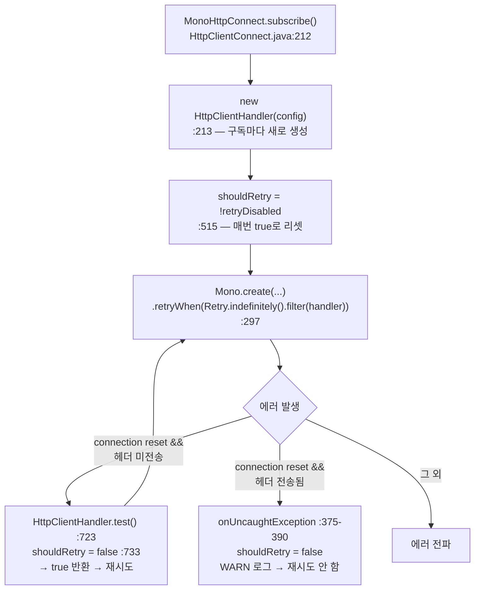

# 재시도와 복원력 — WebClient에 재시도·회로차단기를 붙이는 지점

WebClient 호출에 Reactor `retryWhen`과 회로차단기를 붙일 때, **무엇을 재시도해도 되는가**와 **실제 시도 횟수가 몇 배로 늘어나는가**를 결정하는 것은 라이브러리 설정이 아니라 호출의 의미론이다.

## 목차
- [1. 핵심 개념 (What)](#1-핵심-개념-what)
- [2. 왜 알아야 하는가 (Why)](#2-왜-알아야-하는가-why)
- [3. 내부 구현 분석 (How)](#3-내부-구현-분석-how)
- [4. 실전 예제](#4-실전-예제)
- [5. 정리](#5-정리)

---

## 1. 핵심 개념 (What)

WebClient 호출 하나에는 재시도를 수행할 수 있는 층이 **세 개** 있다.

```
┌──────────────────────────────────────────────────────────────┐
│ ③ 애플리케이션 재시도 — Mono.retryWhen(Retry.backoff(...))     │
│    구독 단위로 재시도 → 파이프라인 전체를 다시 탄다             │
├──────────────────────────────────────────────────────────────┤
│ ② 회로차단기 / 레이트리미터 (resilience4j)                     │
│    ③ 안쪽에 둬야 각 시도가 개별 호출로 집계된다                 │
├──────────────────────────────────────────────────────────────┤
│ ① reactor-netty 자동 1회 재시도 (기본 활성)                   │
│    connection reset 계열 + 헤더 미전송 시에만                  │
│    애플리케이션이 모르는 사이에 시도 횟수를 2배로 만든다         │
└──────────────────────────────────────────────────────────────┘
```

| 층 | 트리거 | 횟수 | 끄는 방법 |
|---|---|---|---|
| ① reactor-netty | `AbortedException.isConnectionReset(err)` && 헤더 미전송 | 구독당 1회 | `HttpClient.disableRetry(true)` |
| ② resilience4j | 설정한 예외 분류 | `RetryConfig` | 데코레이터 미적용 |
| ③ Reactor | `Retry` spec의 `filter` 통과 | `maxAttempts` | — |

Reactor의 재시도 API는 `reactor.util.retry` 네 파일이 전부다: `Retry`(추상 베이스 + 정적 팩토리 `backoff`/`fixedDelay`/`max`/`maxInARow`/`indefinitely`), `RetryBackoffSpec`(지수 백오프 + 지터), `RetrySpec`(지연 없는 재시도), `ImmutableRetrySignal`.

### `maxAttempts` 의 의미가 resilience4j와 반대다

Reactor `RetryBackoffSpec.maxAttempts` 는 **재시도 횟수**이고, 총 시도 횟수는 `maxAttempts + 1` 이다.

```java
// RetryBackoffSpec.generateCompanion() — RetryBackoffSpec.java:596, 608-610
long iteration = isTransientErrors ? copy.totalRetriesInARow() : copy.totalRetries();
if (iteration >= maxAttempts) {
    return Mono.error(retryExhaustedGenerator.apply(this, copy));
}
```

`totalRetries()` 는 "최초 구독 이후 재시도 횟수"다(`Retry.RetrySignal#totalRetries()`, `Retry.java:112`). 즉 `Retry.backoff(3, ...)` 은 **총 4회 HTTP 호출**이다.

resilience4j `RetryConfig.maxAttempts` 는 총 시도 횟수이므로(→ [`resilience4j/main/08-retry-internals.md`](../../resilience4j/main/08-retry-internals.md)) 같은 숫자 3을 넣으면 호출 횟수가 다르다. 두 라이브러리를 섞는 코드에서 가장 흔한 off-by-one이다.

---

## 2. 왜 알아야 하는가 (Why)

### 2.1 재시도해도 되는 요청과 안 되는 요청

판단 기준은 HTTP 메서드가 아니라 **"서버가 이 요청을 처리했을 가능성이 있는가"** 다.

```
  connect → TLS → [헤더 전송] → 본문 전송 → 응답 수신 → 본문 수신
  ╰──── A: 서버 미도달 ────╯ ╰──────── B: 서버 도달 가능 ────────╯

A 구간 실패 → 멱등성 무관하게 재시도 안전 (POST도 OK)
B 구간 실패 → 멱등 메서드만 재시도 가능
```

- **A**: DNS 실패, `ConnectException`, TLS 핸드셰이크 실패, 풀 acquire 타임아웃. 서버는 요청을 본 적도 없다.
- **B**: read timeout, `responseTimeout` 초과, 연결 중간 끊김. 서버가 이미 주문을 생성했을 수 있다.

WebClient에서 이 구분은 예외 타입으로 완전히 드러나지 않는다 — `WebClientRequestException` 이 A와 B 양쪽을 담는다(§3.3). 그래서 **멱등 메서드만 재시도**하거나, 비멱등 요청에는 **멱등성 키**를 붙이는 쪽이 현실적이다.

### 2.2 상태코드별 재시도 판단

```
재시도 허용                      재시도 금지
──────────────────────────────  ──────────────────────────────
408 Request Timeout             400 Bad Request   — 요청이 틀렸다
429 Too Many Requests  ★        401 Unauthorized  — 토큰 갱신 후에만
500 Internal Server Error △     403 / 404 / 409 / 422
502 Bad Gateway                 501 Not Implemented
503 Service Unavailable ★
504 Gateway Timeout

★ Retry-After 헤더를 존중할 것
△ 멱등 메서드에 한해서. 500은 서버가 처리를 끝낸 뒤 터졌을 수도 있다
```

`WebClientResponseException` 은 주요 상태코드마다 중첩 서브클래스를 제공해(`WebClientResponseException.java:351~581`: `BadRequest`, `Unauthorized`, `Forbidden`, `NotFound`, `MethodNotAllowed`, `NotAcceptable`, `Conflict`, `Gone`, `UnsupportedMediaType`, `UnprocessableEntity`, `TooManyRequests`, `InternalServerError`, `NotImplemented`, `BadGateway`, `ServiceUnavailable`, `GatewayTimeout`) `instanceof` 분기도 가능하지만, 확장성 면에서 `getStatusCode()` 로 보는 편이 낫다.

### 2.3 시도 횟수가 곱으로 늘어난다

reactor-netty는 connection reset 계열 오류에 대해 기본적으로 1회 재시도하는데, 그 플래그가 **구독마다 초기화**된다(§3.2). 애플리케이션이 `Retry.backoff(2, ...)` 를 걸면:

```
앱 시도 1 → netty 시도 1 + 자동 재시도 1 = 2 TCP
앱 시도 2 → netty 시도 1 + 자동 재시도 1 = 2 TCP
앱 시도 3 → netty 시도 1 + 자동 재시도 1 = 2 TCP
                             총 6회 TCP 연결 시도
```

유휴 커넥션이 서버 keep-alive 타임아웃으로 대량 끊긴 상황에서는 이 6배가 그대로 부하가 된다. 원인과 해법(`maxIdleTime` < 서버 keep-alive)은 [`08-connection-reuse-pitfalls.md`](08-connection-reuse-pitfalls.md).

### 2.4 타임아웃과 재시도는 예산을 공유한다

재시도 N회를 허용하면 최악 소요 시간은 `N × (호출 타임아웃) + Σ백오프` 다. 상위 SLA가 3초인데 각 시도가 2초 타임아웃이고 재시도가 2회면, 상위가 포기한 뒤에도 하위는 호출을 계속한다 — 취소가 전파되면 멈추지만, 전파가 끊긴 지점(블로킹, `publishOn` 경계)에서는 유령 호출이 남는다.

전체 예산 계산 수식은 [`resilience4j/advanced/12-production-design.md`](../../resilience4j/advanced/12-production-design.md) "3.4 타임아웃 예산", WebClient 타임아웃 3겹은 [`07-timeout-strategy.md`](07-timeout-strategy.md).

---

## 3. 내부 구현 분석 (How)

### 3.1 `RetryBackoffSpec` 의 기본값과 백오프 수식

`Retry.backoff(maxAttempts, minBackoff)` 가 만드는 spec의 기본값 (`Retry.java:167-170`):

| 필드 | 기본값 | 의미 |
|---|---|---|
| `errorFilter` | `t -> true` | **모든 예외를 재시도** |
| `isTransientErrors` | `false` | 누적 카운터(`totalRetries`) 사용 |
| `maxBackoff` | `Duration.ofMillis(Long.MAX_VALUE)` (`RetrySpec.java:55`) | 사실상 무제한 |
| `multiplier` / `jitterFactor` | `2` / `0.5d` | 2배씩 증가, ±50% 지터 |
| `backoffSchedulerSupplier` | `Schedulers::parallel` | 백오프 대기 스레드 |

`filter` 기본값이 `t -> true` 라는 점이 중요하다. **아무 설정 없이 `retryWhen(Retry.backoff(3, ...))` 를 붙이면 400 Bad Request도 세 번 더 보낸다.**

백오프 계산 (`RetryBackoffSpec.java:612-618`):

```java
long nextBackoffLong = (long) (minBackoffLong * Math.pow(multiplier, iteration));
nextBackoff = Duration.ofNanos(nextBackoffLong);
if (nextBackoff.compareTo(maxBackoff) > 0) {
    nextBackoff = maxBackoff;
}
```

지터는 `nextBackoff × jitterFactor` 범위에서 `ThreadLocalRandom` 으로 뽑되 결과가 `[minBackoff, maxBackoff]` 를 벗어나지 않도록 클램프한다(`:631-650`). `minBackoff=200ms`, `multiplier=2`, `jitter=0.5` 면 실제 대기는 `200~300ms` → `200~600ms` → `400~1200ms`.

**`filter` 탈락과 재시도 소진의 결과가 다르다** (`RetryBackoffSpec.java:603-610`):

```java
if (!errorFilter.test(currentFailure)) {
    return Mono.error(currentFailure);          // 원본 예외 그대로
}
if (iteration >= maxAttempts) {
    return Mono.error(retryExhaustedGenerator.apply(this, copy));  // 감싸진다
}
```

- **filter 탈락** → 원본 `WebClientResponseException` 이 그대로 간다. `onStatus`·`onErrorResume` 이 평소처럼 동작한다.
- **재시도 소진** → `Exceptions.retryExhausted("Retries exhausted: ...", lastFailure)` 로 감싸진다(`RetryBackoffSpec.java:66-67`). 원본은 `getCause()` 에 있고, 판별은 `Exceptions.isRetryExhausted(t)` (`Exceptions.java:367`). 원본을 유지하려면 `onRetryExhaustedThrow` 로 교체한다(`:399`).

### 3.2 reactor-netty의 자동 1회 재시도



핵심 네 지점:

1. **`new HttpClientHandler(config)` 가 `subscribe()` 안에 있다** (`HttpClientConnect.java:213`) → 핸들러는 구독당 1개.
2. `shouldRetry = !configuration.retryDisabled` (`:515`) — 생성자에서 초기화. 즉 **새 구독 = 자동 재시도 예산 1회 충전**.
3. `.retryWhen(Retry.indefinitely().filter(handler))` (`:297`) — `indefinitely()` 지만 필터가 1회만 통과시킨다.
4. `HttpClientHandler.test()` (`:723-736`):

```java
if (shouldRetry && AbortedException.isConnectionReset(throwable)) {
    shouldRetry = false;      // 두 번째부터는 통과 못 한다
    redirect(toURI.toString());
    return true;
}
```

재시도 대상 판정은 `AbortedException.isConnectionReset()` (`AbortedException.java:46-56`): `AbortedException("Connection has been closed BEFORE send operation")`, 또는 메시지가 null / `"Broken pipe"` / `"Connection reset by peer"` 를 포함하는 `IOException`·`SocketException`.

**헤더가 이미 전송됐으면 재시도하지 않는다** — `ops.hasSentHeaders()` 를 확인하고 `shouldRetry = false` 로 끈 뒤 WARN을 남긴다(`:375-390`). 즉 netty의 자동 재시도는 §2.1의 A 구간에만 적용되는 **안전한** 재시도다. 문제는 안전함이 아니라 애플리케이션 재시도와 곱해진다는 것. 끄는 법: `HttpClient.disableRetry(true)` (`HttpClient.java:687`, `@since 0.9.6`).

### 3.3 WebClient의 예외 경계

연결 단계 오류는 `ExchangeFunctions` 에서 감싸진다 (`ExchangeFunctions.java:105`, `:138-140`):

```java
.onErrorResume(WebClientUtils.WRAP_EXCEPTION_PREDICATE, t -> wrapException(t, clientRequest))
// ↓
return Mono.error(() -> new WebClientRequestException(t, r.method(), r.url(), r.headers()));
```

감쌀지 여부는 `WebClientUtils.WRAP_EXCEPTION_PREDICATE` 가 결정한다(`WebClientUtils.java:47-48`):

```java
t -> !(t instanceof WebClientException) && !(t instanceof CodecException);
```

따라서 재시도 판정 코드가 봐야 하는 것은 **`WebClientRequestException.getCause()`** 다. 원본 `ConnectException`·`ReadTimeoutException`·`PrematureCloseException` 이 모두 여기 들어 있다. `WebClientRequestException` 은 `getMethod()`/`getUri()`/`getHeaders()` 를 노출하므로(`@since 5.3`) 멱등성 판정도 예외 하나로 가능하다.

```
             WebClientException (abstract, @since 5.0)
                        │
        ┌───────────────┴────────────────┐
WebClientRequestException        WebClientResponseException
  cause = 원본 IO 예외                getStatusCode() / getHeaders()
  getMethod() / getUri()             getResponseBodyAs(Class)
```

### 3.4 resilience4j와의 조합 지점

```java
webClient.get().uri(...).retrieve().bodyToMono(Order.class)
    .transformDeferred(TimeLimiterOperator.of(timeLimiter))      // 가장 안쪽
    .transformDeferred(CircuitBreakerOperator.of(circuitBreaker))
    .transformDeferred(RetryOperator.of(retry))                  // 가장 바깥
```

- `transform` 이 아니라 **`transformDeferred`**. `transform` 은 조립 시점에 한 번만 평가되어 재시도 시 상태가 재사용된다.
- 순서가 결과를 바꾼다. 위 순서면 각 시도가 개별 호출로 서킷에 집계된다. Retry를 안쪽에 두면 재시도 전체가 1회로 집계된다.

이 순서의 근거, permit 획득/반납, 취소 전파, `Mono`/`Flux` 차이는 모두 [`resilience4j/advanced/08-reactor-operators.md`](../../resilience4j/advanced/08-reactor-operators.md) 에 소스 레벨로 정리돼 있다. 재시도 루프 내부는 [`resilience4j/main/08-retry-internals.md`](../../resilience4j/main/08-retry-internals.md), 서킷 상태 전이는 [`resilience4j/main/06-circuitbreaker-state-machine.md`](../../resilience4j/main/06-circuitbreaker-state-machine.md).

---

## 4. 실전 예제

### 4.1 재시도 판정 로직

```java
package com.example.client.resilience;

import java.io.IOException;
import java.time.Duration;
import java.util.Set;

import org.springframework.http.HttpHeaders;
import org.springframework.http.HttpMethod;
import org.springframework.web.reactive.function.client.WebClientRequestException;
import org.springframework.web.reactive.function.client.WebClientResponseException;

/** WebClient 예외를 재시도 가능/불가로 분류한다. */
public final class RetryDecision {

    private static final Set<HttpMethod> IDEMPOTENT = Set.of(
            HttpMethod.GET, HttpMethod.HEAD, HttpMethod.OPTIONS, HttpMethod.PUT, HttpMethod.DELETE);

    private static final Set<Integer> RETRYABLE_STATUS = Set.of(408, 429, 502, 503, 504);

    private RetryDecision() {
    }

    public static boolean isRetryable(Throwable error) {
        if (error instanceof WebClientResponseException ex) {
            return RETRYABLE_STATUS.contains(ex.getStatusCode().value());
        }
        if (error instanceof WebClientRequestException ex) {
            // 연결 단계 실패는 멱등성과 무관하게 안전하지만,
            // 응답 수신 중 끊김과 구분되지 않으므로 멱등 메서드로 제한한다.
            return IDEMPOTENT.contains(ex.getMethod()) && ex.getCause() instanceof IOException;
        }
        return false;
    }

    /**
     * {@code Retry-After} 를 해석한다. delta-seconds 형식만 지원.
     * {@code HttpHeaders}에 타입 안전한 getter가 없어 직접 파싱한다(상수만 제공).
     */
    public static Duration retryAfter(Throwable error) {
        if (!(error instanceof WebClientResponseException ex)) {
            return null;
        }
        String value = ex.getHeaders().getFirst(HttpHeaders.RETRY_AFTER);
        if (value == null) {
            return null;
        }
        try {
            return Duration.ofSeconds(Long.parseLong(value.trim()));
        }
        catch (NumberFormatException ignored) {
            return null;   // HTTP-date 형식 — 백오프 기본값에 맡긴다
        }
    }
}
```

### 4.2 `Retry` spec 빈 구성

```java
package com.example.client.resilience;

import java.time.Duration;

import org.slf4j.Logger;
import org.slf4j.LoggerFactory;
import reactor.util.retry.Retry;
import reactor.util.retry.RetryBackoffSpec;

import org.springframework.boot.context.properties.ConfigurationProperties;
import org.springframework.context.annotation.Bean;
import org.springframework.context.annotation.Configuration;

@Configuration(proxyBeanMethods = false)
public class RetryConfig {

    private static final Logger log = LoggerFactory.getLogger(RetryConfig.class);

    /** maxRetries는 재시도 횟수 — 총 호출은 +1회다. */
    @ConfigurationProperties("app.client.order.retry")
    public record RetryProperties(
            long maxRetries, Duration minBackoff, Duration maxBackoff,
            double jitterFactor, Duration totalBudget) {
    }

    @Bean
    RetryBackoffSpec orderRetrySpec(RetryProperties props) {
        return Retry.backoff(props.maxRetries(), props.minBackoff())
                .maxBackoff(props.maxBackoff())
                .jitter(props.jitterFactor())
                // 기본값이 t -> true 이므로 반드시 좁힌다
                .filter(RetryDecision::isRetryable)
                .doBeforeRetry(signal -> log.warn("order-api 재시도 {}/{} — {}",
                        signal.totalRetries() + 1, props.maxRetries(), signal.failure().toString()))
                // 소진 시 원본 예외를 올려 상위 핸들러가 상태코드를 볼 수 있게 한다
                .onRetryExhaustedThrow((spec, signal) -> signal.failure());
    }
}
```

```yaml
app:
  client:
    order:
      base-url: ${ORDER_API_BASE_URL}
      retry:
        max-retries: 2
        min-backoff: 200ms
        max-backoff: 2s
        jitter-factor: 0.5
        total-budget: 5s
```

### 4.3 `Retry-After` 를 존중하는 호출

429/503에 `Retry-After` 가 오면 지수 백오프를 무시하고 서버 지시를 따라야 한다. `Retry.from()` 으로 컴패니언을 직접 만든다.

```java
package com.example.client.order;

import java.time.Duration;

import org.slf4j.Logger;
import org.slf4j.LoggerFactory;
import reactor.core.publisher.Mono;
import reactor.util.retry.Retry;

import com.example.client.resilience.RetryConfig.RetryProperties;
import com.example.client.resilience.RetryDecision;
import org.springframework.stereotype.Component;
import org.springframework.web.reactive.function.client.WebClient;

@Component
public class OrderClient {

    private static final Logger log = LoggerFactory.getLogger(OrderClient.class);

    private final WebClient webClient;
    private final RetryProperties props;

    public OrderClient(WebClient.Builder builder, String baseUrl, RetryProperties props) {
        this.webClient = builder.baseUrl(baseUrl).build();
        this.props = props;
    }

    public Mono<Order> findById(String orderId) {
        return this.webClient.get()
                .uri("/orders/{id}", orderId)     // URI 템플릿 — 관측 태그 카디널리티 보호
                .retrieve()
                .bodyToMono(Order.class)
                .retryWhen(retryAfterAware())
                .timeout(this.props.totalBudget());   // 재시도를 포함한 하드 상한
    }

    public Mono<Order> create(CreateOrder command) {
        // POST는 비멱등 — retryWhen을 붙이지 않는다
        return this.webClient.post().uri("/orders")
                .bodyValue(command).retrieve().bodyToMono(Order.class);
    }

    /**
     * {@code Retry.from()} 은 재시도 신호 스트림을 받아 "다음 재시도까지 기다릴
     * Publisher"를 돌려주는 가장 낮은 수준의 API다. Retry-After가 있으면 그 값을 쓴다.
     */
    private Retry retryAfterAware() {
        return Retry.from(signals -> signals.concatMap(signal -> {
            long attempt = signal.totalRetries();
            Throwable failure = signal.failure();

            if (!RetryDecision.isRetryable(failure) || attempt >= this.props.maxRetries()) {
                return Mono.error(failure);
            }

            Duration serverHint = RetryDecision.retryAfter(failure);
            Duration delay = (serverHint != null) ? cap(serverHint) : exponential(attempt);

            log.warn("order-api 재시도 {}/{} — {} 후 (출처: {})", attempt + 1,
                    this.props.maxRetries(), delay, serverHint != null ? "Retry-After" : "backoff");
            return Mono.delay(delay);
        }));
    }

    private Duration exponential(long attempt) {
        return cap(Duration.ofNanos((long) (this.props.minBackoff().toNanos() * Math.pow(2, attempt))));
    }

    private Duration cap(Duration d) {
        return d.compareTo(this.props.maxBackoff()) > 0 ? this.props.maxBackoff() : d;
    }
}
```

### 4.4 이중 재시도를 끊기

```java
@Bean
WebClient.Builder orderWebClientBuilder(ConnectionProvider provider, HttpClientProperties props) {
    HttpClient httpClient = HttpClient.create(provider)
            // 자동 1회 재시도를 끈다. 재시도는 애플리케이션 층에서만 한다.
            .disableRetry(true)
            .option(ChannelOption.CONNECT_TIMEOUT_MILLIS, (int) props.getConnectTimeout().toMillis())
            .responseTimeout(props.getResponseTimeout());

    return WebClient.builder().clientConnector(new ReactorClientHttpConnector(httpClient));
}

@Bean
ConnectionProvider orderConnectionProvider(HttpClientProperties props) {
    return ConnectionProvider.builder("order-api")
            .maxConnections(props.getMaxConnections())
            // 서버 keep-alive 타임아웃보다 짧게 — disableRetry와 짝이 되는 설정
            .maxIdleTime(props.getMaxIdleTime())
            .maxLifeTime(props.getMaxLifeTime())
            .pendingAcquireTimeout(props.getPendingAcquireTimeout())
            .evictInBackground(props.getEvictInterval())
            .metrics(true)
            .build();
}
```

`disableRetry(true)` 의 트레이드오프: 서버 쪽에서 끊긴 "무해한" reset도 이제 애플리케이션 재시도 예산을 소비한다. 그래서 `maxIdleTime` 을 서버 keep-alive보다 짧게 두고 `evictInBackground` 를 켜서 **끊긴 커넥션을 애초에 잡지 않는 것**이 짝이 되는 설정이다.

### 4.5 재시도 예산 계산

`responseTimeout=2s`, `maxRetries=2`, `minBackoff=200ms`, `multiplier=2`, `jitter=0.5`, `disableRetry(true)`:

| 단계 | 소요 (최악) | 누적 |
|---|---|---|
| 시도 1 | 2000ms | 2000ms |
| 백오프 1 | 300ms (200 × 1.5) | 2300ms |
| 시도 2 | 2000ms | 4300ms |
| 백오프 2 | 600ms (400 × 1.5) | 4900ms |
| 시도 3 | 2000ms | **6900ms** |

상위 SLA가 5초면 이 설정은 예산을 초과한다. 선택지는 `maxRetries=1` 로 줄이거나, `responseTimeout` 을 당기거나, `.timeout(totalBudget)` 으로 하드 상한을 두는 것 — 마지막이 가장 안전하다(§4.3에 적용돼 있다).

---

## 5. 정리

| 항목 | 결론 |
|---|---|
| `Retry.backoff(n, ...)` 의 호출 횟수 | **n + 1회**. resilience4j `maxAttempts=n` 은 n회 — 섞으면 off-by-one |
| `filter` 기본값 | `t -> true` — **반드시 좁혀라**. 안 그러면 400도 재시도한다 |
| 재시도 안전성 판정 | HTTP 메서드가 아니라 "서버 도달 가능성". 구분이 안 되면 멱등 메서드로 제한 |
| 재시도 상태코드 | 408·429·502·503·504. 500은 멱등 메서드만. 4xx 대부분 금지 |
| `Retry-After` | 429·503에서 반드시 존중. `HttpHeaders.RETRY_AFTER` 를 직접 파싱(타입 getter 없음) |
| 예외 경계 | 연결 단계 → `WebClientRequestException`(cause에 원본), 응답 4xx/5xx → `WebClientResponseException` |
| reactor-netty 자동 재시도 | 기본 **활성**, 구독당 1회, connection reset + 헤더 미전송에만. 구독마다 리셋되어 **앱 재시도와 곱해진다** |
| 끄는 법 | `HttpClient.disableRetry(true)`. 대신 `maxIdleTime` < 서버 keep-alive를 맞춰라 |
| 재시도 소진 예외 | `Exceptions.retryExhausted(...)` 로 감싸짐. `onRetryExhaustedThrow` 로 원본 유지 |
| 전체 예산 | `.timeout(totalBudget)` 로 하드 상한을 두는 것이 가장 안전 |
| resilience4j 조합 | `transformDeferred` 로 붙이고 Retry가 가장 바깥. 내부 원리는 resilience4j 트랙 참조 |

---

## 관련 문서
- 선행: [커넥션 재사용의 함정](08-connection-reuse-pitfalls.md)
- 선행: [타임아웃 전략](07-timeout-strategy.md)
- 후행: [관측성](10-observability.md)
- 참조: [resilience4j — Reactor 오퍼레이터](../../resilience4j/advanced/08-reactor-operators.md)
- 참조: [resilience4j — Retry 내부 구현](../../resilience4j/main/08-retry-internals.md)
- 참조: [resilience4j — CircuitBreaker 상태 머신](../../resilience4j/main/06-circuitbreaker-state-machine.md)
- 참조: [resilience4j — 운영 설계](../../resilience4j/advanced/12-production-design.md)

---
*참고: Spring Framework 6.2.19 / reactor-netty 1.2.18 / Reactor Core 3.7.19 기준*
