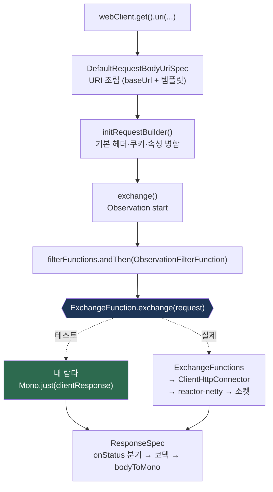

# WebClient 테스트 — 세 가지 층위

WebClient를 테스트한다는 말은 세 가지 다른 일을 가리킨다. `ExchangeFunction` 스텁으로 HTTP 없이 파이프라인을 검증하는 것, `MockWebServer`로 실제 소켓 왕복을 검증하는 것, 그리고 `WebTestClient`로 **서버**를 검증하는 것. 이 셋은 대체 관계가 아니다.

## 목차
- [1. 핵심 개념 (What)](#1-핵심-개념-what)
- [2. 왜 알아야 하는가 (Why)](#2-왜-알아야-하는가-why)
- [3. 내부 구현 분석 (How)](#3-내부-구현-분석-how)
- [4. 실전 예제](#4-실전-예제)
- [5. 정리](#5-정리)

---

## 1. 핵심 개념 (What)

```
┌─────────────────────────────────────────────────────────────────────┐
│ (1) ExchangeFunction 스텁                                            │
│     [WebClient] → filter → [람다] ✂ 소켓 없음                        │
│     ✅ URI 조립, 헤더/쿠키, 필터 순서, onStatus 분기, 재시도 판정       │
│     ❌ 타임아웃, 커넥션 재사용, 실제 HTTP 프레이밍                      │
│     빠름 (~1ms), JUnit 단독                                          │
├─────────────────────────────────────────────────────────────────────┤
│ (2) MockWebServer                                                   │
│     [WebClient] → TCP/HTTP → [MockWebServer]                        │
│     ✅ 코덱 왕복, 타임아웃, 지연, 연결 끊김, 실제 헤더 바이트           │
│     ❌ 서버 측 비즈니스 로직                                          │
│     느림 (~50ms), 포트 바인딩                                        │
├─────────────────────────────────────────────────────────────────────┤
│ (3) WebTestClient (spring-test)                                     │
│     [WebTestClient] → mock 또는 HTTP → [내 WebFlux 앱]               │
│     ✅ 내 컨트롤러·라우터·WebFilter·직렬화                             │
│     ❌ WebClient 자체의 동작 — **WebClient 테스트 도구가 아니다**       │
└─────────────────────────────────────────────────────────────────────┘
```

| 도구 | 테스트 대상 | 필요한 의존성 |
|---|---|---|
| `ExchangeFunction` 람다 | **내 WebClient 호출 코드** | `spring-webflux` 만 |
| `MockWebServer` | **내 코드 + 실제 HTTP 스택** | `com.squareup.okhttp3:mockwebserver` |
| `WebTestClient` | **내 서버 애플리케이션** | `spring-test` |
| `StepVerifier` | 비동기 결과 (위 셋 모두에 공통) | `reactor-test` |

---

## 2. 왜 알아야 하는가 (Why)

### 2.1 `ExchangeFunction` 이 함수형 인터페이스인 것은 테스트 설계다

```java
// ExchangeFunction.java:40-55
@FunctionalInterface
public interface ExchangeFunction {

    Mono<ClientResponse> exchange(ClientRequest request);

    default ExchangeFunction filter(ExchangeFilterFunction filter) {
        return filter.apply(this);
    }
}
```

추상 메서드가 하나다. `WebClient.Builder.exchangeFunction(...)` 에 **람다 하나**를 꽂으면 소켓 없이 `DefaultWebClient` 의 전 로직(URI 조립, 기본 헤더 병합, 필터 체인, `onStatus` 분기, `ResponseSpec` 변환)이 그대로 실행된다.

Spring 자신의 테스트가 이 방식을 쓴다. `ExchangeFilterFunctionsTests` 는 Mockito 없이 람다로 끝낸다 (`ExchangeFilterFunctionsTests.java:57`, `:85`):

```java
ClientResponse response = mock();
ExchangeFunction exchange = r -> Mono.just(response);
```

요청 검증도 람다 안에서 바로 한다 (`:104-109`):

```java
ExchangeFunction exchange = r -> {
    assertThat(r.headers().containsKey(HttpHeaders.AUTHORIZATION)).isTrue();
    assertThat(r.headers().getFirst(HttpHeaders.AUTHORIZATION)).startsWith("Basic ");
    return Mono.just(response);
};
```

`DefaultWebClientTests` 는 Mockito를 쓰되 같은 주입점을 쓴다 (`DefaultWebClientTests.java:65-80`):

```java
@Mock private ExchangeFunction exchangeFunction;
@Captor private ArgumentCaptor<ClientRequest> captor;

@BeforeEach
void setup() {
    ClientResponse mockResponse = mock();
    when(mockResponse.statusCode()).thenReturn(HttpStatus.OK);
    when(mockResponse.bodyToMono(Void.class)).thenReturn(Mono.empty());
    given(this.exchangeFunction.exchange(this.captor.capture())).willReturn(Mono.just(mockResponse));
    this.builder = WebClient.builder().baseUrl("/base").exchangeFunction(this.exchangeFunction);
}
```

이후 `ArgumentCaptor<ClientRequest>` 로 잡아 `request.url()` 을 단정하는 패턴이 반복된다 (`:83-91`).

**둘 중 무엇을 쓸까**: 요청만 검증하면 람다가 간결하다. 호출 횟수(`verifyNoMoreInteractions`)나 연속 호출마다 다른 응답(`thenReturn(a, b)`)이 필요하면 Mockito가 편하다.

### 2.2 `WebTestClient` 는 WebClient 테스트 도구가 아니다

Javadoc이 명확하다 (`WebTestClient.java:67-70`):

> Client for testing **web servers** that uses {@link WebClient} internally to perform requests while also providing a fluent API to verify responses. This client can connect to any server over HTTP, or to a WebFlux application via mock request and response objects.

즉 WebClient는 테스트의 **수단**이고 대상이 아니다. `bindToController`/`bindToRouterFunction`/`bindToApplicationContext` 는 서버를 꽂는 메서드이고 `bindToServer()` 조차 "내가 띄운 서버에 붙는다"는 뜻이다. **WebClient를 쓰는 클라이언트 클래스를 테스트하려고 `WebTestClient` 를 꺼내는 것은 방향이 반대다** — 그 경우 (1) 또는 (2)를 쓴다.

### 2.3 MockWebServer의 artifact와 패키지가 버전마다 다르다

Spring Framework **v6.2.19** 기준으로는 legacy okhttp 3 MockWebServer다.

```groovy
// framework-platform/framework-platform.gradle:39
api("com.squareup.okhttp3:mockwebserver:3.14.9")
// spring-webflux/spring-webflux.gradle:42
testImplementation("com.squareup.okhttp3:mockwebserver")
```
```java
// WebClientIntegrationTests.java:45-47
import okhttp3.mockwebserver.MockResponse;
import okhttp3.mockwebserver.MockWebServer;
import okhttp3.mockwebserver.RecordedRequest;
```

패키지는 **`okhttp3.mockwebserver`** 이고 `mockwebserver3` 이 아니다. (`mockwebserver3` 네임스페이스는 okhttp 5 계열의 새 artifact로, v6.2.19 테스트 소스에는 등장하지 않는다. 새 artifact를 쓰면 import 경로만 바뀌고 아래 패턴은 그대로 통한다.)

### 2.4 `block()` 대신 `StepVerifier`

`block()` 은 값 하나만 확인한다. `StepVerifier` 는 **신호의 순서·종류와 소요 시간**을 확인한다.

```java
// ❌ 에러 타입은 확인하지만 "값 없이 바로 에러인지"는 모른다
assertThatThrownBy(() -> mono.block()).isInstanceOf(WebClientResponseException.class);

// ✅ 값이 안 왔고, 그 타입의 에러가 왔고, 3초 안에 끝났다
StepVerifier.create(mono)
        .expectError(WebClientResponseException.class)
        .verify(Duration.ofSeconds(3));
```

Spring의 통합 테스트가 전부 이 형태다 (`WebClientIntegrationTests.java:156-159`). `StepVerifier` 의 전반적인 사용법은 [`../main/12-testing-debugging.md`](../main/12-testing-debugging.md).

---

## 3. 내부 구현 분석 (How)

### 3.1 `exchangeFunction(...)` 을 꽂으면 어디까지 실행되나



`DefaultWebClientBuilder` 는 `exchangeFunction` 이 지정되면 그것을 쓰고, 아니면 `ExchangeFunctions.create(connector, strategies)` 를 만든다. 즉 람다를 꽂으면 **`ExchangeFunctions` 이하 전부가 교체된다**. 교체되지 **않는** 것:

- URI 템플릿 확장과 `baseUrl` 결합
- `defaultHeaders`/`defaultCookies`/`defaultRequest` 병합
- 사용자 `ExchangeFilterFunction` 체인([`04-exchange-filter-function.md`](04-exchange-filter-function.md))
- Observation 생애([`10-observability.md`](10-observability.md))
- `ResponseSpec` 의 `onStatus` 분기와 기본 4xx/5xx → `WebClientResponseException` 변환
- `bodyToMono`/`bodyToFlux` 의 코덱 호출 — **단, `ClientResponse` 를 `mock()` 으로 만들면 이 단계가 스텁으로 대체된다**

마지막 항목이 중요하다. 코덱까지 타게 하려면 `ClientResponse.create(...)` 로 진짜 응답을 만들어야 한다.

### 3.2 `ClientResponse.create(...)` — 코덱을 타는 스텁

정적 팩토리 네 개 (`ClientResponse.java:246~277`): `create(HttpStatusCode)`(기본 `ExchangeStrategies.withDefaults()`), `create(HttpStatusCode, ExchangeStrategies)`, `create(int, ExchangeStrategies)`, `create(HttpStatusCode, List<HttpMessageReader<?>>)`. `Builder` 로 채운다 (`:327-407`): `statusCode`, `rawStatusCode`, `header(String, String...)`, `cookie`, `body(String)`, `body(Flux<DataBuffer>)`, `body(Function<Flux<DataBuffer>, Flux<DataBuffer>>)`.

이걸 쓰면 `bodyToMono(Order.class)` 가 **실제 Jackson 디코더를 타므로** 역직렬화 버그까지 잡힌다 — `mock(ClientResponse.class)` 는 못 잡는다(§4.1에 예제). 코덱과 `DataBuffer` 소유권 규칙은 [`05-codecs-and-databuffer.md`](05-codecs-and-databuffer.md).

### 3.3 MockWebServer 하네스 — Spring의 패턴

```java
// WebClientIntegrationTests.java:121-139
private MockWebServer server;
private WebClient webClient;

private void startServer(ClientHttpConnector connector) {
    this.server = new MockWebServer();
    this.webClient = WebClient.builder()
            .clientConnector(connector)
            .baseUrl(this.server.url("/").toString())
            .build();
}

@AfterEach
void shutdown() throws IOException {
    if (server != null) {
        this.server.shutdown();
    }
}
```

`new MockWebServer()` 는 `url(...)` 을 처음 호출할 때 포트를 자동 할당하며 시작한다 — `start()` 를 직접 부를 필요가 없다. 응답 큐잉·요청 검증 헬퍼는 `prepareResponse(Consumer<MockResponse>)` / `expectRequest(Consumer<RecordedRequest>)` / `expectRequestCount(int)` 세 개다 (`:1399-1418`, §4.2에 그대로 옮겼다).

`enqueue()` 는 FIFO 큐다 — "첫 응답 503, 두 번째 200"을 만들 때 그대로 쓴다. Spring은 커넥터 5종을 `@ParameterizedTest` 로 돌리지만(`:108-119`), 애플리케이션 테스트에서는 실제로 쓰는 커넥터 하나로 충분하다.

### 3.4 장애 시나리오를 만드는 API

mockwebserver 3.14.9 `MockResponse`: `setResponseCode(int)`, `setHeader(String, Object)`, `setBody(String)`, **`setHeadersDelay(long, TimeUnit)`**(응답 헤더 지연 → `responseTimeout` 테스트), **`setBodyDelay(long, TimeUnit)`**(본문 지연), `throttleBody(long, long, TimeUnit)`, **`setSocketPolicy(SocketPolicy)`**.

`SocketPolicy` 열거값 (jar에서 확인):

| 값 | 의미 | 쓸 곳 |
|---|---|---|
| `DISCONNECT_AT_START` | 요청 읽기 전에 끊기 | connection reset — netty 자동 재시도 트리거 |
| `DISCONNECT_AFTER_REQUEST` | 요청 받고 응답 전에 끊기 | 서버 도달 후 실패 |
| `DISCONNECT_DURING_RESPONSE_BODY` / `…REQUEST_BODY` | 전송 중 끊기 | 부분 수신 / 업로드 실패 |
| `NO_RESPONSE` / `STALL_SOCKET_AT_START` | 응답 없음(소켓 유지) / 소켓 정지 | read·response timeout |
| `FAIL_HANDSHAKE` | TLS 핸드셰이크 실패 | TLS 오류 경로 |
| `KEEP_OPEN`(기본) / `DISCONNECT_AT_END` | keep-alive 유지 / 응답 후 끊기 | 커넥션 재사용 / 재사용 불가 |
| `RESET_STREAM_AT_START` | HTTP/2 스트림 리셋 | h2 테스트 |
| `SHUTDOWN_SERVER_AFTER_RESPONSE`, `UPGRADE_TO_SSL_AT_END`, `SHUTDOWN_INPUT_AT_END`, `SHUTDOWN_OUTPUT_AT_END`, `EXPECT_CONTINUE`, `CONTINUE_ALWAYS` | 프로토콜 세부 | 특수 케이스 |

`DISCONNECT_AT_START` 가 특히 유용하다 — [`09-resilience-integration.md`](09-resilience-integration.md) §3.2의 netty 자동 1회 재시도를 `getRequestCount()` 로 실측할 수 있다.

### 3.5 가상 시간 — 재시도·타임아웃을 빠르게 테스트하기

백오프 2초짜리 재시도를 3회 테스트하면 실시간 6초가 날아간다. `StepVerifier.withVirtualTime(Supplier)` 가 `VirtualTimeScheduler` 를 `Schedulers` 팩토리에 꽂아 시간을 가짜로 만든다 (`StepVerifier.java:192`, `:220-222`):

```java
static <T> FirstStep<T> withVirtualTime(Supplier<? extends Publisher<? extends T>> scenarioSupplier, long n) {
    return withVirtualTime(scenarioSupplier, () -> VirtualTimeScheduler.getOrSet(true), n);
}
```

**지켜야 하는 두 규칙:**

1. **`Supplier` 안에서 Publisher를 만들어라.** 스케줄러가 꽂힌 *뒤에* 조립돼야 한다. 밖에서 만든 `Mono` 를 `create(...)` 에 넘기면 실제 스케줄러를 잡은 상태라 가상 시간이 안 먹는다.
2. **`Retry.backoff(...)` 의 기본 백오프 스케줄러는 `Schedulers::parallel` 이다** (`Retry.java:167-170`). 팩토리 참조라 `VirtualTimeScheduler.getOrSet()` 이 교체할 수 있다. 반면 `.scheduler(Schedulers.boundedElastic())` 처럼 **인스턴스를 직접 넘기면** 교체 대상이 아니어서 실시간으로 돈다.

가상 시간은 **네트워크 지연을 가상화하지 못한다.** 그래서 조합을 이렇게 갈라야 한다.

| 테스트할 것 | 도구 |
|---|---|
| 백오프 간격·재시도 횟수·`Retry-After` 해석 | `ExchangeFunction` 스텁 + `withVirtualTime` |
| `responseTimeout` 이 실제로 끊는가 | MockWebServer + `setHeadersDelay` (실시간, 짧게) |
| 재시도 후 TCP 시도 횟수 | MockWebServer + `SocketPolicy` + `getRequestCount()` |

---

## 4. 실전 예제

테스트 대상 — [`09-resilience-integration.md`](09-resilience-integration.md) §4.3의 `OrderClient` 를 단순화한 형태:

```java
public Mono<Order> findById(String orderId) {
    return this.webClient.get()
            .uri("/orders/{id}", orderId)
            .retrieve()
            .onStatus(HttpStatus.NOT_FOUND::equals, r -> r.releaseBody().then(Mono.empty()))
            .bodyToMono(Order.class)
            .retryWhen(this.retrySpec);
}
```

### 4.1 층위 (1) — `ExchangeFunction` 스텁 (+ 가상 시간)

```java
package com.example.client.order;

// java.time.Duration, java.util.{ArrayList,List}
// java.util.concurrent.atomic.AtomicInteger, org.junit.jupiter.api.Test
// reactor.core.publisher.Mono, reactor.test.StepVerifier, reactor.util.retry.Retry
// com.example.client.resilience.RetryDecision
// org.springframework.core.codec.DecodingException
// org.springframework.http.{HttpHeaders,HttpMethod,HttpStatus,MediaType}
// org.springframework.web.reactive.function.client.{ClientRequest,ClientResponse,
//         ExchangeFunction,WebClient,WebClientResponseException}
// static org.assertj.core.api.Assertions.assertThat

/** HTTP 없이 OrderClient의 요청 조립·응답 처리·재시도 타이밍을 검증한다. */
class OrderClientExchangeFunctionTests {

    private static final String BASE_URL = "https://orders.internal";

    private final List<ClientRequest> captured = new ArrayList<>();

    /** 요청을 기록하고 지정한 응답을 순서대로 돌려주는 스텁.
     *  ExchangeFunction이 함수형 인터페이스라 람다 하나로 끝난다. */
    private ExchangeFunction stub(ClientResponse... responses) {
        return request -> {
            this.captured.add(request);
            return Mono.just(responses[Math.min(this.captured.size() - 1, responses.length - 1)]);
        };
    }

    private OrderClient client(ExchangeFunction exchange, Retry retry) {
        return new OrderClient(WebClient.builder().exchangeFunction(exchange), BASE_URL, retry);
    }

    private static ClientResponse json(HttpStatus status, String body) {
        return ClientResponse.create(status)
                .header(HttpHeaders.CONTENT_TYPE, MediaType.APPLICATION_JSON_VALUE)
                .body(body)
                .build();
    }

    private static Retry backoffSpec() {
        return Retry.backoff(2, Duration.ofSeconds(1))
                .maxBackoff(Duration.ofSeconds(10))
                .jitter(0d)                              // 테스트에서는 지터를 끈다
                .filter(RetryDecision::isRetryable)
                .onRetryExhaustedThrow((spec, signal) -> signal.failure());
    }

    @Test
    void uri템플릿과_baseUrl이_조립되고_속성에_템플릿이_남는다() {
        OrderClient client = client(
                stub(json(HttpStatus.OK, "{\"id\":\"o-1\",\"amount\":12000}")), Retry.max(0));

        StepVerifier.create(client.findById("o-1"))
                .expectNext(new Order("o-1", 12000))
                .verifyComplete();

        ClientRequest request = this.captured.get(0);
        assertThat(request.method()).isEqualTo(HttpMethod.GET);
        assertThat(request.url().toString()).isEqualTo(BASE_URL + "/orders/o-1");
        // uri 태그가 템플릿으로 남는지 — 10-observability.md §2.1
        assertThat(request.attribute(WebClient.class.getName() + ".uriTemplate"))
                .contains(BASE_URL + "/orders/{id}");
    }

    @Test
    void 실제_코덱을_타므로_역직렬화_버그를_잡는다() {
        // amount가 문자열로 오는 서버. mock(ClientResponse.class)로는 절대 못 잡는다
        StepVerifier.create(client(
                        stub(json(HttpStatus.OK, "{\"id\":\"o-1\",\"amount\":\"twelve\"}")),
                        Retry.max(0)).findById("o-1"))
                .expectError(DecodingException.class)
                .verify(Duration.ofSeconds(1));
    }

    @Test
    void onStatus로_404는_빈_Mono가_되고_400은_예외가_된다() {
        StepVerifier.create(client(stub(ClientResponse.create(HttpStatus.NOT_FOUND).build()),
                        Retry.max(0)).findById("missing"))
                .verifyComplete();   // onNext 없이 바로 complete

        StepVerifier.create(client(stub(json(HttpStatus.BAD_REQUEST, "{\"code\":\"INVALID_ID\"}")),
                        Retry.max(0)).findById("!!"))
                .expectErrorSatisfies(error -> assertThat(((WebClientResponseException) error)
                        .getResponseBodyAsString()).contains("INVALID_ID"))
                .verify(Duration.ofSeconds(1));
    }

    @Test
    void 백오프가_1초_2초로_증가하고_세번째_시도에_성공한다() {
        AtomicInteger attempts = new AtomicInteger();

        StepVerifier.withVirtualTime(() -> {
                    // ★ Supplier 안에서 조립해야 가상 스케줄러가 적용된다 (§3.5)
                    ExchangeFunction exchange = request -> {
                        int n = attempts.incrementAndGet();
                        return Mono.just(n < 3
                                ? ClientResponse.create(HttpStatus.SERVICE_UNAVAILABLE).build()
                                : json(HttpStatus.OK, "{\"id\":\"o-1\",\"amount\":12000}"));
                    };
                    return client(exchange, backoffSpec()).findById("o-1");
                })
                .expectSubscription()
                .expectNoEvent(Duration.ofSeconds(1))   // 첫 실패 → 1초 백오프
                .expectNoEvent(Duration.ofSeconds(2))   // 두 번째 실패 → 2초 (multiplier 2)
                .expectNext(new Order("o-1", 12000))
                .verifyComplete();

        assertThat(attempts).hasValue(3);   // 최초 1 + 재시도 2 = Retry.backoff(2, ...)
    }

    @Test
    void 재시도_대상이_아닌_400은_백오프_없이_즉시_실패한다() {
        AtomicInteger attempts = new AtomicInteger();

        StepVerifier.withVirtualTime(() -> client(request -> {
                    attempts.incrementAndGet();
                    return Mono.just(ClientResponse.create(HttpStatus.BAD_REQUEST).build());
                }, backoffSpec()).findById("o-1"))
                .expectSubscription()
                // filter 탈락 → 감싸지지 않은 원본 예외가 바로 간다 (09 문서 §3.1)
                .expectError(WebClientResponseException.BadRequest.class)
                .verify();

        assertThat(attempts).hasValue(1);
    }
}
```

### 4.2 층위 (2) — MockWebServer로 실제 왕복

```java
package com.example.client.order;

// java.io.IOException, java.time.Duration, java.util.concurrent.TimeUnit
// java.util.function.{Consumer,UnaryOperator}, io.netty.channel.ChannelOption
import okhttp3.mockwebserver.MockResponse;
import okhttp3.mockwebserver.MockWebServer;
import okhttp3.mockwebserver.RecordedRequest;
import okhttp3.mockwebserver.SocketPolicy;
// org.junit.jupiter.api.{AfterEach,BeforeEach,Test}
// reactor.netty.http.client.HttpClient, reactor.test.StepVerifier, reactor.util.retry.Retry
// org.springframework.http.{HttpHeaders,MediaType}
// org.springframework.http.client.reactive.ReactorClientHttpConnector
// org.springframework.web.reactive.function.client.{WebClient,
//         WebClientRequestException,WebClientResponseException}
// static org.assertj.core.api.Assertions.assertThat

/**
 * 실제 TCP/HTTP 왕복을 거친다. 타임아웃·연결 끊김을 검증한다.
 * 하네스 패턴은 Spring의 WebClientIntegrationTests에서 가져왔다.
 */
class OrderClientIntegrationTests {

    private static final Duration RESPONSE_TIMEOUT = Duration.ofMillis(300);

    private MockWebServer server;
    private OrderClient client;

    @BeforeEach
    void startServer() {
        this.server = new MockWebServer();   // url() 호출 시 자동 시작
        this.client = newClient(UnaryOperator.identity());
    }

    @AfterEach
    void shutdown() throws IOException {
        if (this.server != null) {
            this.server.shutdown();
        }
    }

    private OrderClient newClient(UnaryOperator<HttpClient> customizer) {
        HttpClient httpClient = customizer.apply(HttpClient.create()
                .option(ChannelOption.CONNECT_TIMEOUT_MILLIS, 500)
                .responseTimeout(RESPONSE_TIMEOUT));

        return new OrderClient(
                WebClient.builder().clientConnector(new ReactorClientHttpConnector(httpClient)),
                this.server.url("/").toString(),
                Retry.max(0));
    }

    @Test
    void 정상_응답을_역직렬화한다() {
        enqueue(response -> response
                .setHeader(HttpHeaders.CONTENT_TYPE, MediaType.APPLICATION_JSON_VALUE)
                .setBody("{\"id\":\"o-1\",\"amount\":12000}"));

        StepVerifier.create(this.client.findById("o-1"))
                .expectNext(new Order("o-1", 12000))
                .expectComplete()
                .verify(Duration.ofSeconds(3));

        expectRequest(request -> {
            assertThat(request.getPath()).isEqualTo("/orders/o-1");
            assertThat(request.getMethod()).isEqualTo("GET");
        });
        assertThat(this.server.getRequestCount()).isEqualTo(1);
    }

    @Test
    void 헤더_지연이_responseTimeout을_넘기면_끊긴다() {
        enqueue(response -> response
                .setHeadersDelay(RESPONSE_TIMEOUT.toMillis() * 3, TimeUnit.MILLISECONDS)
                .setBody("{}"));

        StepVerifier.create(this.client.findById("o-1"))
                .expectErrorSatisfies(error -> {
                    // 연결 단계/수신 중 실패는 WebClientRequestException으로 감싸진다
                    assertThat(error).isInstanceOf(WebClientRequestException.class);
                    assertThat(error.getCause()).isNotNull();   // ReadTimeoutException 계열
                })
                .verify(Duration.ofSeconds(3));
    }

    // setBodyDelay(...) 로 바꾸면 "헤더는 왔는데 본문이 안 오는" 상황이 된다.
    // responseTimeout은 "응답 완료"까지를 재므로 이 경우도 끊긴다 — 07-timeout-strategy.md

    @Test
    void reactor_netty는_connection_reset을_한_번_자동_재시도한다() {
        // 첫 연결은 요청을 읽기 전에 끊긴다 → AbortedException.isConnectionReset == true
        enqueue(response -> response.setSocketPolicy(SocketPolicy.DISCONNECT_AT_START));
        enqueue(response -> response
                .setHeader(HttpHeaders.CONTENT_TYPE, MediaType.APPLICATION_JSON_VALUE)
                .setBody("{\"id\":\"o-1\",\"amount\":12000}"));

        // 애플리케이션 재시도는 0회(Retry.max(0))인데도 성공한다 — netty가 다시 시도했다
        StepVerifier.create(this.client.findById("o-1"))
                .expectNext(new Order("o-1", 12000))
                .expectComplete()
                .verify(Duration.ofSeconds(3));
    }

    @Test
    void disableRetry를_켜면_자동_재시도가_사라진다() {
        OrderClient noRetry = newClient(httpClient -> httpClient.disableRetry(true));

        enqueue(response -> response.setSocketPolicy(SocketPolicy.DISCONNECT_AT_START));
        enqueue(response -> response.setBody("{\"id\":\"o-1\",\"amount\":12000}"));

        StepVerifier.create(noRetry.findById("o-1"))
                .expectError(WebClientRequestException.class)
                .verify(Duration.ofSeconds(3));
    }

    // Retry-After 해석을 검증하려면 setResponseCode(503)
    //     .setHeader(HttpHeaders.RETRY_AFTER, "2") 를 enqueue하고
    //     WebClientResponseException.getHeaders() 를 단정한다 — 09 문서 §4.1

    // --- Spring의 WebClientIntegrationTests와 같은 헬퍼 ---

    private void enqueue(Consumer<MockResponse> consumer) {
        MockResponse response = new MockResponse();
        consumer.accept(response);
        this.server.enqueue(response);
    }

    private void expectRequest(Consumer<RecordedRequest> consumer) {
        try {
            consumer.accept(this.server.takeRequest());
        }
        catch (InterruptedException ex) {
            throw new IllegalStateException(ex);
        }
    }
}
```

### 4.3 층위 (3) — `WebTestClient` 는 내 서버를 검증한다

```java
/** WebTestClient는 "서버가 무엇을 내보내는가"를 고정한다. 소비자 테스트 도구가 아니다 — §2.2 */
class OrderControllerTests {

    private final OrderService service = orderId -> Mono.just(new OrderResponse(orderId, 12000));

    private final WebTestClient webTestClient = WebTestClient
            .bindToController(new OrderController(this.service))
            .build();

    @Test
    void 주문_조회_응답_계약() {
        this.webTestClient.get()
                .uri("/orders/{id}", "o-1")
                .accept(MediaType.APPLICATION_JSON)
                .exchange()
                .expectStatus().isOk()
                .expectHeader().contentType(MediaType.APPLICATION_JSON)
                .expectBody()
                .jsonPath("$.id").isEqualTo("o-1")
                .jsonPath("$.amount").isEqualTo(12000);
    }
}
```

`bindToController` 는 서버를 mock 요청/응답으로 돌려 포트를 안 쓴다. 실제 소켓이 필요하면 `@SpringBootTest(webEnvironment = RANDOM_PORT)` + `bindToServer()`.

### 4.4 어떤 테스트를 몇 개 쓸까

실무 비율은 대략 **(1) 10개 : (2) 3개 : (3) 서버 엔드포인트당 1개**. (2)는 "이 설정이 정말 그렇게 동작하나"를 한 번 못 박는 용도라 많을 필요가 없다 — 대신 CI에서 반드시 돌려야 한다. **타임아웃 설정 오타는 (1)로는 절대 안 잡힌다.**

---


## 5. 정리

| 항목 | 결론 |
|---|---|
| `ExchangeFunction` | `@FunctionalInterface` (`ExchangeFunction.java:40`) → 람다 하나로 HTTP 없이 `DefaultWebClient` 전체 로직 테스트 |
| Spring의 방식 | `ExchangeFilterFunctionsTests` 는 람다(`r -> Mono.just(response)`), `DefaultWebClientTests` 는 `@Mock ExchangeFunction` + `ArgumentCaptor<ClientRequest>` |
| 코덱까지 타려면 | `mock(ClientResponse.class)` 대신 `ClientResponse.create(status).header(...).body(json).build()` |
| MockWebServer (v6.2.19) | `com.squareup.okhttp3:mockwebserver:3.14.9`, 패키지 **`okhttp3.mockwebserver`** (`mockwebserver3` 아님) |
| MWS 하네스 | `new MockWebServer()` → `server.url("/")` 로 baseUrl, `@AfterEach` 에서 `shutdown()`, `enqueue()` 는 FIFO |
| 장애 시나리오 | `setHeadersDelay`/`setBodyDelay`(타임아웃), `setSocketPolicy(DISCONNECT_AT_START / NO_RESPONSE / FAIL_HANDSHAKE / …)` |
| 자동 재시도 실측 | `DISCONNECT_AT_START` + `getRequestCount()` → netty의 1회 재시도가 눈에 보인다 |
| `WebTestClient` | **서버 검증용**. 내부적으로 WebClient를 쓰는 테스트 클라이언트이지, WebClient 단위 테스트의 대체물이 아니다 |
| `StepVerifier` | `block()` 과 달리 신호 순서·종류·소요 시간을 함께 단정. `.verify(Duration)` 으로 상한을 둬라 |
| 가상 시간 | `StepVerifier.withVirtualTime(Supplier)` — **Supplier 안에서 조립**해야 한다 |
| 가상 시간 한계 | `Schedulers` 팩토리만 교체한다. 스케줄러 인스턴스를 직접 넘긴 백오프와 네트워크 지연은 실시간 |
| 테스트 비율 | 스텁 다수 : MWS 소수 : WebTestClient는 서버 엔드포인트당 |

---

## 관련 문서
- 선행: [관측성](10-observability.md)
- 선행: [retrieve vs exchange](03-retrieve-vs-exchange.md)
- 선행: [코덱과 DataBuffer](05-codecs-and-databuffer.md)
- 후행: [Spring Boot 4 / Framework 7 마이그레이션](12-boot4-spring7-migration.md)
- 참조: [Reactor — 테스트와 디버깅](../main/12-testing-debugging.md)

---
*참고: Spring Framework 6.2.19 / reactor-netty 1.2.18 / Reactor Core 3.7.19 기준*
