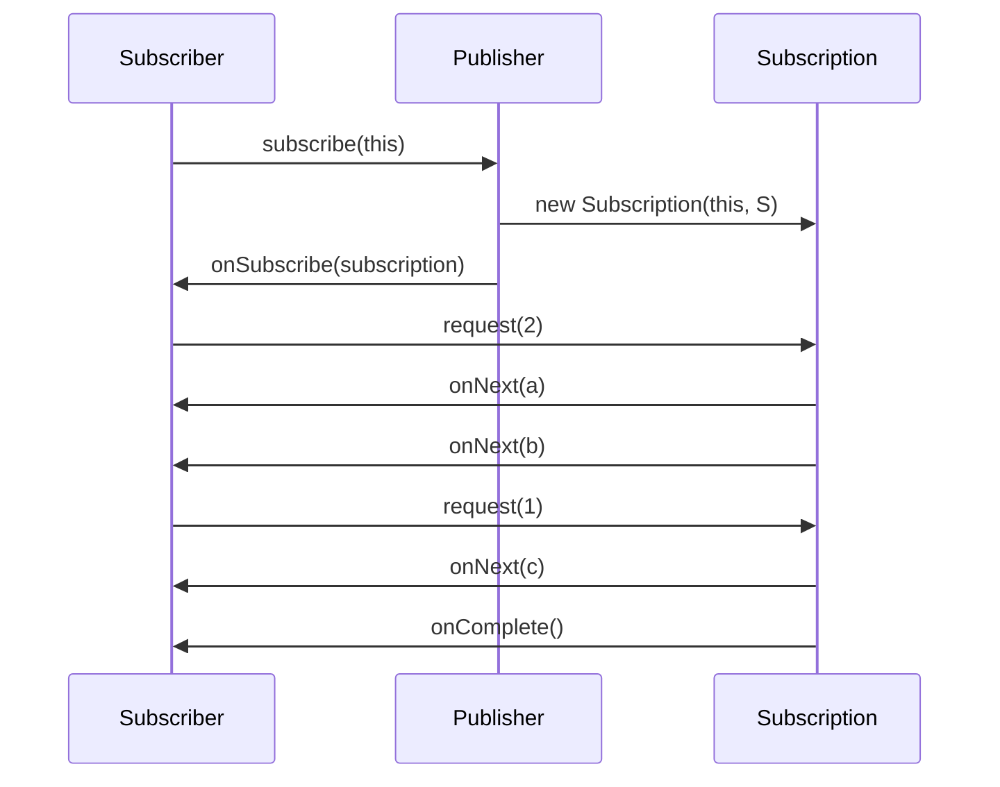

# 리액티브 스트림 규약과 Flux/Mono

Reactive Streams는 네 개의 인터페이스와 몇 줄짜리 규약으로 된 아주 작은 명세다. Reactor는 이 명세를 `CorePublisher`/`CoreSubscriber`로 확장하면서 일부 규칙을 의도적으로 완화했고, 그 위에 `Flux`(0..N)와 `Mono`(0..1)를 타입으로 분리했다.

## 목차
- [1. 핵심 개념 (What)](#1-핵심-개념-what)
- [2. 왜 알아야 하는가 (Why)](#2-왜-알아야-하는가-why)
- [3. 내부 구현 분석 (How)](#3-내부-구현-분석-how)
- [4. 실전 예제](#4-실전-예제)
- [5. 정리](#5-정리)

---

## 1. 핵심 개념 (What)

### 1.1 네 개의 인터페이스

Reactor Core 3.7.19가 의존하는 Reactive Streams 버전은 `1.0.4`다 (`gradle/libs.versions.toml:14`). 이 라이브러리가 제공하는 건 `org.reactivestreams` 패키지의 네 인터페이스뿐이다.

| 인터페이스 | 메서드 | 역할 |
|---|---|---|
| `Publisher<T>` | `subscribe(Subscriber<? super T>)` | 데이터 생산 측. 구독을 받아들인다 |
| `Subscriber<T>` | `onSubscribe(Subscription)`, `onNext(T)`, `onError(Throwable)`, `onComplete()` | 데이터 소비 측. 신호를 받는다 |
| `Subscription` | `request(long)`, `cancel()` | 생산자-소비자 사이의 **1:1 계약**. 배압과 취소의 통로 |
| `Processor<T,R>` | (`Subscriber<T>` + `Publisher<R>`) | 소비하면서 생산하는 중간 단계 |

중요한 건 `Subscription`이다. `Publisher`와 `Subscriber`는 서로를 직접 알지 않고, 구독마다 새로 만들어지는 `Subscription` 하나를 통해서만 대화한다. 배압(backpressure)이라는 말은 결국 "`Subscriber`가 `request(n)`을 호출한 만큼만 `onNext`가 온다"는 이 한 줄이다.

### 1.2 신호 프로토콜



정규 표현식으로 쓰면 이렇다.

```
onSubscribe onNext* (onError | onComplete)?
```

- `onSubscribe`는 **정확히 한 번**, 가장 먼저.
- `onNext`는 0회 이상, 단 지금까지 누적 `request`한 합계를 넘지 않는다.
- `onError`/`onComplete`는 둘 중 **최대 하나**, 최대 한 번. 그 뒤로는 어떤 신호도 오지 않는다.
- `cancel()` 이후에도 이미 출발한 `onNext`가 도착할 수 있다. 취소는 "즉시 멈춤"이 아니라 "더 이상 필요없다는 통보"다.

### 1.3 Reactor 소스가 직접 이름을 부르는 규약 조항

규약 조항 번호를 외울 필요는 없지만, Reactor 소스 안에서 **에러 메시지로 등장하는 네 개**는 알아두면 스택트레이스를 읽을 때 바로 해석된다.

| 조항 | 내용 | 소스에서 등장하는 곳 |
|---|---|---|
| §1.3 | `onSubscribe`/`onNext`/`onError`/`onComplete`는 **직렬로(serially)** 신호되어야 한다 | `InternalManySink.java:57`, `NextProcessor.java:231` |
| §1.9 | `Publisher.subscribe`는 신호 전에 `onSubscribe`를 호출해야 한다 → 그래서 이미 `Subscription`을 받은 구독자는 두 번째 `onSubscribe`를 무시해도 된다 | `Operators.canAppearAfterOnSubscribe()` `publisher/Operators.java:179` |
| §2.12 | `Subscriber.onSubscribe`는 (객체 동일성 기준) **한 번 넘게 호출되어서는 안 된다** | `Exceptions.duplicateOnSubscribeException()` `core/Exceptions.java:197`, `StrictSubscriber.java:82` |
| §3.9 | `request(n)`에서 `n <= 0`이면 `IllegalArgumentException`으로 `onError`를 **반드시** 신호해야 한다 | `Exceptions.nullOrNegativeRequestException()` `core/Exceptions.java:391`, `StrictSubscriber.java:133` |

> 위 번호는 Reactor 소스가 직접 문자열로 적어둔 것만 골랐다. 전체 규약 문장은 reactive-streams 명세 문서를 봐야 한다.

---

## 2. 왜 알아야 하는가 (Why)

### 2.1 Reactor는 규약을 "그대로" 구현하지 않았다

`§3.9`를 그대로 지키면 `request(0)` 한 번에 전체 시퀀스가 `onError`로 터진다. 그런데 Reactor의 연산자들은 내부에서 `request`를 합산·분배하면서 계산상 0이 나오는 경우가 생긴다. 규약을 글자 그대로 지키려면 모든 연산자가 매번 방어 코드를 써야 하고, 그 비용은 핫 패스에 그대로 얹힌다.

그래서 Reactor는 **내부 구독자끼리는 완화된 규칙을 쓰고, 외부 경계에서만 엄격하게 지킨다**는 선택을 했다. 이 경계가 `CoreSubscriber`와 `StrictSubscriber`다. 이걸 모르면 두 가지에서 헤맨다.

1. 커스텀 연산자를 만들었는데 `request(0)`이 조용히 삼켜져서 디버깅이 안 된다 → 완화 때문이다.
2. 서드파티 `Publisher`를 Reactor 체인에 붙였더니 `§2.12 violated` 또는 `§3.9 violated`가 뜬다 → `StrictSubscriber`가 감싸면서 엄격 모드가 켜진 것이다.

### 2.2 `Flux`와 `Mono`를 나눈 이유는 "문서화"가 아니다

`Mono<T>`는 `Flux<T>`의 특수화가 아니라 **독립 클래스**다. 둘 다 `CorePublisher<T>`를 직접 구현한다.

```java
public abstract class Flux<T> implements CorePublisher<T>   // publisher/Flux.java:126
public abstract class Mono<T> implements CorePublisher<T>   // publisher/Mono.java:121
```

카디널리티가 타입에 박히면 실익이 생긴다.

- `Mono`는 값이 최대 하나니까 **큐가 필요 없다**. `Operators.MonoSubscriber`는 `O value` 필드 하나와 `int state` 하나로 전체 배압을 처리한다 (`publisher/Operators.java:1801`). `Flux` 쪽 연산자가 `Queues.small()` 같은 링버퍼를 잡는 것과 대비된다.
- `Mono.flatMap`은 `Mono`를 반환하므로 인터리빙이 없다. 그래서 `MonoFlatMap`은 `maxConcurrency`나 메인 큐 없이 "두 번째 소스" 하나만 추적한다 (`publisher/MonoFlatMap.java:78`의 `volatile FlatMapInner<R> second`).
- API 수준에서 애초에 실수를 막는다. `Mono`에는 `concatMap`이나 `buffer`가 없다.

### 2.3 콜드/핫 구분이 버그의 근원이다

"왜 두 번째 구독자는 데이터를 못 받나요?" 혹은 "왜 HTTP 요청이 두 번 나가나요?"의 답은 거의 항상 콜드/핫 구분이다. 이건 규약에 없는, 구현체가 정하는 성질이다.

---

## 3. 내부 구현 분석 (How)

### 3.1 `CorePublisher` — 훅을 우회하는 내부 진입점

```java
public interface CorePublisher<T> extends Publisher<T> {
	void subscribe(CoreSubscriber<? super T> subscriber);
}
```
`core/CorePublisher.java:34-46`

딱 메서드 하나를 추가한다. javadoc이 목적을 명시한다 (`core/CorePublisher.java:36-41`).

- `Hooks#onLastOperator` 포인트컷을 **우회**한다. 전역 훅은 사용자가 `subscribe`를 호출한 최상단에서 딱 한 번만 적용되어야 하고, 체인 내부의 연산자끼리 서로를 구독할 때 매번 적용되면 안 된다.
- `Context`를 구독 시점에 직접 전달할 수 있다.

즉 `Publisher.subscribe(Subscriber)`는 **공용 현관**이고 `CorePublisher.subscribe(CoreSubscriber)`는 **내부 통로**다. 이 두 갈래가 어떻게 갈라지는지는 [조립 시점 vs 구독 시점](02-assembly-vs-subscribe-time.md)에서 자세히 다룬다.

### 3.2 `CoreSubscriber` — 완화된 규칙과 `currentContext()`

```java
/**
 * A {@link Context} aware subscriber which has relaxed rules for §1.3 and §3.9
 * compared to the original {@link org.reactivestreams.Subscriber} ...
 * If an invalid request {@code <= 0} is done on the received subscription, the request
 * will not produce an onError and will simply be ignored.
 */
public interface CoreSubscriber<T> extends Subscriber<T> {

	default Context currentContext(){
		return Context.empty();
	}

	@Override
	void onSubscribe(Subscription s);
}
```
`core/CoreSubscriber.java:23-61`

추가/변경되는 건 두 가지다.

**(1) `currentContext()`** — 기본 구현이 `Context.empty()`를 반환한다. 연산자 내부 구독자는 이걸 오버라이드해서 다운스트림의 컨텍스트를 그대로 흘려보낸다.

```java
interface InnerOperator<I, O> extends InnerConsumer<I>, InnerProducer<O> {
	@Override
	default Context currentContext() {
		return actual().currentContext();
	}
}
```
`publisher/InnerOperator.java:28-34`

컨텍스트가 **다운스트림 → 업스트림** 방향으로 전파되는 이유가 바로 이 한 줄이다. `actual()`은 다운스트림 구독자고, 각 연산자는 자기 컨텍스트를 묻는 질문을 다운스트림으로 넘긴다. 자세한 건 [컨텍스트 전파](09-context-propagation.md) 참고.

**(2) `§3.9` 완화** — `n <= 0`인 `request`는 `onError` 없이 무시된다. 구현은 `Operators.validate(long)`이다.

```java
public static boolean validate(long n) {
	if (n <= 0) {
		reportBadRequest(n);
		return false;
	}
	return true;
}
```
`publisher/Operators.java:1360-1366`

`reportBadRequest`는 예외를 던지지 않는다. **디버그 로그만 남긴다.**

```java
public static void reportBadRequest(long n) {
	if (log.isDebugEnabled()) {
		log.debug("Negative request",
				Exceptions.nullOrNegativeRequestException(n));
	}
}
```
`publisher/Operators.java:1145-1150`

`§1.3`(직렬 신호) 완화에 대해서는 `CoreSubscriber.onSubscribe`의 javadoc이 구현자 쪽 책임을 명시한다 — "`onNext`가 쓰는 상태는 `request(long)`을 호출하기 **전에** 초기화하라. 그 뒤에 `onNext` 관련 상태를 바꾸려면 스레드 안전성이 필요하다" (`core/CoreSubscriber.java:48-58`). `request()` 호출이 그 자리에서 재진입으로 `onNext`를 유발할 수 있기 때문이다.

### 3.3 경계에서의 엄격 모드 — `StrictSubscriber`

그렇다면 Reactor 밖에서 온 평범한 `Subscriber`는 어떻게 되나. `Operators.toCoreSubscriber()`가 경계를 만든다.

```java
public static <T> CoreSubscriber<? super T> toCoreSubscriber(Subscriber<? super T> actual) {
	Objects.requireNonNull(actual, "actual");
	CoreSubscriber<? super T> _actual;
	if (actual instanceof CoreSubscriber){
		_actual = (CoreSubscriber<? super T>) actual;
	}
	else {
		_actual = new StrictSubscriber<>(actual);
	}
	return _actual;
}
```
`publisher/Operators.java:1378-1392`

`CoreSubscriber`가 아니면 `StrictSubscriber`로 감싼다. 그리고 `StrictSubscriber`는 완화를 되돌린다.

```java
@Override
public void request(long n) {
	if (n <= 0) {
		cancel();
		onError(new IllegalArgumentException(
				"§3.9 violated: positive request amount required but it was " + n));
		return;
	}
	...
}
```
`publisher/StrictSubscriber.java:129-135`

`onSubscribe` 중복 호출도 같은 방식으로 잡는다 (`publisher/StrictSubscriber.java:82`). 거기다 `WIP`/`ERROR` 필드로 `onNext`와 종료 신호를 직렬화해서 `§1.3`도 강제한다 (`publisher/StrictSubscriber.java:86-126`).

```
외부 Subscriber ──toCoreSubscriber()──▶ StrictSubscriber (엄격: §1.3/§2.12/§3.9 강제)
                                              │
CoreSubscriber   ──toCoreSubscriber()──▶ 그대로 통과 (완화: <=0 request 무시)
```

이 설계의 결론: **규약 준수 비용을 체인당 한 번만 낸다.** 내부 수백 개 구독자는 완화된 빠른 경로를 쓰고, 외부와 맞닿는 한 지점에서만 엄격 래퍼가 붙는다.

### 3.4 `Processor`는 3.7에서 어떤 상태인가

`FluxProcessor`와 `MonoProcessor`는 **3.7.19에도 아직 존재하지만 `@Deprecated`다.**

```java
/**
 * @deprecated Processors will be removed in 3.5. Prefer using {@link Many} instead, ...
 */
@Deprecated
public abstract class FluxProcessor<IN, OUT> extends Flux<OUT>
		implements Processor<IN, OUT>, CoreSubscriber<IN>, Scannable, Disposable, ContextHolder {
```
`publisher/FluxProcessor.java:44-49`

`MonoProcessor`도 동일하게 `@Deprecated` 선언을 유지한다 (`publisher/MonoProcessor.java:49-56`). javadoc이 "3.5에서 제거"라고 말하지만 3.7.19 소스에는 여전히 남아 있다.

대체물은 `Sinks`다. 예를 들어 리플레이 싱크의 구현 클래스는 `SinkManyReplayProcessor`이고, 이건 `Processor`를 구현하지 않는다.

```java
final class SinkManyReplayProcessor<T> extends Flux<T> implements InternalManySink<T>,
		CoreSubscriber<T>, ContextHolder, Disposable, Fuseable, Scannable {
```
`publisher/SinkManyReplayProcessor.java:53`

`Flux`를 상속하고 `InternalManySink`를 구현한다. `Publisher`이면서 방출 API를 가지지만, `Subscriber`로 업스트림에 **구독되지는 않는다**. `Processor`의 양방향성을 버리고 "방출 API를 가진 Publisher"로 좁힌 것이 Sinks의 설계다. 자세한 건 [Sinks](11-sinks.md) 참고.

### 3.5 콜드 퍼블리셔 — 구독마다 새 파이프라인

```java
public static <T> Flux<T> just(T data) {
	return onAssembly(new FluxJust<>(data));
}
```
`publisher/Flux.java:1331-1333`

```java
final class FluxJust<T> extends Flux<T>
		implements Fuseable.ScalarCallable<T>, Fuseable, SourceProducer<T> {
	final T value;
```
`publisher/FluxJust.java:51-55`

`FluxJust`는 `value` 하나를 들고 있고, 구독이 올 때마다 그 값으로 새 `Subscription`을 만들어 준다. 구독자 A와 B는 각각 처음부터 받는다. 이게 **콜드**다.

`Flux.just(T...)`는 가변 인자 버전인데, 단일 값 버전과 달리 `fromArray`로 위임한다.

```java
@SafeVarargs
public static <T> Flux<T> just(T... data) {
	return fromArray(data);
}
```
`publisher/Flux.java:1316-1319`

콜드의 극단은 `defer`다. 소스 객체 자체를 구독 시점까지 만들지 않는다.

```java
public static <T> Flux<T> defer(Supplier<? extends Publisher<T>> supplier) {
	return onAssembly(new FluxDefer<>(supplier));
}
```
`publisher/Flux.java:809-811`

### 3.6 핫 퍼블리셔 — 구독자들이 하나의 소스를 공유

```java
public final Flux<T> share() {
	return onAssembly(
			new FluxRefCount<>(new FluxPublish<>(
					this, Queues.SMALL_BUFFER_SIZE, Queues.small(), true
			), 1)
	);
}
```
`publisher/Flux.java:8354-8360`

`FluxPublish`가 멀티캐스트를, `FluxRefCount`가 "구독자 수가 1이 되면 업스트림 구독"을 담당한다. 업스트림 구독은 **한 번만** 일어나고, 그 뒤에 들어온 구독자는 그 시점부터의 신호만 본다. 늦게 온 구독자가 앞 데이터를 놓치는 이유다.

`publish()`는 수동 제어 버전으로, `ConnectableFlux`를 반환해 `connect()` 타이밍을 직접 잡게 한다 (`publisher/Flux.java:7565-7567`).

```
콜드 (Flux.just, Flux.defer, WebClient 호출 등)
  구독자A ──▶ [소스 인스턴스 #1] ──▶ 전체 데이터
  구독자B ──▶ [소스 인스턴스 #2] ──▶ 전체 데이터   (작업이 두 번 실행됨)

핫 (share, publish().connect(), Sinks.many())
                     ┌──▶ 구독자A (처음부터)
  [소스 인스턴스 #1] ─┤
                     └──▶ 구독자B (늦게 붙음 → 앞부분 유실)
```

---

## 4. 실전 예제

### 예제 1: 완화 규칙을 눈으로 확인하기

`CoreSubscriber`로 `request(0)`을 호출하면 조용히 무시되고, 같은 일을 평범한 `Subscriber`로 하면 `§3.9` 위반으로 터진다.

```java
import org.reactivestreams.Subscriber;
import org.reactivestreams.Subscription;
import reactor.core.CoreSubscriber;
import reactor.core.publisher.Flux;

public class RelaxationDemo {

    public static void main(String[] args) {
        System.out.println("--- CoreSubscriber: 완화 경로 ---");
        Flux.just("a", "b").subscribe(new CoreSubscriber<String>() {
            @Override
            public void onSubscribe(Subscription s) {
                s.request(0);            // 무시됨. onError 없음
                s.request(1);            // 정상 동작
            }
            @Override public void onNext(String t)      { System.out.println("onNext: " + t); }
            @Override public void onError(Throwable t)  { System.out.println("onError: " + t); }
            @Override public void onComplete()          { System.out.println("onComplete"); }
        });

        System.out.println("--- 평범한 Subscriber: StrictSubscriber 가 감싸는 경로 ---");
        Flux.just("a", "b").subscribe(new Subscriber<String>() {
            @Override
            public void onSubscribe(Subscription s) {
                s.request(0);            // §3.9 violated → cancel + onError
            }
            @Override public void onNext(String t)      { System.out.println("onNext: " + t); }
            @Override public void onError(Throwable t)  { System.out.println("onError: " + t); }
            @Override public void onComplete()          { System.out.println("onComplete"); }
        });
    }
}
```

예상 출력:

```
--- CoreSubscriber: 완화 경로 ---
onNext: a
--- 평범한 Subscriber: StrictSubscriber 가 감싸는 경로 ---
onError: java.lang.IllegalArgumentException: §3.9 violated: positive request amount required but it was 0
```

첫 번째는 `request(0)`이 무시되고 `request(1)`만 먹혀서 `a` 하나만 나온다. 두 번째는 `Operators.toCoreSubscriber()`가 `StrictSubscriber`를 끼운 결과다 (`publisher/Operators.java:1384-1388`).

### 예제 2: 콜드와 핫을 같은 소스로 비교

```java
import java.time.Duration;
import reactor.core.publisher.Flux;

public class ColdHotDemo {

    public static void main(String[] args) throws InterruptedException {
        // 콜드: 구독마다 side effect 가 다시 실행된다
        Flux<Integer> cold = Flux.range(1, 3)
                                 .doOnSubscribe(s -> System.out.println("[cold] 업스트림 구독 발생"));

        cold.subscribe(v -> System.out.println("[cold] A: " + v));
        cold.subscribe(v -> System.out.println("[cold] B: " + v));
        // → "업스트림 구독 발생" 이 두 번 출력된다

        // 핫: 업스트림 구독은 한 번, 늦게 온 구독자는 앞부분을 놓친다
        Flux<Long> hot = Flux.interval(Duration.ofMillis(100))
                             .doOnSubscribe(s -> System.out.println("[hot] 업스트림 구독 발생"))
                             .share();

        hot.subscribe(v -> System.out.println("[hot] A: " + v));
        Thread.sleep(350);
        hot.subscribe(v -> System.out.println("[hot] B: " + v));  // 0,1,2 를 못 본다
        Thread.sleep(300);
    }
}
```

`share()`가 `FluxRefCount<>(new FluxPublish<>(...), 1)`이라는 걸 알고 보면, "구독자 수가 0 → 1이 될 때 업스트림 구독"이라는 동작이 `FluxRefCount`의 두 번째 인자 `1`에서 나온다는 게 보인다 (`publisher/Flux.java:8355-8359`).

### 예제 3: `Mono`가 큐를 안 쓴다는 걸 타입으로 확인

```java
import reactor.core.publisher.Mono;
import reactor.core.Scannable;

public class MonoPrefetchDemo {

    public static void main(String[] args) {
        Mono<String> mono = Mono.just("x").map(String::toUpperCase);

        // MonoOperator.scanUnsafe: PREFETCH 는 항상 Integer.MAX_VALUE
        //   publisher/MonoOperator.java:48
        System.out.println("Mono prefetch = " +
                Scannable.from(mono).scan(Scannable.Attr.PREFETCH));
    }
}
```

`MonoOperator.scanUnsafe()`는 `Attr.PREFETCH`에 대해 무조건 `Integer.MAX_VALUE`를 돌려준다 (`publisher/MonoOperator.java:47-49`). 값이 최대 하나니까 "미리 몇 개 받아둘지"라는 개념 자체가 없다. 반대로 `FluxOperator`는 `getPrefetch()`를 그대로 노출한다 (`publisher/FluxOperator.java:47-49`).

---

## 5. 정리

- Reactive Streams는 `Publisher`/`Subscriber`/`Subscription`/`Processor` 네 인터페이스뿐이고, 배압의 본질은 `Subscription.request(long)` 하나다. Reactor 3.7.19는 reactive-streams `1.0.4`에 의존한다.
- `CorePublisher`는 `subscribe(CoreSubscriber)`를 추가해 `Hooks#onLastOperator`를 우회하는 **내부 통로**를 만든다. 공용 `Publisher.subscribe(Subscriber)`와 역할이 분리되어 있다.
- `CoreSubscriber`는 두 가지를 바꾼다. `currentContext()`를 추가해 컨텍스트를 다운스트림에서 업스트림으로 흘리고, `§1.3`/`§3.9`를 완화해서 `n <= 0`인 `request`를 `onError` 없이 무시한다(`Operators.validate(long)` → `reportBadRequest`는 디버그 로그만).
- 엄격한 규약은 체인 경계에서 한 번만 강제된다. `Operators.toCoreSubscriber()`가 `CoreSubscriber`가 아닌 구독자를 `StrictSubscriber`로 감싸고, 그 안에서 `§1.3`/`§2.12`/`§3.9`를 되살린다. 규약 준수 비용을 핫 패스에서 걷어내는 설계다.
- `Flux`(0..N)와 `Mono`(0..1)는 상속 관계가 아니라 각각 `CorePublisher<T>`를 구현하는 별개 클래스다. 카디널리티가 타입에 박혀 있으니 `Mono` 쪽 연산자는 큐 대신 값 하나 + 상태 하나(`Operators.MonoSubscriber`)로 끝낼 수 있다.
- `FluxProcessor`/`MonoProcessor`는 3.7.19에 **아직 남아 있지만 `@Deprecated`**다. 대체물인 Sinks 구현체(예: `SinkManyReplayProcessor`)는 `Processor`를 구현하지 않고 `Flux` + `InternalManySink` 조합을 쓴다.
- 콜드/핫은 규약이 아니라 구현체의 성질이다. `FluxJust`/`FluxDefer`는 구독마다 새 파이프라인을, `share()`(= `FluxRefCount` + `FluxPublish`)는 하나의 업스트림 구독을 공유한다.

---

## 관련 문서
- 후행: [조립 시점 vs 구독 시점](02-assembly-vs-subscribe-time.md)
- 후행: [연산자 체인의 실제 구조](03-operator-chain-internals.md)
- 참고: [Sinks](11-sinks.md) — `Processor` 대체물의 설계
- 참고: [컨텍스트 전파](09-context-propagation.md) — `currentContext()`가 역방향으로 흐르는 메커니즘
- 참고: [Reactor 연동 — 배압과 취소를 지키는 오퍼레이터](../../resilience4j/advanced/08-reactor-operators.md) — 규약을 지키는 서드파티 연산자의 실제 사례

---
*참고: Reactor Core 3.7.19 기준(태그 `v3.7.19`). 본문의 소스 경로는 레포 루트의 `reactor-core/src/main/java/reactor/` 기준 상대경로다 — 예: `publisher/Operators.java:70` = `reactor-core/src/main/java/reactor/core/publisher/Operators.java:70`.*
