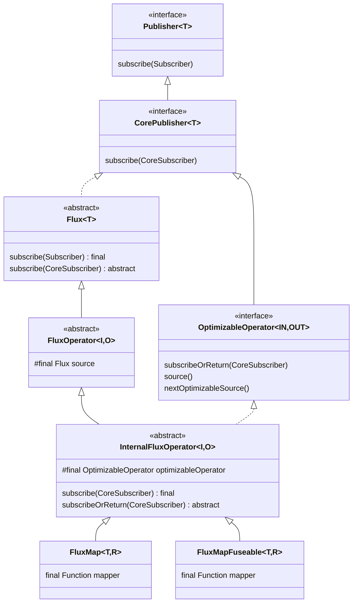

# 연산자 체인의 실제 구조

`.map().filter()` 한 줄이 메모리에 어떤 객체 그래프를 만드는지 추적한다. `InternalFluxOperator`의 상속 구조, `subscribeOrReturn`이 `abstract`인 이유, 조립 시점의 `Fuseable` 분기, 그리고 `InnerOperator`/`InnerProducer`가 구독자 체인을 어떻게 양방향으로 잇는지 본다.

## 목차
- [1. 핵심 개념 (What)](#1-핵심-개념-what)
- [2. 왜 알아야 하는가 (Why)](#2-왜-알아야-하는가-why)
- [3. 내부 구현 분석 (How)](#3-내부-구현-분석-how)
- [4. 실전 예제](#4-실전-예제)
- [5. 정리](#5-정리)

---

## 1. 핵심 개념 (What)

연산자 하나는 **두 개의 클래스**로 구현된다.

| | 조립 시점 객체 | 구독 시점 객체 |
|---|---|---|
| 예 | `FluxMap` | `FluxMap.MapSubscriber` |
| 역할 | `Publisher`. 소스와 설정(mapper 등)을 들고 있음 | `Subscriber` + `Subscription`. 신호를 변환해서 다운스트림에 전달 |
| 수명 | 체인이 살아 있는 동안 | 구독 하나당 한 개 |
| 상속 | `InternalFluxOperator` → `FluxOperator` → `Flux` | `InnerOperator` (= `InnerConsumer` + `InnerProducer`) |
| 상태 | 전부 `final` (불변) | 가변 (`done`, `s`, `requested` …) |

이 분리가 "`Flux` 하나를 여러 번, 여러 스레드에서 동시에 구독할 수 있다"는 성질을 만든다. `Publisher` 쪽은 불변이고, 가변 상태는 전부 구독별 `Subscriber` 객체 안에 있다.

### 1.1 클래스 계층



---

## 2. 왜 알아야 하는가 (Why)

### 2.1 "연산자 하나가 객체 몇 개를 만드는지"가 성능이다

`Flux<T>` 체인에 연산자 10개를 달면 구독 한 번에 최소 10개의 `Subscriber` 객체가 할당된다. 초당 10만 요청을 처리하는 게이트웨이라면 이게 그대로 GC 압력이 된다. Reactor가 퓨전(fusion)과 `ConditionalSubscriber`에 공을 들이는 이유가 바로 이 숫자를 줄이려는 것이다.

또 신호 하나가 체인을 통과할 때마다 `actual.onNext(v)` 가상 호출이 한 단 쌓인다. 체인이 깊으면 스택도 깊어진다 — 2번 문서에서 본 while 루프 최적화는 **구독 과정**만 평탄화하고, `onNext` 전파는 여전히 중첩 호출이다.

### 2.2 `subscribeOrReturn`이 abstract인 이유를 알면 커스텀 연산자를 쓸 수 있다

`InternalFluxOperator`는 `subscribe(CoreSubscriber)`를 `final`로 잠그고 `subscribeOrReturn`을 `abstract`로 남긴다. 즉 **"체인을 어떻게 순회할지"는 프레임워크가 정하고, "내 구독자를 어떻게 만들지"만 서브클래스에 맡긴다.** 커스텀 연산자를 만들 때 `subscribe`를 오버라이드하려 하면 컴파일이 안 되는 이유다.

### 2.3 조립 시점의 `Fuseable` 분기가 퓨전의 출발점이다

`FluxMap`과 `FluxMapFuseable`은 동작이 같지만 클래스가 둘이다. 어느 쪽이 선택되는지는 **조립 시점에, 소스 하나만 보고** 결정된다. 이 분기를 모르면 "분명 `map`을 썼는데 왜 `poll()`이 호출되나" 같은 스택트레이스를 읽을 수 없다.

---

## 3. 내부 구현 분석 (How)

### 3.1 `InternalFluxOperator` — 상속과 구현의 교차점

```java
abstract class InternalFluxOperator<I, O> extends FluxOperator<I, O> implements Scannable,
                                                                                OptimizableOperator<O, I> {

	@Nullable
	final OptimizableOperator<?, I> optimizableOperator;
```
`publisher/InternalFluxOperator.java:26-30`

세 갈래를 동시에 만족시키는 선언이다.

- **`extends FluxOperator<I, O>`** → `Flux<O>`이므로 사용자에게 모든 `Flux` API를 노출한다. 그리고 `protected final Flux<? extends I> source`를 물려받는다 (`publisher/FluxOperator.java:34`).
- **`implements OptimizableOperator<O, I>`** → 구독 시점 while 루프에 참여한다. 타입 파라미터가 **뒤집혀 있다**(`<O, I>`)는 점에 주목. `OptimizableOperator<IN, OUT>`의 `IN`은 "이 연산자가 다운스트림에 내보내는 타입"이라서 연산자의 출력 `O`가 들어간다.
- **`implements Scannable`** → `Attr.PARENT`/`Attr.PREFETCH` 등으로 체인을 들여다볼 수 있다.

주목할 건 클래스 자체가 **package-private (`abstract class`, `public` 없음)** 이라는 점이다. 반면 부모인 `FluxOperator`는 `public abstract class`다 (`publisher/FluxOperator.java:32`). 이 차이가 `scanUnsafe`에 그대로 드러난다.

```java
// FluxOperator (public)
if (key == InternalProducerAttr.INSTANCE) return false; // public class!
```
`publisher/FluxOperator.java:50`

```java
// InternalFluxOperator (package-private)
if (key == InternalProducerAttr.INSTANCE) return true;
```
`publisher/InternalFluxOperator.java:98`

즉 `InternalProducerAttr`는 "이건 Reactor 내부 구현체다"라는 표식이다. 사용자가 `FluxOperator`를 상속해 만든 연산자는 `false`를, Reactor 내부 연산자는 `true`를 반환한다. 이 플래그가 쓰이는 곳이 컨텍스트 복원이다.

```java
subscriber = Operators.restoreContextOnSubscriberIfPublisherNonInternal(publisher, subscriber);
```
`publisher/InternalFluxOperator.java:67`

```java
static <T> CoreSubscriber<T> restoreContextOnSubscriberIfPublisherNonInternal(
		Publisher<?> publisher, CoreSubscriber<T> subscriber) {
	if (ContextPropagationSupport.shouldWrapPublisher(publisher)) {
		return restoreContextOnSubscriber(publisher, subscriber);
	}
	return subscriber;
}
```
`publisher/Operators.java:1009-1015`

"내부 구현체가 아닌 `Publisher`"(= 사용자 코드나 서드파티)로 넘어갈 때만 ThreadLocal 복원 래퍼를 끼운다. 내부끼리는 건너뛰어 오버헤드를 아낀다. 자세한 건 [컨텍스트 전파](09-context-propagation.md) 참고.

### 3.2 `subscribeOrReturn`이 abstract인 이유

```java
@Override
@SuppressWarnings("unchecked")
public final void subscribe(CoreSubscriber<? super O> subscriber) {
	OptimizableOperator operator = this;
	try {
		while (true) {
			subscriber = operator.subscribeOrReturn(subscriber);
			...
```
`publisher/InternalFluxOperator.java:49-55`

```java
@Nullable
public abstract CoreSubscriber<? super I> subscribeOrReturn(CoreSubscriber<? super O> actual) throws Throwable;

@Override
public final CorePublisher<? extends I> source() {
	return source;
}

@Override
public final OptimizableOperator<?, ? extends I> nextOptimizableSource() {
	return optimizableOperator;
}
```
`publisher/InternalFluxOperator.java:80-91`

`final`이 셋, `abstract`가 하나다. 역할 분담이 명확하다.

| 메서드 | 한정자 | 누가 책임지나 |
|---|---|---|
| `subscribe(CoreSubscriber)` | `final` | 프레임워크 — 평탄화 루프, 예외 처리, 컨텍스트 복원 |
| `source()` | `final` | 프레임워크 — `FluxOperator.source` 필드 반환 |
| `nextOptimizableSource()` | `final` | 프레임워크 — 조립 시점에 캐시한 필드 반환 |
| `subscribeOrReturn(CoreSubscriber)` | **`abstract`** | 연산자 — 자기 구독자를 생성 |

`subscribeOrReturn`의 시그니처를 보면 타입이 **역방향**이다. 인자는 `CoreSubscriber<? super O>`(다운스트림, 출력 타입 받음)이고 반환은 `CoreSubscriber<? super I>`(업스트림에 넘길 것, 입력 타입 받음). 구독자 체인을 역방향으로 쌓는다는 걸 타입이 강제한다.

그리고 `throws Throwable`이다 (`publisher/OptimizableOperator.java:44`). 구독자 생성 중 터진 예외를 호출자인 while 루프의 `catch`가 받아서 `Operators.reportThrowInSubscribe`로 신호화한다 (`publisher/InternalFluxOperator.java:74-77`).

### 3.3 `FluxMap` vs `FluxMapFuseable` — 조립 시점 분기

```java
public final <V> Flux<V> map(Function<? super T, ? extends V> mapper) {
	if (this instanceof Fuseable) {
		return onAssembly(new FluxMapFuseable<>(this, mapper));
	}
	return onAssembly(new FluxMap<>(this, mapper));
}
```
`Flux.map()` `publisher/Flux.java:6629-6634`

`filter`도 똑같다.

```java
public final Flux<T> filter(Predicate<? super T> p) {
	if (this instanceof Fuseable) {
		return onAssembly(new FluxFilterFuseable<>(this, p));
	}
	return onAssembly(new FluxFilter<>(this, p));
}
```
`Flux.filter()` `publisher/Flux.java:5381-5386`

두 클래스의 선언 차이는 딱 하나다.

```java
final class FluxMap<T, R> extends InternalFluxOperator<T, R> {
```
`publisher/FluxMap.java:36`

```java
final class FluxMapFuseable<T, R> extends InternalFluxOperator<T, R> implements Fuseable {
```
`publisher/FluxMapFuseable.java:38`

`implements Fuseable`이 붙었는지 여부다. 그런데 이게 **전파된다**는 게 핵심이다.

```
Flux.range(1,3)          FluxRange            implements Fuseable  ✔
  .map(...)              → this instanceof Fuseable == true
                         FluxMapFuseable      implements Fuseable  ✔  (전파)
  .filter(...)           → this instanceof Fuseable == true
                         FluxFilterFuseable   implements Fuseable  ✔  (전파)

Flux.range(1,3)          FluxRange            implements Fuseable  ✔
  .hide()                FluxHide             (Fuseable 아님)      ✘  (차단)
  .map(...)              → this instanceof Fuseable == false
                         FluxMap              (Fuseable 아님)      ✘
  .filter(...)           → this instanceof Fuseable == false
                         FluxFilter           (Fuseable 아님)      ✘
```

`Fuseable` 체인은 한 번 끊기면 아래쪽 전체가 non-fuseable이 된다. `hide()` 하나가 체인 전체의 퓨전을 꺼버리는 이유다.

구독자 클래스도 달라진다.

```java
// FluxMap
static final class MapSubscriber<T, R>
		implements InnerOperator<T, R> {
	...
	Subscription s;
```
`publisher/FluxMap.java:71-79`

```java
// FluxMapFuseable
static final class MapFuseableSubscriber<T, R>
		implements InnerOperator<T, R>,
		           QueueSubscription<R> {
	...
	QueueSubscription<T> s;

	int sourceMode;
```
`publisher/FluxMapFuseable.java:72-83`

차이가 세 군데다.
1. `QueueSubscription<R>`을 추가로 구현한다 → 다운스트림이 `poll()`로 값을 끌어갈 수 있다.
2. 업스트림 `Subscription`을 `QueueSubscription<T>`로 보관한다 → 자기도 업스트림에서 `poll()`로 끌어온다.
3. `int sourceMode` 필드를 둔다 → 협상된 퓨전 모드를 기억한다.

**`onNext` 경로의 차이**가 결정적이다. `FluxMap.MapSubscriber.onNext`는 `mapper.apply(t)`로 변환한 값을 그 자리에서 `actual.onNext(v)`로 넘긴다 (`publisher/FluxMap.java:96-123`). 반면 퓨전 버전은 모드를 먼저 본다.

```java
// FluxMapFuseable.MapFuseableSubscriber.onNext
public void onNext(T t) {
	if (sourceMode == ASYNC) {
		actual.onNext(null);
	}
	else {
		...
```
`publisher/FluxMapFuseable.java:100-110`

ASYNC 퓨전 모드에서는 **`onNext(null)`을 보낸다.** 값을 넣지 않고 "큐에 뭔가 생겼다"는 신호만 보내고, 실제 값은 다운스트림이 `poll()`로 가져간다. 그리고 매핑 함수는 `poll()` 안에서 호출된다.

```java
@Override
@Nullable
public R poll() {
	for(;;) {
		T v = s.poll();
		if (v != null) {
			try {
				return Objects.requireNonNull(mapper.apply(v));   // ← 변환이 여기서 일어난다
			}
			catch (Throwable t) {
				RuntimeException e_ = Operators.onNextPollError(v, t, currentContext());
				if (e_ != null) {
					throw e_;
				}
				else {
					continue;
				}
			}
		}
		return null;
	}
}
```
`MapFuseableSubscriber.poll()` `publisher/FluxMapFuseable.java:179-200`

그래서 `mapper`가 어느 스레드에서 돌지가 바뀐다. 이걸 막기 위한 플래그가 `THREAD_BARRIER`다 — `requestFusion`이 `(requestedMode & Fuseable.THREAD_BARRIER) != 0`이면 협상 없이 `Fuseable.NONE`을 반환하고, 그 외에는 업스트림 `s.requestFusion(requestedMode)` 결과를 `sourceMode`에 저장해 돌려준다 (`publisher/FluxMapFuseable.java:212-223`).

`Fuseable`의 모드 상수는 다섯 개다.

```java
/** Indicates the QueueSubscription can't support the requested mode. */
int NONE = 0;
/** Indicates the QueueSubscription can perform sync-fusion. */
int SYNC = 1;
/** Indicates the QueueSubscription can perform only async-fusion. */
int ASYNC = 2;
/** Indicates the QueueSubscription should decide what fusion it performs (input only). */
int ANY = 3;
int THREAD_BARRIER = 0b100; //4
```
`core/Fuseable.java:34-52`

`ANY`(=3)를 빼먹기 쉬운데, 이건 "업스트림이 알아서 정해라"라는 입력 전용 값이다. `THREAD_BARRIER`(=4)는 다른 네 개와 달리 **비트 플래그**라서 `requestedMode & THREAD_BARRIER`로 검사한다. 퓨전 협상의 전체 그림은 [연산자 퓨전](06-operator-fusion.md)에서 다룬다.

### 3.4 `InnerOperator` / `InnerProducer` / `InnerConsumer`

구독 시점 객체들의 공통 인터페이스다. 세 개가 조합된다.

```java
interface InnerConsumer<I>
		extends CoreSubscriber<I>, Scannable {
}
```
`publisher/InnerConsumer.java:30-33`

```java
interface InnerProducer<O>
		extends Scannable, Subscription {

	CoreSubscriber<? super O> actual();

	@Override
	@Nullable
	default Object scanUnsafe(Attr key){
		if (key == Attr.ACTUAL) {
			return actual();
		}
		if (key == InternalProducerAttr.INSTANCE) return true;
		return null;
	}
}
```
`publisher/InnerProducer.java:35-48`

```java
interface InnerOperator<I, O>
		extends InnerConsumer<I>, InnerProducer<O> {

	@Override
	default Context currentContext() {
		return actual().currentContext();
	}
}
```
`publisher/InnerOperator.java:28-34`

의미를 풀면 이렇다.

| 인터페이스 | = | 역할 | 전형적 구현체 |
|---|---|---|---|
| `InnerConsumer<I>` | `CoreSubscriber<I>` + `Scannable` | **받기만** 한다 (체인의 끝 또는 inner 소스) | `LambdaSubscriber`, `FluxFlatMap.FlatMapInner` |
| `InnerProducer<O>` | `Subscription` + `Scannable` + `actual()` | **주기만** 한다 (체인의 시작) | `Operators.ScalarSubscription` |
| `InnerOperator<I, O>` | 위 둘 전부 | 받아서 변환해 준다 (중간 연산자) | `FluxMap.MapSubscriber`, `MonoFlatMap.FlatMapMain` |

`InnerProducer.actual()`이 **다운스트림 링크**다. 그리고 `InnerConsumer` 쪽이 들고 있는 `Subscription s` 필드가 **업스트림 링크**다. 이 두 개가 구독자 체인을 양방향 연결 리스트로 만든다.

```java
@Override
public CoreSubscriber<? super R> actual() {
	return actual;
}

@Override
public void request(long n) {
	s.request(n);
}

@Override
public void cancel() {
	s.cancel();
}
```
`publisher/FluxMap.MapSubscriber` `publisher/FluxMap.java:157-170`

`MapSubscriber`가 하는 일 전부를 방향으로 정리하면:

```
                         ┌─────────────────────┐
     s.request(n) ◀──────│   MapSubscriber     │◀────── request(n)      [downstream 요청]
     s.cancel()   ◀──────│                     │◀────── cancel()
                         │  Subscription s     │
                         │  CoreSubscriber     │
     onNext(t)    ──────▶│    actual           │──────▶ actual.onNext(mapper.apply(t))
     onError(t)   ──────▶│  boolean done       │──────▶ actual.onError(t)
     onComplete() ──────▶│                     │──────▶ actual.onComplete()
                         └─────────────────────┘
                                   │
                        currentContext() ──▶ actual().currentContext()   [역방향 질의]
```

`done` 플래그가 중복 종료를 막는다.

```java
@Override
public void onError(Throwable t) {
	if (done) {
		Operators.onErrorDropped(t, actual.currentContext());
		return;
	}
	done = true;
	actual.onError(t);
}
```
`publisher/FluxMap.java:125-135`

이미 종료된 뒤에 온 에러는 다운스트림으로 넘기지 않고 `Operators.onErrorDropped`로 보낸다. 규약의 "종료 신호는 최대 한 번"을 각 연산자가 지역적으로 보장하는 방식이다. 자세한 건 [Operators와 BaseSubscriber](04-operators-rs-contract.md) 참고.

### 3.5 체인이 깊어지는 연산자 — `FluxFlatMap`

`map`/`filter`는 구독자 하나를 추가하는 1:1 연산자다. `flatMap`은 구조가 다르다.

```java
final <V> Flux<V> flatMap(Function<? super T, ? extends Publisher<? extends
		V>> mapper, boolean delayError, int concurrency, int prefetch) {
	return onAssembly(new FluxFlatMap<>(
			this,
			mapper,
			delayError,
			concurrency,
			Queues.get(concurrency),
			prefetch,
			Queues.get(prefetch)
	));
}
```
`publisher/Flux.java:10997-11008`

조립 시점에 **큐 서플라이어 두 개**를 받는다. 메인 큐(스칼라 결과용)와 inner 큐(각 내부 퍼블리셔용)다. 공개 오버로드는 `Queues.SMALL_BUFFER_SIZE`/`Queues.XS_BUFFER_SIZE`를 기본값으로 쓴다 (`publisher/Flux.java:5477-5480`).

```java
final class FluxFlatMap<T, R> extends InternalFluxOperator<T, R> {
```
`publisher/FluxFlatMap.java:49`

`implements Fuseable`이 **없다**. `flatMap`은 퓨전 대상이 아니다.

```java
@Override
public CoreSubscriber<? super T> subscribeOrReturn(CoreSubscriber<? super R> actual) {
	if (trySubscribeScalarMap(source, actual, mapper, false, true)) {
		return null;
	}

	return new FlatMapMain<>(actual,
			mapper,
			delayError,
			maxConcurrency,
			mainQueueSupplier,
			prefetch, innerQueueSupplier);
}
```
`FluxFlatMap.subscribeOrReturn()` `publisher/FluxFlatMap.java:92-104`

여기 `null` 반환 경로가 또 나온다. `trySubscribeScalarMap`은 소스가 `Callable`이면 — 즉 값이 하나로 확정되어 있으면 — 구독 자체를 생략하고 바로 처리한다.

```java
static <T, R> boolean trySubscribeScalarMap(Publisher<? extends T> source,
		CoreSubscriber<? super R> s,
		Function<? super T, ? extends Publisher<? extends R>> mapper,
		boolean fuseableExpected,
		boolean errorContinueExpected) {
	if (source instanceof Callable) {
		T t;
		try {
			t = ((Callable<? extends T>) source).call();
		}
		...
```
`publisher/FluxFlatMap.java:118-128`

`Mono.just("x").flatMap(...)` 같은 코드가 큐도 inner 구독자도 만들지 않는 이유다 (`MonoJust`가 `Fuseable.ScalarCallable<T>`를 구현한다 — `publisher/MonoJust.java:30`).

일반 경로에서 만들어지는 `FlatMapMain`은 `map`의 구독자와 비교가 안 되게 무겁다.

```java
static final class FlatMapMain<T, R> extends FlatMapTracker<FlatMapInner<R>>
		implements InnerOperator<T, R> {

	final boolean                      delayError;
	final int                          maxConcurrency;
	final int                          prefetch;
	final int                          limit;
	final Supplier<? extends Queue<R>> mainQueueSupplier;
	final Supplier<? extends Queue<R>> innerQueueSupplier;
	...
	volatile Queue<R>   scalarQueue;
	volatile Throwable  error;
	volatile boolean    done;
	volatile boolean    cancelled;
	volatile long       requested;
	volatile int        wip;
	...
```
`publisher/FluxFlatMap.java:221-256`

그리고 내부 퍼블리셔마다 `FlatMapInner`가 하나씩 더 붙는다.

```java
static final class FlatMapInner<R>
		implements InnerConsumer<R>, Subscription {

	final FlatMapMain<?, R> parent;
	final int prefetch;
	final int limit;
	volatile Subscription s;
	long produced;
	volatile Queue<R> queue;
	volatile boolean done;
```
`publisher/FluxFlatMap.java:912-932`

`FlatMapInner`는 `InnerConsumer`(받기만)다. `InnerOperator`가 아니다 — 받은 값을 `parent`에 넘기고, 출력은 `FlatMapMain`이 드레인 루프에서 합쳐 내보낸다. `wip`/`requested` 필드 조합이 그 드레인 루프의 상태다. [배압과 드레인 루프](05-backpressure-and-drain-loop.md) 참고.

`Mono` 쪽은 훨씬 단순하다.

```java
public final <R> Mono<R> flatMap(Function<? super T, ? extends Mono<? extends R>>
		transformer) {
	return onAssembly(new MonoFlatMap<>(this, transformer));
}
```
`publisher/Mono.java:3177-3180`

```java
final class MonoFlatMap<T, R> extends InternalMonoOperator<T, R> implements Fuseable {
```
`publisher/MonoFlatMap.java:40`

`Fuseable`이고 큐 서플라이어가 없다. 값이 하나니까 인터리빙도 없고 큐도 필요 없다.

```java
static final class FlatMapMain<T, R> implements InnerOperator<T, R>,
                                                Fuseable, //for constants only
		                                        QueueSubscription<R> {

	final Function<? super T, ? extends Mono<? extends R>> mapper;
	final CoreSubscriber<? super R> actual;
	boolean done;
	Subscription s;
	volatile FlatMapInner<R> second;
```
`publisher/MonoFlatMap.java:66-78`

`volatile FlatMapInner<R> second` 하나로 끝난다. `FluxFlatMap`의 `FlatMapInner[] array` + 두 개의 큐 + `wip` 드레인 루프와 비교하면 차이가 선명하다. 두 `flatMap`을 자세히 비교한 내용은 [flatMap/concatMap/switchMap](07-flatmap-concatmap-switchmap.md)에 있다.

---

## 4. 실전 예제

### 예제 1: `Scannable`로 조립된 객체 그래프를 그대로 출력

```java
import reactor.core.Scannable;
import reactor.core.publisher.Flux;

public class ChainGraphDemo {

    public static void main(String[] args) {
        Flux<Integer> fused = Flux.range(1, 10)
                                  .map(i -> i * 2)
                                  .filter(i -> i > 5);

        Flux<Integer> notFused = Flux.range(1, 10)
                                     .hide()              // Fuseable 체인을 끊는다
                                     .map(i -> i * 2)
                                     .filter(i -> i > 5);

        dump("퓨전 가능 체인", fused);
        dump("hide() 로 끊은 체인", notFused);
    }

    static void dump(String title, Flux<?> flux) {
        System.out.println("=== " + title + " ===");
        Scannable.from(flux)
                 .parents()                               // 업스트림으로 올라간다
                 .forEach(s -> System.out.println("   ↑ " + s.getClass().getSimpleName()));
        System.out.println("   (시작) " + flux.getClass().getSimpleName());
        System.out.println();
    }
}
```

예상 출력:

```
=== 퓨전 가능 체인 ===
   ↑ FluxMapFuseable
   ↑ FluxRange
   (시작) FluxFilterFuseable

=== hide() 로 끊은 체인 ===
   ↑ FluxMap
   ↑ FluxHide
   ↑ FluxRange
   (시작) FluxFilter
```

같은 코드인데 클래스가 전부 다르다. `Flux.map()`/`Flux.filter()`의 `this instanceof Fuseable` 분기가 조립 시점에 결정한 결과다 (`publisher/Flux.java:6630`, `publisher/Flux.java:5382`).

`Scannable.parents()`가 동작하는 이유는 `FluxOperator.scanUnsafe`가 `Attr.PARENT`에 `source`를 반환하기 때문이다 (`publisher/FluxOperator.java:49`).

### 예제 2: 구독마다 새 `Subscriber` 체인이 만들어진다는 것

```java
import java.util.concurrent.atomic.AtomicInteger;
import org.reactivestreams.Subscription;
import reactor.core.publisher.Flux;

public class SubscriberPerSubscriptionDemo {

    public static void main(String[] args) {
        AtomicInteger ids = new AtomicInteger();

        // Publisher 그래프는 한 번만 조립된다
        Flux<String> shared = Flux.just("a", "b")
                .map(String::toUpperCase)
                .doOnSubscribe(s -> System.out.printf(
                        "  구독 #%d — Subscription 객체: %s@%x%n",
                        ids.incrementAndGet(),
                        s.getClass().getSimpleName(),
                        System.identityHashCode(s)));

        System.out.println("Publisher 객체: " + shared.getClass().getSimpleName()
                + "@" + Integer.toHexString(System.identityHashCode(shared)));

        shared.subscribe();
        shared.subscribe();
        shared.subscribe();
        // Publisher 는 같은 객체, Subscription(및 그 뒤의 Subscriber 체인)은 매번 새 객체
    }
}
```

`Publisher` 쪽 identity hash는 세 번 모두 같고, `Subscription` 쪽은 매번 다르다. 불변 `Publisher` + 구독별 가변 `Subscriber`라는 분리가 이 출력으로 확인된다.

### 예제 3: 커스텀 연산자 — `InternalFluxOperator`를 모방하기

`InternalFluxOperator`는 package-private이라 상속할 수 없다. 사용자 코드에서는 `public`인 `FluxOperator`를 쓰고 `subscribe(CoreSubscriber)`를 직접 구현한다.

```java
import java.util.function.Predicate;
import org.reactivestreams.Subscription;
import reactor.core.CoreSubscriber;
import reactor.core.publisher.Flux;
import reactor.core.publisher.FluxOperator;
import reactor.core.publisher.Operators;

/**
 * predicate 가 false 를 반환하는 첫 원소에서 onError 를 내는 연산자.
 * InternalFluxOperator 는 package-private 이므로 public FluxOperator 를 상속한다.
 * 그래서 OptimizableOperator 평탄화 루프에는 참여하지 못하고,
 * Scannable 의 InternalProducerAttr 도 false 로 보고된다.
 *   publisher/FluxOperator.java:50
 */
final class FluxRequireAll<T> extends FluxOperator<T, T> {

    private final Predicate<? super T> predicate;

    FluxRequireAll(Flux<? extends T> source, Predicate<? super T> predicate) {
        super(source);
        this.predicate = predicate;
    }

    @Override
    public void subscribe(CoreSubscriber<? super T> actual) {
        source.subscribe(new RequireAllSubscriber<>(actual, predicate));
    }

    /** InnerOperator 는 package-private 이므로 CoreSubscriber + Subscription 을 직접 구현 */
    static final class RequireAllSubscriber<T> implements CoreSubscriber<T>, Subscription {

        private final CoreSubscriber<? super T> actual;
        private final Predicate<? super T>      predicate;

        private Subscription s;
        private boolean      done;

        RequireAllSubscriber(CoreSubscriber<? super T> actual, Predicate<? super T> predicate) {
            this.actual = actual;
            this.predicate = predicate;
        }

        @Override
        public reactor.util.context.Context currentContext() {
            return actual.currentContext();          // InnerOperator 의 기본 구현과 동일
        }

        @Override
        public void onSubscribe(Subscription s) {
            if (Operators.validate(this.s, s)) {     // publisher/Operators.java:1343 부근
                this.s = s;
                actual.onSubscribe(this);
            }
        }

        @Override
        public void onNext(T t) {
            if (done) {
                Operators.onNextDropped(t, actual.currentContext());
                return;
            }
            boolean ok;
            try {
                ok = predicate.test(t);
            }
            catch (Throwable e) {
                onError(Operators.onOperatorError(s, e, t, actual.currentContext()));
                return;
            }
            if (!ok) {
                onError(Operators.onOperatorError(s,
                        new IllegalStateException("predicate 위반: " + t),
                        t, actual.currentContext()));
                return;
            }
            actual.onNext(t);
        }

        // onError / onComplete 는 FluxMap.MapSubscriber 와 동일한 done 플래그 패턴
        //   publisher/FluxMap.java:125-145
        @Override
        public void onError(Throwable t) {
            if (done) {
                Operators.onErrorDropped(t, actual.currentContext());
                return;
            }
            done = true;
            actual.onError(t);
        }

        @Override
        public void onComplete() {
            if (done) {
                return;
            }
            done = true;
            actual.onComplete();
        }

        @Override public void request(long n) { s.request(n); }
        @Override public void cancel()        { s.cancel(); }
    }
}
```

사용:

```java
Flux.just(1, 2, -3, 4)
    .transform(f -> new FluxRequireAll<>(f, i -> i > 0))
    .subscribe(
        v -> System.out.println("ok: " + v),
        e -> System.out.println("err: " + e.getMessage()));
// ok: 1
// ok: 2
// err: predicate 위반: -3
```

`FluxMap.MapSubscriber`의 구조(`publisher/FluxMap.java:71-171`)를 거의 그대로 베낀 모양이다. `done` 플래그, `Operators.validate`, `Operators.onNextDropped`/`onErrorDropped`, `Operators.onOperatorError` — 이 네 개가 연산자 구현의 기본 골격이다. 각각이 정확히 무엇을 하는지는 [Operators와 BaseSubscriber](04-operators-rs-contract.md)에서 다룬다.

---

## 5. 정리

- 연산자 하나는 클래스 둘로 구현된다. 조립 시점의 `Publisher`(불변, `final` 필드)와 구독 시점의 `Subscriber`(가변, 구독당 하나). 이 분리가 하나의 `Flux`를 여러 번·여러 스레드에서 구독할 수 있게 한다.
- `InternalFluxOperator<I, O>`는 `extends FluxOperator<I, O>`(= `Flux<O>` API 제공 + `source` 필드)와 `implements OptimizableOperator<O, I>`(= 평탄화 루프 참여)를 동시에 만족시킨다. 타입 파라미터 순서가 뒤집히는 게 그 신호다 (`publisher/InternalFluxOperator.java:26-27`).
- `InternalFluxOperator`는 package-private이고, `scanUnsafe`에서 `InternalProducerAttr`에 `true`를 반환한다. `public`인 `FluxOperator`는 `false`를 반환한다 (`publisher/FluxOperator.java:50` vs `publisher/InternalFluxOperator.java:98`). 이 플래그로 "내부 구현체 → 외부 Publisher" 경계를 판정해 컨텍스트 복원 래퍼를 선택적으로 끼운다.
- `subscribe(CoreSubscriber)`·`source()`·`nextOptimizableSource()`는 `final`, `subscribeOrReturn`만 `abstract`다. 체인 순회·예외 처리·컨텍스트 복원은 프레임워크가 고정하고, 서브클래스는 "내 구독자를 만들어 반환"하는 일만 한다. 시그니처가 `CoreSubscriber<? super O>` → `CoreSubscriber<? super I>`로 역방향이라 구독자 체인이 역순으로 쌓인다는 걸 타입이 강제한다.
- `Flux.map()`/`Flux.filter()`는 **조립 시점에 `this instanceof Fuseable`을 검사**해 `FluxMap`/`FluxMapFuseable`(또는 `FluxFilter`/`FluxFilterFuseable`) 중 하나를 고른다. `Fuseable`은 체인을 따라 전파되고 `hide()` 같은 non-fuseable 연산자 하나에서 끊긴다.
- 퓨전 버전의 구독자는 `QueueSubscription`을 함께 구현하고 `int sourceMode`를 들며, ASYNC 모드에서 `onNext(null)`을 보낸 뒤 실제 변환을 `poll()` 안에서 수행한다 (`publisher/FluxMapFuseable.java:100-104`, `179-200`). 그래서 `mapper`의 실행 스레드가 바뀔 수 있고, 이를 거부하는 수단이 `THREAD_BARRIER`다 (`publisher/FluxMapFuseable.java:213-217`).
- `Fuseable`의 모드는 `NONE`(0) / `SYNC`(1) / `ASYNC`(2) / `ANY`(3, 입력 전용) / `THREAD_BARRIER`(0b100, 비트 플래그) 다섯 개다 (`core/Fuseable.java:34-52`).
- 구독자 체인의 링크는 `InnerProducer.actual()`(다운스트림)과 각 구독자의 `Subscription s` 필드(업스트림)다. `InnerConsumer` = 받기만, `InnerProducer` = 주기만, `InnerOperator` = 둘 다. `InnerOperator.currentContext()`가 `actual().currentContext()`로 위임하면서 컨텍스트가 역방향으로 흐른다 (`publisher/InnerOperator.java:31-34`).
- `flatMap`은 1:1 연산자가 아니다. `FluxFlatMap`은 `Fuseable`이 아니고, 조립 시점에 큐 서플라이어 둘을 받고, 구독 시점에 `FlatMapMain` 하나 + 내부 퍼블리셔당 `FlatMapInner` 하나를 만든다. 소스가 `Callable`이면 `trySubscribeScalarMap`이 전체를 건너뛴다 (`publisher/FluxFlatMap.java:92-104`). `MonoFlatMap`은 `Fuseable`이고 큐 없이 `volatile FlatMapInner second` 하나만 쓴다 (`publisher/MonoFlatMap.java:78`).

---

## 관련 문서
- 선행: [조립 시점 vs 구독 시점](02-assembly-vs-subscribe-time.md)
- 후행: [Operators와 BaseSubscriber: 규약 구현체](04-operators-rs-contract.md)
- 참고: [배압과 드레인 루프](05-backpressure-and-drain-loop.md) — `FlatMapMain`의 `wip`/`requested` 드레인 루프
- 참고: [연산자 퓨전](06-operator-fusion.md) — `Fuseable` 분기 이후의 퓨전 협상
- 참고: [flatMap/concatMap/switchMap](07-flatmap-concatmap-switchmap.md) — `FluxFlatMap`과 `MonoFlatMap`의 전체 비교

---
*참고: Reactor Core 3.7.19 기준(태그 `v3.7.19`). 본문의 소스 경로는 레포 루트의 `reactor-core/src/main/java/reactor/` 기준 상대경로다 — 예: `publisher/Operators.java:70` = `reactor-core/src/main/java/reactor/core/publisher/Operators.java:70`.*
