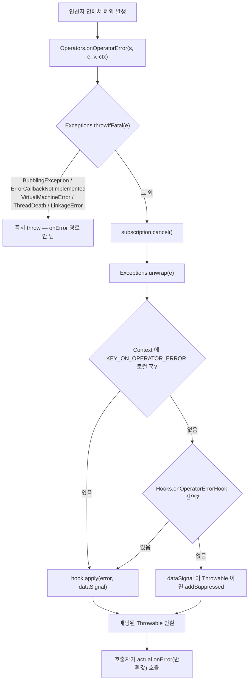
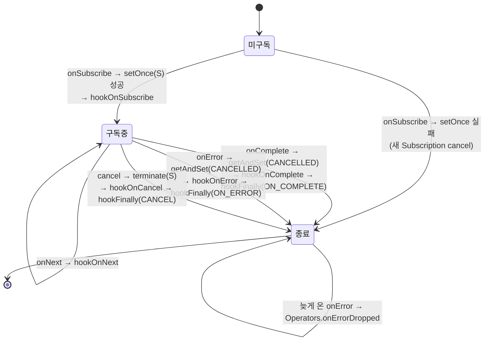

# Operators와 BaseSubscriber: 규약 구현체

연산자를 직접 만들 때 쓰는 도구 상자를 뜯어본다. `Operators`의 원자적 상태 전이 유틸(`addCap`/`terminate`/`setOnce`), 에러·폐기 신호 경로(`onOperatorError`/`onDiscard`), 재사용 구독자(`MonoSubscriber`/`ScalarSubscription`/`CancelledSubscription`/`EmptySubscription`), `BaseSubscriber`의 템플릿 훅, 그리고 `Exceptions`의 예외 분류 체계.

## 목차
- [1. 핵심 개념 (What)](#1-핵심-개념-what)
- [2. 왜 알아야 하는가 (Why)](#2-왜-알아야-하는가-why)
- [3. 내부 구현 분석 (How)](#3-내부-구현-분석-how)
- [4. 실전 예제](#4-실전-예제)
- [5. 정리](#5-정리)

---

## 1. 핵심 개념 (What)

Reactive Streams 규약은 짧지만, 지키는 건 어렵다. 어려운 부분은 전부 **동시성**이다.

- `request(n)`이 여러 스레드에서 동시에 들어오면 누적값이 `Long.MAX_VALUE`를 넘어 음수가 될 수 있다.
- `cancel()`과 `onNext()`가 동시에 일어나면 취소 후에도 값이 흐르거나, 큐에 남은 값이 영원히 해제되지 않는다.
- `onError`와 `onComplete`가 경쟁하면 종료 신호가 두 번 간다.

`Operators`는 이 패턴들을 모아 둔 정적 유틸리티 클래스다 (`publisher/Operators.java:60`의 `public abstract class Operators`). `BaseSubscriber`는 그걸 전부 적용한 **구독자 템플릿**이고, `Exceptions`는 예외를 "전파할 것 / 던질 것 / 치명적인 것"으로 분류하는 체계다.

```
          ┌──────────────────── Operators ────────────────────┐
          │ 수요 누적    addCap(updater, instance, n)          │
          │ 구독 설정    setOnce(S, this, s), validate(cur,nxt)│
          │ 구독 종료    terminate(S, this)                    │
          │ 수요 검증    validate(long n)                      │
          │ 에러 매핑    onOperatorError(...)                  │
          │ 신호 유실    onNextDropped / onErrorDropped        │
          │ 자원 폐기    onDiscard / onDiscardQueueWithClear   │
          │ 재사용 구독  MonoSubscriber / ScalarSubscription /  │
          │             CancelledSubscription / EmptySubscr.   │
          └───────────────────────────────────────────────────┘
                               ▲ 사용
          ┌──────────────── BaseSubscriber ───────────────────┐
          │ final onSubscribe/onNext/onError/onComplete       │
          │       request/requestUnbounded/cancel             │
          │ hook  hookOnSubscribe/hookOnNext/hookOnComplete   │
          │       hookOnError/hookOnCancel/hookFinally        │
          └───────────────────────────────────────────────────┘
                               ▲ 예외 분류
          ┌──────────────── Exceptions ───────────────────────┐
          │ bubble / propagate / throwIfFatal / throwIfJvmFatal│
          │ failWithOverflow / failWithCancel / failWithRejected│
          │ multiple / addThrowable / terminate / unwrap       │
          └───────────────────────────────────────────────────┘
```

---

## 2. 왜 알아야 하는가 (Why)

### 2.1 직접 구현하면 거의 반드시 틀린다

`request`를 누적하는 코드를 손으로 써 보면 금방 드러난다.

```java
// 틀린 코드
volatile long requested;

public void request(long n) {
    requested += n;          // ① 원자적이지 않다
                             // ② Long.MAX_VALUE 를 넘으면 음수가 된다
                             // ③ 이미 취소됐는지 모른다
}
```

`Operators.addCap(REQUESTED, this, n)` 한 줄이 ①②를 해결하고, `Operators.terminate(S, this)`가 ③의 상태 전이를 담당한다. 이 둘을 쓰는 게 "Reactor 스타일"이고, 모든 내부 연산자가 같은 함수를 공유한다는 게 안정성의 근거다.

### 2.2 `onErrorDropped`와 `onDiscard`를 모르면 자원이 샌다

취소 시점에 큐에 남은 원소는 어디로 가나? 그냥 GC되면 되는 객체라면 상관없지만, `ByteBuf`나 `Connection`이라면 **반드시 해제해야 한다.** Reactor의 답이 `onDiscard` 훅이다. Netty 기반 스택(reactor-netty, Spring WebFlux)에서 "버퍼 릭" 경고가 뜰 때 가장 먼저 봐야 할 지점이다.

마찬가지로 종료 후에 도착한 `onError`는 다운스트림으로 못 보낸다(규약 위반). 그런데 그냥 삼키면 예외가 사라진다. 그래서 `Operators.onErrorDropped`가 있고, 훅이 없으면 **ERROR 레벨로 로그를 남긴다.** 운영 로그에서 `Operator called default onErrorDropped`를 봤다면 이 경로다.

### 2.3 `BaseSubscriber`는 "수동 백프레셔"의 표준 답안이다

`subscribe(System.out::println)`은 `LambdaSubscriber`를 쓰고 무조건 `request(Long.MAX_VALUE)`를 한다. 즉 배압이 없다. 소비 속도를 직접 제어하려면 `Subscriber`를 구현해야 하는데, 규약을 전부 지키려면 위의 동시성 문제를 다시 만난다. `BaseSubscriber`는 그 보일러플레이트를 다 처리하고 **훅 메서드만 오버라이드하게** 해 준다.

---

## 3. 내부 구현 분석 (How)

### 3.1 `Operators.addCap` — 수요 누적의 overflow 캡

두 가지 오버로드가 있다. 순수 계산 버전:

```java
public static long addCap(long a, long b) {
	long res = a + b;
	if (res < 0L) {
		return Long.MAX_VALUE;
	}
	return res;
}
```
`publisher/Operators.java:70-76`

`a + b`가 오버플로하면 음수가 되므로 `res < 0L` 하나로 잡아낸다. (둘 다 음수가 아니라는 전제. 수요는 `validate(long)`을 통과한 양수뿐이다.)

그리고 CAS 루프 버전:

```java
public static <T> long addCap(AtomicLongFieldUpdater<T> updater, T instance, long toAdd) {
	long r, u;
	for (;;) {
		r = updater.get(instance);
		if (r == Long.MAX_VALUE) {
			return Long.MAX_VALUE;
		}
		u = addCap(r, toAdd);
		if (updater.compareAndSet(instance, r, u)) {
			return r;
		}
	}
}
```
`publisher/Operators.java:88-99`

두 가지 설계 결정이 보인다.

- `Long.MAX_VALUE`는 **흡수 상태(absorbing state)** 다. 한 번 도달하면 CAS를 시도조차 안 하고 즉시 반환한다. `Long.MAX_VALUE`가 "무한 수요(unbounded)"의 관례적 표현이고, 무한에 더해도 무한이니까 CAS가 불필요하다.
- 반환값이 **더한 뒤의 값이 아니라 더하기 전의 값(`r`)** 이다. 드레인 루프가 "내가 이 request를 처음 넣은 사람인가?(= `r == 0`)"를 판정해 루프를 시작할지 결정하는 데 쓴다. [배압과 드레인 루프](05-backpressure-and-drain-loop.md)에서 이 패턴이 반복된다.

수요 검증은 1번 문서에서 본 대로 `onError` 없이 로그만 남긴다.

```java
public static boolean validate(long n) {
	if (n <= 0) {
		reportBadRequest(n);
		return false;
	}
	return true;
}
```
`publisher/Operators.java:1360-1366`

### 3.2 구독 설정과 종료 — `validate` / `setOnce` / `terminate`

**(1) 비원자 버전 `validate(current, next)`** — 단일 스레드에서 `onSubscribe`가 온다고 보장될 때 쓴다.

```java
public static boolean validate(@Nullable Subscription current, Subscription next) {
	Objects.requireNonNull(next, "Subscription cannot be null");
	if (current != null) {
		next.cancel();
		//reportSubscriptionSet();
		return false;
	}
	return true;
}
```
`publisher/Operators.java:1344-1353`

이미 구독이 있으면 **새 구독을 취소하고** `false`를 반환한다. `§2.12`(onSubscribe 중복 금지) 대응이다. `FluxMap.MapSubscriber.onSubscribe`가 이걸 쓴다 (`publisher/FluxMap.java:87-94`).

**(2) 원자 버전 `setOnce`** — 필드가 `volatile`이고 경쟁이 있을 때.

```java
public static <F> boolean setOnce(AtomicReferenceFieldUpdater<F, Subscription> field, F instance, Subscription s) {
	Objects.requireNonNull(s, "subscription");
	Subscription a = field.get(instance);
	if (a == CancelledSubscription.INSTANCE) {
		s.cancel();
		return false;                                 // 이미 취소됨 — 조용히
	}
	if (a != null) {
		s.cancel();
		reportSubscriptionSet();                      // 이미 구독 있음 — 로그
		return false;
	}
	if (field.compareAndSet(instance, null, s)) {
		return true;
	}
	// CAS 실패 → 그 사이 취소됐는지 재검사 후 같은 분기 반복
	...
}
```
`publisher/Operators.java:1269-1296`

세 가지 결과를 구분한다. (a) 이미 취소됨 → 새 구독 취소, 조용히 `false`. (b) 이미 구독 있음 → 새 구독 취소 + `reportSubscriptionSet()` 로그. (c) CAS 성공 → `true`. CAS 실패 후 다시 검사하는 이유는 그 사이에 (a)가 됐을 수 있기 때문이다 — 취소 경쟁은 **버그가 아니라 정상**이니 로그를 남기지 않는다.

**(3) `terminate` — 원자적 구독 종료**

```java
public static <F> boolean terminate(AtomicReferenceFieldUpdater<F, Subscription> field,
		F instance) {
	Subscription a = field.get(instance);
	if (a != CancelledSubscription.INSTANCE) {
		a = field.getAndSet(instance, CancelledSubscription.INSTANCE);
		if (a != null && a != CancelledSubscription.INSTANCE) {
			a.cancel();
			return true;
		}
	}
	return false;
}
```
`publisher/Operators.java:1323-1334`

`getAndSet`으로 **단 하나의 스레드만** `true`를 받는다. 즉 `cancel()`이 여러 번 호출돼도 업스트림 `cancel()`은 정확히 한 번, 취소 훅도 정확히 한 번 실행된다. 필드에 남는 값이 `CancelledSubscription.INSTANCE`라서 "취소됨"이 영구 표식이 된다.

### 3.3 센티널 구독 — `CancelledSubscription` / `EmptySubscription`

```java
final static class CancelledSubscription implements Subscription, Scannable {
	static final CancelledSubscription INSTANCE = new CancelledSubscription();

	@Override
	public Object scanUnsafe(Attr key) {
		if (key == Attr.CANCELLED) {
			return true;
		}
		return null;
	}

	@Override
	public void cancel() {
		// deliberately no op
	}

	@Override
	public void request(long n) {
		// deliberately no op
	}
	...
}
```
`publisher/Operators.java:1589-1615`

`null` 대신 싱글턴을 쓰는 이유: `Subscription` 필드가 `null`이면 "아직 구독 전"과 "취소됨"을 구분할 수 없다. 센티널을 쓰면 상태가 셋(`null` / 실제 구독 / `CancelledSubscription.INSTANCE`)으로 늘고, `cancel`/`request`가 no-op이라서 호출자가 null 체크 없이 그냥 부를 수 있다. 외부에서는 `Operators.cancelledSubscription()`으로 접근한다 (`publisher/Operators.java:126-128`).

```java
final static class EmptySubscription implements QueueSubscription<Object>, Scannable {
	static final EmptySubscription INSTANCE = new EmptySubscription();
	static final EmptySubscription FROM_SUBSCRIBE_INSTANCE = new EmptySubscription();
	...
	@Override
	public int requestFusion(int requestedMode) {
		return NONE; // can't enable fusion due to complete/error possibility
	}
	@Override
	@Nullable
	public Object scanUnsafe(Attr key) {
		if (key == Attr.TERMINATED) return true;
		return null;
	}
```
`publisher/Operators.java:1617-1657`

`QueueSubscription`을 구현하는 이유가 javadoc에 있다 — "퓨전 가능한 소스에서 `QueueSubscription`을 기대하는 연산자가 `onSubscribe`로 받은 `Subscription`을 이중 검사하지 않아도 되게" (`publisher/Operators.java:167-170`). 쓰이는 데는 빈/에러 시퀀스 신호다 — `Operators.complete(s)`는 `s.onSubscribe(EmptySubscription.INSTANCE)` 후 `s.onComplete()` (`publisher/Operators.java:135-138`), `Operators.error(s, e)`는 같은 `onSubscribe` 후 `s.onError(e)` (`publisher/Operators.java:196-199`).

인스턴스가 **둘**이라는 게 핵심이다. `FROM_SUBSCRIBE_INSTANCE`는 `reportThrowInSubscribe`에서만 쓰이는 별도 객체로, `§1.9` 상황을 식별하는 표식이다 — `Operators.canAppearAfterOnSubscribe(subscription)`이 `subscription == EmptySubscription.FROM_SUBSCRIBE_INSTANCE`를 그대로 반환한다 (`publisher/Operators.java:185-187`).

### 3.4 `Operators.onOperatorError` — 에러 매핑의 단일 지점

3개 오버로드가 있고 모두 가장 긴 버전으로 수렴한다 (`publisher/Operators.java:715-717`, `731-735`).

```java
public static Throwable onOperatorError(@Nullable Subscription subscription,
		Throwable error,
		@Nullable Object dataSignal, Context context) {

	Exceptions.throwIfFatal(error);
	if(subscription != null) {
		subscription.cancel();
	}

	Throwable t = Exceptions.unwrap(error);
	BiFunction<? super Throwable, Object, ? extends Throwable> hook =
			context.getOrDefault(Hooks.KEY_ON_OPERATOR_ERROR, null);
	if (hook == null) {
		hook = Hooks.onOperatorErrorHook;
	}
	if (hook == null) {
		if (dataSignal != null) {
			if (dataSignal != t && dataSignal instanceof Throwable) {
				t = Exceptions.addSuppressed(t, (Throwable) dataSignal);
			}
			//do not wrap original value to avoid strong references
			/*else {
			}*/
		}
		return t;
	}
	return hook.apply(error, dataSignal);
}
```
`publisher/Operators.java:752-779`

실행 순서가 중요하다.

1. **`Exceptions.throwIfFatal(error)`** — 치명적이면 여기서 즉시 던진다. 반환하지 않는다.
2. **`subscription.cancel()`** — 업스트림을 끊는다. 이 연산자는 더 이상 데이터를 받지 않겠다는 뜻.
3. **`Exceptions.unwrap(error)`** — `bubble`/`propagate` 래퍼를 벗긴다.
4. **훅 조회 — 로컬 우선, 전역 폴백.** `context.getOrDefault(Hooks.KEY_ON_OPERATOR_ERROR, null)`로 `Context`에 심긴 로컬 훅을 먼저 보고, 없으면 `Hooks.onOperatorErrorHook`(`publisher/Hooks.java:608`의 `static volatile BiFunction<...> onOperatorErrorHook`)을 쓴다.
5. 훅이 없으면 `dataSignal`이 `Throwable`인 경우에만 suppressed로 붙인다. 주석이 밝히듯 **일반 값은 붙이지 않는다** — 강한 참조로 값이 메모리에 붙잡히는 걸 피하기 위해서다.

즉 `onOperatorErrorHook`이 적용되는 지점은 정확히 `publisher/Operators.java:765` 이고, 그 앞에 로컬 훅 조회(763행)와 fatal 검사(756행)가 선행한다.



### 3.5 `Operators.onDiscard` — 폐기 신호

```java
public static <T> void onDiscard(@Nullable T element, Context context) {
	Consumer<Object> hook = context.getOrDefault(Hooks.KEY_ON_DISCARD, null);
	if (element != null && hook != null) {
		try {
			hook.accept(element);
		}
		catch (Throwable t) {
			log.warn("Error in discard hook", t);
		}
	}
}
```
`publisher/Operators.java:437-447`

두 가지를 기억하면 된다.

- 훅은 **`Context` 로컬 전용**이다. `onOperatorError`와 달리 전역 폴백이 없다. `Flux#doOnDiscard`가 `Operators.discardLocalAdapter`를 통해 `Context`에 `Hooks.KEY_ON_DISCARD`를 심는 방식으로 동작한다 (`publisher/Flux.java:4883-4885`, `publisher/Operators.java:393-400`).
- 훅이 던진 예외는 삼켜지고 `log.warn("Error in discard hook", t)`만 남는다. 폐기 중 예외가 시퀀스를 깨뜨리지 않게 하려는 것.

대량 폐기용으로 `onDiscardMultiple`(Stream/Collection/Iterator/Spliterator 오버로드, `publisher/Operators.java:528`, `559`, `597`, `634`)과 큐 전용 `onDiscardQueueWithClear(Queue, Context, Function)`(`publisher/Operators.java:464`)이 있다. 후자의 javadoc이 최적화를 설명한다 — "훅이 정의돼 있으면 반복 `poll()`로, 없으면 `clear()` 지름길로 큐를 비운다" (`publisher/Operators.java:452-453`).

폐기와 짝을 이루는 게 "유실 신호"다.

```java
public static void onErrorDropped(Throwable e, Context context) {
	Consumer<? super Throwable> hook = context.getOrDefault(Hooks.KEY_ON_ERROR_DROPPED,null);
	if (hook == null) {
		hook = Hooks.onErrorDroppedHook;
	}
	if (hook == null) {
		log.error("Operator called default onErrorDropped", e);
		return;
	}
	hook.accept(e);
}
```
`publisher/Operators.java:667-677`

```java
public static <T> void onNextDropped(T t, Context context) {
	Objects.requireNonNull(t, "onNext");
	Objects.requireNonNull(context, "context");
	Consumer<Object> hook = context.getOrDefault(Hooks.KEY_ON_NEXT_DROPPED, null);
	if (hook == null) {
		hook = Hooks.onNextDroppedHook;
	}
	if (hook != null) {
		hook.accept(t);
	}
	else if (log.isDebugEnabled()) {
		log.debug("onNextDropped: " + t);
	}
}
```
`publisher/Operators.java:689-702`

로그 레벨이 다르다. **유실된 에러는 ERROR, 유실된 값은 DEBUG.** 에러가 사라지는 건 심각하고 값이 하나 사라지는 건(보통 중복 신호라) 그렇지 않다는 판단이다.

### 3.6 `Operators.MonoSubscriber` — 값 하나를 위한 상태 기계

`Mono` 연산자의 공용 베이스다. `public static class`라서 외부에서도 상속할 수 있다.

```java
public static class MonoSubscriber<I, O>
		implements InnerOperator<I, O>,
		           Fuseable,
		           QueueSubscription<O> {

	protected final CoreSubscriber<? super O> actual;

	@Nullable
	protected O   value;
	volatile  int state; //see STATE field updater
```
`publisher/Operators.java:1801-1814`

상태가 다섯 개다.

```java
static final int NO_REQUEST_NO_VALUE   = 0;
static final int NO_REQUEST_HAS_VALUE  = 1;
static final int HAS_REQUEST_NO_VALUE  = 2;
static final int HAS_REQUEST_HAS_VALUE = 3;
static final int CANCELLED         = 4;
```
`publisher/Operators.java:1988-2004`

`0b01` 비트가 "값 있음", `0b10` 비트가 "요청 있음"이다. 그래서 비트 트릭이 성립한다.

```java
public final void complete(@Nullable O v) {
	for (; ; ) {
		int state = this.state;

		// if state is >= HAS_CANCELLED or bit zero is set (*_HAS_VALUE) case, return
		if ((state & ~HAS_REQUEST_NO_VALUE) != 0) {
			this.value = null;
			discard(v);
			return;
		}

		if (state == HAS_REQUEST_NO_VALUE && STATE.compareAndSet(this, HAS_REQUEST_NO_VALUE, HAS_REQUEST_HAS_VALUE)) {
			this.value = null;
			Subscriber<? super O> a = actual;
			a.onNext(v);
			a.onComplete();
			return;
		}
		setValue(v);
		if (state == NO_REQUEST_NO_VALUE && STATE.compareAndSet(this, NO_REQUEST_NO_VALUE, NO_REQUEST_HAS_VALUE)) {
			return;
		}
	}
}
```
`publisher/Operators.java:1850-1873`

`request(long)`가 정확히 거울상이다 — `validate(n)` 통과 후 CAS 루프를 돌면서, `NO_REQUEST_HAS_VALUE`(값이 먼저 와 있던 경우)를 `HAS_REQUEST_HAS_VALUE`로 바꾸는 데 성공한 스레드가 `onNext` + `onComplete`를 발행하고, 그 외에는 `NO_REQUEST_NO_VALUE` → `HAS_REQUEST_NO_VALUE` 전이만 하고 빠진다. 비트 검사도 거울상이다 — `complete`는 `(state & ~HAS_REQUEST_NO_VALUE) != 0`, `request`는 `(s & ~NO_REQUEST_HAS_VALUE) != 0` (`publisher/Operators.java:1932-1958`).

```
        complete(v) 도착            request(n) 도착
             │                           │
NO_REQUEST_NO_VALUE(0) ──complete──▶ NO_REQUEST_HAS_VALUE(1)
             │                           │
          request                     request
             ▼                           ▼
HAS_REQUEST_NO_VALUE(2) ──complete──▶ HAS_REQUEST_HAS_VALUE(3)
                                         │
                                  여기서만 onNext+onComplete 발행
             (어느 상태에서든) cancel ──▶ CANCELLED(4) → 값은 discard
```

"값과 요청이 둘 다 모였을 때, 정확히 한 번만 발행"을 CAS로 보장한다. 요청이 먼저 오든 값이 먼저 오든 결과가 같고, 발행 경로가 둘(`complete`의 1861행, `request`의 1943행) 다 CAS로 보호된다.

취소는 값을 폐기한다.

```java
@Override
public void cancel() {
	O v = value;
	value = null;
	STATE.set(this, CANCELLED);
	discard(v);
}
```
`publisher/Operators.java:1820-1826`

```java
protected void discard(@Nullable O v) {
	Operators.onDiscard(v, actual.currentContext());
}
```
`publisher/Operators.java:1882-1884`

`setValue`도 취소를 확인한다 — 취소 후에 들어온 값은 저장하지 않고 즉시 폐기한다 (`publisher/Operators.java:1972-1978`). 이게 `Mono` 연산자에서 자원이 새지 않는 이유다.

`requestFusion`은 항상 `NONE`을 반환한다 (`publisher/Operators.java:1961-1963`). `Fuseable`과 `QueueSubscription`을 구현하지만 실제 퓨전은 서브클래스가 열어야 한다.

### 3.7 `Operators.ScalarSubscription` — 상수 하나를 동기 발행

```java
static final class ScalarSubscription<T>
		implements Fuseable.SynchronousSubscription<T>, InnerProducer<T> {

	final CoreSubscriber<? super T> actual;
	final T value;

	@Nullable
	final String stepName;

	volatile int once;
```
`publisher/Operators.java:2497-2507`

`once`가 삼진 상태다. `0` = 미발행, `1` = 발행/소비됨, `2` = 취소됨.

```java
@Override
public void request(long n) {
	if (validate(n)) {
		if (ONCE.compareAndSet(this, 0, 1)) {
			Subscriber<? super T> a = actual;
			a.onNext(value);
			if(once != 2) {
				a.onComplete();
			}
		}
	}
}
```
`publisher/Operators.java:2565-2576`

`onNext` **직후에** `once != 2`를 다시 확인한다. `onNext` 안에서 다운스트림이 `cancel()`을 호출했을 수 있으니, 그 경우 `onComplete`를 보내지 않는다. 재진입 취소를 고려한 디테일이다.

퓨전 경로는 `poll()`이다 — `once == 0`이면 `ONCE.lazySet(this, 1)` 후 값을 반환하고, 그 뒤로는 `null` (`publisher/Operators.java:2546-2553`). `requestFusion`은 `(requestedMode & Fuseable.SYNC) != 0`일 때만 `Fuseable.SYNC`를 반환하고 그 외에는 `0`이다 (`publisher/Operators.java:2578-2584`). 값이 이미 손에 있으니 비동기로 기다릴 게 없다.

취소/클리어 모두 미발행 값을 폐기한다.

```java
@Override
public void cancel() {
	if (once == 0) {
		Operators.onDiscard(value, actual.currentContext());
	}
	ONCE.lazySet(this, 2);
}

@Override
public void clear() {
	if (once == 0) {
		Operators.onDiscard(value, actual.currentContext());
	}
	ONCE.lazySet(this, 1);
}
```
`publisher/Operators.java:2519-2533`

`cancel`은 `2`로, `clear`는 `1`로 간다는 차이가 `scanUnsafe`에 반영된다 — `Attr.TERMINATED`는 `once == 1`, `Attr.CANCELLED`는 `once == 2` (`publisher/Operators.java:2557-2562`).

### 3.8 `BaseSubscriber` — 템플릿 메서드 패턴

```java
public abstract class BaseSubscriber<T> implements CoreSubscriber<T>, Subscription,
                                                   Disposable {

	volatile Subscription subscription;

	static AtomicReferenceFieldUpdater<BaseSubscriber, Subscription> S =
			AtomicReferenceFieldUpdater.newUpdater(BaseSubscriber.class, Subscription.class, "subscription");
```
`publisher/BaseSubscriber.java:49-55`

`Subscriber` + `Subscription` + `Disposable` 셋을 동시에 구현한다. 그래서 구독자 객체 자신에게 `request()`/`cancel()`/`dispose()`를 호출할 수 있다.

**final 메서드 — 프레임워크가 잠근 부분**

```java
@Override
public final void onSubscribe(Subscription s) {
	if (Operators.setOnce(S, this, s)) {
		try {
			hookOnSubscribe(s);
		}
		catch (Throwable throwable) {
			onError(Operators.onOperatorError(s, throwable, currentContext()));
		}
	}
}
```
`publisher/BaseSubscriber.java:144-154`

`onNext`도 같은 모양이다 — `Objects.requireNonNull(value, "onNext")` 후 `hookOnNext(value)`를 호출하고, 터지면 `onError(Operators.onOperatorError(subscription, throwable, value, currentContext()))`로 넘긴다 (`publisher/BaseSubscriber.java:156-165`). 훅에서 던진 예외가 자동으로 `onError`가 되는 구조다.

```java
@Override
public final void onError(Throwable t) {
	Objects.requireNonNull(t, "onError");

	if (S.getAndSet(this, Operators.cancelledSubscription()) == Operators
			.cancelledSubscription()) {
		//already cancelled concurrently
		Operators.onErrorDropped(t, currentContext());
		return;
	}

	try {
		hookOnError(t);
	}
	catch (Throwable e) {
		e = Exceptions.addSuppressed(e, t);
		Operators.onErrorDropped(e, currentContext());
	}
	finally {
		safeHookFinally(SignalType.ON_ERROR);
	}
}
```
`publisher/BaseSubscriber.java:167-189`

`onComplete`도 같은 `getAndSet` 선점을 쓴다. 다만 `hookOnComplete()`가 터지면 `onError`를 부르지 않고 `hookOnError`를 **직접** 호출한다 — 이미 `cancelledSubscription`을 세팅했으므로 `onError`를 부르면 그 안에서 `onErrorDropped`로 빠져버리기 때문이다. 소스 주석이 이걸 명시한다: "onError itself will short-circuit due to the CancelledSubscription being set above" (`publisher/BaseSubscriber.java:191-207`).

핵심 패턴: **`S.getAndSet(this, cancelledSubscription())`** 으로 종료를 선점한다. `onError`와 `onComplete`와 `cancel`이 동시에 들어와도 `getAndSet`을 통과하는 스레드는 하나뿐이다. 두 번째로 온 `onError`는 `Operators.onErrorDropped`로 흘러간다.

```java
@Override
public final void request(long n) {
	if (Operators.validate(n)) {
		Subscription s = this.subscription;
		if (s != null) {
			s.request(n);
		}
	}
}

public final void requestUnbounded() {
	request(Long.MAX_VALUE);
}

@Override
public final void cancel() {
	if (Operators.terminate(S, this)) {
		try {
			hookOnCancel();
		}
		catch (Throwable throwable) {
			hookOnError(Operators.onOperatorError(subscription, throwable, currentContext()));
		}
		finally {
			safeHookFinally(SignalType.CANCEL);
		}
	}
}
```
`publisher/BaseSubscriber.java:209-239`

`cancel()`은 `Operators.terminate(S, this)`를 쓴다. 3.2절에서 본 대로 `true`를 받는 스레드가 하나뿐이니 `hookOnCancel`은 한 번만 돈다. `request(n)`은 `subscription`이 `cancelledSubscription`이면 그쪽 `request`가 no-op이라 알아서 무해해진다.

**오버라이드할 훅 — 내가 채우는 부분**

| 훅 | 기본 동작 | 소스 |
|---|---|---|
| `hookOnSubscribe(Subscription)` | `subscription.request(Long.MAX_VALUE)` | `publisher/BaseSubscriber.java:88-90` |
| `hookOnNext(T)` | NO-OP | `publisher/BaseSubscriber.java:100-102` |
| `hookOnComplete()` | NO-OP | `publisher/BaseSubscriber.java:107-109` |
| `hookOnError(Throwable)` | `throw Exceptions.errorCallbackNotImplemented(throwable)` | `publisher/BaseSubscriber.java:117-119` |
| `hookOnCancel()` | NO-OP | `publisher/BaseSubscriber.java:125-127` |
| `hookFinally(SignalType)` | NO-OP | `publisher/BaseSubscriber.java:140-142` |

**`hookOnSubscribe`의 기본값이 `request(Long.MAX_VALUE)`** 라는 게 함정이다. 수동 백프레셔를 하려면 반드시 오버라이드해야 한다. javadoc이 경고한다 — "`Long.MAX_VALUE` 이외의 값을 쓰면 `hookOnNext`에서도 `request`를 호출해야 한다" (`publisher/BaseSubscriber.java:81-83`).

`hookOnError`의 기본값은 조용한 무시가 아니라 **던지기**다. 그리고 그 예외는 `Exceptions.throwIfFatal`이 fatal로 분류하므로 (`core/Exceptions.java:491-493`), `onError`의 catch 블록을 뚫고 올라간다. 에러 핸들링을 안 쓰면 시끄럽게 실패한다는 설계.

`hookFinally`는 `onError`/`onComplete`/`cancel` **세 경로 모두에서, 각 훅 이후에** 실행된다. 그리고 실패해도 시퀀스를 깨지 않는다.

```java
void safeHookFinally(SignalType type) {
	try {
		hookFinally(type);
	}
	catch (Throwable finallyFailure) {
		Operators.onErrorDropped(finallyFailure, currentContext());
	}
}
```
`publisher/BaseSubscriber.java:241-248`

`BaseSubscriber`는 `currentContext()`를 오버라이드하지 않는다. 즉 `CoreSubscriber`의 기본값 `Context.empty()`를 쓴다 (`core/CoreSubscriber.java:44-46`). 클래스 javadoc이 이걸 명시하면서 "컨텍스트가 필요하면 `currentContext()`를 오버라이드하라"고 안내한다 (`publisher/BaseSubscriber.java:34-35`).



### 3.9 `Exceptions` — 세 갈래 예외 분류

**(1) `propagate` — onError로 흘려보낼 것**

```java
public static RuntimeException propagate(Throwable t) {
	throwIfFatal(t);
	if (t instanceof RuntimeException) {
		return (RuntimeException) t;
	}
	return new ReactiveException(t);
}
```
`core/Exceptions.java:405-411`

체크 예외를 `RuntimeException`으로 승격해 람다에서 던질 수 있게 한다. 이미 `RuntimeException`이면 래핑하지 않는다 — 불필요한 중첩을 피한다.

**(2) `bubble` — onError를 건너뛰고 호출 스택으로 올라갈 것**

```java
public static RuntimeException bubble(Throwable t) {
	throwIfFatal(t);
	return new BubblingException(t);
}
```
`core/Exceptions.java:188-191`

`BubblingException`을 `throwIfFatal`이 fatal로 취급하는 게 핵심이다.

```java
static boolean isFatalButNotJvmFatal(@Nullable Throwable t) {
	return t instanceof BubblingException || t instanceof ErrorCallbackNotImplemented;
}
```
`core/Exceptions.java:491-493`

그래서 어느 연산자가 `onOperatorError`를 호출해도 `throwIfFatal`에 걸려 그대로 던져진다. `propagate`한 예외는 `errorConsumer`가 받지만, `bubble`한 예외는 `errorConsumer`를 **지나쳐** `subscribe()` 호출 지점의 `catch`에 잡힌다. "`onError` 파이프라인을 **의도적으로 우회**"가 `bubble`의 정의다.

**(3) `throwIfFatal` / `throwIfJvmFatal` — 복구 불가능한 것**

```java
public static void throwIfFatal(@Nullable Throwable t) {
	if (t == null) {
		return;
	}
	if (isFatalButNotJvmFatal(t)) {                   // Bubbling / ErrorCallbackNotImplemented
		LOGGER.warn("throwIfFatal detected a fatal exception, which is thrown and logged below:", t);
		throw (RuntimeException) t;
	}
	if (isJvmFatal(t)) {                              // VirtualMachineError / ThreadDeath / LinkageError
		LOGGER.warn("throwIfFatal detected a jvm fatal exception, which is thrown and logged below:", t);
		throw (Error) t;
	}
}
```
`core/Exceptions.java:504-516`

`isJvmFatal`은 `VirtualMachineError`/`ThreadDeath`/`LinkageError` 셋만 본다 (`core/Exceptions.java:453-457`). 그리고 `throwIfJvmFatal`은 그 셋만 던진다 (`core/Exceptions.java:526-535`) — 즉 `BubblingException`/`ErrorCallbackNotImplemented`는 통과시킨다. 두 함수가 구분되는 이유다.

**(4) `failWithOverflow` — 배압 위반**

```java
public static IllegalStateException failWithOverflow() {
	return new OverflowException("The receiver is overrun by more signals than expected (bounded queue...)");
}
```
`core/Exceptions.java:237-239`

메시지를 직접 주는 오버로드도 있다 (`core/Exceptions.java:250-252`). `OverflowException extends IllegalStateException`이고 (`core/Exceptions.java:789`), `Exceptions.isOverflow(t)`로 식별한다 (`core/Exceptions.java:316-318`). 짝이 되는 상수가 하나 있다.

```java
public static final String BACKPRESSURE_ERROR_QUEUE_FULL = "Queue is full: Reactive Streams source doesn't respect backpressure";
```
`core/Exceptions.java:49`

내부 큐를 쓰는 연산자들이 "업스트림이 내가 request한 양보다 많이 보냈다"를 알릴 때 `failWithOverflow(BACKPRESSURE_ERROR_QUEUE_FULL)` 조합으로 쓴다 — `FluxPublishOn`(`publisher/FluxPublishOn.java:233`, `801`), `FluxConcatMap`(`publisher/FluxConcatMap.java:246`, `613`), `FluxGroupBy`(`publisher/FluxGroupBy.java:682`), `FluxZip`(`publisher/FluxZip.java:1119`), `ParallelSource`(`publisher/ParallelSource.java:233`), `FluxWindowPredicate`(`publisher/FluxWindowPredicate.java:277`, `780`). 운영 로그에 이 문장이 보이면 규약을 안 지키는 소스가 체인에 끼어 있다는 뜻이다.

**(5) 중첩 예외 타입 계층**

```
Error
└─ StaticThrowable                                 core/Exceptions.java:851
     (Exceptions.TERMINATED 센티널, 스택트레이스/suppression 비활성)

RuntimeException
└─ ReactiveException                               core/Exceptions.java:723
   │  (fillInStackTrace 가 cause 쪽으로 위임)
   ├─ CompositeException   ("Multiple exceptions") core/Exceptions.java:698
   ├─ BubblingException                            core/Exceptions.java:707
   │  └─ CancelException   ("The subscriber has denied dispatching")
   │                                               core/Exceptions.java:779
   └─ SourceException      (public)                core/Exceptions.java:750

IllegalStateException
├─ OverflowException                               core/Exceptions.java:789
└─ RetryExhaustedException                         core/Exceptions.java:803

UnsupportedOperationException
└─ ErrorCallbackNotImplemented                     core/Exceptions.java:759
     (fillInStackTrace 가 this 를 그대로 반환 → 스택 수집 비용 0)

RejectedExecutionException
├─ ReactorRejectedExecutionException                core/Exceptions.java:814
└─ StaticRejectedExecutionException                 core/Exceptions.java:829
```

`ReactiveException.fillInStackTrace()`가 cause로 위임한다는 게 눈에 띈다.

```java
@Override
public synchronized Throwable fillInStackTrace() {
	return getCause() != null ? getCause().fillInStackTrace() :
			super.fillInStackTrace();
}
```
`core/Exceptions.java:733-737`

래퍼의 스택이 아니라 **원인 예외의 스택**이 보존된다. 그래서 `propagate`로 감싼 예외를 디버깅할 때 래퍼 때문에 스택이 망가지지 않는다.

`unwrap`이 이 래퍼들을 벗긴다.

```java
public static Throwable unwrap(Throwable t) {
	Throwable _t = t;
	while (_t instanceof ReactiveException) {
		_t = _t.getCause();
	}
	return _t == null ? t : _t;
}
```
`core/Exceptions.java:545-551`

**(6) 복합 예외 — `multiple` / `addThrowable` / `terminate`**

`Exceptions.multiple(Throwable...)`은 `CompositeException`을 새로 만들고 인자를 전부 `addSuppressed`로 매달아 반환한다 (`core/Exceptions.java:137-147`). `Iterable` 오버로드도 같다 (`core/Exceptions.java:167-177`). 꺼낼 때는 `unwrapMultiple` (`core/Exceptions.java:571`), traceback을 걸러내려면 `unwrapMultipleExcludingTracebacks` (`core/Exceptions.java:599`).

병렬 연산자(`delayError` 모드)가 쓰는 원자 누적기:

```java
public static <T> boolean addThrowable(AtomicReferenceFieldUpdater<T, Throwable> field,
		T instance,
		Throwable exception) {
	for (; ; ) {
		Throwable current = field.get(instance);

		if (current == TERMINATED) {
			return false;                             // 이미 종료 — 버린다
		}
		if (current instanceof CompositeException) {
			current.addSuppressed(exception);         // 세 번째 이후 — suppressed 추가
			return true;
		}
		Throwable update = (current == null)
				? exception                           // 첫 예외 — 그대로 저장
				: multiple(current, exception);       // 두 번째 — Composite 로 승격
		if (field.compareAndSet(instance, current, update)) {
			return true;
		}
	}
}
```
`core/Exceptions.java:78-105`

짝이 되는 종료 연산:

```java
@Nullable
public static <T> Throwable terminate(AtomicReferenceFieldUpdater<T, Throwable> field,
		T instance) {
	Throwable current = field.get(instance);
	if (current != TERMINATED) {
		current = field.getAndSet(instance, TERMINATED);
	}
	return current;
}
```
`core/Exceptions.java:423-431`

`TERMINATED` 센티널로 바꿔치우고 그동안 모인 에러를 꺼낸다. `Exceptions.TERMINATED`는 `StaticThrowable` 싱글턴이다 (`core/Exceptions.java:56`). `StrictSubscriber`의 `onComplete`/`onError`가 이 패턴을 쓴다 (`publisher/StrictSubscriber.java:104-118`). `Operators.terminate(…, Subscription)`와 이름이 같지만 다루는 필드 타입이 다르다 — 전자는 `Throwable`, 후자는 `Subscription`.

**(7) 식별 함수들**

| 함수 | 체크 대상 | 위치 |
|---|---|---|
| `isOverflow(t)` | `OverflowException` | `core/Exceptions.java:316-318` |
| `isBubbling(t)` | `BubblingException` | `core/Exceptions.java:325-327` |
| `isCancel(t)` | `CancelException` | `core/Exceptions.java:334-336` |
| `isErrorCallbackNotImplemented(t)` | `ErrorCallbackNotImplemented` | `core/Exceptions.java:346-348` |
| `isMultiple(t)` | `CompositeException` | `core/Exceptions.java:356` |
| `isTraceback(t)` | 조립 트레이스백 | `core/Exceptions.java:377` |
| `isFatal(t)` | `isFatalButNotJvmFatal` ‖ `isJvmFatal` | `core/Exceptions.java:484-486` |

중첩 클래스 대부분이 package-private이라 `instanceof`로 직접 검사할 수 없다. 이 함수들이 유일한 식별 수단이다.

---

## 4. 실전 예제

### 예제 1: `BaseSubscriber`로 만드는 수동 백프레셔 구독자

배치 단위로 소비하면서, 배치가 끝날 때마다 다음 배치를 요청하는 구독자다. 하류 시스템(DB 벌크 insert, 외부 API)의 처리 속도에 스트림을 맞출 때 쓰는 전형적인 패턴.

```java
import java.util.ArrayList;
import java.util.List;
import java.util.function.Consumer;
import org.reactivestreams.Subscription;
import reactor.core.publisher.BaseSubscriber;
import reactor.core.publisher.SignalType;
import reactor.util.context.Context;

/**
 * batchSize 개씩만 요청하고, 한 배치를 처리한 뒤 다음 배치를 요청하는 구독자.
 *
 * hookOnSubscribe 의 기본 구현이 request(Long.MAX_VALUE) 이므로
 * 수동 백프레셔를 하려면 반드시 오버라이드해야 한다.
 *   publisher/BaseSubscriber.java:88-90
 */
public class BatchingSubscriber<T> extends BaseSubscriber<T> {

    private final int               batchSize;
    private final Consumer<List<T>> batchHandler;
    private final Context           context;

    private final List<T> buffer;
    private       long    totalReceived;

    public BatchingSubscriber(int batchSize, Consumer<List<T>> batchHandler, Context context) {
        if (batchSize <= 0) {
            throw new IllegalArgumentException("batchSize > 0 required but it was " + batchSize);
        }
        this.batchSize = batchSize;
        this.batchHandler = batchHandler;
        this.context = context;
        this.buffer = new ArrayList<>(batchSize);
    }

    /**
     * BaseSubscriber 는 currentContext() 를 오버라이드하지 않으므로 CoreSubscriber 의
     * 기본값 Context.empty() 를 쓴다 (core/CoreSubscriber.java:44-46,
     * publisher/BaseSubscriber.java:34-35). doOnDiscard 등 Context 기반 훅을 쓰려면 여기서 넘긴다.
     */
    @Override
    public Context currentContext() {
        return context;
    }

    @Override
    protected void hookOnSubscribe(Subscription subscription) {
        System.out.println("[subscribe] 첫 배치 " + batchSize + "건 요청");
        request(batchSize);                    // final BaseSubscriber.request(long):209-217
    }

    @Override
    protected void hookOnNext(T value) {
        buffer.add(value);
        totalReceived++;
        if (buffer.size() == batchSize) {
            flush();
            System.out.println("[batch] 다음 " + batchSize + "건 요청");
            request(batchSize);                // 배치 처리 후에만 다음 수요 발행
        }
    }

    @Override
    protected void hookOnComplete() {
        System.out.println("[complete] 총 " + totalReceived + "건 수신");
    }

    /** 오버라이드하지 않으면 errorCallbackNotImplemented 가 throw 되어 catch 를 뚫는다. */
    @Override
    protected void hookOnError(Throwable throwable) {
        System.out.println("[error] " + throwable);
    }

    @Override
    protected void hookOnCancel() {
        System.out.println("[cancel] 취소됨. 버퍼에 " + buffer.size() + "건 남음");
    }

    /**
     * onError / onComplete / cancel 세 경로 모두에서 각 훅 이후에 실행된다.
     * 여기서 던진 예외는 Operators.onErrorDropped 로 흡수되고 시퀀스를 깨지 않는다.
     *   publisher/BaseSubscriber.java:241-248
     */
    @Override
    protected void hookFinally(SignalType type) {
        if (!buffer.isEmpty()) {
            System.out.println("[finally:" + type + "] 잔여 " + buffer.size() + "건 flush");
            flush();
        }
    }

    private void flush() {
        batchHandler.accept(new ArrayList<>(buffer));
        buffer.clear();
    }
}
```

사용:

```java
import reactor.core.publisher.Flux;
import reactor.util.context.Context;

public class BatchingDemo {

    public static void main(String[] args) {
        BatchingSubscriber<Integer> subscriber = new BatchingSubscriber<>(
                3,
                batch -> System.out.println("  → DB insert: " + batch),
                Context.of("traceId", "abc-123"));

        Flux.range(1, 8)
            .doOnRequest(n -> System.out.println("  (업스트림이 받은 request: " + n + ")"))
            .subscribe(subscriber);
    }
}
```

예상 출력:

```
[subscribe] 첫 배치 3건 요청
  (업스트림이 받은 request: 3)
  → DB insert: [1, 2, 3]
[batch] 다음 3건 요청
  (업스트림이 받은 request: 3)
  → DB insert: [4, 5, 6]
[batch] 다음 3건 요청
  (업스트림이 받은 request: 3)
[complete] 총 8건 수신
[finally:onComplete] 잔여 2건 flush
  → DB insert: [7, 8]
```

업스트림에 `request(3)`이 세 번만 나간다 — `Long.MAX_VALUE`가 아니라는 게 핵심이다. 그리고 `hookFinally`가 잔여 2건을 처리한다. `cancel()`을 호출해도 `hookOnCancel` → `hookFinally(CANCEL)` 순서로 같은 flush가 돈다.

### 예제 2: `addCap`의 overflow 캡과 반환값 의미

```java
import java.util.concurrent.atomic.AtomicLongFieldUpdater;
import reactor.core.publisher.Operators;

public class AddCapDemo {

    volatile long requested;
    static final AtomicLongFieldUpdater<AddCapDemo> REQUESTED =
            AtomicLongFieldUpdater.newUpdater(AddCapDemo.class, "requested");

    public static void main(String[] args) {
        // 순수 계산 버전 — publisher/Operators.java:70-76
        System.out.println(Operators.addCap(5, 3));                       // 8
        System.out.println(Operators.addCap(Long.MAX_VALUE - 1, 10));     // Long.MAX_VALUE (캡)

        // CAS 버전 — publisher/Operators.java:88-99. 반환값은 "더하기 전" 값
        AddCapDemo d = new AddCapDemo();
        System.out.println(Operators.addCap(REQUESTED, d, 10));           // 0  ← 이전 값
        System.out.println(Operators.addCap(REQUESTED, d, 5));            // 10 ← 이전 값
        System.out.println(d.requested);                                  // 15

        Operators.addCap(REQUESTED, d, Long.MAX_VALUE);
        // 흡수 상태 — 이후 addCap 은 CAS 없이 즉시 MAX 반환
        System.out.println(Operators.addCap(REQUESTED, d, 100));          // Long.MAX_VALUE
        System.out.println(d.requested);                                  // Long.MAX_VALUE
    }
}
```

1차 호출이 `0`을 반환한다는 게 드레인 루프의 열쇠다 — "이전 수요가 0이었다 = 아무도 드레인 루프를 안 돌리고 있다 = 내가 시작해야 한다"는 판정에 쓰인다.

### 예제 3: `onDiscard` 훅으로 취소 시 자원 해제

```java
import java.util.concurrent.atomic.AtomicBoolean;
import reactor.core.publisher.Flux;

public class DiscardDemo {

    /** 반드시 close() 되어야 하는 자원 */
    static class Resource implements AutoCloseable {
        final int id;
        final AtomicBoolean closed = new AtomicBoolean();

        Resource(int id) { this.id = id; }

        @Override public void close() {
            if (closed.compareAndSet(false, true)) {
                System.out.println("  Resource#" + id + " 해제됨");
            }
        }
        @Override public String toString() { return "Resource#" + id; }
    }

    public static void main(String[] args) throws InterruptedException {
        Flux.range(1, 10)
            .map(Resource::new)
            // doOnDiscard 는 Context 에 Hooks.KEY_ON_DISCARD 를 심는다
            //   (Flux.doOnDiscard → Operators.discardLocalAdapter, publisher/Operators.java:393-400)
            // Operators.onDiscard 는 전역 폴백 없이 이 로컬 훅만 본다 (:437-447)
            .doOnDiscard(Resource.class, Resource::close)
            .onBackpressureBuffer(3)   // 큐가 가득 차면 초과분이 discard 된다
            .take(2)                   // 2개만 받고 취소 → 큐/업스트림의 잔여가 discard
            .subscribe(r -> System.out.println("소비: " + r));

        Thread.sleep(200);
    }
}
```

`take(2)`가 취소를 일으키면 큐에 남은 `Resource`들이 `Operators.onDiscardQueueWithClear`/`onDiscard`를 통해 `Resource::close`로 흘러간다 — `FluxOnBackpressureBuffer`가 그 호출을 갖고 있다 (`publisher/FluxOnBackpressureBuffer.java:173`, `345`, `379`). 훅을 **등록하지 않으면** `Operators.onDiscard`의 `hook != null` 검사에 걸려 아무 일도 일어나지 않고(`publisher/Operators.java:439`), 자원은 그대로 샌다. Netty `ByteBuf` 릭의 전형적 원인이다.


---

## 5. 정리

- `Operators.addCap`은 두 버전이다. 순수 계산 버전은 `a + b < 0`으로 overflow를 잡아 `Long.MAX_VALUE`로 캡하고 (`publisher/Operators.java:70-76`), CAS 버전은 `Long.MAX_VALUE`를 흡수 상태로 취급하며 **더하기 전 값**을 반환한다 (`publisher/Operators.java:88-99`). 반환값이 `0`인지가 드레인 루프 진입 판정에 쓰인다.
- 구독 상태 전이 삼종. `validate(current, next)`는 비원자 버전으로 중복 구독을 취소하고(`publisher/Operators.java:1344-1353`), `setOnce(S, this, s)`는 CAS로 같은 일을 하며 "이미 취소됨"과 "이미 구독됨"을 구분하고(`publisher/Operators.java:1269-1296`), `terminate(S, this)`는 `getAndSet`으로 단 하나의 스레드만 `true`를 받게 해 `cancel`과 취소 훅이 정확히 한 번 실행되게 한다 (`publisher/Operators.java:1323-1334`).
- 센티널 구독 둘. `CancelledSubscription.INSTANCE`는 `null` 대신 쓰는 "취소됨" 표식이고 `request`/`cancel`이 no-op이라 호출자가 null 체크를 생략할 수 있다. `EmptySubscription`은 `QueueSubscription`을 구현해 퓨전 기대 연산자의 이중 검사를 없애며, `INSTANCE`(빈 시퀀스용)와 `FROM_SUBSCRIBE_INSTANCE`(`§1.9` 상황 표식) 두 인스턴스로 나뉜다.
- `Operators.onOperatorError`의 순서는 `throwIfFatal` → `subscription.cancel()` → `Exceptions.unwrap` → `Context` 로컬 훅 → `Hooks.onOperatorErrorHook` 전역 폴백(`publisher/Operators.java:765`) → `dataSignal`이 `Throwable`일 때만 suppressed 추가. 일반 값을 붙이지 않는 건 강한 참조를 피하려는 의도적 결정이다 (`publisher/Operators.java:772` 주석).
- `Operators.onDiscard`는 **`Context` 로컬 훅 전용**이고 전역 폴백이 없다. 훅이 던진 예외는 `log.warn`으로 삼킨다 (`publisher/Operators.java:437-447`). 유실 신호 쪽은 레벨이 갈린다 — `onErrorDropped`는 훅 없으면 ERROR 로그, `onNextDropped`는 DEBUG 로그.
- `Operators.MonoSubscriber`는 값 하나(`O value`)와 상태 하나(`int state`)로 전체 배압을 처리한다. 상태는 `NO_REQUEST_NO_VALUE`(0)/`NO_REQUEST_HAS_VALUE`(1)/`HAS_REQUEST_NO_VALUE`(2)/`HAS_REQUEST_HAS_VALUE`(3)/`CANCELLED`(4)이고 비트 트릭으로 분기한다. 발행 경로가 `complete()`와 `request()` 양쪽에 있고 둘 다 CAS로 단일 발행을 보장하며, 취소된 값은 `discard` → `Operators.onDiscard`로 간다.
- `Operators.ScalarSubscription`은 `once` 삼진 상태(0=미발행/1=소비/2=취소)로 상수 하나를 발행한다. `request`에서 `onNext` **직후** `once != 2`를 재확인해 재진입 취소를 처리하고 (`publisher/Operators.java:2571`), `requestFusion`은 SYNC만 허용한다.
- `BaseSubscriber`는 `onSubscribe`/`onNext`/`onError`/`onComplete`/`request`/`requestUnbounded`/`cancel`을 `final`로 잠그고 여섯 개 훅(`hookOnSubscribe`/`hookOnNext`/`hookOnComplete`/`hookOnError`/`hookOnCancel`/`hookFinally`)만 오버라이드하게 한다. 종료는 `S.getAndSet(cancelledSubscription())` 선점으로 단일화하고 `cancel`은 `Operators.terminate`를 쓴다.
- 기본값 두 개가 함정이다. `hookOnSubscribe`는 **`request(Long.MAX_VALUE)`** 이므로 수동 백프레셔에는 반드시 오버라이드해야 하고, `hookOnError`는 **`Exceptions.errorCallbackNotImplemented`를 던진다** — 이 예외는 `isFatalButNotJvmFatal`에 걸려 catch를 뚫고 올라간다. `hookFinally`는 세 종료 경로 모두에서 실행되고 실패해도 `onErrorDropped`로 흡수된다.
- `Exceptions`의 세 갈래. `propagate`는 `onError`로 흘려보낼 것(체크 예외를 `ReactiveException`으로 승격, 이미 `RuntimeException`이면 그대로), `bubble`은 `onError`를 **우회**해 호출 스택으로 던질 것(`BubblingException`이 fatal로 분류되므로), `throwIfFatal`은 `BubblingException`/`ErrorCallbackNotImplemented`/`VirtualMachineError`/`ThreadDeath`/`LinkageError`를 즉시 던진다(`throwIfJvmFatal`은 뒤쪽 셋만). `failWithOverflow`는 `OverflowException extends IllegalStateException`을 만든다.
- 중첩 예외 타입 대부분이 package-private이라 `isOverflow`/`isBubbling`/`isCancel`/`isErrorCallbackNotImplemented`/`isMultiple`/`isTraceback`/`isFatal`이 유일한 식별 수단이다. `ReactiveException.fillInStackTrace()`는 cause로 위임해 원인 스택을 보존하고, `ErrorCallbackNotImplemented.fillInStackTrace()`는 `this`를 반환해 스택 수집 비용을 없앤다.
- 복합 에러는 `Exceptions.addThrowable`(첫 예외는 그대로, 두 번째부터 `CompositeException` 승격)과 `Exceptions.terminate`(`TERMINATED` 센티널로 교체하며 누적분 반환) 쌍으로 다룬다. `Operators.terminate`와 이름만 같고 대상 필드 타입이 `Throwable`/`Subscription`으로 다르다.

---

## 관련 문서
- 선행: [연산자 체인의 실제 구조](03-operator-chain-internals.md)
- 후행: [배압과 드레인 루프](05-backpressure-and-drain-loop.md)
- 참고: [에러 처리와 재시도](10-error-handling-retry.md) — `onErrorContinue`/`retryWhen`과 `OnNextFailureStrategy`
- 참고: [테스트와 디버깅](12-testing-debugging.md) — `Hooks.onOperatorDebug`와 traceback 예외
- 참고: [Reactor 연동 — 배압과 취소를 지키는 오퍼레이터](../../resilience4j/advanced/08-reactor-operators.md) — `Operators` 유틸을 쓰는 서드파티 연산자 구현 사례

---
*참고: Reactor Core 3.7.19 기준(태그 `v3.7.19`). 본문의 소스 경로는 레포 루트의 `reactor-core/src/main/java/reactor/` 기준 상대경로다 — 예: `publisher/Operators.java:70` = `reactor-core/src/main/java/reactor/core/publisher/Operators.java:70`.*
