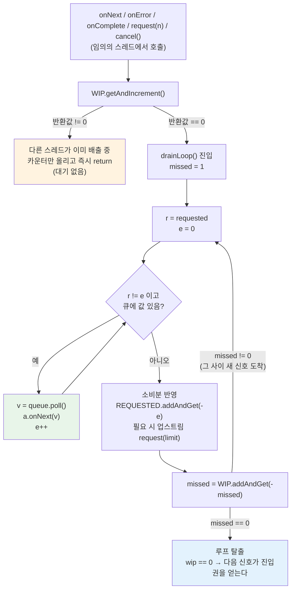

# 백프레셔, request 전파, drain 루프

`request(n)` 이 다운스트림에서 업스트림으로 거슬러 올라가는 경로, prefetch 가 그 왕복을 줄이는 방식, 그리고 여러 스레드가 동시에 신호를 밀어넣어도 `onNext` 직렬화를 보장하는 **WIP(work-in-progress) trampoline** 패턴을 Reactor 소스에서 읽습니다.

## 목차
- [1. 핵심 개념 (What)](#1-핵심-개념-what)
- [2. 왜 알아야 하는가 (Why)](#2-왜-알아야-하는가-why)
- [3. 내부 구현 분석 (How)](#3-내부-구현-분석-how)
- [4. 실전 예제](#4-실전-예제)
- [5. 정리](#5-정리)

---

## 1. 핵심 개념 (What)

Reactive Streams 에서 데이터는 업스트림에서 다운스트림으로 흐르지만, **허락은 반대 방향으로 흐릅니다.** 다운스트림이 `Subscription.request(n)` 으로 "n 개까지 받을 수 있다"고 선언하고, 업스트림은 그 한도 안에서만 `onNext` 를 호출합니다. 이 역방향 신호가 백프레셔입니다.

```
        onNext / onError / onComplete  →  (데이터)
   ┌──────────┐      ┌──────────┐      ┌──────────┐
   │  source  │ ───▶ │ operator │ ───▶ │subscriber│
   └──────────┘      └──────────┘      └──────────┘
        ◀───  request(n) / cancel()  ←  (허락)
```

여기서 세 가지 개념이 갈립니다.

| 개념 | 의미 | 대표 구현 |
|---|---|---|
| **request 전파** | 다운스트림 `request(n)` 을 업스트림으로 중계 | `FluxMap.MapSubscriber.request()` — 그냥 `s.request(n)` 패스스루 |
| **prefetch** | 오퍼레이터가 다운스트림 요청과 무관하게 **미리** 채워 두는 양 | `FluxPublishOn`, `FluxFlatMap` 의 내부 큐 |
| **overflow 전략** | 업스트림이 한도를 무시했을 때(= 요청이 0 인데 데이터가 옴) 무엇을 버릴지 | `onBackpressureBuffer`/`Drop`/`Latest`/`Error` |

그리고 이 모두를 떠받치는 공통 장치가 **drain 루프**입니다. 신호는 여러 스레드에서 올 수 있지만 `onNext` 는 반드시 직렬화되어야 하므로(Reactive Streams Rule 1.3), Reactor 는 락 대신 `volatile int wip` 카운터 하나로 "지금 한 스레드만 배출한다"를 보장합니다.

---

## 2. 왜 알아야 하는가 (Why)

**첫째, prefetch 를 모르면 메모리 예측이 안 됩니다.** `flatMap` 의 기본값은 concurrency 256 · inner prefetch 32 입니다(`Flux.flatMap()` → `Flux.java:5478-5479`). 즉 최악의 경우 inner 큐에만 256 × 32 = 8192 개 원소가 머물 수 있습니다. "`flatMap` 을 썼더니 힙이 튀었다"의 대부분이 여기입니다.

**둘째, overflow 전략의 이름이 동작을 다 설명하지 않습니다.** `onBackpressureBuffer()` 는 **무한 버퍼**이고(`Queues.SMALL_BUFFER_SIZE` 를 링크 크기로 쓰는 `SpscLinkedArrayQueue`), `onBackpressureBuffer(256)` 은 **유한 버퍼**라 초과 시 `onError` 로 터집니다. 같은 메서드 이름인데 OOM 과 에러 종료로 갈립니다.

**셋째, drain 루프를 모르면 "왜 내 `doOnNext` 가 가끔 다른 스레드에서 돌지?"를 설명할 수 없습니다.** WIP 패턴은 "배출을 한 스레드만 한다"를 보장하지만, **그 한 스레드가 누구인지는 고정하지 않습니다.** 신호를 먼저 들고 온 스레드가 남의 몫까지 배출하고 갑니다. 순차성은 보장되지만 스레드 동일성은 보장되지 않는다는 뜻입니다.

---

## 3. 내부 구현 분석 (How)

### 3.1 request 누적 — `Operators.addCap`

`request(n)` 은 누적되며 `Long.MAX_VALUE` 에서 포화(saturate)합니다. `Long.MAX_VALUE` 는 "무한 요청"의 약속된 표현입니다.

```java
// Operators.addCap() — reactor-core/src/main/java/reactor/core/publisher/Operators.java:70
public static long addCap(long a, long b) {
    long res = a + b;
    if (res < 0L) {        // 오버플로 → 무한으로 간주
        return Long.MAX_VALUE;
    }
    return res;
}
```

필드 갱신판은 CAS 루프이고, 이미 `Long.MAX_VALUE` 면 더 이상 쓰지 않습니다.

```java
// Operators.addCap(AtomicLongFieldUpdater, ...) — Operators.java:88
public static <T> long addCap(AtomicLongFieldUpdater<T> updater, T instance, long toAdd) {
    long r, u;
    for (;;) {
        r = updater.get(instance);
        if (r == Long.MAX_VALUE) {
            return Long.MAX_VALUE;   // 무한은 흡수 상태(absorbing state)
        }
        u = addCap(r, toAdd);
        if (updater.compareAndSet(instance, r, u)) {
            return r;                // 직전 값을 반환 → "0 → n 전이"를 감지하는 데 쓰임
        }
    }
}
```

### 3.2 prefetch 와 replenish 임계치 — 75% 규칙

prefetch 큐가 비기 직전까지 기다리면 왕복 지연이 그대로 노출됩니다. 그래서 Reactor 는 **prefetch 의 75% 를 소비한 시점**에 다음 배치를 미리 요청합니다.

```java
// Operators.unboundedOrPrefetch() — Operators.java:1508
static long unboundedOrPrefetch(int prefetch) {
    return prefetch == Integer.MAX_VALUE ? Long.MAX_VALUE : prefetch;
}

// Operators.unboundedOrLimit() — Operators.java:1512
static int unboundedOrLimit(int prefetch) {
    return prefetch == Integer.MAX_VALUE ? Integer.MAX_VALUE : (prefetch - (prefetch >> 2));
}
```

`prefetch - (prefetch >> 2)` = `prefetch × 0.75`. prefetch 가 32 면 limit 은 24 입니다. 즉 24 개를 배출한 순간 업스트림에 `request(24)` 가 나갑니다. `FluxFlatMap.FlatMapInner` 가 이 값을 그대로 씁니다(`FluxFlatMap.java:945`).

`lowTide` 를 주면 임계치를 더 당길 수 있습니다(`Operators.unboundedOrLimit(int, int)` — `Operators.java:1516`).

### 3.3 큐 공급자 선택 — `Queues`

버퍼 크기 상수는 시스템 프로퍼티로 조정 가능하되 **하한이 있습니다.**

```java
// Queues.java:84
public static final int XS_BUFFER_SIZE    = Math.max(8,
        Integer.parseInt(System.getProperty("reactor.bufferSize.x", "32")));

// Queues.java:90
public static final int SMALL_BUFFER_SIZE = Math.max(16,
        Integer.parseInt(System.getProperty("reactor.bufferSize.small", "256")));
```

| 상수 | 기본값 | 시스템 프로퍼티 | 하한 |
|---|---|---|---|
| `Queues.XS_BUFFER_SIZE` | 32 | `reactor.bufferSize.x` | 8 |
| `Queues.SMALL_BUFFER_SIZE` | 256 | `reactor.bufferSize.small` | 16 |

`Queues.get(int)` 이 크기에 따라 구현을 고릅니다(`Queues.java:112`).

```java
public static <T> Supplier<Queue<T>> get(int batchSize) {
    if (batchSize == Integer.MAX_VALUE)   return SMALL_UNBOUNDED;   // SpscLinkedArrayQueue
    if (batchSize == XS_BUFFER_SIZE)      return XS_SUPPLIER;       // SpscArrayQueue(32)
    if (batchSize == SMALL_BUFFER_SIZE)   return SMALL_SUPPLIER;    // SpscArrayQueue(256)
    if (batchSize == 1)                   return ONE_SUPPLIER;      // OneQueue
    if (batchSize == 0)                   return ZERO_SUPPLIER;     // ZeroQueue

    final int adjustedBatchSize = Math.max(8, batchSize);
    if (adjustedBatchSize > 10_000_000) {
        return SMALL_UNBOUNDED;                                     // 너무 크면 링크드로
    }
    else {
        return () -> Hooks.wrapQueue(new SpscArrayQueue<>(adjustedBatchSize));
    }
}
```

공급자 정의는 `Queues.java:482-493` 에 모여 있습니다.

```java
static final Supplier XS_SUPPLIER     = () -> Hooks.wrapQueue(new SpscArrayQueue<>(XS_BUFFER_SIZE));
static final Supplier SMALL_SUPPLIER  = () -> Hooks.wrapQueue(new SpscArrayQueue<>(SMALL_BUFFER_SIZE));
static final Supplier SMALL_UNBOUNDED = () -> Hooks.wrapQueue(new SpscLinkedArrayQueue<>(SMALL_BUFFER_SIZE));
```

두 구현의 차이가 핵심입니다.

- **`SpscArrayQueue`** — 고정 크기 링버퍼. `offer()` 가 가득 차면 `false` 를 반환합니다. 용량이 알려져 있어 `Queues.capacity()` 가 실제 길이를 돌려줍니다(`Queues.java:63-65`).
- **`SpscLinkedArrayQueue`** — 고정 크기 청크를 링크로 이어 붙입니다. `offer()` 가 사실상 실패하지 않고, `Queues.capacity()` 는 `Integer.MAX_VALUE` 를 반환합니다(`Queues.java:60-62`). 즉 **무한 큐**입니다.

둘 다 SPSC(single-producer/single-consumer) 전용입니다. 멀티 프로듀서가 필요하면 `Queues.unboundedMultiproducer()` → `MpscLinkedQueue` 입니다(`Queues.java:225`).

### 3.4 overflow 전략 네 가지

`Flux` 의 팩토리 메서드가 어떤 구현 클래스로 내려가는지가 동작 차이의 전부입니다.

| 연산자 | 구현 클래스 | 소스 | 동작 |
|---|---|---|---|
| `onBackpressureBuffer()` | `FluxOnBackpressureBuffer` (unbounded=true) | `Flux.java:6878` | **무한 버퍼**. 링크 크기 `SMALL_BUFFER_SIZE` |
| `onBackpressureBuffer(maxSize)` | `FluxOnBackpressureBuffer` (unbounded=false) | `Flux.java:6902` | 유한 버퍼. 초과 시 `onError(Overflow)` |
| `onBackpressureBuffer(maxSize, strategy)` | `FluxOnBackpressureBufferStrategy` | `Flux.java:6957` | `DROP_OLDEST`/`DROP_LATEST`/`ERROR` |
| `onBackpressureDrop()` | `FluxOnBackpressureDrop` | `Flux.java:7067` | 요청 0 이면 즉시 폐기 |
| `onBackpressureLatest()` | `FluxOnBackpressureLatest` | `Flux.java:7118` | 가장 최근 1개만 유지 |
| `onBackpressureError()` | **`FluxOnBackpressureDrop`** + 던지는 onDrop | `Flux.java:7102` | 전용 클래스가 없음 |

마지막 줄이 재밌습니다. `onBackpressureError()` 는 별도 오퍼레이터가 아니라 `onBackpressureDrop` 의 콜백에서 예외를 던지는 것입니다.

```java
// Flux.onBackpressureError() — Flux.java:7102
public final Flux<T> onBackpressureError() {
    return onBackpressureDrop(t -> { throw Exceptions.failWithOverflow(); });
}
```

#### `onBackpressureBuffer` — 큐 선택과 overflow 판정

```java
// FluxOnBackpressureBuffer.BackpressureBufferSubscriber 생성자 — FluxOnBackpressureBuffer.java:121
if (unbounded) {
    q = Queues.<T>unbounded(bufferSize).get();   // SpscLinkedArrayQueue
}
else {
    q = Queues.<T>get(bufferSize).get();         // SpscArrayQueue (가능하면)
}

if (!unbounded && Queues.capacity(q) > bufferSize) {
    this.capacityOrSkip = bufferSize;            // 큐가 더 크면 size() 검사로 직접 제한
}
else {
    this.capacityOrSkip = Integer.MAX_VALUE;     // 정확히 맞으면 검사 생략
}
```

`onNext` 에서 두 가지로 overflow 를 잡습니다 — 명시적 `size()` 검사와 `offer()` 실패입니다.

```java
// FluxOnBackpressureBuffer.BackpressureBufferSubscriber.onNext() — FluxOnBackpressureBuffer.java:167
if ((capacityOrSkip != Integer.MAX_VALUE && queue.size() >= capacityOrSkip) || !queue.offer(t)) {
    Throwable ex = Operators.onOperatorError(s, Exceptions.failWithOverflow(), t, ctx);
    if (onOverflow != null) { /* ... onOverflow.accept(t) ... */ }
    Operators.onDiscard(t, ctx);
    onError(ex);
    return;
}
drain(t);
```

`FluxOnBackpressureBuffer` 는 `Fuseable` 을 구현하고(`FluxOnBackpressureBuffer.java:37`), 내부 subscriber 가 `QueueSubscription` 이기도 합니다(`:75-76`). 그래서 출력 퓨전이 켜지면 `drainFused()` 로 분기합니다(`:290`). 퓨전은 [06번 문서](./06-operator-fusion.md)에서 다룹니다.

#### `onBackpressureDrop` — 큐가 없다

```java
// FluxOnBackpressureDrop.DropSubscriber.onNext() — FluxOnBackpressureDrop.java:114
long r = requested;
if (r != 0L) {
    actual.onNext(t);
    if (r != Long.MAX_VALUE) {
        Operators.produced(REQUESTED, this, 1);
    }
}
else {
    try {
        onDrop.accept(t);          // onBackpressureError() 는 여기서 던진다
    }
    catch (Throwable e) {
        onError(Operators.onOperatorError(s, e, t, ctx));
    }
    Operators.onDiscard(t, ctx);
}
```

큐도 WIP 도 없습니다. 업스트림에는 `onSubscribe` 에서 `request(Long.MAX_VALUE)` 를 한 번 보내고(`FluxOnBackpressureDrop.java:109`), 그 뒤로는 다운스트림 요청 잔량만 보고 통과/폐기를 결정합니다. **가장 싸지만 가장 손실이 큽니다.**

#### `onBackpressureLatest` — 큐 대신 슬롯 하나

```java
// FluxOnBackpressureLatest.LatestSubscriber.onNext() — FluxOnBackpressureLatest.java:129
Object toDiscard = VALUE.getAndSet(this, t);   // 이전 값을 밀어내고 최신으로 교체
if (toDiscard != null) {
    Operators.onDiscard(toDiscard, ctx);
}
drain();
```

`AtomicReferenceFieldUpdater` 슬롯 하나가 큐 역할을 합니다. 메모리는 O(1), 손실은 "읽히지 못한 중간값 전부"입니다.

#### `onBackpressureBuffer(maxSize, strategy)` — 버릴 쪽을 고른다

```java
// FluxOnBackpressureBufferStrategy.onNext() — FluxOnBackpressureBufferStrategy.java:159
switch (overflowStrategy) {
    case DROP_OLDEST:
        // 큐의 head 를 꺼내 버리고 새 값을 넣는다
        offer(t);
        break;
    case DROP_LATEST:
        // 방금 온 값을 버린다 (큐는 그대로)
        break;
    case ERROR:
    default:
        // onError(Overflow)
}
```

`BufferOverflowStrategy` 열거형은 `ERROR`/`DROP_LATEST`/`DROP_OLDEST` 세 값입니다(`BufferOverflowStrategy.java:31,35,40`).

### 3.5 drain 루프 / WIP trampoline

여기가 Reactor 동시성의 심장입니다. 요구사항은 하나입니다 — **`onNext` 는 어떤 순간에도 한 스레드만 호출한다.** 구현은 락이 아니라 `volatile int wip` 카운터입니다.

```java
// FluxFlatMap.FlatMapMain — FluxFlatMap.java:253
volatile int wip;
@SuppressWarnings("rawtypes")
static final AtomicIntegerFieldUpdater<FlatMapMain> WIP =
        AtomicIntegerFieldUpdater.newUpdater(FlatMapMain.class, "wip");
```

`AtomicIntegerFieldUpdater` 를 쓰는 이유는 **객체 하나를 아끼기 위해서**입니다. `AtomicInteger` 필드를 두면 subscriber 당 래퍼 객체가 하나 더 생깁니다. 오퍼레이터 체인마다 subscriber 가 만들어지는 Reactor 에서는 이 할당이 그대로 GC 압력이 됩니다.

#### 진입 — `getAndIncrement`

```java
// FluxFlatMap.FlatMapMain.drain() — FluxFlatMap.java:585
void drain(@Nullable R dataSignal) {
    if (WIP.getAndIncrement(this) != 0) {
        if (dataSignal != null && cancelled) {
            Operators.onDiscard(dataSignal, actual.currentContext());
        }
        return;                    // 이미 누군가 배출 중 → 카운터만 올리고 떠난다
    }
    drainLoop();                   // 0 → 1 로 바꾼 스레드만 배출 담당
}
```

`getAndIncrement` 가 **0 을 반환한 단 하나의 스레드**만 `drainLoop()` 에 들어갑니다. 나머지는 "할 일이 더 생겼다"고 카운터에 흔적만 남기고 즉시 반환합니다. **대기(blocking)가 없습니다.** 이게 trampoline 이라 불리는 이유입니다 — 늦게 온 스레드의 일을 먼저 온 스레드가 튕겨 받아 처리합니다.

#### 탈출 — `addAndGet(-missed)`

```java
// FluxOnBackpressureBuffer.drainRegular() 의 꼬리 — FluxOnBackpressureBuffer.java:244
void drainRegular(Subscriber<? super T> a) {
    int missed = 1;
    final Queue<T> q = queue;

    for (;;) {
        long r = requested;
        long e = 0L;

        while (r != e) {
            boolean d = done;
            T t = q.poll();
            boolean empty = t == null;
            if (checkTerminated(d, empty, a, t)) return;
            if (empty) break;
            a.onNext(t);           // ← 직렬화가 보장되는 유일한 지점
            e++;
        }
        if (r == e) {
            if (checkTerminated(done, q.isEmpty(), a, null)) return;
        }
        if (e != 0 && r != Long.MAX_VALUE) {
            REQUESTED.addAndGet(this, -e);      // 소비한 만큼 요청 잔량 차감
        }

        missed = WIP.addAndGet(this, -missed);  // 내가 처리하기로 한 몫을 상계
        if (missed == 0) {
            break;                              // 그 사이 새 일이 없었다 → 종료
        }
        // missed > 0 이면 루프를 한 번 더 (= 남이 밀어넣은 몫 처리)
    }
}
```

핵심은 `WIP.addAndGet(this, -missed)` 입니다. `wip = 0` 으로 리셋하는 게 아니라 **내가 담당하기로 선언한 양만 빼는** 것입니다. 루프를 도는 사이 다른 스레드가 `getAndIncrement` 로 올린 값은 그대로 남아 반환값이 0 이 아니게 되고, 그러면 루프를 한 번 더 돌아 그 일까지 처리합니다. 이 상계 방식이라야 **신호 유실이 없습니다.** (`wip = 0` 으로 덮으면 그 사이 들어온 신호가 사라집니다.)

#### 단순형 — `decrementAndGet == 0`

큐가 하나고 배출량 계산이 필요 없는 경우에는 더 짧은 변형을 씁니다.

```java
// FluxConcatMap.ConcatMapImmediate.drain() — FluxConcatMap.java:345
void drain() {
    if (WIP.getAndIncrement(this) == 0) {    // 0 → 1 로 바꾼 스레드만 진입
        for (;;) {
            if (cancelled) return;
            // ... queue.poll() 하고 inner 구독 ...
            if (WIP.decrementAndGet(this) == 0) {
                break;
            }
        }
    }
}
```

`missed` 변수 없이 매 반복마다 1 씩 깎는 형태입니다. 한 번에 "한 단위 일"만 처리하는 루프라서 가능합니다.

#### CAS fast-path — 큐를 아예 건너뛴다

`FluxFlatMap` 에는 세 번째 변형이 있습니다. **경합이 없고 수요가 있으면 큐를 거치지 않고 바로 `onNext` 를 호출**하는 경로입니다.

```java
// FlatMapMain.tryEmit() — FluxFlatMap.java:541
void tryEmit(FlatMapInner<R> inner, R v) {
    if (wip == 0 && WIP.compareAndSet(this, 0, 1)) {   // :542 — 진입을 CAS 로 선점
        long r = requested;

        Queue<R> q = inner.queue;
        if (r != 0 && (q == null || q.isEmpty())) {
            actual.onNext(v);                           // :547 ← 큐를 안 거친다

            if (r != Long.MAX_VALUE) {
                REQUESTED.decrementAndGet(this);
            }
            inner.request(1);
        }
        else {
            if (q == null) {
                q = getOrCreateInnerQueue(inner);       // 수요가 없으면 큐로
            }
            if (!q.offer(v) && failOverflow(v, inner)) {
                inner.done = true;
                drainLoop();
                return;
            }
        }
        if (WIP.decrementAndGet(this) == 0) {           // :566 — 그 사이 새 신호가 없었다
            if (cancelled) {
                Operators.onDiscard(v, actual.currentContext());
            }
            return;
        }
        drainLoop();                                    // 새 신호가 있었다 → 정규 루프로
    }
    else {
        // 경합 중 → 큐에 넣고 drain(v) 호출
    }
}
```

`getAndIncrement` 대신 **`wip == 0 && compareAndSet(0, 1)`** 을 쓰는 것이 차이입니다. `getAndIncrement` 는 경합 시에도 카운터를 올려 "일이 밀렸다"를 남기지만, 여기서는 CAS 가 실패하면 카운터를 건드리지 않고 `else` 분기로 빠져 큐에 넣습니다. 성공했을 때만 fast-path 로 직접 배출하고 `decrementAndGet == 0` 으로 빠져나갑니다. 중간에 신호가 더 들어왔다면 `decrementAndGet` 이 0 이 아니므로 `drainLoop()` 로 넘어가 정규 경로가 이어받습니다.

`tryEmitScalar()` 도 같은 구조입니다(`FluxFlatMap.java:472`, CAS 진입 `:487`, `actual.onNext` `:492`, 탈출 `:520`). 매퍼가 `Callable` 을 돌려준 경우 큐 할당 자체를 생략하는 최적화입니다.

**즉 `flatMap` 은 "한가할 때는 큐 없이 직접 전달, 붐빌 때만 큐 + drain 루프"로 동작합니다.** 이것이 `flatMap` 이 체인이 한가한 구간에서 큐 할당(`getOrCreateInnerQueue`)조차 하지 않는 이유입니다 — inner 큐는 지연 생성입니다.

네 가지 변형을 정리하면,

| 패턴 | 진입 | 탈출 | 쓰이는 곳 |
|---|---|---|---|
| missed 상계형 | `getAndIncrement != 0` → return | `addAndGet(-missed) == 0` | `FluxFlatMap.drainLoop()`(`:586`, `:801`), `FluxOnBackpressureBuffer`, `FluxOnBackpressureLatest`, `FluxPublishOn` |
| 단위 감산형 | `getAndIncrement == 0` → 진입 | `decrementAndGet() == 0` | `FluxConcatMap.ConcatMapImmediate`(`:345`, `:456`)/`ConcatMapDelayed`(`:687`, `:814`) |
| **CAS fast-path** | `wip == 0 && compareAndSet(0, 1)` | `decrementAndGet() == 0`, 아니면 `drainLoop()` | `FluxFlatMap.tryEmit()`(`:542`, `:566`), `tryEmitScalar()`(`:487`, `:520`) |
| 정리 전용 | `getAndIncrement == 0` → 진입 | (루프 없음) | `cancel()` 에서 큐 비우기 — `FluxFlatMap.java:358`, `FluxOnBackpressureLatest.java:108` |

마지막 것이 중요합니다. `cancel()` 도 WIP 를 통과해야 합니다. 그래야 "배출 중인 스레드와 취소 스레드가 동시에 큐를 건드리는" 경합을 막을 수 있습니다. 주석에도 그렇게 적혀 있습니다 — "discard MUST be happening only and only if there is no racing on elements consumption which is guaranteed by the WIP guard here"(`FluxPublishOn.java:545`, `FluxOnBackpressureBuffer.java:344`).

#### WIP 루프 흐름



이 구조가 보장하는 것과 보장하지 않는 것을 구분해야 합니다.

- **보장함** — `a.onNext(v)` 는 어떤 시점에도 한 스레드에서만 실행됩니다. 순서도 큐 순서 그대로입니다.
- **보장하지 않음** — 그 "한 스레드"가 매번 같은 스레드일 필요는 없습니다. A 스레드가 배출 중 B 가 신호를 넣으면 A 가 B 의 몫까지 처리하지만, A 가 먼저 끝나면 다음 신호는 B 가 배출합니다.

### 3.6 request 전파 전체 경로

`FluxFlatMap` 을 예로 보면, 요청이 세 단계로 쪼개집니다.

```java
// FlatMapMain.onSubscribe() — FluxFlatMap.java:367
actual.onSubscribe(this);
s.request(Operators.unboundedOrPrefetch(maxConcurrency));   // ① 메인에는 concurrency 만큼

// FlatMapMain.request() — FluxFlatMap.java:346
public void request(long n) {
    if (Operators.validate(n)) {
        Operators.addCap(REQUESTED, this, n);               // ② 다운스트림 요청은 누적만
        drain(null);                                        //    실제 배출은 drain 이 한다
    }
}

// FlatMapInner.onSubscribe() — FluxFlatMap.java:949 (request 는 :967)
s.request(Operators.unboundedOrPrefetch(prefetch));         // ③ 각 inner 에는 prefetch 만큼
```

```
       request(10)
            │
            ▼
   ┌────────────────────┐
   │   FlatMapMain      │  REQUESTED += 10  →  drain()
   │   wip trampoline   │
   └────────┬───────────┘
            │ ① request(maxConcurrency=256)   ← 다운스트림 요청과 무관
            ▼
        upstream (outer)
            │ onNext(a), onNext(b), ...  최대 256 개 동시 inner
            ▼
   ┌────────────────────┐   ③ request(prefetch=32) each
   │  FlatMapInner × n  │   소비 24개(=limit)마다 request(24)
   └────────────────────┘
```

**다운스트림의 `request(10)` 은 업스트림까지 그대로 전달되지 않습니다.** 메인 업스트림 요청량은 `maxConcurrency` 가, inner 요청량은 `prefetch` 가 결정하고, `request(10)` 은 "배출 허용량"으로만 쓰입니다. prefetch 가 있는 오퍼레이터는 전부 이 구조입니다.

---

## 4. 실전 예제

### 예제 1 — overflow 전략 네 가지를 눈으로 비교

```java
import reactor.core.publisher.Flux;
import reactor.core.scheduler.Schedulers;
import java.time.Duration;

public class BackpressureStrategies {

    // 초당 1000개를 뿜는 빠른 소스, 다운스트림은 100ms 에 1개만 소비
    static Flux<Long> fast() {
        return Flux.interval(Duration.ofMillis(1)).take(50);
    }

    static void slowConsume(String label, Flux<Long> f) {
        f.publishOn(Schedulers.single(), 1)        // prefetch=1 로 백프레셔를 강하게
         .doOnNext(v -> {
             try { Thread.sleep(30); } catch (InterruptedException ignored) {}
         })
         .doOnError(e -> System.out.println(label + " ERROR: " + e))
         .doOnComplete(() -> System.out.println(label + " done"))
         .subscribe(v -> System.out.println(label + " -> " + v));
    }

    public static void main(String[] args) throws Exception {
        // 무한 버퍼 — 손실 0, 메모리 증가
        slowConsume("[buffer  ]", fast().onBackpressureBuffer());

        // 유한 버퍼 8 — 초과 시 onError(Overflow)
        slowConsume("[buffer8 ]", fast().onBackpressureBuffer(8));

        // 요청 0 이면 즉시 폐기 — 중간값이 통째로 사라진다
        slowConsume("[drop    ]", fast().onBackpressureDrop(
                v -> System.out.println("[drop    ] dropped " + v)));

        // 최신 1개만 유지 — 값이 띄엄띄엄 점프한다
        slowConsume("[latest  ]", fast().onBackpressureLatest());

        Thread.sleep(3000);
    }
}
```

출력 패턴으로 바로 구분됩니다 — `buffer` 는 0,1,2,... 연속, `buffer8` 은 몇 개 뒤 `ERROR`, `drop` 은 "dropped" 로그가 쏟아지고 통과값은 희박, `latest` 는 0 → 27 → 55 처럼 점프합니다.

### 예제 2 — prefetch 가 request 패턴을 바꾸는 것을 확인

```java
import reactor.core.publisher.Flux;
import reactor.core.scheduler.Schedulers;

public class PrefetchObservation {
    public static void main(String[] args) throws Exception {
        Flux.range(1, 100)
            // 업스트림이 실제로 받는 request(n) 을 그대로 찍는다
            .doOnRequest(n -> System.out.println("upstream request(" + n + ")"))
            .publishOn(Schedulers.single(), 16)   // prefetch=16 → limit = 16 - 4 = 12
            .doOnNext(v -> {
                if (v % 12 == 0) System.out.println("  consumed " + v);
            })
            .blockLast();
    }
}
```

`publishOn` 의 prefetch 를 16 으로 주면 `limit = 16 - (16 >> 2) = 12` 이므로, 최초 `request(16)` 뒤로 **12 개씩** 재요청이 나갑니다. prefetch 를 4 로 바꾸면 `limit = 3` 이 되어 요청 왕복이 4 배로 늘고 처리량이 떨어집니다. 반대로 256 으로 올리면 왕복은 줄지만 큐에 최대 256 개가 머뭅니다.

### 예제 3 — WIP 직렬화를 멀티 스레드로 검증

```java
import reactor.core.publisher.Flux;
import reactor.core.publisher.Sinks;
import reactor.core.scheduler.Schedulers;
import java.util.concurrent.atomic.AtomicInteger;
import java.util.concurrent.atomic.AtomicBoolean;

public class SerializationCheck {
    public static void main(String[] args) throws Exception {
        Sinks.Many<Integer> sink = Sinks.many().multicast().onBackpressureBuffer();

        AtomicInteger inFlight = new AtomicInteger();
        AtomicBoolean overlapped = new AtomicBoolean(false);

        sink.asFlux()
            .flatMap(v -> Flux.just(v).subscribeOn(Schedulers.parallel()), 64, 8)
            .subscribe(v -> {
                // onNext 가 겹치면 inFlight 가 1 을 넘는다
                if (inFlight.incrementAndGet() != 1) overlapped.set(true);
                inFlight.decrementAndGet();
            });

        // 4개 스레드가 동시에 신호를 밀어넣는다
        for (int t = 0; t < 4; t++) {
            final int base = t * 1000;
            new Thread(() -> {
                for (int i = 0; i < 1000; i++) {
                    sink.emitNext(base + i, Sinks.EmitFailureHandler.busyLooping(
                            java.time.Duration.ofMillis(100)));
                }
            }).start();
        }

        Thread.sleep(3000);
        System.out.println("onNext 중첩 발생? " + overlapped.get());  // 항상 false
    }
}
```

4개 프로듀서 스레드 × 64개 동시 inner 가 돌아도 `overlapped` 는 `false` 입니다. WIP trampoline 이 배출 담당 스레드를 항상 한 명으로 제한하기 때문입니다.

---

## 5. 정리

- **백프레셔는 역방향 신호**입니다. 데이터는 아래로, `request(n)` 은 위로 흐릅니다. `Long.MAX_VALUE` 는 무한 요청이고 `Operators.addCap` 에서 흡수 상태로 취급됩니다(`Operators.java:70,88`).
- **prefetch 는 request 왕복을 줄이는 선구매**입니다. 임계치는 `prefetch - (prefetch >> 2)` = 75% 이고(`Operators.unboundedOrLimit()` — `Operators.java:1512`), 그만큼 소비하면 다음 배치를 미리 요청합니다.
- **큐 구현은 크기가 고른다.** `Queues.get()` 이 `SpscArrayQueue`(유한) 와 `SpscLinkedArrayQueue`(무한) 를 가릅니다(`Queues.java:112`). 기본 상수는 `XS_BUFFER_SIZE` 32(하한 8), `SMALL_BUFFER_SIZE` 256(하한 16)이고 각각 `reactor.bufferSize.x`/`reactor.bufferSize.small` 로 바꿉니다.
- **overflow 전략은 구현 클래스로 구분하라.** `onBackpressureBuffer()` 는 무한 버퍼, `onBackpressureBuffer(n)` 은 `onError`, `Drop`/`Latest` 는 큐를 아예 안 쓰거나 슬롯 하나만 쓰며, `onBackpressureError()` 는 `FluxOnBackpressureDrop` 의 콜백에서 던지는 것입니다(`Flux.java:7102`).
- **WIP trampoline 이 `onNext` 직렬화의 정체**입니다. `getAndIncrement` 로 진입권을 한 스레드에만 주고, `addAndGet(-missed)` 로 상계해 그 사이 들어온 신호를 놓치지 않습니다. 락도 대기도 없습니다. 순서와 비중첩은 보장되지만 **스레드 동일성은 보장되지 않습니다.**

운영 관점 체크리스트:

| 증상 | 의심 지점 | 확인 |
|---|---|---|
| 힙이 서서히 증가 | `onBackpressureBuffer()` 무인자 사용 | 크기 지정판으로 바꾸고 `onError` 를 받아라 |
| 값이 띄엄띄엄 유실 | `onBackpressureDrop`/`Latest` | 의도한 손실인지 확인 |
| 처리량이 낮음 | prefetch 가 너무 작음 | `limit = prefetch × 0.75` 로 왕복 횟수 계산 |
| `flatMap` 메모리 급증 | concurrency × prefetch | 기본값 256 × 32 = 8192 원소 |

---

## 관련 문서
- 선행: [오퍼레이터와 Reactive Streams 계약](./04-operators-rs-contract.md)
- 후행: [오퍼레이터 퓨전](./06-operator-fusion.md)
- 연관: [flatMap/concatMap/switchMap 내부](./07-flatmap-concatmap-switchmap.md) — prefetch·concurrency 가 실제로 무엇을 제한하는지
- 연관: [스케줄러와 스레딩 모델](./08-schedulers-and-threading.md) — `publishOn` 의 drain 이 어느 스레드에서 도는지
- 연관: [Sinks](./11-sinks.md) — `Sinks.many().multicast().onBackpressureBuffer()` 의 버퍼 동작
- 참고: [Resilience4j 와 Reactor 오퍼레이터](../../resilience4j/advanced/08-reactor-operators.md) — 서드파티 오퍼레이터가 백프레셔를 지키는 방법

---
*참고: Reactor Core 3.7.19 기준*
