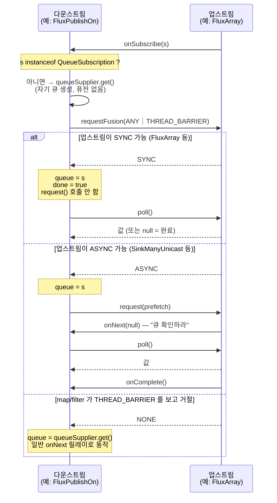

# 오퍼레이터 퓨전

Reactor 가 체인 중간의 큐와 `request(n)` 왕복을 걷어내 "오퍼레이터 n 개"를 "큐 1개 + `poll()` 반복"으로 접어 넣는 최적화 — `Fuseable` 인터페이스와 `requestFusion` 협상 프로토콜을 소스에서 읽습니다.

## 목차
- [1. 핵심 개념 (What)](#1-핵심-개념-what)
- [2. 왜 알아야 하는가 (Why)](#2-왜-알아야-하는가-why)
- [3. 내부 구현 분석 (How)](#3-내부-구현-분석-how)
- [4. 실전 예제](#4-실전-예제)
- [5. 정리](#5-정리)

---

## 1. 핵심 개념 (What)

오퍼레이터 체인은 기본적으로 **신호 릴레이**입니다. `Flux.range(1,3).map(f).filter(p).subscribe(s)` 는 `onNext` 를 세 번 중계하고, 각 단계가 `request(n)` 을 위로 올립니다. 중간 오퍼레이터가 큐를 가진 경우(`publishOn`, `flatMap` 등) 거기에 큐 복사까지 붙습니다.

**퓨전은 이 중간 단계를 "데이터 구조 하나"로 접습니다.** 업스트림이 `Queue` 를 겸하는 `Subscription`(= `QueueSubscription`)을 내놓으면, 다운스트림은 신호를 기다리지 않고 **직접 `poll()` 해서 당겨 갑니다.**

```
[퓨전 없음]  range → onNext → map → onNext → filter → onNext → publishOn
                                                                    │ queue.offer()
             ← request(1) ← request(1) ← request(1) ←────────────────┘

[퓨전 적용]  publishOn 이 range 의 QueueSubscription 을 자기 queue 로 채택
             queue.poll() 할 때마다 range 가 값을 만들고 map/filter 가 그 자리에서 적용된다
             중간 큐 0개, request 왕복 0회
```

퓨전에는 두 방향이 있습니다.

| 방향 | 의미 | 모드 |
|---|---|---|
| **입력 퓨전 (input fusion)** | "나는 업스트림의 큐를 직접 poll 하겠다" | 다운스트림이 `requestFusion()` 을 **호출** |
| **출력 퓨전 (output fusion)** | "나는 다운스트림에게 큐로 보이겠다" | 오퍼레이터가 `requestFusion()` 을 **구현** |

그리고 퓨전의 종류가 두 가지입니다.

- **SYNC 퓨전** — 소스가 값 전체를 이미 가지고 있어 `poll()` 이 즉시 값을 돌려줍니다. `poll()` 이 `null` 이면 그게 완료입니다. `onNext`/`onComplete` 가 **아예 호출되지 않습니다.** 예: `FluxArray`, `FluxIterable`, `FluxRange`.
- **ASYNC 퓨전** — 소스가 값을 나중에 큐에 넣습니다. `onNext(null)` 로 "큐를 확인하라"는 신호만 보내고 실제 값은 `poll()` 로 가져갑니다. 완료는 여전히 `onComplete` 로 옵니다. 예: `SinkManyUnicast`, `FluxPublishOn` 의 출력.

---

## 2. 왜 알아야 하는가 (Why)

**첫째, 성능 차이가 체인 길이에 비례합니다.** `publishOn` 앞에 `map`·`filter` 가 다섯 개 있으면 퓨전 없이는 원소 하나당 `onNext` 호출 6회 + 큐 offer/poll 1회입니다. SYNC 퓨전이 켜지면 `poll()` 한 번에 모든 변환이 호출 스택 안에서 처리됩니다.

**둘째, 퓨전이 스레드 경계를 몰래 넘길 수 있습니다.** 이게 `THREAD_BARRIER` 가 존재하는 이유입니다. `asyncSource.map(expensive).publishOn(scheduler).subscribe()` 에서 전체가 하나의 큐로 융합되면, `expensive` 매퍼가 **`publishOn` 의 워커 스레드에서 `poll()` 될 때** 실행됩니다. 원래라면 업스트림 스레드에서 돌았을 작업이 조용히 옮겨 간 것입니다. `Fuseable` 의 주석이 이 시나리오를 직접 설명합니다(`Fuseable.java:41-51`).

**셋째, 디버깅 중 `onNext(null)` 을 보고 당황하지 않으려면 알아야 합니다.** ASYNC 퓨전에서는 `onNext` 의 인자가 `null` 입니다. 커스텀 오퍼레이터를 작성하면서 이걸 모르면 NPE 가 납니다.

**넷째, 퓨전이 안 되는 오퍼레이터를 알아야 설계가 됩니다.** `FluxFlatMap` 은 `Fuseable` 을 구현하지 않습니다(`FluxFlatMap.java:49`). 즉 `flatMap` 뒤로는 출력 퓨전이 끊깁니다. 이 얘기는 [07번 문서](./07-flatmap-concatmap-switchmap.md)에서 이어집니다.

---

## 3. 내부 구현 분석 (How)

### 3.1 `Fuseable` 의 모드 상수 다섯 개

```java
// reactor-core/src/main/java/reactor/core/Fuseable.java:31
public interface Fuseable {

    /** Indicates the QueueSubscription can't support the requested mode. */
    int NONE = 0;                                          // :34
    /** Indicates the QueueSubscription can perform sync-fusion. */
    int SYNC = 1;                                          // :36
    /** Indicates the QueueSubscription can perform only async-fusion. */
    int ASYNC = 2;                                         // :38
    /** Indicates the QueueSubscription should decide what fusion it performs (input only). */
    int ANY = 3;                                           // :40
    /**
     * Indicates that the queue will be drained from another thread
     * thus any queue-exit computation may be invalid at that point.
     */
    int THREAD_BARRIER = 0b100; //4                        // :51
```

| 상수 | 값 | 의미 | 방향 |
|---|---|---|---|
| `NONE` | 0 | 요청한 모드를 지원 못함 → 퓨전 포기 | 응답 전용 |
| `SYNC` | 1 | 동기 퓨전 가능 | 요청/응답 |
| `ASYNC` | 2 | 비동기 퓨전만 가능 | 요청/응답 |
| `ANY` | 3 (= `SYNC｜ASYNC`) | **"네가 골라라"** | **입력(요청) 전용** |
| `THREAD_BARRIER` | 4 (`0b100`) | 큐가 다른 스레드에서 drain 된다 | 플래그 |

`ANY` 가 **입력 전용**이라는 점이 중요합니다. 주석이 못을 박습니다 — "One should request either SYNC, ASYNC or ANY modes (never NONE) and the implementor should return NONE, SYNC or ASYNC (**never ANY**)"(`Fuseable.java:158-159`). 즉 협상 요청은 `ANY` 로 열어두고 응답은 반드시 구체적인 한 모드로 좁혀야 합니다.

#### `THREAD_BARRIER` 가 비트 플래그인 이유

`SYNC`=1, `ASYNC`=2 는 비트이고 `ANY`=3 은 그 둘의 OR 입니다. `THREAD_BARRIER` 는 `0b100` 이라 이 세 값과 **겹치지 않습니다.** 그래서 모드와 OR 로 합쳐 하나의 `int` 로 전달할 수 있습니다.

```java
// 다운스트림이 보내는 실제 요청값
f.requestFusion(Fuseable.ANY | Fuseable.THREAD_BARRIER);   // = 0b011 | 0b100 = 7
```

받는 쪽은 비트 마스킹으로 분리합니다.

```java
// Fuseable.fusionModeName() — Fuseable.java:89
int evaluated = mode;
String threadBarrierSuffix = "";
if (mode >= 0) {
    evaluated = mode & ~THREAD_BARRIER;                    // THREAD_BARRIER 비트를 지운다
    if (!ignoreThreadBarrier && (mode & THREAD_BARRIER) == THREAD_BARRIER) {
        threadBarrierSuffix = "+THREAD_BARRIER";
    }
}
```

플래그가 아니라 별도 모드였다면 `SYNC_WITH_BARRIER`, `ASYNC_WITH_BARRIER` 처럼 조합마다 상수가 필요했을 겁니다. 직교하는 축이라 비트로 뺀 것입니다.

`THREAD_BARRIER` 를 **보고 거절하는** 쪽이 바로 "스레드를 넘기면 안 되는 계산"을 품은 오퍼레이터입니다.

```java
// FluxMapFuseable.MapFuseableSubscriber.requestFusion() — FluxMapFuseable.java:214
public int requestFusion(int requestedMode) {
    int m;
    if ((requestedMode & Fuseable.THREAD_BARRIER) != 0) {
        return Fuseable.NONE;        // 매퍼가 남의 스레드에서 돌면 안 된다 → 퓨전 거절
    }
    else {
        m = s.requestFusion(requestedMode);
    }
    sourceMode = m;
    return m;
}
```

`FluxFilterFuseable` 도 같습니다(`FluxFilterFuseable.java:262`, `:486`). `map` 의 매퍼와 `filter` 의 프레디케이트는 사용자 코드라서, 그걸 다른 스레드로 몰래 옮기는 대신 퓨전을 포기합니다. **즉 `publishOn` 앞의 `map` 은 퓨전되지 않습니다.** 이게 Reactor 가 "어느 연산자가 어느 스레드에서 도는가"의 직관을 지키는 방법입니다.

### 3.2 `QueueSubscription` — Queue 이면서 Subscription

```java
// Fuseable.QueueSubscription — Fuseable.java:149
interface QueueSubscription<T> extends Queue<T>, Subscription {

    String NOT_SUPPORTED_MESSAGE = "Although QueueSubscription extends Queue it is purely internal" +
            " and only guarantees support for poll/clear/size/isEmpty." +
            " Instances shouldn't be used/exposed as Queue outside of Reactor operators.";

    int requestFusion(int requestedMode);                  // :170 — 유일한 실질 메서드
```

`Queue` 를 상속하지만 **대부분의 `Queue` 메서드가 `UnsupportedOperationException` 을 던지는 default 구현**입니다.

```java
// Fuseable.java:173 이후 — peek/add/offer/remove/element/contains/iterator/
//                           toArray/containsAll/addAll/removeAll/retainAll 전부 동일
@Override
default boolean offer(@Nullable T t) {
    throw new UnsupportedOperationException(NOT_SUPPORTED_MESSAGE);
}
```

실제로 보장되는 건 **`poll()` / `clear()` / `size()` / `isEmpty()` 네 개**뿐입니다(`NOT_SUPPORTED_MESSAGE` 에 명시). `Queue` 를 상속한 이유는 순전히 "기존 drain 루프 코드가 `Queue<T>` 타입 필드에 그대로 담을 수 있게" 하려는 것입니다. `FluxPublishOn` 이 그 전형입니다.

```java
// FluxPublishOn.PublishOnSubscriber.onSubscribe() — FluxPublishOn.java:175
if (s instanceof QueueSubscription) {
    @SuppressWarnings("unchecked") QueueSubscription<T> f = (QueueSubscription<T>) s;

    int m = f.requestFusion(Fuseable.ANY | Fuseable.THREAD_BARRIER);   // :183

    if (m == Fuseable.SYNC) {
        sourceMode = Fuseable.SYNC;
        queue = f;                    // ← Subscription 을 queue 필드에 그대로 담는다
        done = true;                  // ← SYNC 는 onComplete 를 안 기다린다
        actual.onSubscribe(this);
        return;                       // ← request(prefetch) 도 하지 않는다
    }
    if (m == Fuseable.ASYNC) {
        sourceMode = Fuseable.ASYNC;
        queue = f;                    // 같이 채택하되
        actual.onSubscribe(this);
        s.request(Operators.unboundedOrPrefetch(prefetch));   // 요청은 해야 한다
        return;
    }
}

queue = queueSupplier.get();          // 퓨전 실패 → 자기 큐를 새로 만든다
actual.onSubscribe(this);
s.request(Operators.unboundedOrPrefetch(prefetch));
```

세 갈래가 모두 보입니다 — SYNC 면 `request` 자체가 없고(`poll()` 이 요청 역할), ASYNC 면 큐만 공유하고 요청은 유지, NONE 이면 큐를 새로 할당합니다.

`Subscription` → `QueueSubscription` 캐스팅 헬퍼도 있습니다.

```java
// Operators.as() — Operators.java:109
public static <T> QueueSubscription<T> as(Subscription s) {
    if (s instanceof QueueSubscription) {
        return (QueueSubscription<T>) s;
    }
    return null;
}
```

### 3.3 `SynchronousSubscription` — SYNC 전용 축약

```java
// Fuseable.SynchronousSubscription — Fuseable.java:252
interface SynchronousSubscription<T> extends QueueSubscription<T> {

    @Override
    default int requestFusion(int requestedMode) {
        if ((requestedMode & Fuseable.SYNC) != 0) {
            return Fuseable.SYNC;
        }
        return NONE;
    }
}
```

`requestFusion` 의 default 구현이 들어있어 SYNC 소스는 구현할 게 없습니다. `(requestedMode & SYNC) != 0` 이므로 `SYNC`(1), `ANY`(3), `ANY|THREAD_BARRIER`(7) 모두 통과합니다. **`THREAD_BARRIER` 를 신경 쓰지 않는다**는 점이 포인트입니다 — 배열/범위에서 값을 꺼내는 건 어느 스레드에서 해도 무해하니까요.

SYNC 구현 세 가지가 전부 이 인터페이스를 쓰고 `requestFusion` 을 **오버라이드하지 않습니다.**

| 소스 | 클래스 선언 | 내부 subscription |
|---|---|---|
| `Flux.just(...)` / `fromArray` | `FluxArray<T> ... implements Fuseable, SourceProducer<T>` (`FluxArray.java:34`) | `ArraySubscription implements InnerProducer<T>, SynchronousSubscription<T>` (`:70-71`) |
| `Flux.fromIterable(...)` | `FluxIterable<T> ... implements Fuseable, SourceProducer<T>` (`FluxIterable.java:43`) | `IterableSubscription implements InnerProducer<T>, SynchronousSubscription<T>, Consumer<T>` (`:205-206`) |
| `Flux.range(...)` | `FluxRange extends Flux<Integer>` (`FluxRange.java:31`) | `RangeSubscription implements InnerProducer<Integer>, SynchronousSubscription<Integer>` (`:78-79`) |

`poll()` 이 상태 포인터를 한 칸 전진시키는 전부입니다.

```java
// FluxArray.ArraySubscription.poll() — FluxArray.java:186
public T poll() {
    int i = index;
    T[] a = array;
    if (i != a.length) {
        T t = a[i];
        Objects.requireNonNull(t);
        index = i + 1;
        return t;
    }
    return null;              // null = 끝. onComplete 가 필요 없다
}
```

세 소스 모두 `Conditional` 변형을 따로 가집니다(`FluxArray.java:231`, `FluxIterable.java:534`, `FluxRange.java:225`). 다운스트림이 `ConditionalSubscriber` 일 때 쓰는 버전입니다.

### 3.4 ASYNC 퓨전 — `SinkManyUnicast`

```java
// SinkManyUnicast 선언 — SinkManyUnicast.java:87
final class SinkManyUnicast<T> extends Flux<T>
        implements InternalManySink<T>, Disposable, Fuseable.QueueSubscription<T>, Fuseable {
```

Sink 가 **자기 자신이 `QueueSubscription`** 입니다. 큐를 따로 만들지 않고 자기가 큐 역할을 합니다.

```java
// SinkManyUnicast.requestFusion() — SinkManyUnicast.java:501
public int requestFusion(int requestedMode) {
    if ((requestedMode & Fuseable.ASYNC) != 0) {
        outputFused = true;
        return Fuseable.ASYNC;
    }
    return Fuseable.NONE;
}
```

`ASYNC` 비트만 봅니다. `ANY`(3) 로 요청하면 `3 & 2 != 0` 이므로 `ASYNC` 를 돌려줍니다. `SYNC`(1) 단독 요청은 `1 & 2 == 0` 이라 `NONE` 입니다. `THREAD_BARRIER` 역시 무시합니다 — sink 는 사용자 계산을 품지 않으니까요.

`FluxPublishOn` 의 출력 퓨전도 ASYNC 전용입니다.

```java
// FluxPublishOn.PublishOnSubscriber.requestFusion() — FluxPublishOn.java:660
public int requestFusion(int requestedMode) {
    if ((requestedMode & ASYNC) != 0) {
        outputFused = true;
        return ASYNC;
    }
    return NONE;
}
```

당연합니다 — `publishOn` 의 큐는 워커 스레드가 채우므로 `poll()` 이 즉시 값을 보장할 수 없습니다. 그리고 `outputFused` 가 켜지면 `run()` 이 전용 경로로 갑니다.

```java
// FluxPublishOn.PublishOnSubscriber.run() — FluxPublishOn.java:525
public void run() {
    if (outputFused) {
        runBackfused();               // :476 — 다운스트림이 직접 poll 하므로 onNext(null) 만 보낸다
    }
    else if (sourceMode == Fuseable.SYNC) {
        runSync();                    // :338 — 업스트림 큐를 직접 poll
    }
    else {
        runAsync();                   // :401 — 일반 경로
    }
}
```

### 3.5 `ScalarCallable` — 조립 시점 최적화

```java
// Fuseable.ScalarCallable — Fuseable.java:271
interface ScalarCallable<T> extends Callable<T> { }
```

메서드가 없는 마커입니다. "값이 하나뿐이고 지금 당장 `call()` 로 꺼낼 수 있다"는 뜻입니다. `Flux.just(x)`, `Mono.just(x)`, `Mono.empty()` 가 여기 해당합니다.

이 마커는 **조립 시점에 오퍼레이터를 치환**하는 데 쓰입니다.

```java
// Flux.subscribeOn() — Flux.java:8981
public final Flux<T> subscribeOn(Scheduler scheduler, boolean requestOnSeparateThread) {
    if (this instanceof Callable) {
        if (this instanceof Fuseable.ScalarCallable) {
            try {
                @SuppressWarnings("unchecked") T value = ((Fuseable.ScalarCallable<T>) this).call();
                return onAssembly(new FluxSubscribeOnValue<>(value, scheduler));   // 전용 구현으로 교체
            }
            ...
```

`Flux.publishOn()` 도 같은 분기를 가집니다(`Flux.java:7715-7716`). 스칼라 하나를 옮기는 데 큐와 drain 루프를 쓸 필요가 없으니, 값을 미리 꺼내 가벼운 구현으로 바꿉니다. `FluxFlatMap.trySubscribeScalarMap()` 도 이 마커를 활용해 **구독조차 생략**합니다(`FluxFlatMap.java:119`).

### 3.6 `ConditionalSubscriber` — request 왕복 없는 drop

```java
// Fuseable.ConditionalSubscriber — Fuseable.java:121
interface ConditionalSubscriber<T> extends CoreSubscriber<T> {
    /**
     * Try consuming the value and return true if successful.
     * @return true if consumed, false if dropped and a new value can be immediately sent
     */
    boolean tryOnNext(T t);                                // :127
}
```

문제 상황은 이렇습니다. `filter` 가 값을 버리면 다운스트림 요청 잔량은 그대로지만, 업스트림은 "하나 보냈다"고 생각합니다. 그래서 `filter` 는 `request(1)` 을 추가로 올려야 합니다. 원소 하나 버릴 때마다 CAS 왕복이 한 번씩 발생합니다.

`tryOnNext` 는 그 왕복을 없앱니다 — **반환값으로 "소비했는지"를 즉시 알려주므로** 업스트림이 요청 없이 바로 다음 값을 보낼 수 있습니다.

```java
// FluxFilter.FilterConditionalSubscriber.tryOnNext() — FluxFilter.java:122 (유사 구현 :256)
public boolean tryOnNext(T t) {
    if (done) {
        Operators.onNextDropped(t, this.ctx);
        return false;
    }
    boolean b;
    try {
        b = predicate.test(t);
    }
    catch (Throwable e) {
        Throwable e_ = Operators.onNextError(t, e, this.ctx, s);
        if (e_ != null) onError(e_);
        Operators.onDiscard(t, this.ctx);
        return false;
    }
    if (b) {
        actual.onNext(t);
        return true;          // 소비됨
    }
    return false;             // 버림 → 업스트림은 request 없이 다음 값을 보내도 된다
}
```

호출하는 쪽은 소스의 drain 루프입니다.

```java
// FluxArray.ArraySubscriptionConditional 내부 — FluxArray.java:292
boolean b = s.tryOnNext(t);
// b == false 면 소비 카운트를 올리지 않고 다음 원소로 넘어간다

// FluxPublishOn 의 Conditional 변형 — FluxPublishOn.java:937, :1004
if (a.tryOnNext(v)) {
    e++;                      // 소비된 것만 센다
}
```

### 3.7 협상 프로토콜 전체



`ANY | THREAD_BARRIER` 로 요청하는 곳은 소스 전체에서 아홉 군데입니다.

| 호출 위치 | 파일:줄 |
|---|---|
| `FluxPublishOn.PublishOnSubscriber.onSubscribe()` | `FluxPublishOn.java:183` |
| `FluxPublishOn` Conditional 변형 | `FluxPublishOn.java:752` |
| `FluxConcatMap.ConcatMapImmediate.onSubscribe()` | `FluxConcatMap.java:211` |
| `FluxConcatMap.ConcatMapDelayed.onSubscribe()` | `FluxConcatMap.java:576` |
| `FluxFlatMap.FlatMapInner.onSubscribe()` | `FluxFlatMap.java:954` |
| `FluxMergeSequential.MergeSequentialInner.onSubscribe()` | `FluxMergeSequential.java:554` |
| `FluxPublish.PublishSubscriber.onSubscribe()` | `FluxPublish.java:231` |
| `FluxZip` inner | `FluxZip.java:1088` |
| `ParallelSource` | `ParallelSource.java:180` |

전부 **내부에 큐를 가진 오퍼레이터**입니다. 업스트림이 이미 큐라면 자기 큐를 만들지 않으려는 것이고, `THREAD_BARRIER` 를 함께 보내는 건 "이 큐는 내 워커 스레드에서 drain 될 것"이라는 고지입니다.

---

## 4. 실전 예제

### 예제 1 — 퓨전 모드를 직접 관찰

```java
import reactor.core.CoreSubscriber;
import reactor.core.Fuseable;
import reactor.core.publisher.Flux;
import reactor.util.context.Context;
import org.reactivestreams.Subscription;

public class FusionProbe {

    /** 업스트림에게 모드를 물어보고 결과만 찍는 subscriber */
    static <T> void probe(String label, Flux<T> source, int requestedMode) {
        source.subscribe(new CoreSubscriber<T>() {
            @Override public Context currentContext() { return Context.empty(); }

            @Override public void onSubscribe(Subscription s) {
                if (s instanceof Fuseable.QueueSubscription) {
                    @SuppressWarnings("unchecked")
                    Fuseable.QueueSubscription<T> qs = (Fuseable.QueueSubscription<T>) s;
                    int granted = qs.requestFusion(requestedMode);
                    System.out.printf("%-34s 요청=%-22s 응답=%s%n",
                            label,
                            Fuseable.fusionModeName(requestedMode),
                            Fuseable.fusionModeName(granted));
                }
                else {
                    System.out.printf("%-34s QueueSubscription 아님 (퓨전 불가)%n", label);
                }
                s.cancel();
            }
            @Override public void onNext(T t) {}
            @Override public void onError(Throwable t) {}
            @Override public void onComplete() {}
        });
    }

    public static void main(String[] args) {
        int ANY_BARRIER = Fuseable.ANY | Fuseable.THREAD_BARRIER;

        probe("just(1,2,3)",            Flux.just(1, 2, 3),                    ANY_BARRIER);
        probe("range(1,3)",             Flux.range(1, 3),                      ANY_BARRIER);
        probe("fromIterable",           Flux.fromIterable(java.util.List.of(1)), ANY_BARRIER);
        probe("range.map  (BARRIER)",   Flux.range(1, 3).map(i -> i * 2),      ANY_BARRIER);
        probe("range.map  (ANY only)",  Flux.range(1, 3).map(i -> i * 2),      Fuseable.ANY);
        probe("range.filter(BARRIER)",  Flux.range(1, 3).filter(i -> true),    ANY_BARRIER);
        probe("range.flatMap",          Flux.range(1, 3).flatMap(Flux::just),  ANY_BARRIER);
    }
}
```

예상 결과의 핵심 두 줄입니다.

```
range.map  (BARRIER)   요청=ANY+THREAD_BARRIER   응답=NONE     ← 매퍼를 지키려고 거절
range.map  (ANY only)  요청=ANY                  응답=SYNC     ← 장벽이 없으면 융합
range.flatMap          QueueSubscription 아님 (퓨전 불가)        ← FluxFlatMap 은 Fuseable 미구현
```

같은 체인인데 요청에 `THREAD_BARRIER` 가 붙었는지로 결과가 갈립니다. 이것이 `publishOn` 앞의 `map` 이 퓨전되지 않는 이유입니다.

### 예제 2 — SYNC 퓨전이 `onNext` 를 건너뛰는 것 확인

```java
import reactor.core.publisher.Flux;
import reactor.core.publisher.Hooks;
import reactor.core.scheduler.Schedulers;

public class SyncFusionEffect {
    public static void main(String[] args) {
        // publishOn 은 range 의 SynchronousSubscription 을 자기 queue 로 채택한다.
        // 업스트림에 request() 가 나가지 않는다 — poll() 이 요청 역할을 한다.
        System.out.println("--- 퓨전 적용 (range → publishOn) ---");
        Flux.range(1, 5)
            .doOnRequest(n -> System.out.println("  upstream request(" + n + ")"))
            .publishOn(Schedulers.single(), 4)
            .blockLast();

        // map 이 THREAD_BARRIER 를 거절하므로 퓨전이 끊기고 일반 request 가 흐른다
        System.out.println("--- 퓨전 차단 (range → map → publishOn) ---");
        Flux.range(1, 5)
            .doOnRequest(n -> System.out.println("  upstream request(" + n + ")"))
            .map(i -> i)
            .publishOn(Schedulers.single(), 4)
            .blockLast();
    }
}
```

첫 번째는 `request` 로그가 거의 찍히지 않고(SYNC 퓨전으로 `request()` 를 호출하지 않음), 두 번째는 `request(4)` → `request(3)` 식으로 prefetch 왕복이 보입니다.

### 예제 3 — `Hooks.onOperatorDebug()` 로 퓨전 상태 읽기

```java
import reactor.core.Scannable;
import reactor.core.publisher.Flux;

public class ScanFusion {
    public static void main(String[] args) {
        Flux<Integer> fused   = Flux.range(1, 10);
        Flux<Integer> notFused = Flux.range(1, 10).flatMap(Flux::just);

        System.out.println("range      instanceof Fuseable = "
                + (fused instanceof reactor.core.Fuseable));
        System.out.println("flatMap    instanceof Fuseable = "
                + (notFused instanceof reactor.core.Fuseable));

        // Scannable 로 체인 구조 확인
        Scannable.from(notFused).parents()
                 .forEach(p -> System.out.println("  parent: " + p));
    }
}
```

`FluxFlatMap` 이 `Fuseable` 을 구현하지 않는다는 걸 런타임에서 그대로 확인할 수 있습니다.

---

## 5. 정리

- **퓨전이 없애는 것은 중간 큐와 `request(n)` 왕복**입니다. 업스트림의 `QueueSubscription` 을 다운스트림이 자기 `queue` 필드로 채택하면, 신호 릴레이 대신 `poll()` 반복이 됩니다.
- **모드는 다섯 개**입니다 — `NONE`(0) / `SYNC`(1) / `ASYNC`(2) / **`ANY`(3, 입력 전용)** / `THREAD_BARRIER`(`0b100`, 플래그). `ANY` 는 요청에만 쓰고 응답으로 돌려주면 안 됩니다(`Fuseable.java:158-159`).
- **`THREAD_BARRIER` 가 플래그인 이유**는 모드와 직교하는 축이기 때문입니다. `SYNC`/`ASYNC`/`ANY` 와 비트가 겹치지 않아 OR 로 합쳐 하나의 `int` 로 보내고, 받는 쪽은 `mode & ~THREAD_BARRIER` 로 분리합니다(`Fuseable.java:93`).
- **`QueueSubscription` 은 사실상 `requestFusion` 만 있는 인터페이스**입니다. `poll`/`clear`/`size`/`isEmpty` 외의 `Queue` 메서드는 전부 `UnsupportedOperationException` default 입니다(`Fuseable.java:173-242`). `Queue` 를 상속한 건 기존 drain 코드의 `Queue<T>` 필드에 담기 위한 것입니다.
- **SYNC 구현**은 `SynchronousSubscription` 의 default `requestFusion` 을 그대로 쓰며 `THREAD_BARRIER` 를 무시합니다 — `FluxArray`/`FluxIterable`/`FluxRange`. **ASYNC 구현**은 `ASYNC` 비트만 보고 켭니다 — `SinkManyUnicast.java:501`, `FluxPublishOn.java:660`.
- **`map`/`filter` 는 `THREAD_BARRIER` 를 보면 퓨전을 거절합니다**(`FluxMapFuseable.java:214`, `FluxFilterFuseable.java:262`). 사용자 계산을 다른 스레드로 몰래 옮기지 않으려는 의도적 설계입니다.
- **`ConditionalSubscriber.tryOnNext`** 는 "버렸다"를 반환값으로 즉시 알려 `request(1)` 왕복을 없앱니다(`Fuseable.java:121-128`, `FluxFilter.java:122`).
- **`ScalarCallable`** 은 조립 시점에 `subscribeOn`/`publishOn` 을 전용 경량 구현으로 치환하는 마커입니다(`Flux.java:8983`, `:7716`).

---

## 관련 문서
- 선행: [백프레셔, request 전파, drain 루프](./05-backpressure-and-drain-loop.md)
- 후행: [flatMap/concatMap/switchMap 내부](./07-flatmap-concatmap-switchmap.md)
- 연관: [오퍼레이터 체인 내부 구조](./03-operator-chain-internals.md) — `onAssembly` 와 조립 시점 치환
- 연관: [스케줄러와 스레딩 모델](./08-schedulers-and-threading.md) — `THREAD_BARRIER` 가 지키려는 스레드 경계
- 연관: [Sinks](./11-sinks.md) — `SinkManyUnicast` 의 ASYNC 퓨전

---
*참고: Reactor Core 3.7.19 기준*
