# flatMap 계열 내부 — flatMap / concatMap / flatMapSequential / switchMap

같은 "Publisher 를 평탄화한다"는 일을 네 가지 방식으로 구현한 오퍼레이터들 — 내부 큐 구조와 `concurrency`/`prefetch` 가 실제로 무엇을 제한하는지, 순서 보장이 코드 어디에서 갈리는지를 소스에서 읽습니다.

## 목차
- [1. 핵심 개념 (What)](#1-핵심-개념-what)
- [2. 왜 알아야 하는가 (Why)](#2-왜-알아야-하는가-why)
- [3. 내부 구현 분석 (How)](#3-내부-구현-분석-how)
- [4. 실전 예제](#4-실전-예제)
- [5. 정리](#5-정리)

---

## 1. 핵심 개념 (What)

네 오퍼레이터 모두 `T → Publisher<R>` 매퍼를 받아 `Flux<R>` 를 만듭니다. 차이는 **inner Publisher 를 몇 개나 동시에 구독하는가**와 **결과를 어떤 순서로 배출하는가** 두 축뿐입니다.

```
outer:  ──a──────b──────c──────▶
        a→[a1 a2 a3]  (느림)
        b→[b1 b2]     (빠름)
        c→[c1]        (중간)

flatMap            ──b1─b2─c1─a1─a2─a3──▶   동시 구독, 도착 순서대로 (순서 깨짐)
concatMap          ──a1─a2─a3─b1─b2─c1──▶   하나씩 구독, 완전 직렬
flatMapSequential  ──a1─a2─a3─b1─b2─c1──▶   동시 구독하되 배출만 순서대로
switchMap          ──────────────c1──────▶   새 값이 오면 기존 inner 취소
```

| 오퍼레이터 | 동시 구독 | 배출 순서 | 구현 클래스 |
|---|---|---|---|
| `flatMap` | `concurrency` 개 | 도착 순 (interleave) | `FluxFlatMap` |
| `concatMap` | 1개 | outer 순서 | `FluxConcatMapNoPrefetch` / `FluxConcatMap` |
| `flatMapSequential` | `concurrency` 개 | outer 순서 | `FluxMergeSequential` |
| `switchMap` | 1개 (기존 취소) | 최신 inner 만 | `FluxSwitchMapNoPrefetch` / `FluxSwitchMap` |

`concatMap` 과 `switchMap` 은 **구현이 두 개**입니다. prefetch 를 생략하거나 0 을 주면 `...NoPrefetch` 변형이 선택됩니다. 이것이 3.4.0 이후의 기본값입니다.

---

## 2. 왜 알아야 하는가 (Why)

**"flatMap 으로 순서가 깨졌다"** 와 **"concatMap 으로 느려졌다"** 는 실무에서 가장 흔한 두 문제고, 둘 다 구현을 보면 당연한 결과입니다.

- `flatMap` 은 `FlatMapInner` 를 `concurrency` 개까지 **동시에** 구독하고, `drainLoop()` 가 inner 배열을 라운드로빈으로 돌며 큐를 비웁니다(`FluxFlatMap.java:595`). 어느 inner 가 먼저 값을 넣었는지에 따라 배출 순서가 정해지므로 **순서 보장이 애초에 없습니다.**
- `concatMap` 은 inner 가 `onComplete` 를 보낼 때까지 다음 outer 원소를 요청하지 않습니다. `FluxConcatMapNoPrefetch` 는 아예 `upstream.request(1)` 을 inner 완료 시점에만 보냅니다(`FluxConcatMapNoPrefetch.java:275`). **동시성이 1 로 고정**되니 전체 지연이 inner 지연의 합이 됩니다.

**해법이 `flatMapSequential` 인데, 이것도 공짜가 아닙니다.** `FluxMergeSequential` 은 `concurrency` 개를 동시에 구독하되 **head inner 의 큐만 배출**합니다(`FluxMergeSequential.java:366`). 뒤쪽 inner 가 먼저 끝나도 그 결과는 큐에 쌓여 대기합니다. 즉 **메모리 사용량이 `flatMap` 보다 클 수 있습니다** — 첫 inner 가 느리면 나머지 전부가 버퍼링됩니다.

**기본값도 외우고 있어야 합니다.** `flatMap()` 의 기본 concurrency 가 256 이고 prefetch 가 32 입니다. inner 하나가 큰 객체를 흘리면 256 × 32 원소가 힙에 머물 수 있습니다.

---

## 3. 내부 구현 분석 (How)

### 3.1 기본값 — `Flux` 팩토리가 넘기는 상수

소스에서 직접 확인한 값입니다.

| 호출 | 실제 생성 | concurrency | prefetch | 소스 |
|---|---|---|---|---|
| `flatMap(f)` | `FluxFlatMap` | `SMALL_BUFFER_SIZE` = **256** | `XS_BUFFER_SIZE` = **32** | `Flux.java:5478-5479` |
| `flatMap(f, c)` | `FluxFlatMap` | `c` | `XS_BUFFER_SIZE` = 32 | `Flux.java:5522` |
| `concatMap(f)` | **`FluxConcatMapNoPrefetch`** | 1 | 없음 (요청 1개씩) | `Flux.java:4052-4053` |
| `concatMap(f, 0)` | `FluxConcatMapNoPrefetch` | 1 | 없음 | `Flux.java:4090-4091` |
| `concatMap(f, n)` | `FluxConcatMap` + `ErrorMode.IMMEDIATE` | 1 | `n` | `Flux.java:4093` |
| `concatMapDelayError(f)` | `concatMapDelayError(f, 0)` → NoPrefetch | 1 | 없음 | `Flux.java:4132-4133` |
| `flatMapSequential(f)` | `FluxMergeSequential` | `SMALL_BUFFER_SIZE` = **256** | `XS_BUFFER_SIZE` = **32** | `Flux.java:5778` → `:5819` |
| `switchMap(f)` | **`FluxSwitchMapNoPrefetch`** | 1 | 없음 | `Flux.java:9144-9145` |
| `switchMap(f, n)` | `FluxSwitchMap` (n≠0) | 1 | `n` | `Flux.java:9169-9173` |

`flatMapSequential` 의 delayError 매핑이 재미있습니다 — `ErrorMode` 를 재사용합니다.

```java
// Flux.flatMapSequential(mapper, delayError, maxConcurrency, prefetch) — Flux.java:11010
return onAssembly(new FluxMergeSequential<>(this, mapper, maxConcurrency,
        prefetch, delayError ? FluxConcatMap.ErrorMode.END :
        FluxConcatMap.ErrorMode.IMMEDIATE));
```

### 3.2 `FluxFlatMap` — 동시 구독 + inner 배열

#### 클래스 구조

```java
// FluxFlatMap.java:49 — Fuseable 을 구현하지 않는다
final class FluxFlatMap<T, R> extends InternalFluxOperator<T, R> {

    final Function<? super T, ? extends Publisher<? extends R>> mapper;
    final boolean delayError;
    final int maxConcurrency;                                   // :55
    final Supplier<? extends Queue<R>> mainQueueSupplier;       // :57 — 스칼라용
    final int prefetch;                                         // :59
    final Supplier<? extends Queue<R>> innerQueueSupplier;      // :61 — inner 별
```

**큐가 두 종류**입니다.

- `mainQueueSupplier` → `scalarQueue`. 매퍼가 `Callable` 을 돌려줬을 때(= inner 가 값 하나뿐일 때) 구독 없이 값만 담는 큐입니다(`getOrCreateScalarQueue()` — `FluxFlatMap.java:438`).
- `innerQueueSupplier` → inner 마다 지연 생성되는 큐입니다(`getOrCreateInnerQueue()` — `:901`).

메인 subscriber 는 inner 들을 **배열로** 추적합니다.

```java
// FluxFlatMap.java:221
static final class FlatMapMain<T, R> extends FlatMapTracker<FlatMapInner<R>>
        implements InnerOperator<T, R> {

    final int maxConcurrency;          // :225
    final int limit;                   // :227 — maxConcurrency 의 75%

    volatile long requested;           // :248
    volatile int wip;                  // :253
    static final AtomicIntegerFieldUpdater<FlatMapMain> WIP = ...   // :255

    int lastIndex;                     // :264 — 라운드로빈 시작 위치
    int produced;                      // :266 — replenish 카운터
```

`FlatMapTracker` 를 상속해 `get()` 으로 현재 inner 배열을 얻습니다. `lastIndex` 가 있는 게 핵심인데, **매번 배열 0번부터 돌면 앞쪽 inner 가 기아(starvation)** 를 일으키므로 시작 지점을 돌려 공정하게 배분합니다.

#### concurrency 와 prefetch 가 제한하는 것

```java
// FlatMapMain 생성자 — FluxFlatMap.java:283
this.limit = Operators.unboundedOrLimit(maxConcurrency);   // maxConcurrency × 0.75

// FlatMapMain.onSubscribe() — FluxFlatMap.java:373
s.request(Operators.unboundedOrPrefetch(maxConcurrency));  // outer 에 concurrency 만큼 요청

// FlatMapInner 생성자 — FluxFlatMap.java:945
this.limit = Operators.unboundedOrLimit(prefetch);         // prefetch × 0.75

// FlatMapInner.onSubscribe() — FluxFlatMap.java:949, request 는 :967
s.request(Operators.unboundedOrPrefetch(prefetch));        // inner 에 prefetch 만큼 요청
```

결론이 명확합니다.

- **`concurrency` = outer 에 보내는 request 량** = 동시에 살아있을 수 있는 inner 개수.
- **`prefetch` = 각 inner 에 보내는 request 량** = inner 하나가 버퍼링할 원소 수.
- 최대 버퍼 원소 수 ≈ `concurrency × prefetch` (+ scalarQueue).

다운스트림의 `request(n)` 은 **업스트림으로 전달되지 않습니다.** 배출 허용량으로만 쓰입니다.

```java
// FlatMapMain.request() — FluxFlatMap.java:346
public void request(long n) {
    if (Operators.validate(n)) {
        Operators.addCap(REQUESTED, this, n);
        drain(null);                 // 요청 중계가 아니라 배출 트리거
    }
}
```

#### 순서가 깨지는 지점

```java
// FlatMapMain.drainLoop() — FluxFlatMap.java:595
void drainLoop() {
    int missed = 1;
    final Subscriber<? super R> a = actual;

    for (;;) {
        boolean d = done;
        FlatMapInner<R>[] as = get();        // ← 현재 살아있는 inner 전부
        int n = as.length;
        Queue<R> sq = scalarQueue;
        ...
        long r = requested;
        long e = 0L;
        long replenishMain = 0L;
        // 이후 as 배열을 lastIndex 부터 순회하며 각 inner 의 큐를 비운다
        //   → 배출 순서 = 큐에 값이 들어있는 순서 = 도착 순서
        ...
        if (replenishMain != 0L && !done && !cancelled) {
            s.request(replenishMain);        // :794 — 완료된 inner 수만큼 outer 보충
        }
        ...
    }
}
```

**`as` 배열을 순회하는 것 자체가 순서 보장의 포기**입니다. inner A 의 큐가 비어 있고 inner B 에 값이 있으면 B 의 값이 먼저 나갑니다. 어디에도 "outer 인덱스 순서" 정보가 없습니다.

#### `Fuseable` 을 구현하지 않는 이유

```java
// FluxFlatMap.java:49
final class FluxFlatMap<T, R> extends InternalFluxOperator<T, R> {   // implements Fuseable 없음
```

출력 퓨전(= 다운스트림이 `poll()` 로 당겨가기)을 지원하려면 `poll()` 이 **"다음 원소 하나"를 결정론적으로 돌려줘야** 합니다. 하지만 `flatMap` 의 다음 원소는 inner 배열 전체를 스캔해 "지금 값이 있는 아무 큐"에서 꺼내야 하고, 그 과정에서 `replenishMain` 계산과 inner 생명주기 관리가 함께 일어납니다. 이 로직을 `poll()` 한 번에 압축할 수 없습니다.

반면 **입력 퓨전은 합니다.** `FlatMapInner` 가 업스트림과 협상합니다.

```java
// FlatMapInner.onSubscribe() — FluxFlatMap.java:954
int m = f.requestFusion(Fuseable.ANY | Fuseable.THREAD_BARRIER);

if (m == Fuseable.SYNC) {
    sourceMode = Fuseable.SYNC;
    queue = f;
    done = true;
    parent.drain(null);
    return;                      // SYNC 는 request 도, onNext 도 없다
}
if (m == Fuseable.ASYNC) {
    sourceMode = Fuseable.ASYNC;
    queue = f;
}
// NONE 은 fall-through — 큐는 필요할 때 만든다
s.request(Operators.unboundedOrPrefetch(prefetch));
```

ASYNC 로 융합되면 `onNext` 의 인자가 의미 없어집니다.

```java
// FlatMapInner.onNext() — FluxFlatMap.java:973
public void onNext(R t) {
    if (sourceMode == Fuseable.ASYNC) {
        parent.drain(t);             // t 는 참고용, 실제 값은 큐에서 poll
    }
    else {
        ...
        parent.tryEmit(this, t);
    }
}
```

퓨전 세부는 [06번 문서](./06-operator-fusion.md)를 참고하세요.

### 3.3 `FluxConcatMap` — 직렬화와 `ErrorMode`

#### `ErrorMode` 세 값

```java
// FluxConcatMap.ErrorMode — FluxConcatMap.java:60
enum ErrorMode {
    /** Report the error immediately, cancelling the active inner source. */
    IMMEDIATE,
    /** Report error after an inner source terminated. */
    BOUNDARY,
    /** Report the error after all sources terminated. */
    END
}
```

이 값이 **구현 클래스 선택**으로 직결됩니다.

```java
// FluxConcatMap.subscriber() — FluxConcatMap.java:73
switch (errorMode) {
    case BOUNDARY:
        return new ConcatMapDelayed<>(s, mapper, queueSupplier, prefetch, false);  // veryEnd=false
    case END:
        return new ConcatMapDelayed<>(s, mapper, queueSupplier, prefetch, true);   // veryEnd=true
    default:
        return new ConcatMapImmediate<>(s, mapper, queueSupplier, prefetch);
}
```

| `ErrorMode` | 클래스 | `veryEnd` | 에러 보고 시점 |
|---|---|---|---|
| `IMMEDIATE` | `ConcatMapImmediate` (`:130`) | — | 즉시. 활성 inner 를 취소 |
| `BOUNDARY` | `ConcatMapDelayed` (`:491`) | `false` | 현재 inner 가 끝난 뒤 |
| `END` | `ConcatMapDelayed` (`:491`) | `true` | **모든** 소스가 끝난 뒤 |

`concatMap(f)` 은 `IMMEDIATE`, `concatMapDelayError(f, delayUntilEnd, prefetch)` 에서 `delayUntilEnd` 가 `true` 면 `END`, `false` 면 `BOUNDARY` 입니다.

실무 의미는 이렇습니다. `IMMEDIATE` 는 "첫 실패에서 중단" — fail-fast 배치에 맞습니다. `END` 는 "전부 시도하고 에러는 마지막에 모아서" — 100건 중 3건이 실패해도 97건은 처리하고 싶은 경우입니다.

#### `ConcatMapImmediate` 의 drain — 단위 감산형 WIP

```java
// FluxConcatMap.ConcatMapImmediate.drain() — FluxConcatMap.java:345
void drain() {
    if (WIP.getAndIncrement(this) == 0) {
        for (;;) {
            if (cancelled) return;

            if (!active) {                  // ← inner 가 비어 있을 때만 다음 것을 꺼낸다
                boolean d = done;
                T v;
                try {
                    v = queue.poll();
                }
                ...
                else {
                    active = true;          // ← 하나 구독 = 활성
                    p = Operators.toFluxOrMono(p);
                    p.subscribe(inner);
                }
            }
            if (WIP.decrementAndGet(this) == 0) {    // :456
                break;
            }
        }
    }
}
```

**`boolean active` 한 줄이 순서 보장의 전부**입니다. `active` 가 `true` 면 큐에서 다음 outer 원소를 꺼내지 않습니다. inner 가 `onComplete` 를 보내면 `active = false` 로 돌아가고 그때 다음 것을 구독합니다. 동시 구독이 구조적으로 불가능합니다.

#### `FluxConcatMapNoPrefetch` — prefetch 를 아예 없앤 변형

`concatMap(f)` 의 실제 구현입니다. outer 큐조차 두지 않고 **상태 기계**로 "지금 하나 요청 → 받아서 구독 → 완료 → 다시 하나 요청"을 돕니다.

```java
// FluxConcatMapNoPrefetch.FluxConcatMapNoPrefetchSubscriber — FluxConcatMapNoPrefetch.java:79
enum State {                                      // :81
    INITIAL, REQUESTED, ACTIVE, LAST_ACTIVE, TERMINATED, CANCELLED
}

volatile State state;                             // :102
static final AtomicReferenceFieldUpdater<FluxConcatMapNoPrefetchSubscriber, State> STATE = ...  // :105
```

```java
// innerComplete() — FluxConcatMapNoPrefetch.java:268
public void innerComplete() {
    for (State previousState = this.state; ; previousState = this.state) {
        switch (previousState) {
            case ACTIVE:
                if (!STATE.compareAndSet(this, previousState, State.REQUESTED)) {
                    continue;
                }
                upstream.request(1);              // :275 — inner 가 끝난 뒤에야 다음 하나
                return;
            ...
```

`upstream.request(1)` 이 inner 완료 시점에만 나갑니다. **prefetch 큐가 없으니 메모리는 O(1)** 이지만, outer 원소 하나당 request 왕복 한 번이 그대로 비용입니다. 그래서 "`concatMap` 으로 느려졌다"가 발생합니다 — 동시성 1 + request 왕복이 겹칩니다.

prefetch 를 주면 `FluxConcatMap` 으로 가서 outer 를 미리 큐에 받아둡니다. 동시 구독 수는 여전히 1 이지만 **outer 대기 시간은 줄어듭니다.**

```java
// FluxConcatMap.ConcatMapImmediate.onSubscribe() — FluxConcatMap.java:236
s.request(Operators.unboundedOrPrefetch(prefetch));   // outer 를 prefetch 개까지 미리 받는다
```

### 3.4 `FluxMergeSequential` — 동시 구독 + 순서 복원

`flatMapSequential` 의 구현입니다. 핵심 자료구조는 **inner 들의 큐**입니다.

```java
// FluxMergeSequential.MergeSequentialMain — FluxMergeSequential.java:108
static final class MergeSequentialMain<T, R> implements InnerOperator<T, R> {

    final int maxConcurrency;                               // :114
    /** request size for inner subscribers (size of the inner queues) */
    final int prefetch;                                     // :117 (주석 :116)
    final Queue<MergeSequentialInner<R>> subscribers;       // :119 ← 여기가 핵심

    volatile int wip;                                       // :144
```

생성자에서 큐 공급자가 **`prefetch` 와 `maxConcurrency` 중 큰 값**으로 결정됩니다.

```java
// FluxMergeSequential 생성자 — FluxMergeSequential.java:64
this(source, mapper, maxConcurrency, prefetch, errorMode,
        Queues.get(Math.max(prefetch, maxConcurrency)));
```

outer 원소가 올 때마다 inner 를 만들어 **구독하고 동시에 큐에 push** 합니다.

```java
// MergeSequentialMain.onSubscribe() — FluxMergeSequential.java:192, onNext() — :204
public void onSubscribe(Subscription s) {
    ...
    s.request(maxConcurrency == Integer.MAX_VALUE ? Long.MAX_VALUE : maxConcurrency);  // :198
}

public void onNext(T t) {
    ...
    MergeSequentialInner<R> inner = new MergeSequentialInner<>(this, prefetch);        // :215
    ...
    if (!subscribers.offer(inner)) {                                                   // :221
        int badSize = subscribers.size();
        ... // "Too many subscribers for ..." IllegalStateException
    }
    // 그리고 바로 구독 → 동시 실행 시작
}
```

배출은 **head 하나만** 합니다.

```java
// MergeSequentialMain.drain() — FluxMergeSequential.java:338
void drain() {
    if (WIP.getAndIncrement(this) != 0) return;

    int missed = 1;
    MergeSequentialInner<R> inner = current;      // 현재 배출 중인 inner
    ...
    for (;;) {
        long r = requested;
        long e = 0L;

        if (inner == null) {
            ...
            inner = subscribers.poll();           // :366 ← 큐 head 를 꺼낸다
            if (outerDone && inner == null) {
                ... a.onComplete(); return;
            }
            if (inner != null) {
                current = inner;
            }
        }

        if (inner != null) {
            Queue<R> q = inner.queue();           // 그 inner 의 큐만 비운다
            while (e != r) { ... }
        }
        ...
    }
}
```

**`subscribers` 가 FIFO 라는 것이 순서 보장의 정체**입니다. inner 들은 병렬로 달리지만, 배출은 큐 head 의 inner 가 완료될 때까지 그 inner 에서만 나옵니다. 뒤쪽 inner 가 먼저 끝나도 자기 큐에 결과를 쌓아두고 자기 차례를 기다립니다.

```
subscribers 큐:  [inner(a)] [inner(b)] [inner(c)]
                      │          │          │
                  구독 중    구독 중     구독 중   ← 모두 동시에 달린다
                      │          │          │
                  queue(a)   queue(b)   queue(c)  ← 결과는 각자 큐에
                      │
                  배출 (head 만)  ← b,c 의 결과는 대기
```

**이것이 `flatMapSequential` 의 메모리 특성**입니다. 첫 inner 가 느리면 나머지 255 개 inner 의 결과(각 최대 32개)가 모두 힙에 머뭅니다. 반면 `flatMap` 은 도착하는 대로 배출하므로 평균 점유가 더 낮습니다.

### 3.5 `FluxSwitchMap` — 기존 inner 취소

`switchMap(f)` 는 `FluxSwitchMapNoPrefetch` 입니다. outer 에 새 값이 오면 **진행 중인 inner 를 즉시 취소**합니다.

```java
// FluxSwitchMapNoPrefetch.SwitchMapMain.onNext() — FluxSwitchMapNoPrefetch.java:152
public void onNext(T t) {
    if (this.done) {
        Operators.onNextDropped(t, this.actual.currentContext());
        return;
    }

    final SwitchMapInner<T, R> si = this.inner;
    final boolean hasInner = si != null;

    if (!hasInner) {                                 // 첫 값 — 그냥 구독
        final SwitchMapInner<T, R> nsi = new SwitchMapInner<>(this, this.actual, 0, this.logger);
        this.inner = nsi;
        subscribeInner(t, nsi, 0);
        return;
    }

    final int nextIndex = si.index + 1;              // ← inner 에 단조 증가 인덱스
    final SwitchMapInner<T, R> nsi = new SwitchMapInner<>(this, this.actual, nextIndex, this.logger);

    this.inner = nsi;
    si.nextInner = nsi;
    si.nextElement = t;

    long state = incrementIndex(this);
    if (state == TERMINATED) {
        Operators.onDiscard(t, this.actual.currentContext());
        return;
    }

    if (isInnerSubscribed(state)) {
        si.cancelFromParent();                       // :182 ← 기존 inner 취소

        if (!isWip(state)) {
            final long produced = si.produced;
            if (produced > 0) {
                si.produced = 0;
                if (this.requested != Long.MAX_VALUE) {
                    si.requested = 0;
                    REQUESTED.addAndGet(this, -produced);   // 취소된 inner 가 쓴 요청량 반환
                }
            }
            subscribeInner(t, nsi, nextIndex);
        }
    }
}
```

`index` 로 세대(generation)를 관리하는 게 중요합니다. 취소 요청과 inner 의 `onNext` 가 경합할 수 있으므로, **인덱스가 맞지 않는 inner 의 신호는 무시**합니다. prefetch 버전도 같은 발상을 `AtomicReferenceFieldUpdater` + 센티넬로 구현합니다.

```java
// FluxSwitchMap.java:56 — 취소 상태를 나타내는 센티넬 inner
static final SwitchMapInner<Object> CANCELLED_INNER =
        new SwitchMapInner<>(null, 0, Long.MAX_VALUE);

// FluxSwitchMap.SwitchMapMain.onNext() — FluxSwitchMap.java:206
SwitchMapInner<R> si = inner;
if (si != null) {
    si.cancel();                                      // :217
}
SwitchMapInner<R> innerSubscriber = new SwitchMapInner<>(this, prefetch, idx);   // :231
if (INNER.compareAndSet(this, si, innerSubscriber)) {                            // :234
    ...
}

// cancel() — FluxSwitchMap.java:301
SwitchMapInner<?> si = INNER.getAndSet(this, CANCELLED_INNER);
if (si != null && si != CANCELLED_INNER) {
    si.cancel();
}
```

### 3.6 네 구현 비교 다이어그램

```mermaid
flowchart TB
    subgraph FM["flatMap — FluxFlatMap"]
        FM1["outer request(concurrency)"] --> FM2["FlatMapInner[] 배열<br/>최대 concurrency 개 동시 구독"]
        FM2 --> FM3["drainLoop(): lastIndex 부터<br/>배열 라운드로빈 순회"]
        FM3 --> FM4["도착 순 배출<br/>(순서 보장 없음)"]
    end

    subgraph CM["concatMap — FluxConcatMapNoPrefetch"]
        CM1["State.REQUESTED<br/>upstream.request(1)"] --> CM2["State.ACTIVE<br/>inner 1개 구독"]
        CM2 --> CM3["inner onComplete<br/>→ innerComplete()"]
        CM3 --> CM1
        CM2 --> CM4["outer 순 배출<br/>(동시성 1)"]
    end

    subgraph MS["flatMapSequential — FluxMergeSequential"]
        MS1["outer request(maxConcurrency)"] --> MS2["Queue&lt;MergeSequentialInner&gt;<br/>FIFO, 모두 동시 구독"]
        MS2 --> MS3["drain(): subscribers.poll()<br/>head inner 의 큐만 비움"]
        MS3 --> MS4["outer 순 배출<br/>(뒤쪽 결과는 버퍼링)"]
    end

    subgraph SM["switchMap — FluxSwitchMapNoPrefetch"]
        SM1["outer onNext"] --> SM2["si.cancelFromParent()<br/>기존 inner 취소"]
        SM2 --> SM3["새 inner 구독<br/>index++"]
        SM3 --> SM4["최신 inner 결과만 배출"]
    end

    style FM4 fill:#ffebee
    style CM4 fill:#e8f5e9
    style MS4 fill:#e3f2fd
    style SM4 fill:#fff3e0
```



---

## 4. 실전 예제

### 예제 1 — 순서가 깨지는 것과 복원되는 것을 나란히

```java
import reactor.core.publisher.Flux;
import reactor.core.publisher.Mono;
import java.time.Duration;
import java.util.List;

public class OrderingComparison {

    /** id 가 클수록 빨리 끝나는 가짜 I/O — 역순 완료를 유도 */
    static Mono<String> fakeIo(int id) {
        return Mono.just("item" + id)
                   .delayElement(Duration.ofMillis(300 - id * 50));
    }

    public static void main(String[] args) {
        List<Integer> ids = List.of(1, 2, 3, 4, 5);

        System.out.println("flatMap            : " +
                Flux.fromIterable(ids).flatMap(OrderingComparison::fakeIo)
                    .collectList().block());
        // → [item5, item4, item3, item2, item1]  완료 순서대로

        System.out.println("concatMap          : " +
                Flux.fromIterable(ids).concatMap(OrderingComparison::fakeIo)
                    .collectList().block());
        // → [item1, item2, item3, item4, item5]  직렬 — 총 소요 = 지연의 합

        System.out.println("flatMapSequential  : " +
                Flux.fromIterable(ids).flatMapSequential(OrderingComparison::fakeIo)
                    .collectList().block());
        // → [item1, item2, item3, item4, item5]  동시 실행 + 순서 복원
    }
}
```

### 예제 2 — 소요 시간으로 동시성 차이를 측정

```java
import reactor.core.publisher.Flux;
import reactor.core.publisher.Mono;
import java.time.Duration;

public class ConcurrencyCost {

    static Mono<Integer> work(int i) {
        return Mono.just(i).delayElement(Duration.ofMillis(100));
    }

    static void measure(String label, Flux<Integer> f) {
        long t0 = System.currentTimeMillis();
        long count = f.count().block();
        System.out.printf("%-26s %d개 / %dms%n", label, count, System.currentTimeMillis() - t0);
    }

    public static void main(String[] args) {
        Flux<Integer> src = Flux.range(1, 20);

        measure("flatMap (기본 c=256)",      src.flatMap(ConcurrencyCost::work));
        measure("flatMap (c=4)",             src.flatMap(ConcurrencyCost::work, 4));
        measure("flatMap (c=1)",             src.flatMap(ConcurrencyCost::work, 1));
        measure("concatMap",                 src.concatMap(ConcurrencyCost::work));
        measure("concatMap (prefetch=8)",    src.concatMap(ConcurrencyCost::work, 8));
        measure("flatMapSequential",         src.flatMapSequential(ConcurrencyCost::work));
    }
}
```

대략 이런 분포가 나옵니다.

```
flatMap (기본 c=256)       20개 / ~110ms    ← 20개 전부 동시
flatMap (c=4)              20개 / ~510ms    ← 5배치 × 100ms
flatMap (c=1)              20개 / ~2010ms   ← concatMap 과 같아진다
concatMap                  20개 / ~2010ms   ← 동시성 1
concatMap (prefetch=8)     20개 / ~2010ms   ← prefetch 는 동시성을 못 올린다
flatMapSequential          20개 / ~110ms    ← 동시 실행 + 순서 보장
```

**`concatMap(f, 8)` 이 빨라지지 않는 게 요점**입니다. prefetch 는 outer 원소를 미리 받아두는 것이지 inner 를 동시에 구독하는 게 아닙니다. `concatMap` 이 느리면 늘려야 하는 건 prefetch 가 아니라 — `flatMapSequential` 로 바꾸는 것입니다.

### 예제 3 — `ErrorMode` 세 가지 동작 확인

```java
import reactor.core.publisher.Flux;

public class ErrorModeDemo {

    static Flux<String> inner(int i) {
        if (i == 2) {
            return Flux.just("ok" + i).concatWith(Flux.error(new RuntimeException("fail@" + i)));
        }
        return Flux.just("ok" + i);
    }

    public static void main(String[] args) {
        // IMMEDIATE — 에러를 만나면 즉시 중단
        System.out.println("IMMEDIATE : " + Flux.range(1, 4)
                .concatMap(ErrorModeDemo::inner)
                .onErrorResume(e -> Flux.just("[" + e.getMessage() + "]"))
                .collectList().block());
        // → [ok1, ok2, [fail@2]]           3,4 는 아예 실행되지 않음

        // BOUNDARY — 현재 inner 가 끝난 뒤 보고 (delayUntilEnd = false)
        System.out.println("BOUNDARY  : " + Flux.range(1, 4)
                .concatMapDelayError(ErrorModeDemo::inner, false, 32)
                .onErrorResume(e -> Flux.just("[" + e.getMessage() + "]"))
                .collectList().block());

        // END — 모든 소스가 끝난 뒤 보고 (delayUntilEnd = true)
        System.out.println("END       : " + Flux.range(1, 4)
                .concatMapDelayError(ErrorModeDemo::inner, true, 32)
                .onErrorResume(e -> Flux.just("[" + e.getMessage() + "]"))
                .collectList().block());
        // → [ok1, ok2, ok3, ok4, [fail@2]]  3,4 도 처리된 뒤 에러
    }
}
```

`END` 만이 "실패한 하나 때문에 나머지를 버리지 않는" 동작을 줍니다. 배치 처리에서 자주 필요한 모드입니다.

### 예제 4 — `switchMap` 으로 검색어 디바운스

```java
import reactor.core.publisher.Flux;
import reactor.core.publisher.Mono;
import java.time.Duration;

public class SwitchMapSearch {

    static Mono<String> search(String q) {
        return Mono.just("result(" + q + ")")
                   .delayElement(Duration.ofMillis(200))
                   .doOnSubscribe(s -> System.out.println("  query 시작: " + q))
                   .doOnCancel(() -> System.out.println("  query 취소: " + q));
    }

    public static void main(String[] args) {
        // 타이핑: r → re → rea → reac → react (50ms 간격)
        Flux.just("r", "re", "rea", "reac", "react")
            .delayElements(Duration.ofMillis(50))
            .switchMap(SwitchMapSearch::search)
            .doOnNext(r -> System.out.println("배출: " + r))
            .blockLast();
    }
}
```

출력에서 `query 취소` 가 네 번 찍히고 `배출` 은 한 번만 나옵니다. 새 값이 올 때마다 `si.cancelFromParent()` 가 호출되기 때문입니다(`FluxSwitchMapNoPrefetch.java:182`). **`flatMap` 으로 같은 코드를 쓰면 다섯 개 결과가 모두 나옵니다** — 자동완성에서는 버그입니다.

---

## 5. 정리

| 축 | `flatMap` | `concatMap` | `flatMapSequential` | `switchMap` |
|---|---|---|---|---|
| 구현 | `FluxFlatMap` | `FluxConcatMapNoPrefetch` (기본) | `FluxMergeSequential` | `FluxSwitchMapNoPrefetch` (기본) |
| 동시 구독 | `concurrency` (기본 256) | 1 | `concurrency` (기본 256) | 1 (기존 취소) |
| 순서 | 도착 순 | outer 순 | outer 순 | 최신만 |
| 순서 결정 지점 | `drainLoop()` 의 inner 배열 순회 (`FluxFlatMap.java:595`) | `boolean active` 가드 (`FluxConcatMap.java:345`) | `Queue<Inner>` FIFO head 배출 (`FluxMergeSequential.java:366`) | `cancelFromParent()` (`FluxSwitchMapNoPrefetch.java:182`) |
| 최대 버퍼 | `concurrency × prefetch` | prefetch (NoPrefetch 는 0) | `concurrency × prefetch`, 첫 inner 가 느리면 전부 적체 | prefetch (NoPrefetch 는 0) |
| `Fuseable` | **미구현** (출력 퓨전 불가) | 미구현 | 미구현 | 미구현 |

핵심 다섯 가지:

1. **`concurrency` 는 outer request 량, `prefetch` 는 inner request 량**입니다(`FluxFlatMap.java:373`, `:967`). 둘의 곱이 버퍼 상한입니다. 다운스트림 `request(n)` 은 업스트림으로 전달되지 않고 배출 허용량으로만 쓰입니다(`FluxFlatMap.java:346`).
2. **"flatMap 으로 순서가 깨졌다"** 는 `drainLoop()` 가 inner 배열을 `lastIndex` 부터 순회하기 때문입니다. 순서 정보가 코드에 없습니다. 고치려면 `flatMapSequential` 입니다.
3. **"concatMap 으로 느려졌다"** 는 `active` 가드가 동시 구독을 1 로 고정하기 때문입니다. prefetch 를 올려도 동시성은 올라가지 않습니다 — outer 대기만 줄어듭니다.
4. **`flatMapSequential` 의 대가는 메모리**입니다. head inner 가 느리면 뒤쪽 inner 결과 전부가 각자 큐에 적체됩니다.
5. **`flatMap` 이 `Fuseable` 을 구현하지 않는 이유**는 `poll()` 이 inner 배열 스캔 + `replenishMain` 계산 + inner 생명주기 관리를 한 호출에 담을 수 없기 때문입니다. **입력 퓨전은 합니다** — `FlatMapInner` 가 `requestFusion(ANY｜THREAD_BARRIER)` 로 협상합니다(`FluxFlatMap.java:954`).

선택 기준:

```
순서가 필요한가?
├─ 아니오 → flatMap            (동시성 최대, 가장 빠름)
└─ 예
   ├─ 동시 실행이 필요한가?
   │  ├─ 예   → flatMapSequential  (빠름 + 순서, 메모리 주의)
   │  └─ 아니오 → concatMap        (메모리 최소, 가장 느림)
   └─ 최신 것만 필요한가? → switchMap  (이전 요청 취소)
```

---

## 관련 문서
- 선행: [오퍼레이터 퓨전](./06-operator-fusion.md)
- 후행: [스케줄러와 스레딩 모델](./08-schedulers-and-threading.md)
- 연관: [백프레셔, request 전파, drain 루프](./05-backpressure-and-drain-loop.md) — `concurrency`/`prefetch` 가 request 로 변환되는 과정과 WIP 패턴
- 연관: [에러 처리와 retry](./10-error-handling-retry.md) — `ErrorMode` 와 `onErrorContinue`/`onErrorResume` 의 관계

---
*참고: Reactor Core 3.7.19 기준*
