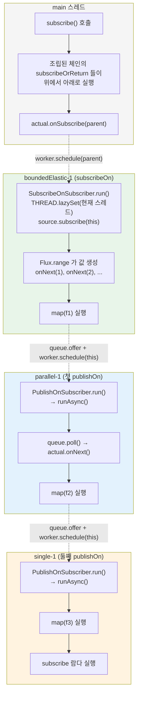

# 스케줄러와 스레딩 모델

`Schedulers` 팩토리 다섯 종류의 실제 기본값과 구현 클래스, 그리고 `publishOn`(다운스트림 실행을 옮긴다) 과 `subscribeOn`(구독 시점을 옮긴다) 의 구현 차이를 소스에서 읽습니다.

## 목차
- [1. 핵심 개념 (What)](#1-핵심-개념-what)
- [2. 왜 알아야 하는가 (Why)](#2-왜-알아야-하는가-why)
- [3. 내부 구현 분석 (How)](#3-내부-구현-분석-how)
- [4. 실전 예제](#4-실전-예제)
- [5. 정리](#5-정리)

---

## 1. 핵심 개념 (What)

Reactor 는 **스레드를 직접 만들지 않습니다.** 오퍼레이터 체인은 기본적으로 `subscribe()` 를 호출한 스레드에서 전부 실행됩니다. 스레드를 바꾸고 싶으면 `publishOn`/`subscribeOn` 으로 명시해야 하고, 그때 사용할 스레드 풀이 `Scheduler` 입니다.

```java
public interface Scheduler extends Disposable {
    Disposable schedule(Runnable task);
    Worker createWorker();          // 순차 실행이 보장되는 작업 단위
    void init();
    // ...
}
```

핵심은 `Worker` 입니다. **한 `Worker` 에 넣은 작업들은 순차적으로, 비동시적으로 실행됩니다.** 오퍼레이터는 `Worker` 하나를 잡고 그 안에서만 작업을 던지므로 "같은 체인의 신호는 겹치지 않는다"가 보장됩니다.

그리고 두 전환 오퍼레이터의 의미가 다릅니다.

| 오퍼레이터 | 무엇을 옮기는가 | 영향 범위 |
|---|---|---|
| `publishOn(s)` | **다운스트림 신호 처리**(`onNext`/`onComplete`/`onError`) | 호출 지점 **아래** |
| `subscribeOn(s)` | **구독 자체**(`source.subscribe(...)` 호출) | 체인 **전체의 시작점** |

```
Flux.range(1, 3)            ← subscribeOn 이 지정한 스레드 (구독이 거기서 시작)
    .map(f1)                ← 같은 스레드
    .publishOn(schedA)
    .map(f2)                ← schedA 의 워커 스레드
    .publishOn(schedB)
    .map(f3)                ← schedB 의 워커 스레드
    .subscribeOn(schedC)    ← 체인 맨 위의 구독을 schedC 로
    .subscribe()
```

`subscribeOn` 은 체인 어디에 놓아도 효과가 같고(맨 위로 전달됨), `publishOn` 은 **놓인 위치부터 아래**에만 적용됩니다.

---

## 2. 왜 알아야 하는가 (Why)

**첫째, 기본값을 알아야 사이징이 됩니다.** `boundedElastic()` 은 CPU 코어 수의 10배까지 스레드를 만들고, 스레드당 **10만 개**의 작업을 큐에 쌓습니다. 16코어 머신이면 스레드 160개 × 큐 10만 = 최대 1,600만 개 작업이 적체될 수 있다는 뜻입니다. 이 숫자를 모르면 "왜 OOM 전까지 아무 경고가 없었나"를 설명할 수 없습니다.

**둘째, `publishOn` 과 `subscribeOn` 을 혼동하면 블로킹 호출이 엉뚱한 스레드에서 돕니다.** JDBC 호출을 `subscribeOn(boundedElastic())` 으로 감쌌는데 그 위에 `publishOn(parallel())` 이 있으면, 블로킹 호출은 여전히 `boundedElastic` 에서 돌지만 그 결과 처리는 `parallel` 에서 돕니다. 반대로 순서가 바뀌면 블로킹이 `parallel` 로 들어가 이벤트 루프를 막습니다.

**셋째, `NonBlocking` 마커를 알아야 "왜 `block()` 이 터지나"를 압니다.** `parallel()`/`single()` 의 스레드는 `NonBlocking` 을 구현합니다. 그 위에서 `block()` 을 호출하면 `IllegalStateException` 이 즉시 던져집니다. `boundedElastic()` 은 구현하지 않으므로 허용됩니다. **이 차이는 스레드 팩토리의 boolean 인자 하나**로 결정됩니다.

가상 스레드와 WebFlux 의 비교는 [Virtual Thread vs WebFlux vs Coroutine](../../java/virtual-thread/03-vs-webflux-coroutine.md) 문서에 있습니다. 여기서는 Reactor 의 `boundedElastic` 이 가상 스레드를 **어떻게 켜는지**만 다룹니다.

---

## 3. 내부 구현 분석 (How)

### 3.1 v3.7.19 의 실제 기본값

`Schedulers` 클래스 상단의 상수 네 개가 전부입니다. 모두 소스에서 직접 읽은 값입니다.

```java
// Schedulers.DEFAULT_POOL_SIZE — reactor-core/src/main/java/reactor/core/scheduler/Schedulers.java:82
public static final int DEFAULT_POOL_SIZE =
        Optional.ofNullable(System.getProperty("reactor.schedulers.defaultPoolSize"))
                .map(Integer::parseInt)
                .orElseGet(() -> Runtime.getRuntime().availableProcessors());

// Schedulers.DEFAULT_BOUNDED_ELASTIC_SIZE — Schedulers.java:95
public static final int DEFAULT_BOUNDED_ELASTIC_SIZE =
        Optional.ofNullable(System.getProperty("reactor.schedulers.defaultBoundedElasticSize"))
                .map(Integer::parseInt)
                .orElseGet(() -> 10 * Runtime.getRuntime().availableProcessors());

// Schedulers.DEFAULT_BOUNDED_ELASTIC_QUEUESIZE — Schedulers.java:107
public static final int DEFAULT_BOUNDED_ELASTIC_QUEUESIZE =
        Optional.ofNullable(System.getProperty("reactor.schedulers.defaultBoundedElasticQueueSize"))
                .map(Integer::parseInt)
                .orElse(100000);

// Schedulers.DEFAULT_BOUNDED_ELASTIC_ON_VIRTUAL_THREADS — Schedulers.java:120
public static final boolean DEFAULT_BOUNDED_ELASTIC_ON_VIRTUAL_THREADS =
        Optional.ofNullable(System.getProperty("reactor.schedulers.defaultBoundedElasticOnVirtualThreads"))
                .map(Boolean::parseBoolean)
                .orElse(false);
```

| 상수 | 기본값 | 시스템 프로퍼티 |
|---|---|---|
| `DEFAULT_POOL_SIZE` | `Runtime.availableProcessors()` | `reactor.schedulers.defaultPoolSize` |
| `DEFAULT_BOUNDED_ELASTIC_SIZE` | **10 × `availableProcessors()`** | `reactor.schedulers.defaultBoundedElasticSize` |
| `DEFAULT_BOUNDED_ELASTIC_QUEUESIZE` | **100000** (스레드당) | `reactor.schedulers.defaultBoundedElasticQueueSize` |
| `DEFAULT_BOUNDED_ELASTIC_ON_VIRTUAL_THREADS` | **false** | `reactor.schedulers.defaultBoundedElasticOnVirtualThreads` |
| `BoundedElasticScheduler.DEFAULT_TTL_SECONDS` | **60** (유휴 스레드 회수) | 없음 (`newBoundedElastic(..., ttlSeconds)` 인자로만) |

`DEFAULT_BOUNDED_ELASTIC_QUEUESIZE` 가 **스레드당**이라는 점을 놓치기 쉽습니다. Javadoc 이 "maximum number of enqueued tasks **PER THREAD**"(`Schedulers.java:101-103`)로 대문자로 강조합니다. 이 한도를 넘기면 `RejectedExecutionException` 입니다.

`DEFAULT_TTL_SECONDS` 는 `BoundedElasticScheduler.java:78` 에 하드코딩된 `60` 입니다.

### 3.2 팩토리와 구현 클래스 대응

| 팩토리 | 소스 | 구현 클래스 | 캐시 |
|---|---|---|---|
| `Schedulers.parallel()` | `Schedulers.java:295` | `ParallelScheduler` (`ParallelScheduler.java:41`) | `CACHED_PARALLEL` |
| `Schedulers.boundedElastic()` | `Schedulers.java:277` | `BoundedElasticScheduler` (`BoundedElasticScheduler.java:72`) 또는 `BoundedElasticThreadPerTaskScheduler` | `CACHED_BOUNDED_ELASTIC` |
| `Schedulers.single()` | `Schedulers.java:1064` | `SingleScheduler` (`SingleScheduler.java:37`) | `CACHED_SINGLE` |
| `Schedulers.immediate()` | `Schedulers.java:309` | `ImmediateScheduler` (`ImmediateScheduler.java:32`) | 싱글턴 |
| `Schedulers.fromExecutorService(es)` | `Schedulers.java:179`, `:192` | **`DelegateServiceScheduler`** | 없음 (매번 새로) |
| `Schedulers.fromExecutor(e)` | `Schedulers.java:141`, `:159` | `ExecutorScheduler` (`ExecutorScheduler.java:42`) | 없음 |

`parallel`/`boundedElastic`/`single` 은 **공유 캐시 인스턴스**입니다.

```java
// Schedulers.java:277, :295, :1064
public static Scheduler boundedElastic() { return cache(CACHED_BOUNDED_ELASTIC, BOUNDED_ELASTIC, BOUNDED_ELASTIC_SUPPLIER); }
public static Scheduler parallel()       { return cache(CACHED_PARALLEL, PARALLEL, PARALLEL_SUPPLIER); }
public static Scheduler single()         { return cache(CACHED_SINGLE, SINGLE, SINGLE_SUPPLIER); }
```

```java
// 공급자 정의 — Schedulers.java:1222-1227
static final Supplier<Scheduler> BOUNDED_ELASTIC_SUPPLIER = new BoundedElasticSchedulerSupplier();
static final Supplier<Scheduler> PARALLEL_SUPPLIER = () -> newParallel(PARALLEL, DEFAULT_POOL_SIZE, true);
static final Supplier<Scheduler> SINGLE_SUPPLIER   = () -> newSingle(SINGLE, true);
```

**공유 인스턴스는 직접 `dispose()` 할 수 없습니다.** Javadoc 이 명시합니다 — "One cannot directly dispose the common instances, as they are cached and shared between callers"(`Schedulers.java:286-288`). 전체를 끄려면 `Schedulers.shutdownNow()` 입니다.

`ParallelScheduler` 는 **단일 스레드 executor N 개**로 구성됩니다.

```java
// ParallelScheduler.java:76-80 (주석 + 코드)
// ({@code Executors.newScheduledThreadPoolExecutor} with core and max pool size of 1).
ScheduledThreadPoolExecutor poolExecutor = new ScheduledThreadPoolExecutor(1, factory);
```

그리고 `createWorker()` 는 라운드로빈으로 하나를 고릅니다(`roundRobin` 필드 — `ParallelScheduler.java:64`, `:224`). 스레드풀 하나가 아니라 "1-스레드 풀 N 개"인 이유는 `Worker` 의 순차성 보장을 executor 레벨에서 공짜로 얻기 위해서입니다.

`ImmediateScheduler` 는 스케줄링을 아예 하지 않습니다.

```java
// ImmediateScheduler.schedule() — ImmediateScheduler.java:51
public Disposable schedule(Runnable task) {
    task.run();              // 제출한 스레드에서 즉시 실행
    return FINISHED;
}
```

Javadoc 의 표현대로 "null object" 입니다 — Scheduler 를 요구하는 API 에 "스레드를 바꾸지 말라"를 전달하는 용도입니다(`Schedulers.java:300-303`).

### 3.3 가상 스레드 지원 — v3.7.19 에 있다

**3.7.19 에 실제로 존재합니다.** `reactor.schedulers.defaultBoundedElasticOnVirtualThreads` 프로퍼티와 `BoundedElasticThreadPerTaskScheduler` 구현이 모두 있습니다. Javadoc 이 도입 시점을 밝힙니다 — "Since 3.6.0 `boundedElastic()` can run tasks on `VirtualThread`s if the application runs on a Java 21+ runtime and the `DEFAULT_BOUNDED_ELASTIC_ON_VIRTUAL_THREADS` system property is set to `true`"(`Schedulers.java:68-71`).

구현은 **멀티 릴리스 JAR** 로 갈립니다. 같은 클래스가 두 소스 셋에 존재합니다.

```
reactor-core/src/main/java/reactor/core/scheduler/BoundedElasticSchedulerSupplier.java     ← JDK 8~20
reactor-core/src/main/java21/reactor/core/scheduler/BoundedElasticSchedulerSupplier.java   ← JDK 21+
reactor-core/src/main/java21/reactor/core/scheduler/BoundedElasticThreadPerTaskScheduler.java
reactor-core/src/main/java21/reactor/core/scheduler/VirtualThreadFactory.java
```

JDK 21 미만 런타임에서는 프로퍼티를 켜도 **경고 로그만 찍고 폴백**합니다.

```java
// JDK 8 버전 — reactor-core/src/main/java/reactor/core/scheduler/BoundedElasticSchedulerSupplier.java:40
public Scheduler get() {
    if (DEFAULT_BOUNDED_ELASTIC_ON_VIRTUAL_THREADS) {
        logger.warn(
                "Virtual Threads support is not available on the given JVM. Falling back to default BoundedElastic setup");
    }
    return newBoundedElastic(DEFAULT_BOUNDED_ELASTIC_SIZE,
            DEFAULT_BOUNDED_ELASTIC_QUEUESIZE,
            BOUNDED_ELASTIC,
            BoundedElasticScheduler.DEFAULT_TTL_SECONDS,
            true);
}
```

JDK 21+ 에서는 가상 스레드 팩토리로 thread-per-task 스케줄러를 만듭니다.

```java
// JDK 21 버전 — reactor-core/src/main/java21/reactor/core/scheduler/BoundedElasticSchedulerSupplier.java:37
public Scheduler get() {
    if (DEFAULT_BOUNDED_ELASTIC_ON_VIRTUAL_THREADS) {
        Scheduler scheduler = factory.newThreadPerTaskBoundedElastic(
                DEFAULT_BOUNDED_ELASTIC_SIZE,
                DEFAULT_BOUNDED_ELASTIC_QUEUESIZE,
                Thread.ofVirtual()
                      .name(LOOM_BOUNDED_ELASTIC + "-", 1)
                      .uncaughtExceptionHandler(Schedulers::defaultUncaughtException)
                      .factory());
        scheduler.init();
        return scheduler;
    }
    return newBoundedElastic(DEFAULT_BOUNDED_ELASTIC_SIZE, ...);
}
```

주의할 점이 Javadoc 에 적혀 있습니다 — thread-per-task 구현에서는 **`DEFAULT_BOUNDED_ELASTIC_SIZE` 를 올리는 걸 고려하라**고 합니다(`Schedulers.java:235-237`). 가상 스레드는 싸니까 플랫폼 스레드 기준의 "코어 × 10" 상한이 오히려 병목이 됩니다. 또 ExecutorService 기반 구현은 유휴 스레드를 재사용하지만, thread-per-task 는 "always creates new threads up to the specified limit" 입니다(`Schedulers.java:253-254`).

### 3.4 `NonBlocking` 마커와 블로킹 탐지

마커 인터페이스는 메서드가 없습니다.

```java
// reactor-core/src/main/java/reactor/core/scheduler/NonBlocking.java:28
public interface NonBlocking { }
```

이 마커를 붙이는 주체는 스레드 팩토리입니다.

```java
// ReactorThreadFactory.newThread() — ReactorThreadFactory.java:58
public final Thread newThread(@NonNull Runnable runnable) {
    String newThreadName = name + "-" + counterReference.incrementAndGet();
    Thread t = rejectBlocking
            ? new NonBlockingThread(runnable, newThreadName)      // :61
            : new Thread(runnable, newThreadName);
    ...
}

// ReactorThreadFactory.java:92
static final class NonBlockingThread extends Thread implements NonBlocking { ... }
```

**`rejectBlocking` boolean 하나가 전부**입니다. 팩토리 호출부를 보면 어느 스케줄러가 블로킹을 거부하는지 바로 보입니다.

```java
// Schedulers.newParallel(name, parallelism, daemon) — Schedulers.java:533
return newParallel(parallelism,
        new ReactorThreadFactory(name, ParallelScheduler.COUNTER, daemon,
                true, Schedulers::defaultUncaughtException));     // ← rejectBlocking = true

// Schedulers.newSingle(name, daemon) — Schedulers.java:580
return newSingle(new ReactorThreadFactory(name, SingleScheduler.COUNTER, daemon,
        true, Schedulers::defaultUncaughtException));             // ← rejectBlocking = true

// Schedulers.newBoundedElastic(threadCap, queuedTaskCap, name, ttlSeconds, daemon) — Schedulers.java:436
return newBoundedElastic(threadCap, queuedTaskCap,
        new ReactorThreadFactory(name, BoundedElasticScheduler.COUNTER, daemon, false,
                Schedulers::defaultUncaughtException),            // ← rejectBlocking = false
        ttlSeconds);
```

| 스케줄러 | `rejectBlocking` | `block()` 호출 시 |
|---|---|---|
| `parallel()` | `true` | `IllegalStateException` |
| `single()` | `true` | `IllegalStateException` |
| `boundedElastic()` | **`false`** | 허용 |

판정은 두 갈래입니다.

```java
// Schedulers.isNonBlockingThread() — Schedulers.java:696
public static boolean isNonBlockingThread(Thread t) {
    return t instanceof NonBlocking || nonBlockingThreadPredicate.test(t);
}

// Schedulers.isInNonBlockingThread() — Schedulers.java:680
public static boolean isInNonBlockingThread() {
    return isNonBlockingThread(Thread.currentThread());
}
```

기본 프레디케이트는 "항상 false" 입니다(`DEFAULT_NON_BLOCKING_THREAD_PREDICATE = thread -> false` — `Schedulers.java:125`). 외부 프레임워크(예: Netty 이벤트 루프)가 자기 스레드를 등록할 수 있게 `registerNonBlockingThreadPredicate()` 가 열려 있습니다(`Schedulers.java:704`) — `or()` 로 누적됩니다.

실제로 예외를 던지는 쪽은 블로킹 subscriber 들입니다.

```java
// BlockingSingleSubscriber.blockingGet() — BlockingSingleSubscriber.java:86
if (Schedulers.isInNonBlockingThread()) {
    throw new IllegalStateException("block()/blockFirst()/blockLast() are blocking, "
            + "which is not supported in thread " + Thread.currentThread().getName());
}
```

같은 가드가 `BlockingSingleSubscriber.java:121`, `BlockingOptionalMonoSubscriber.java:107`, `:145`, `BlockingIterable.java:167` 에 있습니다. 즉 `block()`/`blockFirst()`/`blockLast()`/`blockOptional()`/`toIterable()`/`toStream()` 이 전부 막힙니다.

BlockHound 연동도 같은 마커를 씁니다.

```java
// ReactorBlockHoundIntegration — ReactorBlockHoundIntegration.java:38
builder.nonBlockingThreadPredicate(current -> current.or(NonBlocking.class::isInstance));
```

이쪽은 `block()` 뿐 아니라 `Thread.sleep`, 소켓 I/O 등 **JDK 레벨 블로킹 전부**를 잡습니다.

### 3.5 `publishOn` — 다운스트림 실행을 옮긴다

`FluxPublishOn` 의 내부 subscriber 가 **`Runnable` 을 함께 구현**하는 것이 핵심입니다.

```java
// FluxPublishOn.java:42
final class FluxPublishOn<T> extends InternalFluxOperator<T, T> implements Fuseable {

    final int prefetch;                               // :50

// FluxPublishOn.java:110
static final class PublishOnSubscriber<T>
        implements QueueSubscription<T>, Runnable, InnerOperator<T, T> {
                                        //  ↑ 자기 자신이 Worker 에 제출되는 작업

    final Worker worker;                              // :117
    final int prefetch;                               // :121
    final int limit;                                  // :123
    volatile int wip;                                 // :137
    int sourceMode;                                   // :152
    boolean outputFused;                              // :156
```

`Worker` 는 조립이 아니라 **구독 시점**에 만들어집니다.

```java
// FluxPublishOn.subscribeOrReturn() — FluxPublishOn.java:87
Worker worker = Objects.requireNonNull(scheduler.createWorker(),
        "The scheduler returned a null worker");
```

신호가 오면 값을 큐에 넣고 **자기 자신을 Worker 에 제출**합니다.

```java
// PublishOnSubscriber.onNext() — FluxPublishOn.java:214
public void onNext(T t) {
    if (sourceMode == ASYNC) {
        trySchedule(this, null, null /* t always null */);
        return;
    }
    ...
    trySchedule(this, null, t);        // :237
}

// trySchedule() — FluxPublishOn.java:293
void trySchedule(...) {
    if (WIP.getAndIncrement(this) != 0) {    // WIP trampoline — 이미 돌고 있으면 제출 생략
        ...
        return;
    }
    try {
        worker.schedule(this);               // :312 ← this 가 Runnable
    }
    ...
}
```

워커 스레드에서 `run()` 이 호출되고, 거기서 큐를 drain 하며 **다운스트림 `onNext` 를 호출**합니다.

```java
// PublishOnSubscriber.run() — FluxPublishOn.java:525
public void run() {
    if (outputFused) {
        runBackfused();          // :476 — 다운스트림이 직접 poll 하므로 onNext(null) 만
    }
    else if (sourceMode == Fuseable.SYNC) {
        runSync();               // :338 — 업스트림 QueueSubscription 을 직접 poll
    }
    else {
        runAsync();              // :401 — 일반 경로
    }
}
```

**즉 `publishOn` 아래의 모든 오퍼레이터가 이 `run()` 의 호출 스택 안에서 실행됩니다.** 그래서 "호출 지점 아래"만 영향을 받습니다.

`WIP` trampoline 이 여기서 하나 더 하는 일이 있습니다 — `worker.schedule()` 중복 제출을 막습니다. 이미 drain 중이면 카운터만 올리고 제출하지 않으므로, 작업 큐에 같은 `Runnable` 이 쌓이지 않습니다. drain 루프 패턴은 [05번 문서](./05-backpressure-and-drain-loop.md)에서 다룹니다.

업스트림과의 퓨전 협상도 `onSubscribe` 에서 일어납니다.

```java
// PublishOnSubscriber.onSubscribe() — FluxPublishOn.java:175
if (s instanceof QueueSubscription) {
    QueueSubscription<T> f = (QueueSubscription<T>) s;
    int m = f.requestFusion(Fuseable.ANY | Fuseable.THREAD_BARRIER);   // :183
    if (m == Fuseable.SYNC) { sourceMode = SYNC; queue = f; done = true; ... return; }
    if (m == Fuseable.ASYNC) { sourceMode = ASYNC; queue = f; ... return; }
}
queue = queueSupplier.get();      // 퓨전 실패 → 자기 큐
```

`THREAD_BARRIER` 를 함께 보내는 이유가 바로 이 구조입니다 — "이 큐는 내 워커 스레드에서 drain 된다"는 고지입니다. 자세한 내용은 [06번 문서](./06-operator-fusion.md)에 있습니다.

기본 prefetch 는 `SMALL_BUFFER_SIZE` = 256 입니다.

```java
// Flux.publishOn(Scheduler) — Flux.java:7659
public final Flux<T> publishOn(Scheduler scheduler) {
    return publishOn(scheduler, Queues.SMALL_BUFFER_SIZE);
}
```

### 3.6 `subscribeOn` — 구독 시점을 옮긴다

구조가 완전히 다릅니다. `FluxSubscribeOn` 은 **`source.subscribe(...)` 호출 자체를 `Runnable` 로 감쌉니다.**

```java
// FluxSubscribeOn.subscribeOrReturn() — FluxSubscribeOn.java:53
public CoreSubscriber<? super T> subscribeOrReturn(CoreSubscriber<? super T> actual) {
    Worker worker = Objects.requireNonNull(scheduler.createWorker(),
            "The scheduler returned a null Function");

    SubscribeOnSubscriber<T> parent = new SubscribeOnSubscriber<>(source,
            actual, worker, requestOnSeparateThread);
    actual.onSubscribe(parent);            // ← onSubscribe 는 현재 스레드에서

    try {
        worker.schedule(parent);           // ← 구독만 워커로 보낸다
    }
    catch (RejectedExecutionException ree) { ... }
    return null;
}
```

`run()` 이 하는 일이 단 두 줄입니다.

```java
// SubscribeOnSubscriber.run() — FluxSubscribeOn.java:192
public void run() {
    THREAD.lazySet(this, Thread.currentThread());   // 구독 스레드 기억
    source.subscribe(this);                         // ← 여기가 전부
}
```

`source.subscribe(this)` 가 워커 스레드에서 호출되므로, **업스트림 체인 전체의 구독과 그 이후 신호 생성이 그 스레드에서 일어납니다.** `Flux.range(...)` 같은 소스가 값을 뿜는 것도 이 스레드입니다.

`requestOnSeparateThread` 플래그가 하나 더 있습니다.

```java
// SubscribeOnSubscriber.requestUpstream() — FluxSubscribeOn.java:129
void requestUpstream(final long n, final Subscription s) {
    if (!requestOnSeparateThread || Thread.currentThread() == THREAD.get(this)) {
        s.request(n);                       // 같은 스레드면 직접 요청
    }
    else {
        worker.schedule(() -> s.request(n)); // 다른 스레드면 워커로 위임
    }
}
```

`subscribeOn(scheduler)` 의 기본값은 `true` 입니다(`Flux.java:8942-8943`). 즉 `request(n)` 도 구독 스레드로 모읍니다. 이유는 소스 구현이 "같은 스레드에서만 호출된다"를 가정할 수 있게 하는 것입니다.

**`subscribeOn` 이 여러 개면 가장 위(소스에 가까운) 것이 이깁니다.** 조립 시점에 `FluxSubscribeOn` 이 중첩되고, 바깥쪽의 `subscribeOrReturn` 이 먼저 실행되어 안쪽 구독을 자기 워커로 보내지만, 안쪽이 다시 자기 워커로 보내므로 최종 소스 구독은 가장 안쪽(= 체인에서 가장 위) 스케줄러에서 일어납니다.

### 3.7 어느 연산자가 어느 스레드에서 도는가



대응하는 코드는 이렇습니다.

```java
Flux.range(1, 3)                        // boundedElastic-1  (subscribeOn 때문에)
    .map(this::f1)                      // boundedElastic-1
    .publishOn(Schedulers.parallel())
    .map(this::f2)                      // parallel-1
    .publishOn(Schedulers.single())
    .map(this::f3)                       // single-1
    .subscribeOn(Schedulers.boundedElastic())
    .subscribe(v -> log(v));            // single-1
```

규칙 두 개로 요약됩니다.

1. **`subscribeOn` 은 체인의 "시작 스레드"를 정합니다.** 위치 무관, 가장 위가 이깁니다.
2. **`publishOn` 은 "그 지점 아래"의 스레드를 정합니다.** 여러 개면 각각 자기 구간을 가집니다.

### 3.8 어떤 스케줄러를 고를까

| 작업 | 스케줄러 | 이유 |
|---|---|---|
| CPU 연산 (파싱, 계산, 암호화) | `parallel()` | 코어 수만큼의 1-스레드 풀. 컨텍스트 스위치 최소 |
| 블로킹 I/O (JDBC, 블로킹 HTTP 클라이언트, 파일) | `boundedElastic()` | 스레드 수 상한이 있고 `rejectBlocking=false` |
| 순차성이 필요한 작업 (로그 집계, 단일 커넥션) | `single()` | 스레드 1개 공유 |
| 스레드를 바꾸지 않고 싶음 | `immediate()` | 호출 스레드에서 즉시 실행 |
| 기존 풀 재사용 (`ThreadPoolTaskExecutor` 등) | `fromExecutorService(es)` | `DelegateServiceScheduler` 로 감싼다 |

**`boundedElastic()` 의 두 상한을 혼동하지 마세요.** 스레드 수는 `DEFAULT_BOUNDED_ELASTIC_SIZE`(코어 × 10), 큐는 **스레드당** `DEFAULT_BOUNDED_ELASTIC_QUEUESIZE`(10만)입니다. 전자를 넘으면 큐에 들어가고, 후자까지 넘으면 `RejectedExecutionException` 입니다(`Schedulers.java:241-244`).

워커가 스레드를 고르는 방식도 알아둘 만합니다 — "By order of preference, threads backing a new Worker are picked from the idle pool, created anew or reused from the busy pool"(`Schedulers.java:454-456`). 그리고 선택은 **워커 생성 시 한 번만** 이루어지므로, 두 워커가 같은 스레드를 공유하면 한쪽의 긴 작업이 다른 쪽을 지연시킬 수 있습니다(`Schedulers.java:459-462`).

---

## 4. 실전 예제

### 예제 1 — 기본값을 런타임에서 확인

```java
import reactor.core.scheduler.Schedulers;

public class SchedulerDefaults {
    public static void main(String[] args) {
        System.out.println("availableProcessors            = " + Runtime.getRuntime().availableProcessors());
        System.out.println("DEFAULT_POOL_SIZE              = " + Schedulers.DEFAULT_POOL_SIZE);
        System.out.println("DEFAULT_BOUNDED_ELASTIC_SIZE   = " + Schedulers.DEFAULT_BOUNDED_ELASTIC_SIZE);
        System.out.println("DEFAULT_BOUNDED_ELASTIC_QUEUE  = " + Schedulers.DEFAULT_BOUNDED_ELASTIC_QUEUESIZE);
        System.out.println("BE_ON_VIRTUAL_THREADS          = "
                + Schedulers.DEFAULT_BOUNDED_ELASTIC_ON_VIRTUAL_THREADS);

        System.out.println("최대 적체 작업 수 = "
                + (long) Schedulers.DEFAULT_BOUNDED_ELASTIC_SIZE
                        * Schedulers.DEFAULT_BOUNDED_ELASTIC_QUEUESIZE);
    }
}
```

8코어 머신 출력:

```
availableProcessors            = 8
DEFAULT_POOL_SIZE              = 8
DEFAULT_BOUNDED_ELASTIC_SIZE   = 80
DEFAULT_BOUNDED_ELASTIC_QUEUE  = 100000
BE_ON_VIRTUAL_THREADS          = false
최대 적체 작업 수 = 8000000
```

운영에서 줄이려면 JVM 인자로 넣습니다.

```bash
java -Dreactor.schedulers.defaultBoundedElasticSize=32 \
     -Dreactor.schedulers.defaultBoundedElasticQueueSize=1000 \
     -jar app.jar
```

프로퍼티는 **클래스 로딩 시 한 번** 읽히는 `static final` 이므로 런타임 변경이 불가능합니다. JVM 시작 인자여야 합니다.

### 예제 2 — `publishOn` vs `subscribeOn` 스레드 추적

```java
import reactor.core.publisher.Flux;
import reactor.core.scheduler.Schedulers;

public class ThreadTracing {

    static <T> T tag(String step, T v) {
        System.out.printf("%-12s %-22s %s%n", step, Thread.currentThread().getName(), v);
        return v;
    }

    public static void main(String[] args) throws Exception {
        Flux.range(1, 2)
            .map(i -> tag("map-1", i))
            .publishOn(Schedulers.parallel())
            .map(i -> tag("map-2", i))
            .publishOn(Schedulers.single())
            .map(i -> tag("map-3", i))
            .subscribeOn(Schedulers.boundedElastic())
            .doOnNext(i -> tag("doOnNext", i))
            .blockLast();
    }
}
```

출력:

```
map-1        boundedElastic-1       1      ← subscribeOn 이 정한 시작 스레드
map-1        boundedElastic-1       2
map-2        parallel-1             1      ← 첫 publishOn 아래
map-3        single-1               1      ← 둘째 publishOn 아래
doOnNext     single-1               1
map-2        parallel-1             2
map-3        single-1               2
doOnNext     single-1               2
```

`map-1` 이 `boundedElastic` 인 것이 `subscribeOn` 의 효과입니다 — 체인 **맨 아래**에 붙였는데 **맨 위**가 영향을 받았습니다. `source.subscribe(this)` 를 워커로 보냈기 때문입니다(`FluxSubscribeOn.java:192`).

### 예제 3 — `NonBlocking` 가드 동작 확인

```java
import reactor.core.publisher.Mono;
import reactor.core.scheduler.Schedulers;
import java.time.Duration;

public class BlockingGuard {

    static void attempt(String label, reactor.core.scheduler.Scheduler s) {
        try {
            Mono.fromCallable(() -> {
                    boolean nb = Schedulers.isInNonBlockingThread();
                    System.out.printf("%-16s thread=%-22s NonBlocking=%s%n",
                            label, Thread.currentThread().getName(), nb);
                    // 같은 스레드에서 block() 을 호출해 본다
                    return Mono.just("inner").delayElement(Duration.ofMillis(10)).block();
                })
                .subscribeOn(s)
                .block();
            System.out.println("  → 성공");
        }
        catch (Exception e) {
            System.out.println("  → " + e.getClass().getSimpleName() + ": " + e.getMessage());
        }
    }

    public static void main(String[] args) {
        attempt("boundedElastic", Schedulers.boundedElastic());  // 허용
        attempt("parallel",       Schedulers.parallel());        // IllegalStateException
        attempt("single",         Schedulers.single());          // IllegalStateException
    }
}
```

출력:

```
boundedElastic   thread=boundedElastic-1        NonBlocking=false
  → 성공
parallel         thread=parallel-1              NonBlocking=true
  → IllegalStateException: block()/blockFirst()/blockLast() are blocking, which is not supported in thread parallel-1
single           thread=single-1                NonBlocking=true
  → IllegalStateException: block()/blockFirst()/blockLast() are blocking, which is not supported in thread single-1
```

예외 메시지가 `BlockingSingleSubscriber.java:87` 의 문자열과 정확히 일치합니다.

### 예제 4 — 블로킹 I/O 를 안전하게 격리

```java
import reactor.core.publisher.Flux;
import reactor.core.publisher.Mono;
import reactor.core.scheduler.Schedulers;

public class BlockingIsolation {

    /** JDBC 같은 블로킹 호출 — boundedElastic 으로 격리한다 */
    static Mono<String> blockingQuery(int id) {
        return Mono.fromCallable(() -> {
                    Thread.sleep(50);                         // 블로킹 I/O 시뮬레이션
                    return "row-" + id + "@" + Thread.currentThread().getName();
                })
                .subscribeOn(Schedulers.boundedElastic());    // ← Mono 단위로 격리
    }

    public static void main(String[] args) {
        Flux.range(1, 6)
            // flatMap 의 각 inner 가 자기 subscribeOn 을 가진다 → 동시 실행
            .flatMap(BlockingIsolation::blockingQuery, 4)
            // 결과 가공은 CPU 작업이므로 parallel 로
            .publishOn(Schedulers.parallel())
            .map(s -> s.toUpperCase() + " | processed on " + Thread.currentThread().getName())
            .doOnNext(System.out::println)
            .blockLast();
    }
}
```

포인트는 **`subscribeOn` 을 `Mono` 안쪽에 둔 것**입니다. 체인 바깥에 `subscribeOn(boundedElastic())` 하나만 두면 블로킹 호출이 **한 스레드에서 직렬로** 돕니다. `flatMap` 의 inner 마다 `subscribeOn` 이 있어야 각 inner 가 별도 워커를 잡아 동시에 실행됩니다. (`flatMap` 의 concurrency 는 [07번 문서](./07-flatmap-concatmap-switchmap.md)를 참고하세요.)

### 예제 5 — 기존 스레드풀을 Scheduler 로 재사용

```java
import reactor.core.publisher.Flux;
import reactor.core.scheduler.Scheduler;
import reactor.core.scheduler.Schedulers;
import java.util.concurrent.ExecutorService;
import java.util.concurrent.Executors;

public class ReuseExistingPool {
    public static void main(String[] args) throws Exception {
        ExecutorService pool = Executors.newFixedThreadPool(4, r -> {
            Thread t = new Thread(r, "legacy-pool");
            t.setDaemon(true);
            return t;
        });

        // DelegateServiceScheduler 로 감싼다 — 캐시되지 않으므로 직접 dispose 해야 한다
        Scheduler scheduler = Schedulers.fromExecutorService(pool, "legacy");

        Flux.range(1, 4)
            .publishOn(scheduler)
            .doOnNext(i -> System.out.println(i + " on " + Thread.currentThread().getName()))
            .blockLast();

        scheduler.dispose();      // 공유 캐시 인스턴스가 아니므로 dispose 가능
        pool.shutdown();
    }
}
```

`fromExecutorService` 가 만드는 `DelegateServiceScheduler` 는 **캐시되지 않습니다**(`Schedulers.java:192-195`). 매 호출마다 새 인스턴스이므로 직접 수명을 관리해야 합니다. 반면 `parallel()`/`single()`/`boundedElastic()` 은 공유 캐시라 `dispose()` 가 무효입니다.

---

## 5. 정리

**v3.7.19 기본값** (모두 `Schedulers` 의 `static final` — JVM 시작 인자로만 변경 가능):

| 상수 | 기본값 | 프로퍼티 | 소스 |
|---|---|---|---|
| `DEFAULT_POOL_SIZE` | `availableProcessors()` | `reactor.schedulers.defaultPoolSize` | `Schedulers.java:82` |
| `DEFAULT_BOUNDED_ELASTIC_SIZE` | 10 × `availableProcessors()` | `reactor.schedulers.defaultBoundedElasticSize` | `Schedulers.java:95` |
| `DEFAULT_BOUNDED_ELASTIC_QUEUESIZE` | 100000 (스레드당) | `reactor.schedulers.defaultBoundedElasticQueueSize` | `Schedulers.java:107` |
| `DEFAULT_BOUNDED_ELASTIC_ON_VIRTUAL_THREADS` | false | `reactor.schedulers.defaultBoundedElasticOnVirtualThreads` | `Schedulers.java:120` |
| `BoundedElasticScheduler.DEFAULT_TTL_SECONDS` | 60 | 없음 | `BoundedElasticScheduler.java:78` |

**구현 클래스**: `parallel()` → `ParallelScheduler`(1-스레드 executor N 개 + 라운드로빈), `boundedElastic()` → `BoundedElasticScheduler` 또는 JDK 21+ 에서 `BoundedElasticThreadPerTaskScheduler`, `single()` → `SingleScheduler`, `immediate()` → `ImmediateScheduler`(제출 스레드에서 즉시 실행), `fromExecutorService()` → `DelegateServiceScheduler`, `fromExecutor()` → `ExecutorScheduler`.

**가상 스레드는 3.7.19 에 존재합니다.** `reactor.schedulers.defaultBoundedElasticOnVirtualThreads=true` + JDK 21+ 런타임이면 `BoundedElasticThreadPerTaskScheduler` 가 선택됩니다(멀티 릴리스 JAR 의 `src/main/java21` 소스 셋). JDK 21 미만에서는 경고 로그를 남기고 폴백합니다(`src/main/java/.../BoundedElasticSchedulerSupplier.java:40`). 3.6.0 부터의 기능입니다(`Schedulers.java:68-71`). 가상 스레드 모드에서는 스레드 상한을 올리는 걸 고려하라고 Javadoc 이 권합니다(`Schedulers.java:235-237`).

**`publishOn` vs `subscribeOn` — 구현이 다릅니다.**

| | `publishOn` | `subscribeOn` |
|---|---|---|
| 클래스 | `FluxPublishOn` (`Fuseable` 구현) | `FluxSubscribeOn` |
| 클래스 선언 | `FluxPublishOn.java:42` (`implements Fuseable`) | `FluxSubscribeOn.java:38` (`Fuseable` 미구현) |
| 내부 subscriber | `QueueSubscription` + **`Runnable`** + `InnerOperator` (`FluxPublishOn.java:110`), 다운스트림이 `ConditionalSubscriber` 면 `PublishOnConditionalSubscriber` (`:674`) | `InnerOperator` + **`Runnable`** (`FluxSubscribeOn.java:80`) |
| `run()` 이 하는 일 | 큐를 drain 하며 `actual.onNext()` 호출 (`:525`) | `source.subscribe(this)` 단 한 줄 (`:192`) |
| Worker 제출 시점 | 신호가 올 때마다 (`trySchedule` — `:293`) | 구독 시 한 번 (`:62`) |
| 옮기는 것 | **다운스트림 실행** | **구독 시점** |
| 영향 범위 | 호출 지점 아래 | 체인 전체의 시작점 (가장 위가 이김) |
| 기본 prefetch | `SMALL_BUFFER_SIZE` = 256 (`Flux.java:7659`) | 해당 없음 |

**`NonBlocking` 은 `ReactorThreadFactory` 의 `rejectBlocking` boolean 으로 켜집니다**(`ReactorThreadFactory.java:58-61`). `parallel`/`single` 은 `true`, `boundedElastic` 은 `false` 입니다(`Schedulers.java:533`, `:580`, `:436`). 판정은 `Schedulers.isNonBlockingThread()`(`Schedulers.java:696`) 이고, 예외는 `BlockingSingleSubscriber` 등이 던집니다(`BlockingSingleSubscriber.java:86-87`). 외부 프레임워크는 `registerNonBlockingThreadPredicate()` 로 자기 스레드를 등록할 수 있습니다(`Schedulers.java:704`).

운영 체크리스트:

- **블로킹 호출은 `boundedElastic()` 에만** 넣고, 그것도 `Mono`/`Flux` **inner 단위로** `subscribeOn` 하세요. 체인 바깥에 한 번만 걸면 직렬화됩니다.
- **`boundedElastic` 의 큐가 스레드당 10만**입니다. 기본값으로는 OOM 전까지 백프레셔 신호가 없습니다. 운영 환경에서는 `defaultBoundedElasticQueueSize` 를 작게 잡으세요.
- **공유 인스턴스는 `dispose()` 가 안 됩니다.** 전체 종료는 `Schedulers.shutdownNow()` 입니다.
- 가상 스레드와 WebFlux 중 무엇을 쓸지는 [Virtual Thread vs WebFlux vs Coroutine](../../java/virtual-thread/03-vs-webflux-coroutine.md) 에서 다룹니다.

---

## 관련 문서
- 선행: [flatMap/concatMap/switchMap 내부](./07-flatmap-concatmap-switchmap.md)
- 후행: [Context 전파](./09-context-propagation.md)
- 연관: [백프레셔, request 전파, drain 루프](./05-backpressure-and-drain-loop.md) — `publishOn` 의 WIP trampoline 과 prefetch
- 연관: [오퍼레이터 퓨전](./06-operator-fusion.md) — `THREAD_BARRIER` 가 지키려는 스레드 경계
- 연관: [테스트와 디버깅](./12-testing-debugging.md) — `VirtualTimeScheduler`, BlockHound
- 참고: [Virtual Thread vs WebFlux vs Coroutine](../../java/virtual-thread/03-vs-webflux-coroutine.md) — 가상 스레드와 리액티브 모델의 선택 기준

---
*참고: Reactor Core 3.7.19 기준*
