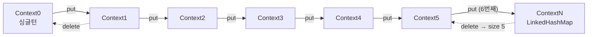

# Context 전파 — 구독과 함께 거꾸로 흐르는 데이터

Reactor의 `Context`는 리액티브 체인에서 `ThreadLocal`을 대신하는 장치입니다. 그런데 이 값은 **다운스트림에서 업스트림 방향으로**, 그것도 조립 시점이 아닌 구독 시점에 전달됩니다. 이 방향을 거꾸로 이해하면 `contextWrite`를 아무리 옮겨 봐도 값이 안 보이는 미궁에 빠집니다.

## 목차
- [1. 핵심 개념 (What)](#1-핵심-개념-what)
- [2. 왜 알아야 하는가 (Why)](#2-왜-알아야-하는가-why)
- [3. 내부 구현 분석 (How)](#3-내부-구현-분석-how)
- [4. 실전 예제](#4-실전-예제)
- [5. 정리](#5-정리)

---

## 1. 핵심 개념 (What)

### 두 개의 인터페이스

`reactor.util.context` 패키지에는 쌍으로 된 인터페이스가 있습니다.

| 인터페이스 | 역할 | 주요 메서드 |
|---|---|---|
| `ContextView` | 읽기 전용 뷰 | `get(Object)`, `getOrDefault`, `getOrEmpty`, `hasKey`, `isEmpty`, `size`, `stream`, `forEach` |
| `Context` | 읽기 + 쓰기 (`ContextView` 상속) | `put`, `putNonNull`, `delete`, `putAll`, `readOnly()` |

`Context extends ContextView`이고 (`reactor-core/src/main/java/reactor/util/context/Context.java:39`), `Context.readOnly()`는 그냥 `this`를 돌려줍니다 (`Context.java:210`). 즉 런타임 타입은 하나이고 인터페이스로 "쓰기 API를 숨기는" 설계입니다. 연산자가 사용자 람다에 넘겨줄 때는 `ContextView`로 좁혀 넘깁니다 — `FluxDeferContextual.subscribe()`가 `ctx.readOnly()`를 전달하는 게 그 예입니다 (`reactor-core/src/main/java/reactor/core/publisher/FluxDeferContextual.java:49`).

### 불변

`Context.put(key, value)`는 **새 인스턴스를 반환**합니다. 기존 인스턴스는 바뀌지 않습니다.

```java
Context c1 = Context.of("user", "kim");
Context c2 = c1.put("traceId", "abc-123");

c1.hasKey("traceId");   // false — c1은 그대로
c2.get("user");         // "kim"
```

불변인 이유는 하나의 `Flux`가 여러 번, 여러 스레드에서 동시에 구독될 수 있기 때문입니다. 구독마다 자기 `Context`를 가져야 하고, 구독 A가 쓴 값이 구독 B에 보이면 안 됩니다. 가변 맵이라면 구독마다 방어적 복사를 해야 하고, 그 복사 비용과 동기화 비용이 모든 신호 경로에 얹힙니다.

### 쓰기와 읽기

| 목적 | API |
|---|---|
| 쓰기 | `Flux#contextWrite(ContextView)` / `contextWrite(Function<Context, Context>)` |
| 읽기 | `Flux#deferContextual(Function<ContextView, Publisher>)`, `Mono#deferContextual` |
| ThreadLocal에서 흡수 | `contextCapture()` |

---

## 2. 왜 알아야 하는가 (Why)

### 방향이 반직관적이다

이 문서의 핵심 가치는 이 그림 하나입니다.

```
  조립(assembly) 순서 →  읽는 방향은 그 반대

   Flux.just(1,2,3)                       ← [A] 소스
       .flatMap(this::callApi)            ← [B]
       .contextWrite(Context.of("t","1")) ← [C] 여기서 쓴다
       .map(String::valueOf)              ← [D]
       .subscribe(...)                    ← [E] 최종 구독자


  구독(subscribe) 시점의 Context 흐름

   [E] subscribe()         currentContext() = {}            (Context.empty)
        │  subscribe 호출이 위로 올라간다
        ▼
   [D] map                 currentContext() = {}            ← [E]에 위임
        │
        ▼
   [C] contextWrite        currentContext() = {t=1}         ← 여기서 값을 "덧붙여" 만든다
        │                                   ▲
        ▼                                   │ 이 Context를 보는 건 위쪽뿐
   [B] flatMap             currentContext() = {t=1}         ← [C]에 위임
        │
        ▼
   [A] just                currentContext() = {t=1}


  ┌────────────────────────────────────────────────────────┐
  │ 신호(onNext/onError/onComplete)는 아래로 흐른다        │
  │ Context는 구독 시점에 아래에서 위로 "밀려 올라간다"    │
  └────────────────────────────────────────────────────────┘
```

즉 **`contextWrite`는 자기보다 위(업스트림)에 있는 연산자에게만 보입니다.** `[D] map` 안에서는 `t=1`을 볼 수 없습니다. 흔한 실수가 이것입니다.

```java
// 안 된다 — deferContextual이 contextWrite보다 아래(다운스트림)에 있다
Mono.just("x")
    .contextWrite(Context.of("traceId", "abc"))
    .flatMap(v -> Mono.deferContextual(ctx -> Mono.just(ctx.get("traceId"))))  // NoSuchElementException
    .subscribe();

// 된다 — deferContextual이 contextWrite보다 위(업스트림)에 있다
Mono.just("x")
    .flatMap(v -> Mono.deferContextual(ctx -> Mono.just(ctx.get("traceId"))))
    .contextWrite(Context.of("traceId", "abc"))
    .subscribe();
```

실무 규칙으로 굳히면: **`contextWrite`는 체인의 가장 아래, `subscribe()` 직전에 한 번** 둡니다. 그러면 체인 전체가 그 값을 봅니다.

### ThreadLocal이 리액티브에서 깨진다

`Flux`의 신호는 어느 스레드에서 실행될지 정해져 있지 않습니다. `publishOn`/`subscribeOn`이 끼면 체인 중간에 스레드가 바뀌고, `flatMap`의 inner는 또 다른 스레드에서 돌 수 있습니다. `ThreadLocal`은 스레드에 묶인 저장소라 이 경계를 못 넘습니다.

MDC 로깅이 깨지는 메커니즘이 정확히 이것입니다. `MDC.put("traceId", ...)`는 요청을 받은 스레드의 `ThreadLocal<Map>`에 값을 넣는데, 실제 로그를 찍는 `doOnNext`는 `boundedElastic-3`에서 실행되어 그 맵이 비어 있습니다. 로그에 `traceId=` 가 빈 채로 나오고 분산 추적이 끊깁니다.

> 스레드풀 경계에서 `ThreadLocal`이 사라지는 전체 목록(MDC·SecurityContext·트랜잭션·RequestContext)과 `clear()`를 빼먹으면 생기는 컨텍스트 오염 문제는 [MDC·컨텍스트 전파 — 스레드가 바뀌면 사라지는 것들](../../resilience4j/advanced/10-context-propagation.md)에서 이미 다뤘습니다. 여기서는 Reactor `Context` 자체의 설계와 전파 방향에 집중합니다.

---

## 3. 내부 구현 분석 (How)

### 3.1 크기별 특화 구현 — 해시맵을 피하는 최적화

`Context` 구현체는 7개입니다.

```
reactor-core/src/main/java/reactor/util/context/
├── Context0.java      (0개)  — 싱글턴
├── Context1.java      (1개)  — key, value 필드 2개
├── Context2.java      (2개)  — 필드 4개
├── Context3.java      (3개)  — 필드 6개
├── Context4.java      (4개)  — 필드 8개
├── Context5.java      (5개)  — 필드 10개
└── ContextN.java      (6개+) — LinkedHashMap 상속
```

`Context1`을 보면 해시맵이 아니라 그냥 **필드 두 개**입니다 (`Context1.java:26-34`).

```java
final class Context1 implements CoreContext {
	final Object key;
	final Object value;
	// ...
	@Override
	public boolean hasKey(Object key) {
		return this.key.equals(key);
	}
}
```

조회는 해시 계산·버킷 탐색 없이 `equals` 한 번입니다. 실무에서 `Context`에 들어가는 건 traceId·userId·locale 같은 몇 개뿐이라, 이 특화가 대부분의 경우를 커버합니다.

**put 시 승급(promotion)** — `Context1.put()`은 같은 키면 `Context1`을 새로 만들고, 다른 키면 `Context2`로 올라갑니다 (`Context1.java:21-29`).

```java
public Context put(Object key, Object value) {
	Objects.requireNonNull(key, "key");
	Objects.requireNonNull(value, "value");
	if (this.key.equals(key)) {
		return new Context1(key, value);
	}
	return new Context2(this.key, this.value, key, value);
}
```

`Context5.put()`에서 6번째 키가 들어오면 비로소 `ContextN`(= `LinkedHashMap`)으로 넘어갑니다 (`Context5.java:83`).

**delete 시 강등(demotion)도 있습니다.** `ContextN.delete()`는 삭제 후 크기가 5가 되면 `Context5`로 되돌립니다 (`ContextN.java:90-115`). 한 번 맵이 되면 영구히 맵인 게 아니라, 양방향으로 최적 표현을 유지합니다.



`Context.of(Map)`도 같은 규칙을 씁니다 — 맵 크기가 5 이하면 `Context1`~`Context5`로 "압축"합니다 (`Context.java:148-186`). 6개 이상일 때만 모든 키/값의 null을 검사하고 `ContextN`을 만듭니다. `ContextN(Map)` 생성자가 null 검사를 하지 않는 저수준 API라서 호출 쪽에서 막는 구조입니다.

**`CoreContext`** 는 이 최적화를 합병에도 적용하는 내부 인터페이스입니다 (`CoreContext.java:25`). `putAll(other)`에서 상대도 `CoreContext`면 `putAllInto(this)`를 호출해 중간 `Map.Entry` 객체 생성을 피하고, 그렇지 않으면 `ContextN`에 모은 뒤 **크기가 5 이하면 다시 `Context.of(Map)`으로 압축**합니다.

### 3.2 전파의 실제 메커니즘 — `CoreSubscriber.currentContext()`

`Context`를 옮기는 건 `Publisher`가 아니라 `Subscriber`입니다. `CoreSubscriber`에 메서드가 하나 있습니다 (`reactor-core/src/main/java/reactor/core/CoreSubscriber.java:44`).

```java
default Context currentContext() {
	return Context.empty();
}
```

기본값이 `Context.empty()`입니다. 그리고 거의 모든 연산자의 내부 Subscriber가 구현하는 `InnerOperator`는 이렇게 위임합니다 (`reactor-core/src/main/java/reactor/core/publisher/InnerOperator.java:31-34`).

```java
default Context currentContext() {
	return actual().currentContext();
}
```

`actual()`은 **다운스트림 Subscriber**입니다. 즉 연산자 대부분은 자기 Context를 안 갖고 아래쪽에 물어봅니다. 이 위임 체인이 바로 2절 그림의 "아래에서 위로"를 만듭니다.

이 체인을 끊고 값을 주입하는 게 `FluxContextWrite`입니다.

```java
// FluxContextWrite.java:41-45
public CoreSubscriber<? super T> subscribeOrReturn(CoreSubscriber<? super T> actual) {
	Context c = doOnContext.apply(actual.currentContext());
	return new ContextWriteSubscriber<>(actual, c);
}

// FluxContextWrite.java:88-91 — ContextWriteSubscriber
public Context currentContext() {
	return this.context;     // 위임하지 않는다
}
```

읽어 둘 세 가지가 여기 다 있습니다.

1. **구독 시점에 평가된다.** `subscribeOrReturn`은 `subscribe()` 체인이 올라갈 때 호출되므로, `doOnContext` 람다는 조립 시점이 아니라 구독마다 실행됩니다. 구독마다 다른 Context를 만들 수 있는 이유입니다.
2. **다운스트림 Context를 입력으로 받는다.** `actual.currentContext()`를 함수에 먹이므로 `contextWrite`를 여러 번 겹치면 아래쪽 값에 위쪽 값이 누적됩니다 (키가 같으면 더 위에 있는 — 즉 더 나중에 평가되는 — 쪽이 이깁니다).
3. **신호는 그냥 통과시킨다.** `onNext`/`onError`/`onComplete`는 `actual`로 바로 넘깁니다 (`FluxContextWrite.java:106-127`). Context는 신호와 같이 흐르지 않습니다.

읽기 쪽인 `FluxDeferContextual`은 `subscribe()`에서 `actual.currentContext()`를 꺼내 팩토리에 넘기고, 그 결과 `Publisher`를 구독합니다 (`FluxDeferContextual.java:44-58`). "Context를 읽어서 Publisher를 만드는" defer입니다.

### 3.3 ThreadLocal과의 연결 — micrometer-context-propagation

Reactor 3.7.19는 `io.micrometer:context-propagation` 라이브러리와 연동합니다. 클래스패스 감지는 `ContextPropagationSupport`의 static 초기화 블록이 담당하고, 세 단계로 버전까지 구분합니다 (`reactor-core/src/main/java/reactor/core/publisher/ContextPropagationSupport.java:41-68`).

```java
Class.forName("io.micrometer.context.ContextRegistry");                          // 있으면 기본 지원
Class.forName("io.micrometer.context.ThreadLocalAccessor").getDeclaredMethod("restore", Object.class);  // 1.0.1+
Class.forName("io.micrometer.context.ContextSnapshotFactory");                   // 1.0.3+
```

1.0.3 미만이면 "scope 기반 `ThreadLocalAccessor`에서 메모리 누수가 날 수 있다"는 경고를 찍습니다 (`ContextPropagationSupport.java:63-67`).

**두 가지 사용 모드가 있습니다.**

| 모드 | API | 동작 |
|---|---|---|
| 명시적 흡수 | `Flux#contextCapture()` / `Mono#contextCapture()` | 등록된 모든 `ThreadLocalAccessor`에서 값을 긁어 `Context`에 넣는다 |
| 자동 전파 | `Hooks.enableAutomaticContextPropagation()` | `contextWrite` 경계에서 업스트림 실행 시 `ThreadLocal`을 복원한다 |

`contextCapture()`는 context-propagation이 없으면 **그냥 자기 자신을 반환**합니다 (`Flux.java:4340-4350`).

```java
public final Flux<T> contextCapture() {
	if (!ContextPropagationSupport.isContextPropagationAvailable()) {
		return this;
	}
	if (ContextPropagationSupport.propagateContextToThreadLocals) {
		return onAssembly(new FluxContextWriteRestoringThreadLocals<>(
				this, ContextPropagation.contextCapture()));
	}
	return onAssembly(new FluxContextWrite<>(this, ContextPropagation.contextCapture()));
}
```

`ContextPropagation.contextCapture()`는 전역 `ContextRegistry`를 쓰는 `Function<Context, Context>`를 돌려줍니다 (`ContextPropagation.java:147-149`).

`Hooks.enableAutomaticContextPropagation()`은 세 가지를 합니다 (`Hooks.java:543-550`).

```java
public static void enableAutomaticContextPropagation() {
	if (ContextPropagationSupport.isContextPropagationOnClasspath) {
		Schedulers.onScheduleHook(CONTEXT_IN_THREAD_LOCALS_KEY,
				ContextPropagation.scopePassingOnScheduleHook());   // ① 스케줄러 작업 래핑
		ContextPropagationSupport.propagateContextToThreadLocals = true;  // ② contextWrite가 TL 복원 변종으로
		ContextPropagation.configureContextSnapshotFactory(true);         // ③ clearMissing=true
	}
}
```

①의 `scopePassingOnScheduleHook()`은 스케줄러에 제출되는 모든 `Runnable`을 현재 `ThreadLocal` 스냅샷으로 감쌉니다 (`ContextPropagation.java:127-132`).

```java
public static Function<Runnable, Runnable> scopePassingOnScheduleHook() {
	return delegate -> {
		ContextSnapshot contextSnapshot = captureThreadLocals();
		return contextSnapshot.wrap(delegate);
	};
}
```

②가 켜지면 `contextWrite`가 `FluxContextWrite` 대신 `FluxContextWriteRestoringThreadLocals`를 씁니다 (`Flux.java:4394-4401`). 이 변종이 업스트림으로 신호를 넘기기 전에 `Context` → `ThreadLocal` 복원 scope를 열어 줍니다. 즉 **`contextWrite`가 ThreadLocal 전파의 논리적 경계**입니다 — 그 위쪽 연산자에서는 `ThreadLocal`이 보이고, 아래쪽으로 신호가 내려갈 때는 원래(수정 전) Context 기준으로 돌아갑니다 (`Hooks.java:531-535` 주석).

자동 전파가 꺼져 있고 context-propagation만 있는 경우에도 `handle`과 `tap`은 Context 스냅샷을 복원합니다 (`ContextPropagation.contextRestoreForHandle`, `ContextPropagation.java:167`; `contextRestoreForTap`, `ContextPropagation.java:211`). `shouldRestoreThreadLocalsInSomeOperators()`가 그 조건입니다 (`ContextPropagationSupport.java:96-98`).

반대 방향(`Context` → micrometer가 읽기)은 `ReactorContextAccessor`가 SPI로 제공합니다 (`reactor-core/src/main/java/reactor/util/context/ReactorContextAccessor.java:37`). `readableType()`이 `ContextView`, `writeableType()`이 `Context`이고, 쓰기는 `target.putAllMap(source)`입니다.

3.7.19에서 자동 전파 상태를 조회하는 API도 있습니다 — `Hooks.isAutomaticContextPropagationEnabled()` (`Hooks.java:570`, `@since 3.7.12`).

### 3.4 `Hooks.enableContextLossTracking()`

별개의 장치가 하나 더 있습니다. `transform`/`transformDeferred`에서 비(非)Reactor 타입을 거치면 Context가 유실될 수 있는데, 이를 예외로 잡아 주는 전역 플래그입니다 (`Hooks.java:497-515`).

```java
public static void enableContextLossTracking() {
	DETECT_CONTEXT_LOSS = true;
}
```

`Flux.transform` 계열이 `Hooks.DETECT_CONTEXT_LOSS`를 읽습니다 (`Flux.java:9942`, `9968`, `10002`). 커스텀 `transform`을 쓰는 라이브러리를 디버깅할 때 유용하고, 운영에선 끄는 게 맞습니다.

---

## 4. 실전 예제

### 4.1 MDC를 깨뜨리지 않는 로깅

가장 확실한 방법은 ThreadLocal을 쓰지 않고 Context에서 직접 읽어 쓰는 것입니다.

```java
import org.slf4j.MDC;
import reactor.core.publisher.Mono;
import reactor.util.context.Context;

public class TracedService {

    private static final String TRACE_ID = "traceId";

    public Mono<String> handle(String orderId) {
        // deferContextual로 Context를 꺼내 두고, 로그를 찍는 순간만 MDC에 심는다
        return Mono.deferContextual(ctx -> {
            String traceId = ctx.getOrDefault(TRACE_ID, "none");
            return loadOrder(orderId)
                    .doOnNext(order -> {
                        try (MDC.MDCCloseable ignored = MDC.putCloseable(TRACE_ID, traceId)) {
                            log.info("order loaded: {}", order);
                        }
                    });
        })
        // 체인의 가장 아래에 한 번 — 위쪽 전체가 본다
        .contextWrite(ctx -> ctx.put(TRACE_ID, newTraceId()));
    }
}
```

`doOnNext` 람다는 `ContextView`를 인자로 받지 못하므로, 바깥을 `deferContextual`로 감싸 Context를 미리 꺼내 두는 것이 요령입니다. 로그를 찍는 구간만 `try-with-resources`로 MDC에 심고, `MDCCloseable`이 블록을 벗어날 때 지우므로 스레드 재사용 시 다른 요청으로 값이 새지 않습니다.

micrometer-context-propagation과 `Hooks.enableAutomaticContextPropagation()`을 쓰면 이 보일러플레이트를 없앨 수 있습니다. 애플리케이션 시작 시 한 번 켜고, SLF4J MDC용 `ThreadLocalAccessor`를 `ContextRegistry`에 등록하면 `contextWrite(Context.of("traceId", id))`만으로 업스트림의 MDC가 채워집니다. 다만 **전역 훅이라 라이브러리 코드까지 영향을 받으므로** 애플리케이션 레벨에서만 켜고, 등록된 accessor 목록을 문서화해 두는 게 좋습니다.

### 4.2 전파 방향을 눈으로 확인하는 테스트

```java
import org.junit.jupiter.api.Test;
import reactor.core.publisher.Mono;
import reactor.test.StepVerifier;
import reactor.util.context.Context;

import java.util.NoSuchElementException;

class ContextDirectionTest {

    @Test
    void 업스트림에서만_보인다() {
        Mono<String> upstreamRead = Mono.deferContextual(ctx -> Mono.just(ctx.get("k")))
                .contextWrite(Context.of("k", "v"));     // 읽기보다 아래

        StepVerifier.create(upstreamRead)
                .expectNext("v")
                .verifyComplete();
    }

    @Test
    void 다운스트림에서는_안_보인다() {
        Mono<String> downstreamRead = Mono.just("x")
                .contextWrite(Context.of("k", "v"))      // 읽기보다 위
                .flatMap(v -> Mono.deferContextual(ctx -> Mono.just(ctx.<String>get("k"))));

        StepVerifier.create(downstreamRead)
                .expectError(NoSuchElementException.class)
                .verify();
    }

    @Test
    void 겹쳐_쓰면_더_아래가_먼저_평가되고_위가_덮는다() {
        Mono<String> mono = Mono.deferContextual(ctx -> Mono.just(ctx.<String>get("k")))
                .contextWrite(Context.of("k", "inner"))   // 나중에 평가 → 이긴다
                .contextWrite(Context.of("k", "outer"));  // 먼저 평가

        StepVerifier.create(mono)
                .expectNext("inner")
                .verifyComplete();
    }

    @Test
    void 구독마다_독립이다() {
        Mono<String> template = Mono.deferContextual(ctx -> Mono.just(ctx.<String>get("req")));

        StepVerifier.create(template.contextWrite(Context.of("req", "A")))
                .expectNext("A").verifyComplete();
        StepVerifier.create(template.contextWrite(Context.of("req", "B")))
                .expectNext("B").verifyComplete();
    }
}
```

마지막 테스트가 불변성의 실질적 효용입니다 — 같은 `template` 인스턴스를 두 번 구독했는데 서로 간섭하지 않습니다. `ContextWriteSubscriber`가 구독마다 새로 만들어지고 각자 자기 `Context` 필드를 들고 있기 때문입니다 (`FluxContextWrite.java:65-74`).

### 4.3 특화 구현의 승급을 확인하기

```java
import reactor.util.context.Context;

public class ContextShapeDemo {
    public static void main(String[] args) {
        Context c = Context.empty();
        System.out.println(c.getClass().getSimpleName() + " size=" + c.size());   // Context0 size=0

        for (int i = 1; i <= 6; i++) {
            c = c.put("k" + i, "v" + i);
            System.out.println(c.getClass().getSimpleName() + " size=" + c.size());
        }
        // Context1 ... Context5, 그리고 6번째에서 ContextN

        c = c.delete("k6");
        System.out.println(c.getClass().getSimpleName() + " size=" + c.size());   // Context5 size=5
    }
}
```

`toString()`도 구현체 이름을 그대로 노출합니다 (`Context1.java:97-99`: `"Context1{" + key + '=' + value + '}'`). 디버깅 중 `Context`를 찍으면 어떤 표현인지 바로 보입니다.

---

## 5. 정리

| 항목 | 내용 |
|---|---|
| 방향 | 구독 시점에 **다운스트림 → 업스트림**. `contextWrite`는 자기보다 위에만 보인다 |
| 메커니즘 | `CoreSubscriber.currentContext()`를 `InnerOperator`가 `actual()`로 위임하는 체인. `ContextWriteSubscriber`가 그 체인을 끊고 값을 주입 |
| 불변 | `put`이 새 인스턴스 반환. 하나의 `Publisher`를 여러 번 구독해도 서로 간섭 없음 |
| 성능 | 0~5개는 `Context0`~`Context5`로 필드 기반, 6개 이상만 `ContextN`(LinkedHashMap). `delete`로 다시 내려올 수도 있다 |
| 평가 시점 | `contextWrite`의 람다는 **구독마다** 실행 (조립 시점이 아니다) |
| 읽기 | `deferContextual(ctx -> ...)`. 람다는 `ContextView`(읽기 전용)를 받는다 |
| ThreadLocal | `contextCapture()`로 흡수, `Hooks.enableAutomaticContextPropagation()`으로 자동화. 둘 다 micrometer-context-propagation 필요 (없으면 no-op) |
| 실무 규칙 | `contextWrite`는 `subscribe()` 직전에 한 번. ThreadLocal 의존 로깅은 `deferContextual` + 짧은 scope로 감싼다 |

확인한 3.7.19 API: `Hooks.enableContextLossTracking()`/`disableContextLossTracking()` (`Hooks.java:504`, `513`), `Hooks.enableAutomaticContextPropagation()`/`disableAutomaticContextPropagation()` (`Hooks.java:543`, `556`), `Hooks.isAutomaticContextPropagationEnabled()` (`Hooks.java:570`, `@since 3.7.12`).

---

## 관련 문서
- 선행: [조립 시점과 구독 시점](02-assembly-vs-subscribe-time.md)
- 선행: [연산자 체인 내부 구조](03-operator-chain-internals.md)
- 선행: [스케줄러와 스레딩](08-schedulers-and-threading.md)
- 후행: [에러 처리와 재시도](10-error-handling-retry.md) — `onErrorContinue`가 이 Context 메커니즘을 어떻게 쓰는지
- 참고: [MDC·컨텍스트 전파 — 스레드가 바뀌면 사라지는 것들](../../resilience4j/advanced/10-context-propagation.md) — resilience4j `ContextPropagator`로 스레드풀 경계를 넘기는 쪽

---
*참고: Reactor Core 3.7.19 기준*
