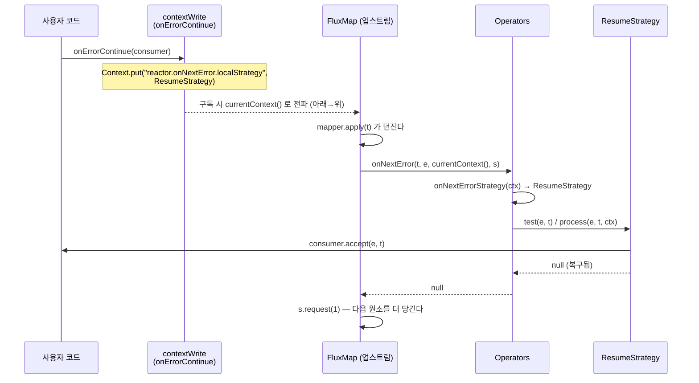

# 에러 처리와 재시도 — 신호를 바꾸는 것과 Context에 심는 것

Reactor의 에러 처리는 두 계열로 갈립니다. `onErrorReturn`/`onErrorMap`/`onErrorResume`는 **onError 신호를 다른 신호로 바꾸는 연산자**이고, `onErrorContinue`는 연산자가 아니라 **Context에 전략을 심어 업스트림의 동작을 바꾸는 장치**입니다. 이 차이를 알면 `onErrorContinue`가 왜 예측 불가능한지도 같이 알게 됩니다.

## 목차
- [1. 핵심 개념 (What)](#1-핵심-개념-what)
- [2. 왜 알아야 하는가 (Why)](#2-왜-알아야-하는가-why)
- [3. 내부 구현 분석 (How)](#3-내부-구현-분석-how)
- [4. 실전 예제](#4-실전-예제)
- [5. 정리](#5-정리)

---

## 1. 핵심 개념 (What)

### onError* 계열 — 신호를 바꾼다

| 연산자 | 하는 일 | 구현 |
|---|---|---|
| `onErrorReturn(v)` | onError → `onNext(v)` + `onComplete` | `FluxOnErrorReturn` (`Flux.java:7419`) |
| `onErrorComplete()` | onError → `onComplete` | 같은 `FluxOnErrorReturn`, fallbackValue가 `null` (`Flux.java:7132`) |
| `onErrorMap(f)` | onError(e) → onError(f(e)) | `onErrorResume(e -> Mono.error(f(e)))` (`Flux.java:7318`) |
| `onErrorResume(f)` | onError → 다른 `Publisher`를 이어서 구독 | `FluxOnErrorResume` (`Flux.java:7368`) |
| `doOnError(c)` | 부수효과만. 신호는 그대로 통과 | `doOnSignal(...)` → `FluxPeek` 계열 (`Flux.java:4930`) |

`onErrorMap`과 `onErrorReturn`은 독립 연산자가 아닙니다. `onErrorMap`은 `onErrorResume` 위에 얹혀 있고, `onErrorComplete`는 `onErrorReturn`과 클래스를 공유합니다 (`FluxOnErrorReturn.java:31` 주석: *"This operator is behind both `Flux#onErrorReturn(Object)` and `Flux#onErrorComplete()` APIs"*).

`Class`/`Predicate` 변종도 전부 가장 일반적인 형태로 환원됩니다.

```java
// Flux.java:7437
public final <E extends Throwable> Flux<T> onErrorReturn(Class<E> type, T fallbackValue) {
	return onErrorReturn(type::isInstance, fallbackValue);
}
// Flux.java:7403
public final Flux<T> onErrorResume(Predicate<? super Throwable> predicate,
		Function<? super Throwable, ? extends Publisher<? extends T>> fallback) {
	return onErrorResume(e -> predicate.test(e) ? fallback.apply(e) : error(e));
}
```

### `onErrorContinue` — 연산자가 아니다

`Flux.onErrorContinue()`의 구현 전체가 이것입니다 (`Flux.java:7199-7205`).

```java
public final Flux<T> onErrorContinue(BiConsumer<Throwable, Object> errorConsumer) {
	BiConsumer<Throwable, Object> genericConsumer = errorConsumer;
	return contextWriteSkippingContextPropagation(Context.of(
			OnNextFailureStrategy.KEY_ON_NEXT_ERROR_STRATEGY,
			OnNextFailureStrategy.resume(genericConsumer)
	));
}
```

`FluxOnErrorContinue` 같은 클래스는 존재하지 않습니다. `contextWrite`로 `"reactor.onNextError.localStrategy"` 키에 전략 객체를 넣는 게 전부입니다. 상쇄용 `onErrorStop()`도 같은 키에 `STOP` 전략을 넣습니다 (`Flux.java:7301-7305`).

### 재시도

| API | 반환 | 특징 |
|---|---|---|
| `Retry.max(n)` | `RetrySpec` | 즉시 n회 재시도 |
| `Retry.maxInARow(n)` | `RetrySpec` | `transientErrors=true`. onNext가 카운터를 리셋 |
| `Retry.indefinitely()` | `RetrySpec` | `maxAttempts = Long.MAX_VALUE` |
| `Retry.backoff(n, min)` | `RetryBackoffSpec` | 지수 백오프 + jitter 0.5 |
| `Retry.fixedDelay(n, d)` | `RetryBackoffSpec` | min=max=d, jitter 0 |
| `Retry.from(f)` / `Retry.withThrowable(f)` | `Retry` | 직접 companion 작성 |

---

## 2. 왜 알아야 하는가 (Why)

### `doOnError`로는 복구가 안 된다

```java
Flux.just(1, 2, 0, 4)
    .map(i -> 10 / i)
    .doOnError(e -> log.error("division failed", e))   // 로그만 찍고
    .subscribe(System.out::println, e -> System.out.println("FAILED: " + e));
// 10
// 5
// FAILED: java.lang.ArithmeticException: / by zero
```

`doOnError`는 콜백을 실행한 뒤 **onError를 그대로 다운스트림에 넘깁니다** (`Flux.java:4921-4922` 주석: *"The Consumer is executed first, then the onError signal is propagated downstream"*). 시퀀스는 끝납니다. 로그와 복구를 섞어 쓰려면 `doOnError` + `onErrorResume`을 같이 써야 합니다.

### `onErrorContinue`의 범위가 누출된다

`onErrorContinue`가 Context에 전략을 심는다는 사실에서 세 가지 성질이 바로 따라옵니다.

1. **업스트림 방향으로만 작동한다.** Context는 다운스트림 → 업스트림으로 전파되므로 (→ [09-context-propagation.md](09-context-propagation.md)), `onErrorContinue`는 자기보다 **위**에 있는 연산자의 동작을 바꿉니다. 아래쪽 연산자에는 효과가 없습니다.

2. **연산자가 개별적으로 지원해야 한다.** 업스트림 연산자가 Context를 읽어 `Operators.onNextError(...)`를 호출해야 비로소 효과가 납니다. 3.7.19에서 이를 호출하는 파일은 15개입니다.

```
FluxConcatMap, FluxConcatMapNoPrefetch, FluxFilter, FluxFilterFuseable,
FluxFlatMap, FluxFlattenIterable, FluxHandle, FluxHandleFuseable,
FluxMap, FluxMapFuseable, FluxMergeComparing, FluxMergeSequential,
FluxPeek, FluxPeekFuseable
(+ OnNextFailureStrategy 자신)
```

여기 없는 연산자는 `onErrorContinue`를 **무시**합니다. 어떤 연산자가 지원하는지는 Javadoc의 `<strong>Error Mode Support:</strong>` 블록으로만 알 수 있고, 체인을 한 줄 고치다 지원 연산자가 비지원 연산자로 바뀌면 조용히 동작이 달라집니다.

3. **라이브러리 코드까지 새어 나간다.** Context는 구독 체인 전체로 올라가므로, 내가 쓴 `flatMap` 안의 라이브러리가 만든 `Flux`에도 전략이 전달됩니다. 그 라이브러리가 `onErrorContinue`를 전제하지 않고 작성됐다면 의도하지 않은 복구가 일어납니다. Javadoc이 직접 경고합니다 (`Flux.java:7177-7180`).

> *"Note that onErrorContinue() is a specialist operator that can make the behaviour of your reactive chain unclear. It operates on upstream, not downstream operators, it requires specific operator support to work, and the scope can easily propagate upstream into library code that didn't anticipate it (resulting in unintended behaviour.)"*

Javadoc이 제시하는 대안도 명확합니다 (`Flux.java:7186-7190`).

```java
.flatMap(id -> repository.retrieveById(id)
                         .doOnError(System.err::println)
                         .onErrorResume(e -> Mono.empty()))
```

**원소 단위 에러는 그 원소를 처리하는 inner publisher 안에서 끝내는 것**이 정답입니다. 범위가 람다 안으로 한정되고, 연산자 지원 여부에 의존하지 않고, 위로 새지 않습니다. 참고로 3.7.19에서 `onErrorContinue`는 `@Deprecated`가 아닙니다 — "권장되지 않는다"는 것은 Javadoc의 설명이고, 컴파일 경고는 나지 않습니다.

### `retryWhen`과 `repeatWhen`의 차이

둘은 구조가 똑같습니다. 소스가 종료되면 companion publisher에 신호를 흘리고, companion이 onNext하면 소스를 다시 구독합니다. 차이는 **무엇을 트리거로 보는가**입니다.

| | `retryWhen(Retry)` | `repeatWhen(Function<Flux<Long>, Publisher>)` |
|---|---|---|
| 트리거 | **onError** | **onComplete** |
| companion 입력 | `Flux<Retry.RetrySignal>` | `Flux<Long>` (지금까지 방출한 개수) |
| 클래스 | `FluxRetryWhen` (`Flux.java:8118`) | `FluxRepeatWhen` (`Flux.java:7910`) |

즉 `retry`는 실패 복구, `repeat`는 폴링입니다. 둘 다 같은 내부 패턴(`Sinks.Many` + `MultiSubscriptionSubscriber`)으로 구현돼 있습니다.

---

## 3. 내부 구현 분석 (How)

### 3.1 `onErrorResume` — 구독을 갈아타는 Subscriber

`FluxOnErrorResume.ResumeSubscriber`는 `Operators.MultiSubscriptionSubscriber`를 상속합니다. 이름 그대로 **여러 Subscription을 순차적으로 들 수 있는** Subscriber입니다 (`FluxOnErrorResume.java:56-57`).

```java
// FluxOnErrorResume.java:69-108
public void onSubscribe(Subscription s) {
	if (!second) {
		actual.onSubscribe(this);   // 첫 구독에서만 다운스트림에 알린다
	}
	set(s);                         // Subscription 교체
}

public void onError(Throwable t) {
	if (!second) {
		second = true;
		Publisher<? extends T> p;
		try {
			p = Operators.toFluxOrMono(Objects.requireNonNull(nextFactory.apply(t),
					"The nextFactory returned a null Publisher"));
		}
		catch (Throwable e) {
			Throwable _e = Operators.onOperatorError(e, actual.currentContext());
			_e = Exceptions.addSuppressed(_e, t);   // 원래 에러를 suppressed로 보존
			actual.onError(_e);
			return;
		}
		p.subscribe(this);          // fallback을 같은 Subscriber로 구독
	}
	else {
		actual.onError(t);          // fallback도 실패하면 그냥 전달
	}
}
```

읽어 둘 점 셋.

- `second` 플래그로 **한 번만** 전환합니다. fallback이 또 에러를 내면 그대로 다운스트림으로 갑니다.
- `onSubscribe`를 두 번 호출하지 않습니다. RS 규약상 다운스트림은 `onSubscribe`를 한 번만 받아야 하므로, fallback 구독 시에는 건너뜁니다.
- `nextFactory` 람다 자체가 던지면 `Exceptions.addSuppressed`로 **원래 에러를 잃지 않습니다**. 디버깅 시 두 에러를 다 볼 수 있습니다.
- `onNext`에서 `producedOne()`을 호출해 (`FluxOnErrorResume.java:78-84`) 이미 흘린 개수를 기록합니다. fallback으로 갈아탈 때 남은 request 수를 정확히 계산하기 위한 것입니다.

```
  [다운스트림]
      │ onSubscribe(ResumeSubscriber)  ← 한 번만
      │
  ResumeSubscriber  ──set(s1)──> [원본 소스]
      │                               │ onError(e)
      │  second=false → true
      │
      └──set(s2)──> [nextFactory.apply(e) 가 만든 Publisher]
                        │ onNext / onComplete → actual 로 그대로
```

### 3.2 `onErrorContinue` — Context → `Operators.onNextError` → 전략

전략 조회는 `Operators.onNextErrorStrategy(Context)` 한 군데에 모여 있습니다 (`Operators.java:797-811`).

```java
static final OnNextFailureStrategy onNextErrorStrategy(Context context) {
	OnNextFailureStrategy strategy = null;

	BiFunction<? super Throwable, Object, ? extends Throwable> fn = context.getOrDefault(
			OnNextFailureStrategy.KEY_ON_NEXT_ERROR_STRATEGY, null);
	if (fn instanceof OnNextFailureStrategy) {
		strategy = (OnNextFailureStrategy) fn;
	} else if (fn != null) {
		strategy = new OnNextFailureStrategy.LambdaOnNextErrorStrategy(fn);
	}

	if (strategy == null) strategy = Hooks.onNextErrorHook;   // 전역 훅
	if (strategy == null) strategy = OnNextFailureStrategy.STOP;  // 기본값
	return strategy;
}
```

우선순위가 **Context → 전역 훅(`Hooks.onNextError`) → `STOP`** 입니다. 기본 `STOP`은 `test()`가 항상 `false`를 돌려주므로 아무것도 복구하지 않습니다 (`OnNextFailureStrategy.java:146-160`).

연산자가 호출하는 쪽은 `Operators.onNextError(value, error, context, subscription)`입니다 (`Operators.java:855-871`).

```java
public static <T> Throwable onNextError(@Nullable T value, Throwable error, Context context,
		Subscription subscriptionForCancel) {
	error = unwrapOnNextError(error);
	OnNextFailureStrategy strategy = onNextErrorStrategy(context);
	if (strategy.test(error, value)) {
		Throwable t = strategy.process(error, value, context);
		if (t != null) {
			subscriptionForCancel.cancel();   // 전략이 처리 못 했으면 취소
		}
		return t;
	}
	else {
		return onOperatorError(subscriptionForCancel, error, value, context);
	}
}
```

**반환값이 `null`이면 "복구됐다"**, 아니면 "이 에러를 onError로 내보내라"는 뜻입니다. `FluxMap`이 그 계약을 쓰는 방식 (`FluxMap.java:111-120`):

```java
catch (Throwable e) {
	Throwable e_ = Operators.onNextError(t, e, actual.currentContext(), s);
	if (e_ != null) {
		onError(e_);
	}
	else {
		s.request(1);     // 복구됐으니 다음 원소 하나를 더 요청
	}
	return;
}
```

`s.request(1)`이 핵심입니다. 원소 하나를 버렸으므로 배압 계정을 맞추기 위해 하나를 더 당겨옵니다. **이 코드가 연산자 안에 직접 박혀 있어야** `onErrorContinue`가 작동합니다. 그래서 "연산자별 개별 지원"이 필요합니다.

용도별 변종이 네 개 있습니다.

| 메서드 | Subscription 취소 | 반환 | 용도 |
|---|---|---|---|
| `onNextError(v, e, ctx, s)` | 한다 | `Throwable?` | `onNext`, `tryOnNext` (`Operators.java:855`) |
| `onNextError(v, e, ctx)` | 안 한다 | `Throwable?` | 비동기 연산자 (`Operators.java:890`) |
| `onNextInnerError(e, ctx, s?)` | 선택적 | `Throwable?` | inner publisher의 에러 (`Operators.java:915`) |
| `onNextPollError(v, e, ctx)` | 안 한다 | `RuntimeException` | fusion의 `poll()` — 던져야 하므로 (`Operators.java:954`) |

전략 구현체는 세 가지입니다 (`OnNextFailureStrategy.java`).

```
STOP              (146)  test() = false. 아무것도 복구하지 않는다. 기본값
RESUME_DROP       (162)  = new ResumeDropStrategy(null)
ResumeDropStrategy(200)  onNextDropped / onErrorDropped 훅으로 흘려보낸다
ResumeStrategy    (164)  사용자 BiConsumer 호출. ← onErrorContinue가 쓰는 것
LambdaOnNextErrorStrategy (236)  Context에 BiFunction만 들어 있을 때의 어댑터
```

`ResumeStrategy.process()`를 보면 사용자 consumer가 던질 때의 처리까지 정해져 있습니다 (`OnNextFailureStrategy.java:180-197`).

```java
public Throwable process(Throwable error, @Nullable Object value, Context context) {
	if (errorPredicate == null) {
		Exceptions.throwIfFatal(error);
	}
	else if (!errorPredicate.test(error)) {
		Exceptions.throwIfFatal(error);
		return error;              // 조건 불일치 → 원래 에러 전파
	}
	try {
		errorConsumer.accept(error, value);
		return null;               // 복구 성공
	}
	catch (Throwable e) {
		return Exceptions.addSuppressed(e, error);   // consumer가 던지면 원래 에러를 suppressed로
	}
}
```

전체 흐름:



### 3.3 `retryWhen` — companion publisher와 `Sinks.Many`

`FluxRetryWhen.subscribe()`가 전체 배선을 보여 줍니다 (`FluxRetryWhen.java:53-83`).

```java
static <T> void subscribe(CoreSubscriber<? super T> s, Retry whenSourceFactory,
		CorePublisher<? extends T> source) {
	CorePublisher<? extends T> wrapped = Operators.toFluxOrMono(source);
	RetryWhenOtherSubscriber other = new RetryWhenOtherSubscriber();
	CoreSubscriber<T> serial = Operators.serialize(s);

	RetryWhenMainSubscriber<T> main = new RetryWhenMainSubscriber<>(
			serial, other.completionSignal, wrapped, whenSourceFactory.retryContext());

	other.main = main;
	serial.onSubscribe(main);

	Publisher<?> p;
	try {
		p = Objects.requireNonNull(whenSourceFactory.generateCompanion(other),
				"The whenSourceFactory returned a null Publisher");
	}
	catch (Throwable e) {
		s.onError(Operators.onOperatorError(e, s.currentContext()));
		return;
	}

	p = Operators.toFluxOrMono(p);
	p.subscribe(other);

	if (!main.cancelled) {
		wrapped.subscribe(main);
	}
}
```

```
   [소스]                                [companion]
     │                                        ▲
     │ onError(e)                             │ RetrySignal
     ▼                                        │
  RetryWhenMainSubscriber ──signaller.emitNext(this)──┘
     │   (Sinks.Many<RetrySignal>)
     │                                   generateCompanion(...)
     │                                        │
     │        ┌───── resubscribe(trigger) ◄───┘ onNext
     ▼        │                                 (companion이 값을 내면 재구독)
   source.subscribe(main)  ← 다시
                                             onError/onComplete
                                                 → 다운스트림 종료
```

세 가지가 읽힙니다.

- **`Operators.serialize(s)`** 로 다운스트림을 직렬화합니다. 재구독 과정에서 신호가 겹칠 수 있으므로 RS 규약 §1.3(직렬 전달)을 지키기 위한 장치입니다.
- **`RetryWhenMainSubscriber`가 직접 `Retry.RetrySignal`을 구현합니다** (`FluxRetryWhen.java:97-98`). 별도 객체를 매번 만들지 않고 자기 자신을 emit합니다 (`FluxRetryWhen.java:194`: `signaller.emitNext(this, Sinks.EmitFailureHandler.FAIL_FAST)`). 그래서 이 객체는 **살아 있는 가변 뷰**이고, companion 쪽에서 반드시 `copy()`를 떠야 합니다.
- companion과의 통신 수단이 `Sinks.Many<Retry.RetrySignal>`입니다 (→ [11-sinks.md](11-sinks.md)).

`RetrySpec.generateCompanion()`이 `copy()`를 가장 먼저 부르는 이유가 바로 그것입니다 (`RetrySpec.java:355-381`).

```java
public Flux<Long> generateCompanion(Flux<RetrySignal> flux) {
	return Flux.deferContextual(cv ->
		flux
			.contextWrite(cv)
			.concatMap(retryWhenState -> {
				RetrySignal copy = retryWhenState.copy();        // ← 즉시 스냅샷
				Throwable currentFailure = copy.failure();
				long iteration = isTransientErrors ? copy.totalRetriesInARow() : copy.totalRetries();

				if (currentFailure == null) {
					return Mono.error(new IllegalStateException("RetryWhenState#failure() not expected to be null"));
				}
				else if (!errorFilter.test(currentFailure)) {
					return Mono.error(currentFailure);           // filter 불일치 → 원래 에러 전파
				}
				else if (iteration >= maxAttempts) {
					return Mono.error(retryExhaustedGenerator.apply(this, copy));
				}
				else {
					return applyHooks(copy, Mono.just(iteration), doPreRetry, doPostRetry,
							asyncPreRetry, asyncPostRetry, cv);
				}
			})
			.onErrorStop()                                       // ← 자기 보호
	);
}
```

`.onErrorStop()`이 마지막에 붙어 있습니다. 사용자가 다운스트림에서 `onErrorContinue`를 켰더라도 **재시도 companion 내부는 영향받지 않도록** 명시적으로 차단하는 것입니다. 3.2절의 "범위 누출"이 실제 문제라는 걸 Reactor 자신의 코드가 증명합니다.

`concatMap`인 것도 의도적입니다 — 재시도 신호는 순차 처리돼야 하고, 동시에 여러 재구독이 일어나면 안 됩니다.

### 3.4 백오프 계산 — jitter의 실제 공식

`RetryBackoffSpec.generateCompanion()`의 지연 계산 (`RetryBackoffSpec.java:610-655`):

```java
// ① 지수 증가
long minBackoffLong = minBackoff.toNanos();
long nextBackoffLong = (long) (minBackoffLong * Math.pow(multiplier, iteration));
nextBackoff = Duration.ofNanos(nextBackoffLong);
if (nextBackoff.compareTo(maxBackoff) > 0) {
	nextBackoff = maxBackoff;          // 상한 고정
}
// (ArithmeticException 오버플로 시에도 maxBackoff)

// ② 지연 0이면 바로 재시도
if (nextBackoff.isZero()) {
	return RetrySpec.applyHooks(copy, Mono.just(iteration), ...);
}

// ③ jitter 범위 계산
long jitterOffset = nextBackoff.multipliedBy((long) (100 * jitterFactor)).dividedBy(100).toMillis();
long lowBound  = Math.max(minBackoff.minus(nextBackoff).toMillis(), -jitterOffset);
long highBound = Math.min(maxBackoff.minus(nextBackoff).toMillis(),  jitterOffset);

long jitter = (highBound == lowBound)
		? (highBound == 0 ? 0 : random.nextLong(highBound))
		: random.nextLong(lowBound, highBound);

Duration effectiveBackoff = nextBackoff.plusMillis(jitter);
return RetrySpec.applyHooks(copy, Mono.delay(effectiveBackoff, backoffSchedulerSupplier.get()), ...);
```

`lowBound`/`highBound`를 `minBackoff`/`maxBackoff`로 클램프하므로, **jitter를 적용해도 실효 지연은 `[minBackoff, maxBackoff]` 범위를 벗어나지 않습니다** (`RetryBackoffSpec.java:42-43` Javadoc이 보장하는 내용). 기본 설정도 소스로 확인됩니다 (`Retry.java:167-193`).

| 팩토리 | multiplier | jitterFactor | minBackoff | maxBackoff | scheduler |
|---|---|---|---|---|---|
| `Retry.backoff(n, min)` | 2 | 0.5 | `min` | `MAX_BACKOFF`(= `Duration.ofMillis(Long.MAX_VALUE)`) | `Schedulers::parallel` |
| `Retry.fixedDelay(n, d)` | 2 | 0 | `d` | `d` | `Schedulers::parallel` |

`fixedDelay` 뒤에 `minBackoff`/`maxBackoff`를 다시 부르면 **지수 백오프로 되돌아갑니다** (`Retry.java:179-180` 주석). `multiplier`가 2로 남아 있기 때문입니다.

`validateArguments()`는 `jitterFactor`가 0~1이 아니면 `IllegalArgumentException`을 던지는데, 호출 지점이 `generateCompanion()` 안이라 **구독 시점**에 터집니다 (`RetryBackoffSpec.java:583-589`).

### 3.5 `RetrySignal`과 `RetryExhaustedException`

```java
// Retry.java:104-151
public interface RetrySignal {
	long totalRetries();                 // 최초 구독 이후 누적 재시도 횟수
	long totalRetriesInARow();           // 최근 onNext 이후 연속 재시도 횟수
	Throwable failure();                 // 현재 에러
	default ContextView retryContextView() { return Context.empty(); }
	default RetrySignal copy() {
		return new ImmutableRetrySignal(totalRetries(), totalRetriesInARow(), failure(), retryContextView());
	}
}
```

`transientErrors(true)`(= `Retry.maxInARow`)이면 `totalRetriesInARow()`를, 아니면 `totalRetries()`를 카운터로 씁니다. 즉 **중간에 하나라도 성공해서 흘러나가면 예산이 리셋**됩니다. 스트리밍 소스(SSE, Kafka)에 적합합니다.

재시도 소진 시 생성되는 예외:

```java
// RetrySpec.java:60-66 (RetryBackoffSpec.java:66-71 도 동일 형태)
RETRY_EXCEPTION_GENERATOR = (builder, rs) ->
	Exceptions.retryExhausted("Retries exhausted: " + (
			builder.isTransientErrors
					? rs.totalRetriesInARow() + "/" + builder.maxAttempts + " in a row (" + rs.totalRetries() + " total)"
					: rs.totalRetries() + "/" + builder.maxAttempts
	), rs.failure());
```

`Exceptions.retryExhausted(msg, cause)`는 `RetryExhaustedException`(= `IllegalStateException` 상속)을 만들고, **마지막 실패를 `cause`로 붙입니다** (`reactor-core/src/main/java/reactor/core/Exceptions.java:307-308`, `803-810`). 판별은 `Exceptions.isRetryExhausted(t)` (`Exceptions.java:367`).

`RetryExhaustedException` 클래스 자체는 `static final` 패키지 전용이라 `catch (RetryExhaustedException e)`로 잡을 수 없습니다. `Exceptions.isRetryExhausted()`나 `IllegalStateException`으로 받아야 합니다.

---

## 4. 실전 예제

### 4.1 onError* 계열 비교

```java
import org.junit.jupiter.api.Test;
import reactor.core.publisher.Flux;
import reactor.core.publisher.Mono;
import reactor.test.StepVerifier;

class OnErrorVariantsTest {

    private Flux<Integer> source() {
        return Flux.just(1, 2, 0, 4).map(i -> 10 / i);   // 세 번째에서 터진다
    }

    @Test
    void onErrorReturn_은_폴백값_하나와_complete() {
        StepVerifier.create(source().onErrorReturn(-1))
                .expectNext(10, 5, -1)
                .verifyComplete();
    }

    @Test
    void onErrorComplete_는_조용히_끝낸다() {
        StepVerifier.create(source().onErrorComplete())
                .expectNext(10, 5)
                .verifyComplete();
    }

    @Test
    void onErrorMap_은_예외만_바꾼다() {
        StepVerifier.create(source().onErrorMap(ArithmeticException.class,
                        e -> new IllegalStateException("bad input", e)))
                .expectNext(10, 5)
                .expectErrorSatisfies(e -> {
                    assert e instanceof IllegalStateException;
                    assert e.getCause() instanceof ArithmeticException;
                })
                .verify();
    }

    @Test
    void onErrorResume_은_다른_시퀀스로_이어진다() {
        StepVerifier.create(source().onErrorResume(e -> Flux.just(100, 200)))
                .expectNext(10, 5, 100, 200)
                .verifyComplete();
    }

    @Test
    void doOnError_는_복구하지_않는다() {
        StringBuilder logged = new StringBuilder();
        StepVerifier.create(source().doOnError(e -> logged.append(e.getClass().getSimpleName())))
                .expectNext(10, 5)
                .expectError(ArithmeticException.class)
                .verify();
        assert logged.toString().equals("ArithmeticException");
    }

    @Test
    void 권장_패턴_원소별_처리는_람다_안에서_끝낸다() {
        StepVerifier.create(
                        Flux.just(1, 2, 0, 4)
                                .flatMap(i -> Mono.fromSupplier(() -> 10 / i)
                                        .doOnError(e -> System.err.println("skip " + i + ": " + e))
                                        .onErrorResume(e -> Mono.empty())))
                .expectNext(10, 5, 2)      // 0은 조용히 빠진다
                .verifyComplete();
    }
}
```

마지막 테스트가 Javadoc이 권하는 형태입니다. 범위가 `flatMap` 람다 안으로 닫혀 있어서 어떤 연산자가 뭘 지원하는지 신경 쓸 필요가 없습니다.

### 4.2 `onErrorContinue`의 범위 누출을 재현하기

```java
import org.junit.jupiter.api.Test;
import reactor.core.publisher.Flux;
import reactor.test.StepVerifier;

import java.util.ArrayList;
import java.util.List;

class OnErrorContinueScopeTest {

    @Test
    void 업스트림의_map_은_영향을_받는다() {
        List<Object> dropped = new ArrayList<>();

        StepVerifier.create(
                        Flux.just(1, 2, 0, 4)
                                .map(i -> 10 / i)                      // ← 위: 영향받는다
                                .onErrorContinue((e, v) -> dropped.add(v)))
                .expectNext(10, 5, 2)
                .verifyComplete();

        assert dropped.equals(List.of(0));
    }

    @Test
    void 다운스트림의_map_은_영향을_받지_않는다() {
        StepVerifier.create(
                        Flux.just(1, 2, 0, 4)
                                .onErrorContinue((e, v) -> {})         // ← 위치가 위
                                .map(i -> 10 / i))                     // ← 아래: 영향 없음
                .expectNext(10, 5)
                .expectError(ArithmeticException.class)
                .verify();
    }

    @Test
    void onErrorStop_으로_범위를_끊는다() {
        StepVerifier.create(
                        Flux.just(1, 2, 0, 4)
                                .map(i -> 10 / i)
                                .onErrorStop()                         // 여기서 위로는 STOP
                                .onErrorContinue((e, v) -> {}))
                .expectNext(10, 5)
                .expectError(ArithmeticException.class)
                .verify();
    }
}
```

세 테스트가 "Context는 아래에서 위로 흐른다"는 명제를 그대로 보여 줍니다. 두 번째 테스트에서 `onErrorContinue`를 어디로 옮겨야 할지 헷갈린다면, 09번 문서의 전파 방향 그림을 다시 보면 됩니다.

### 4.3 백오프 재시도 — 실전 조합

```java
import io.netty.handler.timeout.ReadTimeoutException;
import reactor.core.Exceptions;
import reactor.core.publisher.Mono;
import reactor.util.retry.Retry;

import java.io.IOException;
import java.time.Duration;

public class ResilientClient {

    private final WebClient webClient;

    public Mono<Order> fetchOrder(String id) {
        return webClient.get().uri("/orders/{id}", id)
                .retrieve(Order.class)
                .retryWhen(
                        Retry.backoff(3, Duration.ofMillis(200))
                                .maxBackoff(Duration.ofSeconds(2))
                                .jitter(0.5)                          // 기본값과 같지만 명시
                                .filter(this::isRetryable)            // 재시도할 에러만
                                .doBeforeRetry(rs -> log.warn("retry {}/{} for order {}: {}",
                                        rs.totalRetries() + 1, 3, id, rs.failure().toString()))
                                .onRetryExhaustedThrow((spec, rs) ->
                                        new OrderUnavailableException(
                                                "order " + id + " unavailable after " + rs.totalRetries() + " retries",
                                                rs.failure()))
                )
                .onErrorMap(e -> !(e instanceof OrderUnavailableException),
                        e -> new OrderUnavailableException("order " + id + " failed", e));
    }

    private boolean isRetryable(Throwable t) {
        // 4xx 같은 영구 실패는 재시도하지 않는다
        return t instanceof IOException
                || t instanceof ReadTimeoutException
                || (t instanceof HttpServerErrorException);
    }
}
```

주의할 점 세 개.

1. **`filter`를 반드시 지정합니다.** 기본값이 `t -> true`라서 (`Retry.java:168`) 400 Bad Request도 3번 재시도합니다. 멱등하지 않은 요청이면 더 위험합니다.
2. **`onRetryExhaustedThrow`로 도메인 예외로 바꿉니다.** 기본값은 `RetryExhaustedException`인데 패키지 전용 클래스라 `catch`가 안 됩니다. 마지막 실패를 `cause`로 넘기는 걸 잊지 마세요.
3. **백오프 지연은 `Schedulers.parallel()`에서 실행됩니다** (`Retry.java:168`). 이 스케줄러를 블로킹 작업으로 고갈시키면 재시도 지연도 밀립니다 (→ [08-schedulers-and-threading.md](08-schedulers-and-threading.md)).

### 4.4 `transientErrors`로 스트리밍 재시도 예산 관리

```java
import org.junit.jupiter.api.Test;
import reactor.core.publisher.Flux;
import reactor.test.StepVerifier;
import reactor.util.retry.Retry;

import java.util.concurrent.atomic.AtomicInteger;

class TransientErrorsTest {

    @Test
    void maxInARow_는_성공_후_예산을_리셋한다() {
        AtomicInteger attempt = new AtomicInteger();

        Flux<Integer> flaky = Flux.defer(() -> {
            int n = attempt.incrementAndGet();
            // 매 구독마다 값 하나는 성공시킨 뒤 실패
            return Flux.concat(Flux.just(n), Flux.error(new IllegalStateException("boom " + n)));
        });

        // 연속 실패 2회까지 허용. 매 구독이 onNext를 하나씩 내므로 카운터가 계속 리셋되어
        // indefinitely 와 사실상 같아진다 → 횟수를 걸어 종료 조건을 만들어야 한다
        StepVerifier.create(flaky.retryWhen(Retry.maxInARow(2).filter(e -> attempt.get() < 4)))
                .expectNext(1, 2, 3, 4)
                .expectError(IllegalStateException.class)
                .verify();
    }

    @Test
    void retryExhausted_판별() {
        StepVerifier.create(
                        Flux.error(new IllegalStateException("always"))
                                .retryWhen(Retry.max(2)))
                .expectErrorSatisfies(e -> {
                    assert reactor.core.Exceptions.isRetryExhausted(e);
                    assert e.getMessage().equals("Retries exhausted: 2/2");
                    assert e.getCause() instanceof IllegalStateException;
                })
                .verify();
    }
}
```

두 번째 테스트의 메시지 포맷 `"Retries exhausted: 2/2"`는 `RetrySpec.RETRY_EXCEPTION_GENERATOR` (`RetrySpec.java:60-66`)가 만드는 문자열 그대로입니다. `transientErrors=true`면 `"2/2 in a row (5 total)"` 형태가 됩니다.

### 4.5 `repeatWhen`으로 폴링

```java
import reactor.core.publisher.Flux;
import reactor.core.publisher.Mono;

import java.time.Duration;

public class StatusPoller {

    // onComplete 를 트리거로 5초마다 다시 조회
    public Flux<JobStatus> poll(String jobId) {
        return fetchStatus(jobId)
                .repeatWhen(completions -> completions.delayElements(Duration.ofSeconds(5)))
                .takeUntil(JobStatus::isTerminal);
    }

    // 비교: 실패만 재시도하고 싶다면 retryWhen
    public Mono<JobStatus> fetchOnce(String jobId) {
        return fetchStatus(jobId).single()
                .retryWhen(reactor.util.retry.Retry.backoff(3, Duration.ofMillis(100)));
    }

    private Flux<JobStatus> fetchStatus(String jobId) { /* ... */ return Flux.empty(); }
}
```

`repeatWhen`의 companion은 `Flux<Long>`을 받습니다 — 각 값은 **그 회차에 소스가 방출한 원소 개수**입니다 (`FluxRepeatWhen.java:163`에서 `signaller.emitNext(p, ...)`의 `p`가 `produced`). 0이면 "이번엔 아무것도 안 나왔다"는 뜻이라 종료 조건으로 쓸 수 있습니다.

---

## 5. 정리

| 항목 | 내용 |
|---|---|
| `doOnError` vs `onError*` | `doOnError`는 콜백 후 onError를 그대로 전달. 복구는 `onErrorReturn`/`Resume`/`Map`만 |
| 환원 관계 | `onErrorMap` → `onErrorResume(e -> Mono.error(f(e)))`, `onErrorComplete` → `FluxOnErrorReturn`(fallback=null), `Class`/`Predicate` 변종 → 일반형 |
| `onErrorResume` 구현 | `MultiSubscriptionSubscriber`. `second` 플래그로 한 번만 전환, `onSubscribe`는 한 번만, 팩토리 예외는 `addSuppressed`로 원인 보존 |
| `onErrorContinue` 구현 | **연산자 클래스가 없다.** `contextWrite`로 `"reactor.onNextError.localStrategy"` 키에 `OnNextFailureStrategy`를 심는 것 |
| 소비 경로 | `Operators.onNextError(...)` → `onNextErrorStrategy(ctx)` → Context / `Hooks.onNextErrorHook` / `STOP` 순 조회 |
| 연산자 지원 | 3.7.19에서 `Operators.onNextError*`를 호출하는 파일 15개(map/filter/handle/flatMap/concatMap/peek 계열 등). 나머지는 무시 |
| 권장 대안 | 원소 단위 에러는 inner publisher 안에서 `doOnError` + `onErrorResume(e -> Mono.empty())` |
| `Retry` 팩토리 | `max`, `maxInARow`(transientErrors), `indefinitely`, `backoff`(mult 2, jitter 0.5), `fixedDelay`(jitter 0) |
| `RetrySignal` | `MainSubscriber`가 직접 구현한 **가변 뷰** → companion에서 `copy()` 필수 |
| jitter 보장 | `lowBound`/`highBound`가 `[minBackoff, maxBackoff]`로 클램프되어 범위를 벗어나지 않는다 |
| 소진 | `RetryExhaustedException`(패키지 전용, `IllegalStateException` 상속). `Exceptions.isRetryExhausted()`로 판별, `onRetryExhaustedThrow`로 교체 |
| `repeatWhen` | onComplete 트리거, companion은 `Flux<Long>`(방출 개수). `retryWhen`은 onError 트리거, `Flux<RetrySignal>` |

---

## 관련 문서
- 선행: [연산자와 Reactive Streams 규약](04-operators-rs-contract.md)
- 선행: [Context 전파](09-context-propagation.md) — `onErrorContinue`의 범위가 왜 업스트림인지
- 후행: [Sinks: 명령형 코드와의 경계](11-sinks.md) — `retryWhen` companion이 쓰는 `Sinks.Many`
- 후행: [Reactor 테스트와 디버깅](12-testing-debugging.md)
- 참고: [Reactor 연동 — 배압과 취소를 지키는 오퍼레이터](../../resilience4j/advanced/08-reactor-operators.md) — resilience4j `RetryOperator`가 `retryWhen`을 어떻게 감싸는지

---
*참고: Reactor Core 3.7.19 기준*
