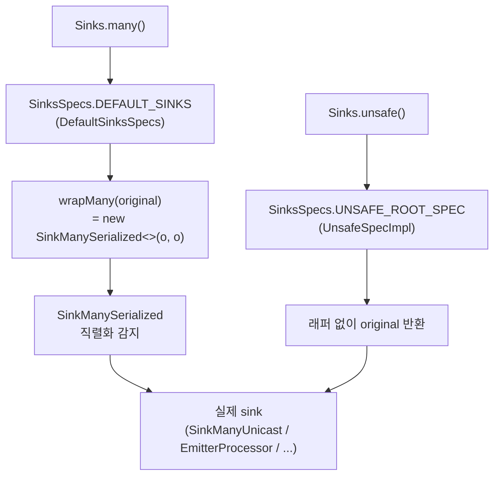

# Sinks — 명령형 코드와 리액티브 스트림의 경계

콜백·이벤트 리스너·메시지 핸들러처럼 "내가 값을 밀어넣는" 코드를 `Flux`/`Mono`로 잇는 공식 수단이 `Sinks`입니다. 핵심은 **Sinks가 스레드 안전을 자동으로 보장하지 않는다**는 점과, 실패를 `EmitResult`로 **값으로 돌려준다**는 설계입니다.

## 목차
- [1. 핵심 개념 (What)](#1-핵심-개념-what)
- [2. 왜 알아야 하는가 (Why)](#2-왜-알아야-하는가-why)
- [3. 내부 구현 분석 (How)](#3-내부-구현-분석-how)
- [4. 실전 예제](#4-실전-예제)
- [5. 정리](#5-정리)

---

## 1. 핵심 개념 (What)

### 세 가지 sink 타입

| 타입 | 의미 | 신호 메서드 | 변환 |
|---|---|---|---|
| `Sinks.Many<T>` | `Flux` 의미론 — 0..N개 | `tryEmitNext`/`tryEmitComplete`/`tryEmitError` | `asFlux()` |
| `Sinks.One<T>` | `Mono` 의미론 — 0..1개 | `tryEmitValue`/`tryEmitEmpty`/`tryEmitError` | `asMono()` |
| `Sinks.Empty<T>` | 완료/실패만 | `tryEmitEmpty`/`tryEmitError` | `asMono()` |

`One extends Empty` (`Sinks.java:1151`), `Empty`와 `Many`는 각각 독립이며 둘 다 `Scannable`입니다 (`Sinks.java:758`, `999`).

### 팩토리와 spec 계층

```
Sinks (reactor-core/src/main/java/reactor/core/publisher/Sinks.java:47)
├── Sinks.empty()      → Sinks.Empty<T>              (:65)
├── Sinks.one()        → Sinks.One<T>                (:80)
├── Sinks.many()       → ManySpec                    (:92)
│     ├── .unicast()   → UnicastSpec                 (:351)
│     │     ├── onBackpressureBuffer()
│     │     ├── onBackpressureBuffer(Queue)
│     │     ├── onBackpressureBuffer(Queue, Disposable endCallback)
│     │     └── onBackpressureError()
│     ├── .multicast() → MulticastSpec                (:358)
│     │     ├── onBackpressureBuffer()
│     │     ├── onBackpressureBuffer(int bufferSize)
│     │     ├── onBackpressureBuffer(int bufferSize, boolean autoCancel)
│     │     ├── directAllOrNothing()
│     │     └── directBestEffort()
│     └── .replay()    → MulticastReplaySpec          (:366)
│           ├── all() / all(int batchSize)
│           ├── latest() / latestOrDefault(T)
│           ├── limit(int historySize)
│           ├── limit(Duration maxAge) / limit(Duration, Scheduler)
│           └── limit(int, Duration) / limit(int, Duration, Scheduler)
└── Sinks.unsafe()     → RootSpec                    (:106)
      ├── .empty() / .one() / .many()
      └── .manyWithUpstream() → ManyWithUpstreamUnsafeSpec  (:339)
```

`unicast`는 **구독자 1명**만 받습니다. `multicast`는 여러 명, `replay`는 여러 명 + 과거 값 재생입니다.

### `Sinks.unsafe()`는 무엇이 unsafe인가

`Sinks.many()`가 돌려주는 sink는 전부 `Sink*Serialized`로 감싸져 있습니다. `Sinks.unsafe()`는 그 래퍼를 벗긴 원본을 줍니다 (`Sinks.java:96-108`).

> *"Unsafe `Sinks.Many`, `Sinks.One` and `Sinks.Empty` are not serialized nor thread safe, which implies they MUST be externally synchronized so as to respect the Reactive Streams specification."*

즉 **unsafe = 동시 접근을 감지하지 않는다**는 뜻입니다. 이미 RS 규약을 지키는 문맥(연산자 내부, `Subscriber` 안)에서 호출한다면 감지 비용을 없애는 선택지입니다.

---

## 2. 왜 알아야 하는가 (Why)

### 실패를 예외가 아니라 값으로 돌려준다

`Sinks.Many.tryEmitNext(t)`는 `void`가 아니라 `EmitResult`를 반환합니다.

```java
Sinks.Many<String> sink = Sinks.many().multicast().onBackpressureBuffer();
Sinks.EmitResult result = sink.tryEmitNext("hello");
if (result.isFailure()) {
    // 구독자가 없다 / 버퍼가 찼다 / 이미 종료됐다 / 다른 스레드가 쓰는 중이다
}
```

이유는 명령형 코드가 호출한다는 전제 때문입니다. `onNext`를 던지는 쪽은 RS 체인의 일부가 아니므로 "어디로 에러를 보낼지"가 정의되지 않습니다. 그래서 반환값으로 돌려주고, **처리 정책을 호출자가 고르게** 합니다. `orThrow()`/`orThrowWithCause(Throwable)`로 즉시 예외화할 수도 있습니다 (`Sinks.java:172`, `187`).

### `Sinks`는 스레드 안전이 아니다 (정확히는, 직렬화를 감지만 한다)

Reactive Streams 규약 §1.3이 요구하는 것은 **`onSubscribe`/`onNext`/`onError`/`onComplete`가 직렬로 전달돼야 한다**는 것입니다. 두 스레드가 동시에 `sink.tryEmitNext(...)`를 호출하면 이 규약이 깨집니다.

Reactor의 선택은 "락을 걸어 직렬화해 주겠다"가 아니라 **"동시 접근을 감지해서 `FAIL_NON_SERIALIZED`를 돌려주겠다"** 입니다. 왜냐하면 락은 비용이고, 애초에 올바른 설계는 호출 쪽에서 직렬화하는 것이기 때문입니다.

이 차이가 실무에서 문제를 만듭니다.

```java
// 위험: 여러 스레드가 같은 sink에 쓴다
@EventListener
public void onEvent(DomainEvent e) {   // 여러 스레드에서 동시 호출될 수 있다
    sink.tryEmitNext(e);               // → 간헐적 FAIL_NON_SERIALIZED
}
```

해결책은 셋 중 하나입니다.

1. 호출 쪽에서 직렬화 (단일 스레드 executor, 큐 + 전용 드레인 스레드)
2. `emitNext(v, EmitFailureHandler.busyLooping(duration))` — 경합 시 재시도
3. `emitNext(v, (sig, res) -> res == FAIL_NON_SERIALIZED)` — 무한 busy-spin (CPU 주의)

2·3번은 **busy-loop**이므로 경합이 심하면 CPU를 태웁니다. 근본 해결은 1번입니다.

### `FAIL_ZERO_SUBSCRIBER`에 놀라지 않기

`Sinks.many().multicast().onBackpressureBuffer()`는 "첫 구독자가 붙기 전의 값을 버퍼링하지 않는" 쪽에 가깝습니다. 정확히는 큐가 꽉 찼을 때 구독자가 없으면 `FAIL_ZERO_SUBSCRIBER`, 있으면 `FAIL_OVERFLOW`를 돌려줍니다 (`SinkManyEmitterProcessor.java:270-272`).

```java
if (!q.offer(t)) {
	return subscribers == EMPTY ? EmitResult.FAIL_ZERO_SUBSCRIBER : EmitResult.FAIL_OVERFLOW;
}
```

구독자가 생기기 전에 발생한 이벤트까지 받아야 한다면 `replay()` 계열을 쓰거나 `unicast()`를 써야 합니다. "이벤트가 몇 개 사라졌다"는 버그 신고의 상당수가 여기서 나옵니다.

---

## 3. 내부 구현 분석 (How)

### 3.1 구현 클래스 지도

`reactor-core/src/main/java/reactor/core/publisher/`에 실제로 존재하는 파일은 11개입니다.

| 파일 | 역할 | 도달 경로 |
|---|---|---|
| `Sinks.java` | 공개 API (인터페이스 + `EmitResult` + `EmitFailureHandler`) | — |
| `SinksSpecs.java` | spec 구현 + 직렬화 래핑 결정 | — |
| `SinkManyUnicast.java` | 큐 버퍼링, 구독자 1명 | `many().unicast().onBackpressureBuffer()` |
| `SinkManyUnicastNoBackpressure.java` | 버퍼 없음, 배압 위반 시 에러 | `many().unicast().onBackpressureError()` |
| `SinkManyEmitterProcessor.java` | 큐 + 멀티캐스트 | `many().multicast().onBackpressureBuffer(...)` |
| `SinkManyBestEffort.java` | 버퍼 없는 멀티캐스트 | `many().multicast().directAllOrNothing()` / `directBestEffort()` |
| `SinkManyReplayProcessor.java` | 히스토리 재생 | `many().replay().*` |
| `SinkManySerialized.java` | 직렬화 감지 데코레이터 | `many()` 전 경로 |
| `SinkOneMulticast.java` | `Sinks.One` 본체 (`SinkEmptyMulticast` 상속) | `Sinks.one()` |
| `SinkEmptyMulticast.java` | `Sinks.Empty` 본체 | `Sinks.empty()` |
| `SinkOneSerialized.java` / `SinkEmptySerialized.java` | 직렬화 감지 데코레이터 | `one()` / `empty()` |

이름 주의: `SinkManyReplay`가 아니라 **`SinkManyReplayProcessor`** 입니다 (`SinkManyReplayProcessor.java:53`). 이름에 `Processor`가 붙어 있지만 deprecated된 `ReplayProcessor`와는 다른 클래스이고, 패키지 전용(`final class`)입니다.

spec → 구현 매핑은 `SinksSpecs.DefaultSinksSpecs`에 그대로 적혀 있습니다.

```java
// SinksSpecs.java:242 — multicast().onBackpressureBuffer()
return wrapMany(new SinkManyEmitterProcessor<>(true, Queues.SMALL_BUFFER_SIZE));
// SinksSpecs.java:257 — multicast().directAllOrNothing()
final SinkManyBestEffort<T> original = SinkManyBestEffort.createAllOrNothing();
// SinksSpecs.java:270 — replay().all()
final SinkManyReplayProcessor<T> original = SinkManyReplayProcessor.create();
// SinksSpecs.java:349 — unicast().onBackpressureBuffer()
final SinkManyUnicast<T> original = SinkManyUnicast.create();
```

기본 버퍼 크기 `Queues.SMALL_BUFFER_SIZE`는 **256**이고 시스템 프로퍼티 `reactor.bufferSize.small`로 바꿀 수 있습니다 (최소 16) — `reactor-core/src/main/java/reactor/util/concurrent/Queues.java:90-91`.

### 3.2 `Sinks.many()` vs `Sinks.unsafe()` — 래핑 분기



`UnicastSpecImpl`은 `serialized` 플래그 하나로 두 경로를 겸합니다 (`SinksSpecs.java:332-345`).

```java
static final class UnicastSpecImpl implements Sinks.UnicastSpec {
	final boolean serialized;
	// Sinks.many() 경로: new UnicastSpecImpl(true)   — SinksSpecs.java:198
	// Sinks.unsafe() 경로: new UnicastSpecImpl(false) — SinksSpecs.java:72

	<T, MANY extends Many<T> & ContextHolder> Many<T> wrapMany(MANY original) {
		if (serialized) {
			return new SinkManySerialized<>(original, original);
		}
		return original;
	}
}
```

즉 **`FAIL_NON_SERIALIZED`는 `Sinks.many()`/`one()`/`empty()` 경로에서만 나옵니다.** `Sinks.unsafe()`로 만든 sink에 두 스레드가 동시에 쓰면 아무 경고 없이 RS 규약을 깨고 데이터가 깨집니다.

### 3.3 직렬화 감지 — 재진입 허용 CAS 락

`SinksSpecs.AbstractSerializedSink`가 감지 로직의 전부입니다 (`SinksSpecs.java:36-63`).

```java
abstract static class AbstractSerializedSink {
	volatile int wip;
	static final AtomicIntegerFieldUpdater<AbstractSerializedSink> WIP = ...;

	volatile Thread lockedAt;
	static final AtomicReferenceFieldUpdater<AbstractSerializedSink, Thread> LOCKED_AT = ...;

	boolean tryAcquire(Thread currentThread) {
		if (WIP.get(this) == 0 && WIP.compareAndSet(this, 0, 1)) {
			LOCKED_AT.lazySet(this, currentThread);
		}
		else {
			if (LOCKED_AT.get(this) != currentThread) {
				return false;              // ← 다른 스레드가 잡고 있다
			}
			WIP.incrementAndGet(this);     // ← 같은 스레드면 재진입 허용
		}
		return true;
	}
}
```

`SinkManySerialized.tryEmitError()`가 쓰는 방식 (`SinkManySerialized.java:72-88`):

```java
public Sinks.EmitResult tryEmitError(Throwable t) {
	Objects.requireNonNull(t, "t is null in sink.error(t)");
	Thread currentThread = Thread.currentThread();
	if (!tryAcquire(currentThread)) {
		return Sinks.EmitResult.FAIL_NON_SERIALIZED;     // 실패를 던지지 않고 반환
	}
	try {
		return sink.tryEmitError(t);
	} finally {
		if (WIP.decrementAndGet(this) == 0) {
			LOCKED_AT.compareAndSet(this, currentThread, null);
		}
	}
}
```

읽어 둘 점 셋.

- **블로킹하지 않습니다.** 락을 못 잡으면 기다리지 않고 바로 `FAIL_NON_SERIALIZED`를 돌려줍니다. 이것이 "감지만 한다"의 의미입니다.
- **재진입 가능합니다.** `onNext` 처리 중 다운스트림이 동기적으로 다시 `tryEmitNext`를 부르는 경우(같은 스레드)를 허용합니다. `wip` 카운터가 그래서 boolean이 아니라 int입니다.
- `lazySet`을 쓰는 이유는 주석에 4단계 논증으로 적혀 있습니다 (`SinksSpecs.java:48-52`) — 다른 스레드가 낡은 `null`이나 낡은 스레드를 보더라도 `!= currentThread` 조건에는 영향이 없기 때문입니다.

### 3.4 `tryEmitNext` vs `emitNext` — 실패 처리의 기본값

`emitNext`는 추상 메서드가 아니라 `InternalManySink`의 default 구현입니다 (`reactor-core/src/main/java/reactor/core/publisher/InternalManySink.java:25-63`).

```java
default void emitNext(T value, Sinks.EmitFailureHandler failureHandler) {
	for (;;) {
		Sinks.EmitResult emitResult = tryEmitNext(value);
		if (emitResult.isSuccess()) {
			return;
		}

		boolean shouldRetry = failureHandler.onEmitFailure(SignalType.ON_NEXT, emitResult);
		if (shouldRetry) {
			continue;                           // ← busy-loop
		}

		switch (emitResult) {
			case FAIL_ZERO_SUBSCRIBER:
				return;                         // NO-OP (버릴 Context조차 없다)
			case FAIL_OVERFLOW:
				Operators.onDiscard(value, currentContext());
				emitError(Exceptions.failWithOverflow("Backpressure overflow during Sinks.Many#emitNext"),
						failureHandler);        // ← sink를 종료시킨다
				return;
			case FAIL_CANCELLED:
				Operators.onDiscard(value, currentContext());
				return;
			case FAIL_TERMINATED:
				Operators.onNextDropped(value, currentContext());
				return;
			case FAIL_NON_SERIALIZED:
				throw new EmissionException(emitResult,
						"Spec. Rule 1.3 - onSubscribe, onNext, onError and onComplete signaled to a Subscriber MUST be signaled serially.");
			default:
				throw new EmissionException(emitResult, "Unknown emitResult value");
		}
	}
}
```

이 switch가 **`emitNext`의 "합리적 기본 정책"** 입니다 (`Sinks.java:811` 주석: *"This API is intended as a good default for convenience"*). 중요한 비대칭 두 가지:

- `FAIL_OVERFLOW`만 **sink를 에러로 종료시킵니다.** 다른 실패는 값을 버리고 조용히 돌아갑니다. "버퍼가 찼다"는 복구 불가능한 설계 오류로 취급하는 것입니다.
- `FAIL_NON_SERIALIZED`만 **예외를 던집니다.** 규약 위반은 버그이므로 숨기지 않습니다.

`emitComplete`/`emitError`의 정책은 조금 다릅니다 (`InternalManySink.java:66-93`, `96-125`).

| EmitResult | `emitNext` | `emitComplete` | `emitError` |
|---|---|---|---|
| `FAIL_ZERO_SUBSCRIBER` | 조용히 버림 | 무시 | 무시 |
| `FAIL_OVERFLOW` | discard + **emitError** | 무시 | 무시 |
| `FAIL_CANCELLED` | discard | 무시 | 무시 |
| `FAIL_TERMINATED` | `onNextDropped` 훅 | 무시 | `onErrorDropped` 훅 |
| `FAIL_NON_SERIALIZED` | **EmissionException** | **EmissionException** | **EmissionException** |

`emitError`에서 `FAIL_TERMINATED`만 `onErrorDropped`로 보내는 게 중요합니다 — 두 번째 에러가 조용히 사라지면 디버깅이 불가능해지기 때문입니다.

### 3.5 `EmitFailureHandler`

```java
// Sinks.java:256-292
public interface EmitFailureHandler {
	EmitFailureHandler FAIL_FAST = (signalType, emission) -> false;

	static EmitFailureHandler busyLooping(Duration duration) {
		return new OptimisticEmitFailureHandler(duration);
	}

	boolean onEmitFailure(SignalType signalType, EmitResult emitResult);
}
```

`FAIL_FAST`는 재시도하지 않습니다 — 3.4절의 switch로 바로 떨어집니다.

`busyLooping(duration)`의 구현이 중요합니다 (`Sinks.java:230-242`).

```java
static class OptimisticEmitFailureHandler implements EmitFailureHandler {
	private final long deadline;

	OptimisticEmitFailureHandler(Duration duration){
		this.deadline = System.nanoTime() + duration.toNanos();
	}

	@Override
	public boolean onEmitFailure(SignalType signalType, EmitResult emitResult) {
		return emitResult.equals(Sinks.EmitResult.FAIL_NON_SERIALIZED)
				&& (System.nanoTime() < this.deadline);
	}
}
```

**`FAIL_NON_SERIALIZED`만 재시도합니다.** `FAIL_OVERFLOW`나 `FAIL_TERMINATED`는 재시도해도 상태가 변하지 않으므로 바로 포기합니다. 그리고 deadline이 **핸들러 생성 시점**에 고정되므로, 핸들러 인스턴스를 필드에 캐싱해 재사용하면 안 됩니다 — 호출마다 `busyLooping(...)`을 새로 만들어야 합니다.

### 3.6 각 구현의 `EmitResult` 분포

언제 어떤 실패가 나는지는 구현마다 다릅니다.

**`SinkManyUnicast.tryEmitNext`** (`SinkManyUnicast.java:228-241`):

```java
public EmitResult tryEmitNext(T t) {
	if (done)      return EmitResult.FAIL_TERMINATED;
	if (cancelled) return EmitResult.FAIL_CANCELLED;
	if (!queue.offer(t)) {
		return (once > 0) ? EmitResult.FAIL_OVERFLOW : EmitResult.FAIL_ZERO_SUBSCRIBER;
	}
	drain(t);
	return EmitResult.OK;
}
```

`once > 0`은 "한 번이라도 구독된 적이 있다"는 플래그입니다. 구독 전이면 `FAIL_ZERO_SUBSCRIBER`, 구독 후 큐가 차면 `FAIL_OVERFLOW`.

**`SinkManyEmitterProcessor.tryEmitNext`** (`SinkManyEmitterProcessor.java:243-275`) — 첫 호출 시 큐를 lazy 생성하고, 큐가 차면 현재 구독자 수로 실패 코드를 가릅니다.

**`SinkManyBestEffort.tryEmitNext`** (`SinkManyBestEffort.java:90-150`) — 버퍼가 없으므로 각 구독자의 request를 직접 확인합니다. `allOrNothing`이면 한 명이라도 request가 0이면 `FAIL_OVERFLOW`, `bestEffort`면 받을 수 있는 구독자에게만 보내고 OK.

정리하면:

| EmitResult | 언제 나는가 |
|---|---|
| `OK` | 성공. 단 "소비됐다"는 보장은 아니다 (`Sinks.java:111-117`: in-flight cancel 중에도 OK가 나올 수 있다) |
| `FAIL_TERMINATED` | 이미 `complete`/`error`로 종료된 sink |
| `FAIL_OVERFLOW` | 버퍼 용량 초과(버퍼형) 또는 구독자 request 부족(direct형) |
| `FAIL_CANCELLED` | 구독자가 취소해 sink가 중단됨 |
| `FAIL_NON_SERIALIZED` | 다른 스레드가 emit 중 (`Sink*Serialized` 경로에서만) |
| `FAIL_ZERO_SUBSCRIBER` | 구독된 적이 없고 버퍼링도 못 하는 상태 |

### 3.7 구버전 `Processor` API의 상태

3.7.19에서 레거시 `Processor` 계열은 **전부 `@Deprecated`** 입니다.

| 클래스 | deprecated 메시지 | 대체 |
|---|---|---|
| `UnicastProcessor` (`UnicastProcessor.java:90-94`) | *"to be removed in 3.5, prefer clear cut usage of `Sinks`"* | `Sinks.many().unicast().onBackpressureBuffer()` |
| `EmitterProcessor` (`EmitterProcessor.java:58-70`) | *"To be removed in 3.5"* | `Sinks.many().multicast().onBackpressureBuffer()` |
| `ReplayProcessor` (`ReplayProcessor.java:50-54`) | *"To be removed in 3.5"* | `Sinks.many().replay().*` |
| `DirectProcessor` (`DirectProcessor.java:83-88`) | *"To be removed in 3.5"* | `Sinks.many().multicast().directBestEffort()` |
| `FluxProcessor` (`FluxProcessor.java:44-48`) | *"Processors will be removed in 3.5"* | `Sinks.Many` |
| `MonoProcessor` (`MonoProcessor.java:49-53`) | *"Processors will be removed in 3.5"* | `Sinks.One` / `Sinks.Empty` |

"3.5에서 제거"라고 적혀 있지만 **3.7.19에도 파일은 남아 있습니다.** 즉 deprecated 상태로 유지되고 있는 것이고, 새 코드에서 쓸 이유는 없습니다. deprecation 이유도 명확합니다 — `Processor`는 `Publisher`이면서 `Subscriber`라 "지금 이 객체에 무엇을 할 수 있는가"가 타입으로 드러나지 않습니다. `Sinks.Many`는 쓰기 API만, `asFlux()`는 읽기만 노출해 역할을 분리합니다.

---

## 4. 실전 예제

### 4.1 콜백 API를 Flux로 잇기

```java
import reactor.core.publisher.Flux;
import reactor.core.publisher.Sinks;

import java.time.Duration;
import java.util.concurrent.ExecutorService;
import java.util.concurrent.Executors;

/**
 * 외부 라이브러리의 리스너 콜백을 Flux로 변환한다.
 * 콜백이 여러 스레드에서 올 수 있으므로 단일 스레드 executor로 직렬화한다.
 */
public class PriceFeedBridge implements AutoCloseable {

    private final Sinks.Many<PriceTick> sink =
            Sinks.many().multicast().onBackpressureBuffer(1024, false);
    // autoCancel=false: 마지막 구독자가 떠나도 sink를 종료하지 않는다

    // 콜백이 어느 스레드에서 오든 여기로 모아 직렬화한다 — 근본 해결
    private final ExecutorService serializer =
            Executors.newSingleThreadExecutor(r -> new Thread(r, "price-sink"));

    public PriceFeedBridge(ExternalFeed feed) {
        feed.addListener(this::onTick);
    }

    private void onTick(PriceTick tick) {
        serializer.execute(() -> {
            Sinks.EmitResult result = sink.tryEmitNext(tick);
            if (result.isFailure()) {
                switch (result) {
                    case FAIL_OVERFLOW ->
                            log.warn("price buffer full, dropping tick {}", tick.symbol());
                    case FAIL_ZERO_SUBSCRIBER ->
                            log.debug("no subscriber yet, dropping tick {}", tick.symbol());
                    case FAIL_TERMINATED ->
                            log.debug("sink already closed");
                    default ->
                            log.error("unexpected emit failure: {}", result);
                }
            }
        });
    }

    public Flux<PriceTick> prices() {
        return sink.asFlux();
    }

    @Override
    public void close() {
        serializer.execute(() -> sink.emitComplete(Sinks.EmitFailureHandler.FAIL_FAST));
        serializer.shutdown();
    }
}
```

설계 결정 셋.

- **`multicast().onBackpressureBuffer(1024, false)`** — 여러 구독자, 1024개 버퍼, 마지막 구독자가 떠나도 sink 유지. `autoCancel` 기본값이 `true`(`SinksSpecs.java:242`)이므로 재구독 가능한 피드에서는 명시적으로 `false`를 줘야 합니다.
- **`tryEmitNext` + 명시적 분기** — 각 실패를 다르게 처리해야 하니 `emitNext`의 기본 정책을 쓰지 않습니다. 특히 `FAIL_OVERFLOW`를 `emitError`로 종료시키면 안 되는 상황입니다.
- **단일 스레드 executor** — `busyLooping`으로 때우지 않고 원인을 없앱니다.

### 4.2 `tryEmitNext` vs `emitNext` 선택 기준

```java
import org.junit.jupiter.api.Test;
import reactor.core.publisher.Sinks;
import reactor.test.StepVerifier;

import java.time.Duration;

class EmitChoiceTest {

    @Test
    void tryEmitNext_는_실패를_값으로_준다() {
        Sinks.Many<String> sink = Sinks.many().multicast().onBackpressureBuffer();

        // 구독자가 없고 버퍼도 없는 상태에서는 성공할 수도 실패할 수도 있다
        sink.tryEmitComplete();
        Sinks.EmitResult after = sink.tryEmitNext("late");

        assert after == Sinks.EmitResult.FAIL_TERMINATED;
        assert after.isFailure();
    }

    @Test
    void emitNext_는_기본_정책대로_처리한다() {
        Sinks.Many<String> sink = Sinks.many().multicast().onBackpressureBuffer();
        sink.tryEmitComplete();

        // FAIL_TERMINATED → onNextDropped 훅으로 흘려보내고 조용히 반환 (예외 없음)
        sink.emitNext("late", Sinks.EmitFailureHandler.FAIL_FAST);
    }

    @Test
    void orThrow_로_즉시_예외화() {
        Sinks.Many<String> sink = Sinks.many().multicast().onBackpressureBuffer();
        sink.tryEmitComplete();

        try {
            sink.tryEmitNext("late").orThrow();
            throw new AssertionError("should have thrown");
        }
        catch (Sinks.EmissionException e) {
            assert e.getReason() == Sinks.EmitResult.FAIL_TERMINATED;
        }
    }

    @Test
    void busyLooping_은_호출마다_새로_만든다() {
        Sinks.Many<String> sink = Sinks.many().multicast().onBackpressureBuffer();

        StepVerifier.create(sink.asFlux())
                .then(() -> {
                    // deadline이 생성 시점에 고정되므로 필드로 캐싱하면 안 된다
                    sink.emitNext("a", Sinks.EmitFailureHandler.busyLooping(Duration.ofMillis(100)));
                    sink.emitNext("b", Sinks.EmitFailureHandler.busyLooping(Duration.ofMillis(100)));
                    sink.emitComplete(Sinks.EmitFailureHandler.FAIL_FAST);
                })
                .expectNext("a", "b")
                .verifyComplete();
    }
}
```

선택 기준을 표로 굳히면:

| 상황 | 선택 |
|---|---|
| 실패마다 다르게 로깅·계측해야 한다 | `tryEmitNext` + switch |
| 오버플로를 치명적 오류로 보고 sink를 끝내도 된다 | `emitNext(v, FAIL_FAST)` |
| 짧은 경합만 예상되고 직렬화를 보장하기 어렵다 | `emitNext(v, busyLooping(d))` — **매번 새 핸들러** |
| 실패를 즉시 예외로 올리고 싶다 | `tryEmitNext(v).orThrow()` |
| 호출자가 이미 RS 문맥(연산자/Subscriber) 안이다 | `Sinks.unsafe()...` + `tryEmitNext` |

### 4.3 `FAIL_NON_SERIALIZED`를 재현하고 고치기

```java
import org.junit.jupiter.api.Test;
import reactor.core.publisher.Sinks;

import java.util.concurrent.*;
import java.util.concurrent.atomic.AtomicInteger;

class NonSerializedTest {

    @Test
    void 동시_emit_은_FAIL_NON_SERIALIZED_를_만든다() throws Exception {
        Sinks.Many<Integer> sink = Sinks.many().multicast().onBackpressureBuffer(100_000);
        sink.asFlux().subscribe();   // 구독자를 붙여 둔다

        int threads = 8, perThread = 2_000;
        AtomicInteger nonSerialized = new AtomicInteger();
        CountDownLatch start = new CountDownLatch(1);
        ExecutorService pool = Executors.newFixedThreadPool(threads);

        for (int t = 0; t < threads; t++) {
            pool.submit(() -> {
                start.await();
                for (int i = 0; i < perThread; i++) {
                    if (sink.tryEmitNext(i) == Sinks.EmitResult.FAIL_NON_SERIALIZED) {
                        nonSerialized.incrementAndGet();
                    }
                }
                return null;
            });
        }
        start.countDown();
        pool.shutdown();
        pool.awaitTermination(10, TimeUnit.SECONDS);

        // 경합이 있으면 0보다 크다 (환경에 따라 0일 수도 있으므로 단정하지 않는다)
        System.out.println("FAIL_NON_SERIALIZED count = " + nonSerialized.get());
    }

    @Test
    void 직렬화하면_사라진다() throws Exception {
        Sinks.Many<Integer> sink = Sinks.many().multicast().onBackpressureBuffer(100_000);
        sink.asFlux().subscribe();

        ExecutorService producer = Executors.newFixedThreadPool(8);
        ExecutorService serializer = Executors.newSingleThreadExecutor();
        AtomicInteger nonSerialized = new AtomicInteger();

        for (int t = 0; t < 8; t++) {
            producer.submit(() -> {
                for (int i = 0; i < 2_000; i++) {
                    int v = i;
                    serializer.execute(() -> {
                        if (sink.tryEmitNext(v) == Sinks.EmitResult.FAIL_NON_SERIALIZED) {
                            nonSerialized.incrementAndGet();
                        }
                    });
                }
            });
        }
        producer.shutdown();
        producer.awaitTermination(10, TimeUnit.SECONDS);
        serializer.shutdown();
        serializer.awaitTermination(10, TimeUnit.SECONDS);

        assert nonSerialized.get() == 0;   // 단일 스레드 → 경합 없음
    }
}
```

첫 테스트의 카운트는 환경·타이밍에 따라 0이 나올 수도 있습니다 (`tryAcquire`의 재진입 허용 조건 때문에 짧은 구간에서는 겹치지 않을 수 있음). 그래서 `assert > 0`을 걸지 않았습니다. 두 번째 테스트가 보여 주는 결론만 확실합니다 — **직렬화하면 이 실패는 아예 발생하지 않습니다.**

### 4.4 `Sinks.One`으로 비동기 콜백을 Mono로

```java
import reactor.core.publisher.Mono;
import reactor.core.publisher.Sinks;

public class LegacyAdapter {

    /** 콜백 기반 레거시 API → Mono */
    public Mono<Result> callAsync(Request req) {
        Sinks.One<Result> sink = Sinks.one();

        legacyClient.send(req, new Callback() {
            @Override
            public void onSuccess(Result r) {
                // FAIL_TERMINATED(중복 콜백) 등은 기본 정책으로 흘려보낸다
                sink.emitValue(r, Sinks.EmitFailureHandler.FAIL_FAST);
            }

            @Override
            public void onFailure(Throwable t) {
                sink.emitError(t, Sinks.EmitFailureHandler.FAIL_FAST);
            }
        });

        return sink.asMono();
    }
}
```

`Sinks.One`은 레거시 콜백 어댑터의 전형적 용례입니다. 콜백이 두 번 불려도 두 번째는 `FAIL_TERMINATED`가 되고, `emitError`의 기본 정책이 `Operators.onErrorDropped` 훅으로 보내므로 **조용히 사라지지 않고 로그에 남습니다** (`InternalManySink` 계열과 동일한 정책, `InternalOneSink.java` 참조).

주의: `Sinks.one()`은 구독자가 없어도 값을 보관합니다(`SinkOneMulticast`가 `value` 필드를 들고 있음, `SinkOneMulticast.java:41-61`). 하지만 `asMono()`를 아무도 구독하지 않으면 `legacyClient.send`는 이미 실행된 상태라 **요청은 떠났는데 결과는 버려집니다.** `Mono.create`나 `Mono.defer`로 구독 시점에 요청을 보내도록 하는 게 더 정확한 변환입니다.

### 4.5 `replay()`로 늦은 구독자 대응

```java
import org.junit.jupiter.api.Test;
import reactor.core.publisher.Sinks;
import reactor.test.StepVerifier;

class ReplayTest {

    @Test
    void multicast_는_구독_전_값을_못_본다() {
        Sinks.Many<String> sink = Sinks.many().multicast().onBackpressureBuffer();
        sink.tryEmitNext("before");          // 구독자 0명

        StepVerifier.create(sink.asFlux())
                .then(() -> {
                    sink.tryEmitNext("after");
                    sink.tryEmitComplete();
                })
                .expectNext("after")          // "before"는 없다
                .verifyComplete();
    }

    @Test
    void replay_all_은_전부_재생한다() {
        Sinks.Many<String> sink = Sinks.many().replay().all();
        sink.tryEmitNext("before");

        StepVerifier.create(sink.asFlux())
                .then(() -> {
                    sink.tryEmitNext("after");
                    sink.tryEmitComplete();
                })
                .expectNext("before", "after")
                .verifyComplete();
    }

    @Test
    void replay_latest_는_최신_하나만() {
        Sinks.Many<Integer> sink = Sinks.many().replay().latest();
        sink.tryEmitNext(1);
        sink.tryEmitNext(2);
        sink.tryEmitNext(3);

        StepVerifier.create(sink.asFlux())
                .then(sink::tryEmitComplete)
                .expectNext(3)
                .verifyComplete();
    }

    @Test
    void replay_limit_은_개수_제한() {
        Sinks.Many<Integer> sink = Sinks.many().replay().limit(2);
        sink.tryEmitNext(1);
        sink.tryEmitNext(2);
        sink.tryEmitNext(3);

        StepVerifier.create(sink.asFlux())
                .then(sink::tryEmitComplete)
                .expectNext(2, 3)
                .verifyComplete();
    }
}
```

`replay().all()`은 **모든 값을 메모리에 들고 있습니다.** 무한 스트림에 쓰면 OOM입니다. 실무에서는 `limit(n)`이나 `limit(Duration)`을 씁니다. `limit(Duration maxAge, Scheduler)` 변종은 시간 기준 만료를 특정 스케줄러에서 처리하므로 테스트에서 `VirtualTimeScheduler`를 끼울 수 있습니다 (→ [12-testing-debugging.md](12-testing-debugging.md)).

---

## 5. 정리

| 항목 | 내용 |
|---|---|
| 역할 | 명령형 코드(콜백·리스너·핸들러)를 `Flux`/`Mono`로 잇는 공식 수단 |
| 타입 | `Many`(Flux), `One`(0..1), `Empty`(완료/실패만). `One extends Empty` |
| spec | `many()` → `unicast`(1명) / `multicast`(N명) / `replay`(N명+히스토리) |
| 실패 표현 | 예외가 아니라 `EmitResult` 반환. `isSuccess()`/`isFailure()`/`orThrow()` |
| 스레드 안전 | **보장하지 않는다.** `Sink*Serialized`가 동시 접근을 *감지*해 `FAIL_NON_SERIALIZED` 반환 (블로킹 없음, 같은 스레드 재진입은 허용) |
| `unsafe()` | `Sink*Serialized` 래퍼를 벗긴다 → 감지조차 없음. RS 문맥 안에서만 |
| `tryEmitNext` | 결과를 값으로 받아 직접 분기 |
| `emitNext(v, h)` | `InternalManySink`의 default 구현. `FAIL_OVERFLOW`는 sink를 에러 종료, `FAIL_NON_SERIALIZED`는 `EmissionException`, 나머지는 discard/drop |
| `busyLooping(d)` | `FAIL_NON_SERIALIZED`만 재시도. deadline이 **생성 시점 고정** → 캐싱 금지 |
| 기본 버퍼 | `Queues.SMALL_BUFFER_SIZE` = 256 (`reactor.bufferSize.small`로 조정, 최소 16) |
| 구현 클래스 | `SinkManyUnicast`, `SinkManyUnicastNoBackpressure`, `SinkManyEmitterProcessor`, `SinkManyBestEffort`, **`SinkManyReplayProcessor`**, `SinkManySerialized`, `SinkOneMulticast`, `SinkOneSerialized`, `SinkEmptyMulticast`, `SinkEmptySerialized` |
| 레거시 `Processor` | `UnicastProcessor`/`EmitterProcessor`/`ReplayProcessor`/`DirectProcessor`/`FluxProcessor`/`MonoProcessor` 전부 3.7.19에서 `@Deprecated` (파일은 남아 있음) |
| 실무 1순위 | 멀티스레드 emit은 **호출 쪽에서 직렬화**. busy-loop은 차선 |

---

## 관련 문서
- 선행: [배압과 드레인 루프](05-backpressure-and-drain-loop.md) — `FAIL_OVERFLOW`가 나는 큐 메커니즘
- 선행: [에러 처리와 재시도](10-error-handling-retry.md) — `retryWhen`이 `Sinks.Many<RetrySignal>`로 companion과 통신
- 후행: [Reactor 테스트와 디버깅](12-testing-debugging.md) — `TestPublisher`로 sink 소비자를 테스트하기
- 후행: [WebClient와 커넥터](../advanced/01-webclient-builder-connectors.md)

---
*참고: Reactor Core 3.7.19 기준*
